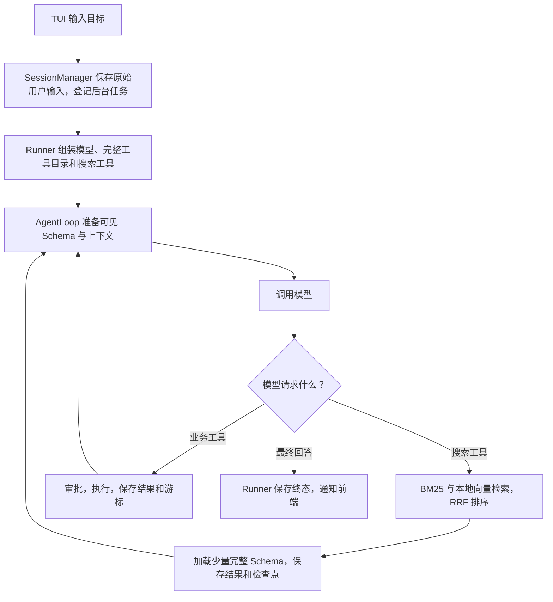

# KamaClaude · S11

一个 Python 本地 Coding Agent：TUI 展示对话、工具进度和审批，独立 Core 负责调用模型、执行工具和保存检查点。前后端通过 TCP、JSON-RPC、NDJSON 通信。

S11 增加 **MCP 工具混合检索、哈希缓存和按需加载**：接入多个 MCP 时，完整工具目录留在 Core，模型通过 `search_tool` 找到当前所需工具，再加载完整参数定义。

## 先理解几个关键问题

**为什么要按需加载？**

以前每次请求都会携带所有工具 Schema，压缩历史也不能消除这部分固定开销。现在内置工具常驻，普通新 Run 初始仅增加一个搜索入口；命中的 MCP 工具从下一次模型请求开始可用。

**检索用什么信息？**

模型传入当前需求描述，后端补充本轮真实用户输入。BM25 负责名称和关键词匹配，本地 E5 向量负责语义召回，RRF 根据排名融合。搜索结果只返回简短说明，完整 Schema 放在下一次请求的 `tools` 中。

**会不会每次都重新计算向量？**

不会。SQLite 保存完整定义哈希、检索文本哈希和向量缓存。重连时完整拉取工具列表，无变化不更新工具记录；只有检索文本或模型指纹变化才重新编码。工具只改了默认参数而检索文本不变时，更新定义并复用向量。

**搜索成功就获得执行权限了吗？**

搜索只加载定义。实际调用继续经过参数检查、原有权限审批和逐工具保存。结果未知仍由用户核实。当前版本不增加子 Agent 的 MCP 能力。

## 整体执行主线



完整对话仍写入 `thread.jsonl`；压缩只改变模型工作历史。恢复继续使用原 Run、预算、工具目录和已加载列表，不重新搜索猜测、不重跑 completed 工具。

## 安装与运行

```powershell
uv sync
uv run kama-core
# 另开终端
uv run kama-tui
```

聊天模型沿用现有 Anthropic、OpenAI、DeepSeek Provider 配置。MCP 支持 stdio 与标准 Streamable HTTP。

未安装可选推理库，或模型加载失败时，搜索明确降级为 `keyword_only`，内置工具和 MCP 关键词检索仍可使用。

需要混合检索时，使用现成的 Sentence Transformers 库：

```powershell
uv sync --extra retrieval
uv run --extra retrieval kama-core
```

在 `~/.kama/config.toml` 配置：

```toml
[tool_search]
enabled = true
db_path = '~/.kama/tool_catalog.sqlite3'
model_path = '' # 默认首次下载官方 E5 small，以后使用本地缓存
top_k = 3
max_loaded_schema_tokens = 8192
```

`model_path` 留空时，首次需要语义检索会下载官方 `intfloat/multilingual-e5-small`，缓存到 `~/.kama/models`，后续优先离线使用完整缓存。只下载一份约 470 MB 的 safetensors 权重及必要配置，不下载重复的 bin、ONNX、OpenVINO 版本。

也可将 `model_path` 设为已有目录，例如 `'C:\models\multilingual-e5-small'`；这种模式严格离线，不会在目录错误时尝试联网补齐。推理默认 CPU，禁止远程自定义代码。更换文件后重启 Core。对应环境变量统一为 `KAMA_TOOL_SEARCH_` 加字段大写，例如 `KAMA_TOOL_SEARCH_MODEL_PATH`。

## 规则与边界

- 只在 MCP 启动和重新连接时同步目录，运行中不会自动发现远端新增工具；需要重新连接或重启 Core。
- 明确配置的工具白名单继续生效；显式选中的 MCP 工具直接展示，搜索不能突破白名单。
- 已加载 MCP Schema 默认最多占 8,192 个估算 Token；超限不截断定义，结果会提示缩小需求或新建任务。同一 Run 不自动卸载工具。
- 搜索工具最长等待 600 秒，以覆盖首次模型下载；整轮执行时间预算仍优先约束它。普通工具默认 120 秒不变。
- 已加载列表、加载模式和原始输入随版本 1 检查点保存。恢复时定义或服务身份变化，明确拒绝续跑，不静默使用新工具。
- 工具列表变化会使旧 Usage 锚点失效，重新估算完整请求；压缩和真实模型调用使用同一份可见 Schema。
- 缓存不等于活跃连接，失败同步不发布半份目录，也不会把网络失败误判为工具删除。
- 工作区内普通读取默认允许，写入、编辑询问；外部路径单次审批。Shell 继续在本机执行，审批不提供操作系统沙箱。

## 学习与验证入口

实现细节、旧新流程对比、恢复和代码阅读顺序见 [S11 学习文档](./docs/S11-MCP工具检索与按需加载.md)。

```powershell
# 不调用付费模型的完整回归
uv run pytest tests -m "not integration" -q

# 使用官方模型缓存；首次使用时会下载模型
uv run --extra retrieval python scripts/eval_tool_search.py

# 准备好本地模型与可选依赖后执行真实离线对比
uv run --extra retrieval python scripts/eval_tool_search.py --model-path C:\models\multilingual-e5-small
```

评估对比 Recall@3、Schema 估算量、搜索耗时与 embedding 重算次数。示例数据集较小，不能据此承诺真实任务成功率或账单收益。

最终验证：**824 项通过、1 项 Windows 文件符号链接权限跳过、1 项付费测试排除**。真实 E5 已下载缓存，并在禁用联网后验证推理、向量复用和模型实例重建；Ruff、源码 mypy、协议和文档链接检查通过。
