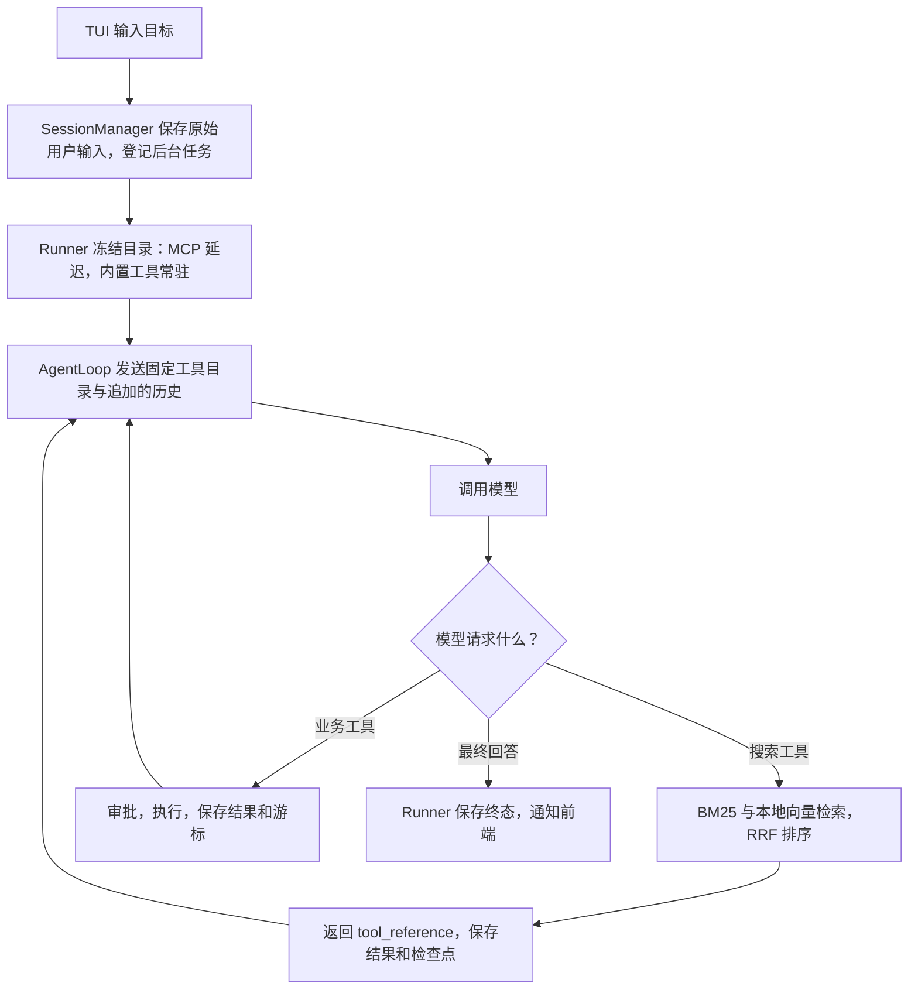

# KamaClaude · S11

一个 Python 本地 Coding Agent：TUI 展示对话、工具进度和审批，独立 Core 负责调用模型、执行工具和保存检查点。前后端通过 TCP、JSON-RPC、NDJSON 通信。

S11 增加 **MCP 工具混合检索、哈希缓存和按需加载**：接入多个 MCP 时，本地混合检索负责找工具，`defer_loading＋tool_reference` 负责按需交给模型。DeepSeek / Anthropic 请求保持完整工具数组稳定：MCP 工具全部延迟，内置工具与 `search_tool` 不延迟。上下文改为**工具结果入口限长＋保留近期原文的历史摘要**，同一 Run 的 system 与原生工具目录冻结，减少对旧前缀的反复修改。

## 先理解几个关键问题

**为什么要按需加载？**

以前每次请求都会携带所有工具 Schema，压缩历史也不能消除这部分固定开销。现在内置工具常驻，MCP 工具在请求中统一标记 `defer_loading=true`，未引用时不占初始模型上下文。模型先调用常驻的 `search_tool`，后端返回结构化引用，API 在下一轮展开对应 Schema。完整目录仍通过 HTTP 发送，延迟加载减少的是模型上下文，不是请求体大小。

**检索用什么信息？**

模型传入当前需求描述，后端补充本轮真实用户输入。BM25 负责名称和关键词匹配，本地 E5 向量负责语义召回，RRF 根据排名融合。搜索结果包含简短说明和真正的 `tool_reference` 内容块。BM25、E5、RRF、SQLite 及向量缓存全部保留；服务端只展开引用，不代替本地检索。

**会不会每次都重新计算向量？**

不会。SQLite 保存完整定义哈希、检索文本哈希和向量缓存。重连时完整拉取工具列表，无变化不更新工具记录；只有检索文本或模型指纹变化才重新编码。工具只改了默认参数而检索文本不变时，更新定义并复用向量。

**搜索成功就获得执行权限了吗？**

搜索只加载定义。实际调用继续经过参数检查、原有权限审批和逐工具保存。结果未知仍由用户核实。当前版本不增加子 Agent 的 MCP 能力。

## 整体执行主线



完整对话仍写入 `thread.jsonl`；压缩只改变模型工作历史。恢复继续使用原 Run、预算、工具目录和已加载列表，不重新搜索猜测、不重跑 completed 工具。

## 轻量 Skill：统一放在全局目录

Skill 是任务操作手册，不替换基础 system，也不授予工具权限。模型看到精简目录后，可以按需加载：

```json
{"name": "review"}
```

上面是 `load_skill` 工具的全部参数。任务目标放在用户消息里，例如“审查 src 目录”；也可以直接输入 `/review src`。

```text
~/.kama/skills/
├── review/SKILL.md
├── summarize/SKILL.md
├── orchestrate/SKILL.md
└── init/SKILL.md
```

首次发现或加载时补齐缺失的示例，已有文件不覆盖。初始化完成后，用户删除的示例不会反复生成。Core 和 TUI 都只读取这个全局目录；原项目目录和扁平 `.md` 文件不再参与查找。

```markdown
---
name: review
description: 审查代码并给出文件位置与验证证据
---
先确认当前用户要求的审查范围，再搜索和阅读相关代码。
按严重程度报告问题，区分已确认的问题与待验证的推测。
不要因为加载了这份流程而跳过工具审批。
```

每个 Run 最多启用一个 Skill；同名重复调用返回“已加载”，新任务可重新选择。目录冻结后新增的 Skill 下一 Run 才可发现；目录最多 2,048 个估算 Token，正文最多 4,000 个估算 Token，超限明确报错。

完整正文作为任务上下文，普通长输出裁剪不会切断它。正文快照随检查点保存，压缩后按需补回且不重复注入，恢复不重新读取磁盘文件。辅助文件和脚本仍通过已有工具按需使用。

旧 Skill 需移到 `<name>/SKILL.md`，保证 frontmatter 中名称与目录一致，并移除 `allowed_tools` 和 `$ARGUMENTS`。旧限制不再生效，实际工具范围仍由 Agent/子角色白名单与运行时审批决定。详见 [Skill 与提示组织学习文档](./docs/S11-轻量Skill与提示组织.md)。

## 上下文请求怎么组织

```text
固定部分：基础/角色提示＋全局用户 AGENTS.md＋项目 AGENTS.md
工具目录：本轮冻结的定义、顺序及 defer_loading 标记
messages：自动记忆快照＋一份历史摘要（如有）＋近期原文
```

- 用户规则每个新 Run 读取一次；普通步骤、压缩和恢复沿用原 system。
- `AGENTS.auto.md` 与项目 `MEMORY.md` 索引作为标准上下文消息注入，不写入 `thread.jsonl`。普通步骤复用快照；真正采用摘要时才刷新，与候选历史一起保存。
- 工具结果超过 8,000 字符，先保存完整结果、原子归档全文，再把头尾共 4,000 字符的预览送入模型。旧结果不会随着变旧反复裁剪、去重或遮蔽。
- 请求前用“最近有效 Usage 的输入＋输出＋新增字节估算”判断压力；前缀变化则全文估算。达到输入硬预算的 80% 才尝试一次摘要。
- 优先保留最近三轮真实用户对话，近期预算默认 16,384 个估算 Token；过长时保留最新请求与放得下的完整模型/工具组。最小保留区也放不下就明确中断。
- 摘要请求复用原 system、工具和历史，末尾追加摘要指令。只替换较早历史，固定六节 Markdown；摘要失败不替换历史，超出硬预算则中断。
- Anthropic 的缓存点只加入请求副本；DeepSeek 使用服务端自动缓存。摘要会改变消息前缀，不能保证之前整段历史继续命中缓存，固定 system 与目录仍保持不变。

```toml
[compaction]
auto_threshold = 0.8
context_window_tokens = 65536
output_reserve_tokens = 8192
keep_recent_turns = 3
recent_token_budget = 16384
summary_max_tokens = 2048
tool_result_limit = 8000
tool_result_keep = 4000
```

`auto_threshold=0` 关闭自动摘要，但仍检查硬预算；`/compact` 未达阈值也不会调用模型。移除旧 `prune_target_ratio`，将 `keep_recent_groups` 改为 `keep_recent_turns` 与 `recent_token_budget`；旧配置会明确报迁移错误。环境变量改用 `KAMA_COMPACT_KEEP_TURNS`、`KAMA_COMPACT_RECENT_TOKENS`，删除 `KAMA_COMPACT_PRUNE_TARGET` 和 `KAMA_COMPACT_KEEP_GROUPS`。

完整对话始终保存在 `thread.jsonl`，TUI 打开历史看到原文；`checkpoint.messages` 才是可压缩的模型工作历史。长结果归档失败会保留 completed 状态，恢复只补输出整理，不重跑工具。检查点版本仍为 1，旧中断 Run 保持原提示布局，下一次新 Run 才切换。

## 安装与运行

```powershell
uv sync
uv run kama-core
# 另开终端
uv run kama-tui
```

DeepSeek 的 Anthropic 兼容端点与 Anthropic Provider 使用原生延迟加载。普通 OpenAI Chat Completions 无此协议，继续使用原有“搜到后追加 Schema”的方式，不发送不支持的字段；旧 Run 保持已冻结模式。MCP 支持 stdio 与标准 Streamable HTTP，传输方式不变。

未安装可选推理库，或模型加载失败时，搜索明确降级为 `keyword_only`，内置工具和 MCP 关键词检索仍可使用。

需要混合检索时，使用现成的 Sentence Transformers 库：

```powershell
uv sync --extra retrieval
uv run --extra retrieval kama-core
```

在 `~/.kama/config.toml` 配置：

```toml
[tool_search]
enabled = true
db_path = '~/.kama/tool_catalog.sqlite3'
model_path = '' # 默认首次下载官方 E5 small，以后使用本地缓存
top_k = 3
max_loaded_schema_tokens = 8192
```

`model_path` 留空时，首次需要语义检索会下载官方 `intfloat/multilingual-e5-small`，缓存到 `~/.kama/models`，后续优先离线使用完整缓存。只下载一份约 470 MB 的 safetensors 权重及必要配置，不下载重复的 bin、ONNX、OpenVINO 版本。

也可将 `model_path` 设为已有目录，例如 `'C:\models\multilingual-e5-small'`；这种模式严格离线，不会在目录错误时尝试联网补齐。推理默认 CPU，禁止远程自定义代码。更换文件后重启 Core。对应环境变量统一为 `KAMA_TOOL_SEARCH_` 加字段大写，例如 `KAMA_TOOL_SEARCH_MODEL_PATH`。

## 规则与边界

- 只在 MCP 启动和重新连接时同步目录，运行中不会自动发现远端新增工具；需要重新连接或重启 Core。
- MCP 白名单仍限制可检索和执行的工具。原生模式中白名单内的 MCP 也全部延迟，自动附带必需的 `search_tool` 入口；搜索不能发现白名单之外的 MCP。
- 已加载 MCP Schema 默认最多占 8,192 个估算 Token；超限不截断定义，结果会提示缩小需求或新建任务。普通步骤不自动卸载；采用历史摘要后仅保留近期必要引用并释放旧额度。
- 搜索工具最长等待 600 秒，以覆盖首次模型下载；整轮执行时间预算仍优先约束它。普通工具默认 120 秒不变。
- 已加载列表、原生引用、加载模式和原始输入随版本 1 检查点保存。恢复时定义或服务身份变化，明确拒绝续跑，不静默使用新工具。
- 原生搜索不再改变顶层工具数组，新增引用可继续使用旧 Usage 锚点；估算新增部分时计入引用展开后的完整 Schema。历史摘要仅为近期必要工具保留最小的真实发现调用/引用结果对；真正改写历史或提示仍会使锚点失效。
- 缓存不等于活跃连接，失败同步不发布半份目录，也不会把网络失败误判为工具删除。
- 工作区内普通读取默认允许，写入、编辑询问；外部路径单次审批。Shell 继续在本机执行，审批不提供操作系统沙箱。

## 学习与验证入口

实现细节、旧新流程对比、恢复和代码阅读顺序见 [S11 学习文档](./docs/S11-MCP工具检索与按需加载.md)。

```powershell
# 不调用付费模型的完整回归
uv run pytest tests -m "not integration" -q

# 使用官方模型缓存；首次使用时会下载模型
uv run --extra retrieval python scripts/eval_tool_search.py

# 准备好本地模型与可选依赖后执行真实离线对比
uv run --extra retrieval python scripts/eval_tool_search.py --model-path C:\models\multilingual-e5-small
```

评估对比 Recall@3、Schema 估算量、搜索耗时与 embedding 重算次数。示例数据集较小，不能据此承诺真实任务成功率或账单收益。

原生延迟加载改造（压缩重设计前）的历史验证：完整非付费回归 **843 项通过、1 项 Windows 文件符号链接权限跳过、1 项付费测试排除**；收尾补充计数器独立调用与 TUI 历史展示后，84 项相关测试再次通过。完整回归包含真实缓存 E5 的离线推理；Ruff、源码 mypy、协议和文档链接检查通过。


## 原生延迟加载的最短例子

```text
请求 tools：[read_file(false), search_tool(false), github__get_issue(true), ...]
模型：search_tool("获取 issue 详情")
本地：BM25＋E5 → RRF → 选出 github__get_issue
结果：text 说明＋tool_reference("github__get_issue")
下一轮：tools 数组不变；API 展开引用，模型正常调用 github__get_issue
后端：原有审批 → MCP 执行 → 保存结果
```

授权后的两次真实 DeepSeek `deepseek-flash` 请求已验证：接受延迟标记、引用后正确调用测试工具、工具数组不变；第二次返回 256 个缓存读取 Token。只使用测试定义和 `hello`，未执行业务工具。这是小样本协议烟测，不保证其他模型或代理端点兼容，也不代表长期缓存收益。

需要再次验证可显式运行 `uv run python scripts/check_deferred_tools.py`；它会发起最多两次计费请求，普通测试不会运行它。DeepSeek 忽略 Anthropic 的 `cache_control`，缓存仍由服务端自动管理。[DeepSeek 兼容说明](https://api-docs.deepseek.com/guides/anthropic_api/)、[Anthropic 延迟工具协议](https://platform.claude.com/docs/en/agents-and-tools/tool-use/tool-search-tool)。


## 本次压缩重设计的验证

完整非付费回归 **843 项通过、1 项 Windows 文件符号链接权限跳过、1 项付费测试排除**，包含真实缓存 E5 离线推理、MCP JSON/SSE、TCP、Core 重启与 TUI。新增验证覆盖固定前缀、三轮保留、引用释放、旧提示布局及归档失败后只补整理；已删除不再适用的旧去重/遮蔽层测试。

改动文件 Ruff、完整源码 mypy、生成协议一致性和文档链接检查通过。未提交、未推送，也未发起新的付费 API 请求；这些测试不代表实际 Prompt Cache 命中率。


轻量 Skill 改造后，完整非付费回归 **862 项通过、1 项 Windows 文件链接权限跳过、1 项付费测试排除**；Ruff、源码 mypy、协议和文档链接检查通过。包含真实 Core/TCP 重启后的 Skill 快照恢复验证，未调用新的付费模型，未提交或推送。
