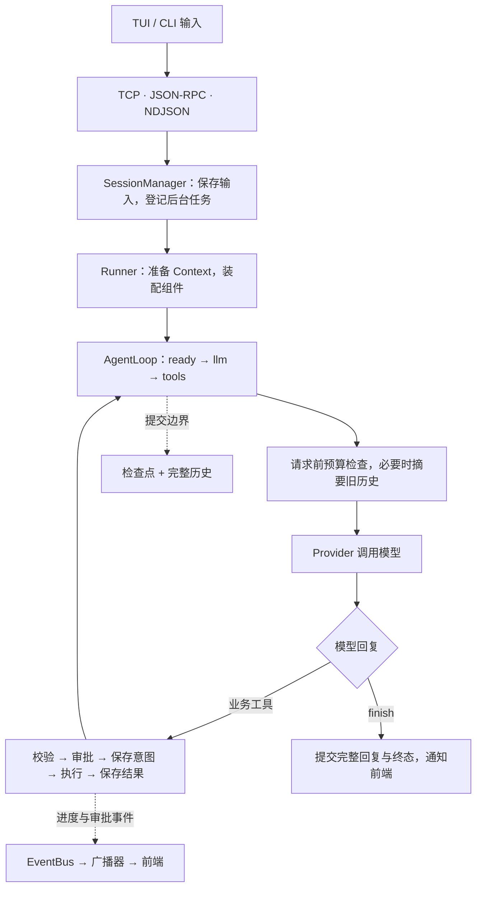

# KamaClaude

一个基于 Python 的本地 Coding Agent。用户通过 TUI 或 CLI 输入目标，独立 Core 调用模型、执行工具并保存运行状态，前端实时显示回复、工具进度和审批。

`s12` 基于已整合 S0–S11 的 dev，增加**只读子 Agent 协作、成果收集与父子共享预算**。当前面向单用户、单 Core 使用；真实复杂任务的成功率与成本收益仍需要独立评估。本阶段阅读入口：[S12 学习说明](./docs/S12-子Agent协作与共享预算.md)。

## 先理解几个核心问题

**一次对话和一次执行是什么关系？**

Session 是会话，每次用户输入创建一个 Run；Run 内每次模型请求是一个 Step。新 Run 通过 `finish(result)` 提交完整回复或待确认的问题。成功表示本轮回复已提交，chat 会话可以继续输入，不代表业务已经通过独立验收。

**前端关闭后，任务会停止吗？**

Core 持有后台 Task，客户端通过 `asyncio.shield()` 等待。TUI 断线只断开连接；重连会重新打开原会话。Core 重启后，从检查点识别中断状态，由用户选择继续、核实后重试未知工具或终止本轮。

**压缩后还能查看完整对话吗？**

可以。`checkpoint.json` 保存模型工作历史；`thread.jsonl` 始终追加完整原文。压缩只替换工作历史。前端分页读取固定范围的完整原文，加载期间缓冲实时事件，再按事件水位去重。

**接入很多 MCP 工具，会全部塞进模型上下文吗？**

DeepSeek / Anthropic 使用原生延迟加载模式：完整目录及顺序在本轮冻结，MCP 标记 `defer_loading=true`，内置工具和 `search_tool` 常驻。模型调用 `search_tool` 后，本地 BM25＋E5 向量检索、RRF 融合返回 `tool_reference`，下一步再使用对应工具。完整目录仍通过 HTTP 发送；非原生 Provider 使用本地按需展示完整 Schema 的兼容路径。

`search_tool` 接收两个必填参数：`description` 描述所需能力，用于“本轮原始用户输入＋描述”的语义检索；`keywords` 是 1～3 个关键词的数组，只供 BM25 词面匹配，可填写服务名、工具名或参数名。两路仍用 RRF 融合，关键词不是必须全部命中的硬过滤。语义模型不可用时只使用关键词降级检索，不把描述和背景重新混入关键词查询。例如：

```json
{"description": "读取 GitHub 问题的详情及讨论，定位用户反馈的故障", "keywords": ["github", "get_issue", "comments"]}
```

关键词去掉首尾空白后每项为 1～100 字符，描述最多 2000 字符。工具名称仍为 `search_tool`，数据库和向量缓存格式不变；此次入参 Schema 已变更，冻结旧定义的中断 Run 仍按原规则拒绝续跑，可终止旧 Run 后开始新任务。

**加载工具或 Skill，就获得执行权限了吗？**

没有。Skill 提供流程说明，工具搜索只发现定义。实际操作仍经过参数校验、权限审批、路径复核、执行意图保存和结果提交。

## 一次任务的执行主线



普通执行与恢复使用同一条 Loop。`context.run` 是唯一执行状态来源；Runner 负责组装和收尾，Loop 通过注入的组件管理上下文、工具批次、预算和保存。

| 职责 | 代码入口 |
| --- | --- |
| 会话、锁、Core 持有的后台任务 | [session/manager.py](./src/kama_claude/core/session/manager.py) |
| 上下文准备、依赖装配、运行收尾 | [runner.py](./src/kama_claude/core/runner.py)、[assembly.py](./src/kama_claude/core/assembly.py) |
| 阶段推进、模型回复与结束判断 | [loop.py](./src/kama_claude/core/loop.py)、[finish.py](./src/kama_claude/core/tools/builtin/finish.py) |
| 工具批次、恢复游标、逐工具保存 | [tools/batch.py](./src/kama_claude/core/tools/batch.py)、[tools/invocation.py](./src/kama_claude/core/tools/invocation.py) |
| 原子快照、完整历史、恢复决定 | [checkpoint/](./src/kama_claude/core/checkpoint/)、[session/store.py](./src/kama_claude/core/session/store.py) |
| 统一 Provider、受管重试和累计预算 | [llm/](./src/kama_claude/core/llm/)、[run_budget.py](./src/kama_claude/core/run_budget.py) |
| 重复读取与短循环保护 | [progress.py](./src/kama_claude/core/progress.py)、[工具批次入口](./src/kama_claude/core/tools/batch.py) |
| 估算、近期保留、摘要候选与提交 | [compact/](./src/kama_claude/core/compact/) |
| 规则、自动记忆、全局 Skill 加载 | [memory/](./src/kama_claude/core/memory/)、[skills/](./src/kama_claude/core/skills/) |
| MCP 连接、目录哈希、混合检索 | [mcp/](./src/kama_claude/core/mcp/)、[discovery/](./src/kama_claude/core/discovery/) |
| 子 Agent、额度、有界等待、成果交接 | [subagent/](./src/kama_claude/core/subagent/)、[agents/](./src/kama_claude/core/agents/) |
| 工作区、审批、文件与命令工具 | [workspace.py](./src/kama_claude/core/workspace.py)、[permissions/](./src/kama_claude/core/permissions/)、[tools/builtin/](./src/kama_claude/core/tools/builtin/) |
| TUI、通信协议、事件与 Trace | [tui/app.py](./src/kama_claude/tui/app.py)、[transport/](./src/kama_claude/core/transport/)、[events/](./src/kama_claude/core/events/)、[trace/](./src/kama_claude/core/trace/) |

## 启动

需要 Python **3.12** 和 uv，支持 Windows、macOS、Linux。以下命令从本仓库根目录执行，Core 启动目录成为本轮固定 workspace。用于其他仓库时，在已安装本包的环境中从目标目录启动 Core。Windows 的命令工具默认运行本机 cmd；当前没有 Docker 执行环境。

```text
uv sync
```

在启动目录创建 UTF-8 `.env`，填写实际密钥和当前接口可用的模型名：

```dotenv
DEEPSEEK_API_KEY=你的密钥
KAMA_LLM_DEFAULT_MODEL=你的DeepSeek模型名
```

当前 Core 默认装配 `DeepseekProvider`，走 Anthropic 兼容接口。请显式设置模型名，配置类中的历史默认值仍是 Claude 示例。Anthropic、OpenAI 适配器可以通过代码注入；使用 OpenAI 还需安装 `openai` SDK，目前没有 Provider 切换配置项。

分别打开两个终端：

```text
uv run kama-core
uv run kama-tui
```

默认连接 `127.0.0.1:7437`。TUI 启动后选择历史会话或新建会话；`Ctrl+O` 切换会话，`Ctrl+Q` 退出界面并保留会话，`Ctrl+W` 显式关闭空闲会话。中断任务由恢复按钮处理；未知副作用需要先核实。Core 支持 Ctrl+C 收尾。

CLI 调试同样需要 Core：

```text
uv run kama ping
uv run kama run --goal "读取 README.md，解释项目执行主线"
uv run kama chat
```

## 上下文、记忆与 Skill

- **固定前缀**：基础/角色提示＋全局用户 `AGENTS.md`＋项目用户 `AGENTS.md`，同一 Run 内冻结；完整允许工具目录与顺序同样冻结；非原生兼容模式的可见子集可按需变化，恢复使用保存值。
- **自动记忆**：全局 `AGENTS.auto.md` 和项目 `MEMORY.md` 索引通过标准上下文消息注入，不写入完整对话。普通步骤复用快照；真正采用摘要后刷新并与候选历史一起提交。主题详情通过 `memory_read` 按需读取，`memory_write` 维护自动信息和项目主题。
- **输出入口限长**：普通工具正文超过 32,000 字符时，先保存结果并归档全文，再把头尾共 24,000 字符的预览放进工作历史。输出整理失败会中断，已完成工具不重跑。
- **请求前估算**：使用有效的上次实际输入＋输出 Usage，加上新增部分 UTF-8 字节数除以四向上取整；前缀改变则重新全文估算。没有 tokenizer 或动态阈值校准。
- **历史摘要**：默认输入估算达到配置窗口的 80% 时尝试一次；优先保留最近三轮，工具调用与结果不可拆开。旧历史合并成一份六节结构化摘要，校验后才保存。`/compact` 与自动入口共用规则，未达阈值不调用摘要模型。
- **Skill**：只从 `~/.kama/skills/<name>/SKILL.md` 加载。可输入 `/review src`，也可让模型调用 `load_skill(name)`。每个 Run 最多一个活动 Skill，正文随检查点保存，压缩后按需补回。首次补齐 review、summarize、orchestrate、init 示例，已有文件不覆盖。

旧 `context.md`、`notes.md` 不再自动读取或迁移；已删除 `note_save`、`/memory` 和 `memory.inspect`。用户维护的 `AGENTS.md` 对内置写入工具只读。Skill 不覆盖基础 system，不扩大工具白名单。

## 配置与默认参数

默认按“全局 `~/.kama/config.toml` → 项目 `.kama/config.toml` → 环境变量”覆盖；`.env` 不覆盖已有系统环境变量。设置 `KAMA_CONFIG` 时只读取指定 TOML，再应用环境覆盖。解析入口见 [config/](./src/kama_claude/core/config/)。

```toml
[agent]
max_steps = 0             # 0 不限步数，仍累计 Step 并保存在检查点中
max_run_seconds = 1800    # 30 分钟；0 关闭累计时间限制
max_total_tokens = 0      # 整棵任务树累计 Token 上限，0 关闭
repeat_failure_limit = 5
no_progress_limit = 5     # 只读调用模式重复上限；0 关闭，启用范围 4～20

[compaction]
auto_threshold = 0.8      # 0 关闭自动摘要，硬预算检查仍生效
context_window_tokens = 1048576  # 默认按 DeepSeek 官方 1M；其他模型按实际能力配置
output_reserve_ratio = 0.03125    # 1M 下单次输出最多 32K
safety_margin_ratio = 0.02
keep_recent_turns = 3
recent_history_ratio = 0.20
summary_max_ratio = 0.03125       # 摘要硬上限 32K
summary_target_ratio = 0.0078125  # 摘要软目标最多 8K
tool_result_limit = 32000        # 固定字符数
tool_result_keep = 24000

[subagent]
max_active = 2
max_total = 6

[permission]
timeout_s = 300          # 给用户留出查看命令和编辑内容的时间

[memory]
global_auto_ratio = 0.0005
project_index_ratio = 0.001
```

Run 的累计执行时间包含模型、工具和审批等待；恢复不重置原 Run 的预算。普通模型调用、自动摘要与子 Agent 的模型请求纳入整棵树的共享预算，手动压缩单独记用量。

所有上下文额度按 `context_window_tokens × ratio` 即时推导，不另存固定 Token 配置。自动摘要按整个窗口的 80% 触发，`0` 关闭自动摘要但保留硬预算检查；普通输入硬预算扣除 3.125% 输出预留和 2% 安全余量。摘要请求独立扣除 3.125% 摘要输出上限和相同安全余量。窗口仍须按实际模型能力配置。

近期原文最多使用窗口的 20%，优先保留最近三轮；固定 system、用户规则、工具定义和自动记忆按实际估算占用扣除，剩余空间不足时进一步缩小近期额度，完整工具配对不可拆开。用户规则不静默截断，放不下会明确失败。

摘要继续使用六节结构。软目标取“窗口的 0.78125%”与“被摘要旧历史的四分之一”中的较小值；API 上限为窗口的 3.125%，不要求用满。空摘要、截断或缩减不足仍不采用。以 1M 为例：触发线 838860，近期额度最多 209715，摘要软目标最多 8192、输出上限 32768，普通输出预留 32768，安全余量 20972 Token；取整后的个位差异来自向下取整和安全余量向上取整。

`KAMA_COMPACT_WINDOW_TOKENS` 指定窗口；`KAMA_COMPACT_OUTPUT_RATIO`、`KAMA_COMPACT_SAFETY_RATIO`、`KAMA_COMPACT_RECENT_RATIO`、`KAMA_COMPACT_SUMMARY_RATIO`、`KAMA_COMPACT_SUMMARY_TARGET_RATIO` 覆盖对应比例。自动记忆用 `KAMA_MEMORY_GLOBAL_AUTO_RATIO`、`KAMA_MEMORY_PROJECT_INDEX_RATIO`；MCP 加载额度用 `KAMA_TOOL_SEARCH_MAX_LOADED_SCHEMA_RATIO`。比例必须有限且在 0 与 1 之间，合计必须给固定提示留空间，触发线也须给摘要输出留余量。

升级时移除旧的 `output_reserve_tokens`、`recent_token_budget`、`summary_max_tokens`、`global_auto_tokens`、`project_index_tokens`、`max_loaded_schema_tokens` 及对应旧环境变量；检测到旧字段会明确提示迁移，不静默混用。自动记忆保持精简的小比例；缩小窗口后，超额的自动文件需精简或调高比例，不会被自动截断。配置加载需重启 Core。新 Run 的 MCP Schema 额度按比例推导后随检查点冻结，旧 Run 续跑保留已提交限制；步数和累计 Token、时间限额也保持原有恢复语义。

工具输出限长保持固定：超过 32000 字符归档，头尾预览共 24000 字符，减少阅读代码时过早裁剪；文件、命令的 IO 大小限制不随窗口放大。累计 Token 和执行时间是多次请求的成本保护，不是单次上下文份额，继续独立配置。

以上默认面向代码阅读、局部修改和测试验证。步数暂不设上限，但正常完成、取消、30 分钟执行时间、重复失败及无进展保护仍会结束本轮。TOML 或 `KAMA_MAX_STEPS` 设置正整数可重新启用步数限制，负数无效。主、子 Agent 沿用本轮冻结的限制，恢复不会因更改配置而重置旧 Run 的预算。

TUI 在每次模型回复旁只显示输入 Token、输出 Token、缓存命中率和回复后的上下文占用。流式阶段使用 Usage 锚点或字节估算，并用 `≈` 标记；结束后改用 API 真实 Usage，输出包含服务端统计的工具参数及思考用量。缓存命中率为“缓存读取 / 总输入”，占用率为“本次总输入＋当前回复输出 / Core 配置窗口”，缓存输入不重复相加。生成期间只能估算已收到的可见文本，未收到的思考与工具参数在最终 Usage 到达后校正；旧累计预算行不再展示，预算记账、停止和重试提示仍保留。

重复失败保护处理连续相同错误；无进展保护补充检测 `read_file`、`list_dir`、`find_files`、`search_text` 中连续重复且结果不变的调用，支持长度 1～3 的短循环。重复 3 轮时提醒模型改变方法，默认 5 轮时以 `no_progress` 停止本轮；至少等模型看到提醒后的下一 Step 仍重复才停止。同一查询结果变化、写入或其他工具调用会清空观察窗口，子 Agent 等待不纳入此检测。该机制不判断任务语义，其他形式的循环仍依靠 Step、时间及 Token 上限。

`no_progress_limit` 可通过 `KAMA_AGENT_NO_PROGRESS_LIMIT` 覆盖。限制与指纹随 Run 检查点保存，恢复不重置；新 Run 重新计数，旧 Run 缺少该字段时保持关闭。工具结果未知时不自动重试，仍需用户核实。

MCP 支持标准 stdio 和 Streamable HTTP。HTTP 配置示例需要替换为真实端点：

```toml
[[mcp.servers]]
name = "remote"
transport = "streamable-http"
url = "https://your-mcp-server.example/mcp"

[tool_search]
enabled = true
top_k = 3
max_loaded_schema_ratio = 0.01
# model_path = "C:/models/multilingual-e5-small"
```

语义检索使用 Sentence Transformers 的 multilingual-e5-small：`uv sync --extra retrieval` 安装可选依赖。不指定模型目录时首次下载并缓存；指定目录时离线读取。依赖或模型不可用会明确降级为 `keyword_only`。工具目录只在启动和重新连接时同步；完整列表拉取成功后按定义哈希事务更新，检索文本和模型指纹未变时复用向量。

## 文件、命令与审批

按 `Ctrl+P` 切换当前会话的审批模式，顶部显示 Core 确认的实际模式，`Esc` 关闭选择框。模式弹窗和连接使用独立 Worker 组，切换不会取消 TCP 连接或正在等待的请求。

| 操作 | ASK（默认） | APPROVE | FULL |
|---|---|---|---|
| 工作区内读取、搜索 | 允许 | 允许 | 允许 |
| 工作区内写入、编辑 | 询问，可授权同工具操作同文件 | 允许 | 允许 |
| 工作区外读取 | 单次询问 | 允许 | 允许 |
| 工作区外写入、编辑 | 单次询问 | 单次询问 | 允许 |
| 完整解析的普通命令 | 按命令允许规则 | 允许 | 允许 |
| 高危、无法分析或要求询问的命令 | 按现有命令规则，未允许则询问 | 单次询问 | 允许 |
| 其他已开放工具（含 MCP） | 沿用各工具策略 | 默认允许 | 允许 |
| 明确禁止的操作 | 拒绝 | 拒绝 | 拒绝 |

ASK 下的文件授权键仍是“会话＋工具＋后端实际文件路径”，不匹配原始字符串或父目录。所有模式执行前都重新解析路径，目标变化则拒绝。明确禁止包括工具策略、持久拒绝和可识别的命令禁止规则；用户 `AGENTS.md` 只读保护、工具白名单、Run 预算和未知结果恢复确认不会因切换模式失效。

Bash 独立判断：Windows 使用保守 cmd 解析，POSIX 使用 Bash AST。ASK 下只有完整解析且所有命令匹配允许规则时才自动允许，默认允许规则为空。APPROVE 额外保留高危询问：删除、格式化、权限修改、终止进程、危险 Git 操作，以及解释器执行脚本、嵌套 Shell 等无法分析内容的调用；普通允许规则不能盖过该检查，显式询问规则也仍有效。该列表是保守分类，不能识别任意程序内部的危险行为；FULL 仍检查可识别的禁止规则，但不会因为无法解析而询问。

模式保存在 `PermissionManager.session_premission_modes`，只在当前 Core 内存中生效；主、子 Agent 共用所属会话模式。断线重连保留，切换会话同步对应模式，关闭会话清除，Core 重启默认恢复 ASK。切换只影响后续工具调用，已发出的审批仍需按原选项回答，正在执行的工具不会被撤回。模式通过 `session.set_permission_mode` 修改，并向同一会话的前端广播；不写入检查点或模型参数。

这些是应用层检查。获批 Shell 和远程 MCP 的实际能力不受文件工具路径校验限制；命令执行和子 Agent 没有系统沙箱。

## 子 Agent 协作

采用“多个只读助手＋前台修改任务”的轻量分工。默认 `explorer` 定位代码；`planner`、`reviewer` 提供只读分析；`executor` 实施修改并验证，只能前台执行。自定义角色也按与父白名单交集后的工具范围检查，包含 Shell、写记忆、写文件、派生能力或未知工具的角色不能后台运行。权限审批继续生效；这是协作约束，不是系统沙箱。

模型通过以下工具协作（以下为工具参数示意）：

```text
spawn_agent(description="检查连接处理", prompt="目标、范围、约束、证据和完成条件",
            subagent_type="explorer", run_in_background=true)
agent_result(run_ids=["child-one", "child-two"], wait_s=10)
agent_cancel(run_ids=["unneeded-child"])
```

以上 ID 需替换为 spawn_agent 返回的真实 Run ID。`agent_result` 一次查询 1～8 个 ID；已有结果立即返回，否则最多等到任意任务完成或超时。取消查询不取消子任务。取消子任务后仍需查询终态；父任务未收集完后台结果时不能 `finish`。父任务退出时清理自己的后代，单轮取消等待最多 2 秒，不承诺强制终止忽略取消的协程。

普通工具默认有 120 秒执行期限，部分工具另行指定。`spawn_agent` 不继承这个固定期限，前台等待由父子 Run 剩余时间、Token 和 Step 预算约束；取消仍传递到前台子任务。调用入口显式指定的工具超时仍优先，超时后继续保留未知副作用的保守语义。

角色从项目 `.kama/agents/`、用户 `~/.kama/agents/`、内建配置依次选择。精简目录进入 `spawn_agent` 描述，实例保存配置快照；恢复时角色定义指纹变化会被冻结 Schema 校验拒绝。未选择角色默认使用只读 explorer。

后台子任务结束后，完成事件进入直接父任务的轻量通知队列。在父任务下一次模型请求的准备边界，将未投递提醒合并追加到工作上下文：`子任务 <run_id> 已结束，状态为 success，请调用 agent_result 获取结果`。提醒不包含完整报告、不算真实用户输入、不写入完整对话；重复事件去重，已收集的结果不再提醒。队列及投递记录随检查点保存，不主动打断正在进行的模型请求，也不额外创建模型请求。

**预算按树共享**：每个 Run 的 `actual_tokens`、`estimated_tokens` 已包含所有后代；`child_actual_tokens`、`child_estimated_tokens` 表示其中的后代部分。自身用量为总量减后代部分。祖先只接收每笔请求的增量，不再次累加子任务报告。普通请求、自动摘要和每次重试都先检查各级余额、预留“输入估计＋输出上限”，提交根检查点后才调用模型；有效 Usage 替换预留，缺失、失败和取消保留估算占用。并发兄弟不能各自领取一份完整根预算。实际 Usage 可能超过估算，运行器会据此停止后续操作，不承诺账单绝不超过配置值。

任务数量默认同根同时 3 个、累计派生 8 个，包含前台、后台与嵌套任务；数量限制随新 Run 冻结。`max_steps` 仍为每个 Agent 的循环保护；执行时间按祖先墙钟剩余量约束，不叠加并行子任务耗时。`max_total_tokens=0` 仍表示关闭 Token 上限。

子 Run 在 `report.md` 外保存 `result.json`，包含真实终态、有限摘要、用量、来源和报告路径。缓存淘汰或 Core 重启后可从当前会话的运行目录重新查询，绝不自动重派。损坏记录明确报错。已完成且结果明确的子任务不会阻碍父任务续跑收集成果；没有完成记录的子任务树、结果未知的子任务及结果未知的 `spawn_agent` 仍拒绝自动恢复。

升级提示：`agent_result` 参数统一为 `run_ids` 列表，旧 `run_id` 参数不再接受；新增 `agent_cancel`，角色目录进入 Schema。先完成或终止旧中断 Run，不能绕过冻结工具校验。沙箱、worktree 和子 Agent 追问本轮未实现。

## 数据保存

| 默认路径 | 内容 |
| --- | --- |
| `~/.kama/sessions/<sid>/checkpoint.json` | 权威工作历史、Run 状态、工具游标、提示与预算快照 |
| 同目录 `thread.jsonl`、`meta.json` | 只追加的完整对话、导出的会话元数据 |
| 同目录 `runs/<run_id>/` | `events.jsonl`、`.tasks/`、长输出 `outputs/`、摘要副本；子 Agent 有 `report.md`、`result.json` |
| `~/.kama/AGENTS.md`、项目 `AGENTS.md` | 用户维护的全局/项目规则 |
| `~/.kama/AGENTS.auto.md` | Agent 维护的精简全局信息 |
| `~/.kama/projects/<project-id>/memory/` | `MEMORY.md` 索引与主题 Markdown；项目 ID 根据规范化项目路径生成 |
| `~/.kama/skills/` | 全局 Skill 目录 |
| `~/.kama/tool_catalog.sqlite3`、`~/.kama/models/` | 工具目录与向量缓存、默认 Embedding 模型缓存 |
| `~/.kama/policy.toml` | 旧策略的明确拒绝记录；当前会话授权只保存在内存 |
| `~/.kama/traces/daemon.jsonl`、`~/.kama/logs/` | Trace、Core/TUI 日志 |

`KAMA_SESSIONS_DIR` 可覆盖会话根目录。独立运行未绑定 Session 的 Runner 时，默认写入当前目录的 `runs/`。

启动日志只输出明确挑选的配置摘要，例如模型、步数、预算和 MCP 服务数量，不输出完整配置对象、请求头、环境变量值、MCP URL 或启动参数。JSON 日志使用真正的 JSON 序列化；引号、换行及异常堆栈会被转义，保持每条记录一行。这不是对任意业务消息或 Trace 内容的通用脱敏。

通信单帧上限为 64 MiB，按 UTF-8 字节计量。`session.open` 返回历史首屏、`next_cursor` 和固定 `history_end`；后续通过 `session.get_history` 分页，TUI 自动加载完整快照。每页目标为 1 MiB 或 200 条消息，单条消息不拆分；单条或快照其他字段仍超帧时明确返回错误，不静默截断。无法解析所属请求的超限输入会关闭连接并结束所有等待，Core 业务 Run 保持独立。

## 通信保护与关闭

服务端先校验请求、检查额度，再创建并登记 Task。普通请求默认每连接 8 个、全局 64 个；`permission.respond` 与 `core.ping` 使用独立控制额度，每连接 2 个、全局 8 个。额度包含 handler 执行和等待响应写出；超额返回 `-32034 Server busy`，没有无限排队的请求 Task。

每条连接只有一个 `ConnectionSender`：RPC 响应、事件和历史回放共用 FIFO 发送队列。实时广播快速入队，RPC 和回放等待各自帧写出；切换会话只更新订阅，不销毁发送器。队列最多 128 帧、64 MiB＋1 字节，包含发送中的帧；`drain()` 超时为 5 秒。队列满、超时或写入失败只断开对应连接，并明确结束发送等待。已提交历史与执行状态通过重新打开会话同步，未提交 token 不保证补齐。

Core 退出先停止新业务接入，已有连接仍能回答审批；普通请求返回 `-32035 Server shutting down`。然后取消并保存业务 Run、关闭 MCP，再回收请求和发送器、关闭 TCP 与 Trace。请求取消等待、发送排空及连接关闭各有 2 秒等待上限；不配合取消的协程会被记录并再次取消，不能承诺强制终止。客户端断线时只回收该连接的 RPC，已登记业务 Run 继续由 Core 持有。

请求 Task 与业务 Task 的区别见 [socket_server.py](./src/kama_claude/core/transport/socket_server.py)、[sender.py](./src/kama_claude/core/transport/sender.py) 和 [session/manager.py](./src/kama_claude/core/session/manager.py)。客户端接收回调仍按顺序执行，须快速返回；需要等待 RPC 的工作应安排到独立 worker。

## 验证与边界

```text
uv run pytest tests -m "not integration" -q
uv run ruff check src tests scripts
uv run mypy src
uv run python scripts/gen_protocol_doc.py --check
```

这里的 `integration` 标记专指付费模型测试；非付费命令仍覆盖真实 TCP、Core 进程重启、MCP JSON/SSE 与 TUI。Embedding 真实离线验证需配置 `KAMA_TEST_E5_MODEL_PATH`。测试数量和实测结果以运行输出为准；机制测试不代表真实代码修复成功率或 Prompt Cache 收益。

测试守护进程最多等待 15 秒启动；进程提前退出时立即失败，报告 PID、退出码和最多 8 KiB 的 stderr 尾部。失败和测试结束都会回收进程，避免只留下笼统的启动超时。

当前边界：主 Agent 支持检查点恢复，未知副作用仍需用户核实；不恢复外部进程或未完成子任务树。子 Agent 在同一 Core 中运行，独立上下文、共享工作区，受根 Run 数量限制，通过 `agent_result(run_ids, wait_s)` 批量有界等待并交回报告，共享整棵任务树的 Token 上限。`finish` 不进行业务自动验收。长会话存储成本和真实任务评估仍是后续改进点。

协议以 [WIRE_PROTOCOL.md](./WIRE_PROTOCOL.md) 为准。历史学习资料见 [项目面试题](./docs/interview/01-项目面试题与参考答案.md)、[模拟面试](./docs/interview/02-模拟面试与复习清单.md)、[相关八股](./docs/interview/03-相关八股与连续追问.md)；阅读时对照当前源码。dev 独立维护总览和面试资料，阶段学习文档保留在对应分支。
