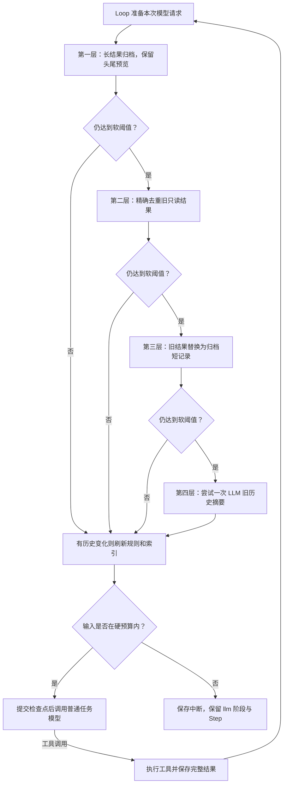

# KamaClaude · S10

一个 Python 本地 AI Agent：TUI 展示对话、工具进度和审批，Core 调用模型与工具。前后端使用 TCP / JSON-RPC / NDJSON 通信。

S10 在 S9 上完善**工具审批、子进程环境控制与轻量多 Agent 协作**，保留已有运行保护、上下文压缩、Markdown 记忆和检查点恢复。

## 从这里看运行主线

```text
SessionManager 接收输入、登记后台任务
→ AgentRunner 准备上下文、装配依赖
→ AgentLoop 按 ready → llm → tools 推进
  ├─ ContextManager：估算、压缩和提交模型工作历史
  ├─ ManagedProvider：请求预算、重试与 Usage
  └─ ToolBatchExecutor：按游标执行、逐工具保存
→ AgentRunner 保存终态，再通知前端
```

主循环采用构造注入，主、子 Agent 共用 `create_agent_loop()` 装配入口。所有组件使用同一个 `context.run`；完整历史、检查点和运行状态继续沿用原实现。

TUI 的连接、会话和 RPC 留在 App，文本与工具展示由 ConversationView 管理。工具显示按 `(run_id, tool_use_id)` 区分；Trace 写入失败会降级并有界结束，不再卡住退出。配置按模型、加载、TOML 和环境变量拆分，原覆盖顺序保留。

建议先读 [主循环](./src/kama_claude/core/loop.py)，再进入 [上下文准备](./src/kama_claude/core/compact/manager.py) 和 [工具批次](./src/kama_claude/core/tools/batch.py)。完整的新旧对照、保存位置和阅读顺序见 [S10 主线整理与阅读指南](./docs/S10-主线整理与阅读指南.md)。

## S10：更明确的工具授权

- 明确禁止优先于会话授权和命令允许规则；静态判断统一由 `policy.assess()` 完成。
- 工作区内读取、搜索、列目录默认允许；写入、编辑默认询问，可允许本次、拒绝本次或允许本会话内同一工具操作同一文件。授权只使用后端解析出的实际路径，不放行同目录其他文件。
- 工作区外文件访问始终只允许单次决定，不能被会话授权跳过。
- Bash 工具独立判断：Windows 仍在本机 cmd 执行并保留保守解析；POSIX 使用 tree-sitter 与 tree-sitter-bash 校验简单语法并提取参数列表。共用参数前缀规则，禁止优先于询问、询问优先于允许；所有命令都明确允许后才自动执行。默认规则为空，复杂语法单次询问，不提供 Shell 沙箱，也没有接入 Docker。
- Core 生成独立 `request_id`，审批响应同时校验会话与 Run；重复、超时和归属错误的回复明确报错。重连保留子 Run 的审批身份。
- TUI、CLI 展示完整命令、工作目录、审批原因和授权范围；后端接受回复后才移除审批。CLI 等待运行结果时仍可输入审批决定。
- 命令与 stdio MCP 默认只继承基础环境变量，不自动获得模型 API Key、GitHub Token、代理凭据等。需要的变量通过配置显式传入。

```toml
[execution]
forward_env = ["BUILD_PROFILE"]       # 从 Core 环境中只额外取这些变量
env = { PYTHONUNBUFFERED = "1" }       # 明确传值；优先于透传

[[mcp.servers]]
name = "local-service"
transport = "stdio"
command = "python"
args = ["server.py"]
forward_env = ["MY_SERVICE_TOKEN"]    # 每个 MCP 服务单独配置
```

旧 `~/.kama/policy.toml` 中的工具级 `allow` 不再生效，`deny` 仍保留；文件不自动改写。新授权只放在内存中，关闭会话或重启 Core 后失效。升级时需一并重启 Core 和前端，旧 `permission.respond(tool_use_id, ...)` 已替换为审批 ID 协议。

本阶段没有增加 Docker 或操作系统沙箱。本机命令仍可以访问当前用户有权访问的文件和网络；清理环境变量也不阻止脚本从文件中读取凭据。完整设计、新旧对照和阅读顺序见 [S10 工具审批与执行环境](./docs/S10-工具审批与执行环境.md)。

## 代码定位与局部修改工具

内置工具统一通过严格的 Pydantic 参数模型生成 Schema、执行前校验；错误参数不会先进入审批或被误判为未知副作用。

```text
find_files 找文件 → search_text 搜索符号 → read_file 按行阅读
→ edit_file 精确局部替换 → bash 运行验证
```

- `find_files` 支持 glob；`search_text` 默认字面量搜索，也支持有超时保护的逐行正则，返回路径、行号与前后文。
- `read_file` 默认从第 1 行读取 200 行，支持 `start_line`、`max_lines` 和下一页位置，输出最多 50 KiB。
- `edit_file` 要求旧片段唯一匹配，提交前核对原文并返回 diff；它与 `write_file` 都使用原子替换，保留原文件权限。
- 目录树与搜索默认过滤常见生成目录及各级 `.gitignore`，可用 `include_ignored=true` 显式查看；遍历不跟随链接。
- 主、子 Agent 共用工作区规则；外部路径仍须单次审批。TUI 的编辑审批展示新旧片段，结果可展开查看 diff。
- 参数、缺失资源、编辑冲突、权限和运行异常分开分类；修改结果不确定时仍中断并等待核实。

工具定义已升级，旧中断 Run 若触发冻结 Schema 不匹配，会明确拒绝续跑；历史仍可查看，可终止旧 Run 后开始新任务。详见 [内置工具校验与代码工具链](./docs/S9-内置工具校验与代码工具链.md)。

## 子 Agent 运行与保护

- Core 共享子任务注册表，同一会话的新 Run 可以查询之前的任务；查询隔离会话，关闭会话和 Core 时清理对应任务。
- 前后台共用运行、取消和异常收尾；查询会检查业务状态，步数耗尽等失败不再显示为空成功。完成后释放 Context，只保留最近 100 条结果。
- `agent_result(run_id, wait_s=10)` 最多等待 0～30 秒。等待超时或查询者取消不会取消后台子任务；超时提示稍后继续查询，完成后立即返回。
- 同一根 Run 的子、孙任务共享数量限制：默认最多同时活跃 3 个、累计派生 8 个；前后台都计数，超过直接返回 `resource_limit`。结果缓存淘汰或更换 Runner 不重置累计数，恢复会补入检查点中已提交的派生记录。
- 子任务提示统一要求“结论、证据、已完成、验证、遗留事项”五个 Markdown 章节。结束后先原子保存 `runs/<子Run ID>/report.md`，再通知与缓存；前台返回和后台查询均提供真实状态、最多 4,000 字符的回答摘要及全文路径。模型陈述与后端执行记录分开，不从模型回答推断测试通过或退出码。
- 角色缺失、损坏直接报错；省略白名单表示继承父范围，`allowed_tools=[]` 表示没有工具。planner、reviewer 默认不提供写文件和 shell。
- 子任务使用相同的运行保护、Usage 锚点估算和四层上下文整理。时间、Token 与重复失败限制继承父 Run 的冻结值；TUI 单独展示子任务用量和停止原因。
- 内建角色默认继承父模型；自定义角色的 `model` 可切换当前供应商的模型。子任务消耗暂不汇总进父 Run Token 上限，仍不支持子任务树断点恢复。

```toml
[subagent]
max_active = 3
max_total = 8
```

也可使用 `KAMA_SUBAGENT_MAX_ACTIVE`、`KAMA_SUBAGENT_MAX_TOTAL`；两项都必须为正整数。关闭会话清理对应内存额度，重启 Core 不恢复未完成的子任务树。

`agent_result` 新增参数改变了工具 Schema。升级前先完成或终止相关旧 Run；冻结 Schema 不兼容时仍拒绝续跑，不静默替换工具定义。RPC 和检查点版本均未改变。

流程与阅读顺序见 [S10 轻量多 Agent 协作](./docs/S10-轻量多Agent协作.md)。

## 工作区路径与单次审批

`read_file`、`write_file`、`list_dir`、`find_files`、`search_text`、`edit_file` 统一以当前 Run 冻结的 `workspace` 为根目录，主 Agent、子 Agent 和恢复运行使用同一根目录。相对路径先解析 `..`、符号链接和 Windows junction，再判断是否越界；遍历不递归跟随链接。

- 工作区内普通读取默认允许，写入和编辑询问；“本会话允许”只绑定当前工具和具体实际文件。工作区外强制单次审批，历史授权不能跳过。
- TUI 展示原始路径、实际路径、工作区与操作，只提供“允许一次”“拒绝一次”。批准后路径若改变，拒绝执行。
- 工作区外的 S9 输出归档也可审批后读取；没有审批管理器时直接拒绝外部访问。
- 这是文件工具的应用层检查。Shell 只固定工作目录；远程 MCP 的文件访问、Core 内部保存不受此规则限制。

详见 [工作区路径校验与单次审批](./docs/S9-工作区路径校验与单次审批.md)，包含执行链路、代码入口和安全边界。

## 运行保护与 Usage 锚点估算

- 运行限制：原有 Step 上限，加上可选累计时间与 Token 上限；恢复不重置累计值。
- 连续相同工具失败第 3 次提醒模型改变方法，默认第 5 次停止。
- 命令分块读取、最多保留 64 KiB 输出，超时和取消时清理受管进程。未知副作用仍由用户确认。
- 请求估算：最近一次请求的真实输入＋输出 Usage，再加其后新增消息的 UTF-8 字节数 ÷ 4（向上取整）；上次 assistant 回复不重复估算，历史改变时全文重估。
- 固定阈值：输入硬预算为“上下文窗口－输出预留－1,024”，默认达到其 80% 时触发压缩；不再按实际量与粗估量的比例修正阈值或硬预算。
- 普通请求、自动摘要和模型重试共用预算。失败或缺少 Usage 的请求保留估算占用，不当成零消耗。
- TUI 分开显示实际已知 Token、估算占用和执行时间；缓存输入计入上下文占用。

```toml
[agent]
max_steps = 20
max_run_seconds = 0       # 0关闭；例如1800秒
max_total_tokens = 0      # 0关闭；例如200000
repeat_failure_limit = 5  # 0关闭
```

已移除 tokenizer 依赖和配置。锚点按 Provider、模型与请求用途隔离，随检查点保存；system、工具定义或旧消息变化时失效。主 Run Token 上限不包含子 Agent 的模型请求；未知用量保留估算占用，不是精确账单。

S10 的当前计算方式见 [Usage 锚点与固定压缩阈值](./docs/S10-Usage锚点与固定压缩阈值.md)；运行保护基础见 [S9 运行保护](./docs/S9-运行保护与Usage锚点估算.md)。

## 四层处理顺序



| 层 | 处理什么 | 是否额外请求模型 |
| --- | --- | --- |
| 长结果预览 | 超过 8,000 字符的工具正文，归档后保留头尾合计 4,000 字符 | 否 |
| 精确去重 | 旧只读工具的名称、参数、完整输出都相同的结果，保留最新一份 | 否 |
| 旧结果归档 | 旧工具正文替换为工具名、调用 ID 和全文位置 | 否 |
| LLM 摘要 | 前三层结束后仍达到软阈值的旧历史 | 是，最多尝试一次 |

程序层保留所有真实用户消息、assistant 内容、工具参数及配对结构；保护最近两组完整模型交互，不进一步缩减错误结果。去重仅缩减模型输入，**不跳过实际工具执行**。

核心主线仍是 **SessionManager → AgentRunner → AgentLoop**。分层协调在 Compactor，候选提交仍走原检查点入口。

## 用户规则与索引式记忆

新 Run 默认加载四个精简入口，详细主题通过 `memory_read` 按需读取：

| 入口 | 维护者与内容 |
| --- | --- |
| `~/.kama/AGENTS.md` | 用户维护，全局规则，Agent 只读 |
| `~/.kama/AGENTS.auto.md` | Agent 维护的少量全局信息，默认最多 512 估算 token |
| `<项目根>/AGENTS.md` | 用户维护的项目规则，Agent 只读 |
| `~/.kama/projects/<project-id>/memory/MEMORY.md` | 项目主题索引，默认最多 1,024 估算 token |

项目根优先识别 Git 根，非 Git 目录使用固定 workspace；ID 包含规范路径哈希，同名项目和不同 worktree 分开。主题分为 `user / feedback / project / reference`，使用 Markdown 保存摘要、正文和来源，索引由后端维护。

`memory_write` 默认允许更新项目主题或全局自动信息，明确禁止策略仍生效。更新全局自动文件须携带 `memory_read(scope="global")` 返回的 `expected_hash`，避免覆盖并发更新。内置文件写入、编辑和记忆接口不能修改用户规则；获批本机 Shell 和远程 MCP 仍受各自能力边界限制，不提供系统级只读隔离。

```toml
[memory]
global_auto_tokens = 512
project_index_tokens = 1024
```

环境变量为 `KAMA_MEMORY_GLOBAL_AUTO_TOKENS`、`KAMA_MEMORY_PROJECT_INDEX_TOKENS`，两项均为正整数。写入超预算时明确要求精简，不截断用户规则。完整请求还需通过统一输入预算检查。

普通步骤沿用已提交的提示；任一压缩层实际改变工作历史后，重新读取四个入口，替换旧注入块，再把新历史与快照一起保存。下一次模型调用使用刷新后的提示；恢复中断 Run 使用最近已提交的快照。

已删除前端 `/memory` 页面及后端 `memory.inspect` RPC。记忆通过自然语言调用工具维护，也可在磁盘查看 Markdown。旧三层记忆文件保留但不读取、不迁移，旧 scope、pinned 和配置项不再支持；旧中断 Run 遇到工具 Schema 变化仍拒绝续跑，应先完成或终止旧 Run。

完整设计、工具示例、压缩刷新和阅读入口见 [S10 规则与索引式记忆](./docs/S10-规则与索引式记忆.md)。

## MCP 标准远程连接

本地 MCP 服务使用 `stdio`，远程服务改为标准 **Streamable HTTP**。原 MCP 裸 TCP 模式已移除；TUI/CLI 与 Core 之间的 TCP 通信继续使用。

```toml
[[mcp.servers]]
name = "cloudflare_docs"
transport = "streamable-http"
url = "https://docs.mcp.cloudflare.com/mcp"
# headers = { Authorization = "Bearer <token>" }  # 按服务要求设置
```

官方 MCP SDK 处理协议协商、JSON/SSE 响应和会话关闭，项目继续负责工具包装、权限与检查点。已使用 Cloudflare 公网 MCP 服务完成工具发现和文档搜索，并用独立 SDK 服务验证 JSON/SSE、stdio、鉴权、取消和清理。

详见 [MCP 标准远程连接与真实服务验证](./docs/S9-MCP标准远程连接.md)。可运行 `uv run python -X utf8 scripts/check_mcp.py` 复现；本机代理链路不可用时，可显式加 `--direct` 对该检查进程直连。

## 启动与操作

环境：Python 3.12、uv；从项目根目录启动。

```text
uv sync
uv run kama-core
```

另开终端：

```text
uv run kama-tui
```

Runner 默认使用 DeepSeek 的 Anthropic 兼容接口。本地 `.env` 设置 `DEEPSEEK_API_KEY` 和 `KAMA_LLM_DEFAULT_MODEL`，模型名按账号实际可用值填写，密钥不上传。

TUI 启动后选择历史会话或新建会话。Ctrl+O 切换，Ctrl+Q 退出界面，Ctrl+W 主动关闭会话。空闲时输入 `/compact` 手动整理。

手动也走四层流程，空间足够就返回“无需继续压缩，未调用 LLM”，不会强制摘要，也不必创建模型 SDK。界面显示实际处理阶段，以及是否调用 LLM。

## 默认配置

项目 `.kama/config.toml`：

```toml
[compaction]
auto_threshold = 0.8
prune_target_ratio = 0.65
context_window_tokens = 65536
output_reserve_tokens = 8192
keep_recent_groups = 2
summary_max_tokens = 2048
tool_result_limit = 8000
tool_result_keep = 4000
```

- 硬输入预算 = 窗口 − 输出预留 − 1,024，默认 **56,320**。
- 自动压力阈值 = 硬预算 × 80%，默认约 **45,056**。
- 程序层尽量处理到硬预算 × 65%，默认约 **36,608**；某层结束后只要已低于软阈值，就不进入下一层。
- `prune_target_ratio` 必须大于零且小于有效软阈值。
- `auto_threshold=0`：自动只做长结果预览和硬预算检查；手动仍按 80% 压力阈值执行四层。
- 程序层始终保护最近两组。LLM 后备沿用近期原文约 8,192 token 的额度，必要时减少为一组，仍不得拆开工具批次。
- 窗口是应用预算，需按实际模型配置；字符估算不等于精确计费 token。

环境变量：`KAMA_COMPACT_THRESHOLD`、`KAMA_COMPACT_PRUNE_TARGET`、`KAMA_COMPACT_WINDOW_TOKENS`、`KAMA_COMPACT_OUTPUT_TOKENS`、`KAMA_COMPACT_KEEP_GROUPS`、`KAMA_COMPACT_SUMMARY_TOKENS`、`KAMA_COMPACT_TOOL_LIMIT`、`KAMA_COMPACT_TOOL_KEEP`。

## 保存与失败处理

- `checkpoint.json` 保存模型工作上下文和恢复状态，允许预览、去重和摘要，版本仍为 1。
- `thread.jsonl` 始终追加完整对话原文：用户输入、模型完整回复、工具调用与完整结果。压缩不重写它。
- TUI 重新打开或重连会话时，从 `thread.jsonl` 显示完整历史；继续运行时，模型读取检查点中的压缩上下文。
- 原文先随检查点提交，再同步追加到 thread；重启按固定消息 ID 补写，不重复记录。仍保留 `meta.json`、笔记和 Run 记录。
- 完整输出先保存到对应 `runs/<rid>/outputs/<哈希>.txt`；短记录可以独立定位全文，不依赖另一条重复结果还在上下文中。
- 摘要成功后额外导出 `runs/<rid>/summary_<时间>.md`，恢复仍依赖检查点。
- 程序缩减成功、摘要失败时，程序结果仍提交；硬预算内继续任务，超限则中断。
- 归档或检查点失败立即停止；不发成功通知，不重跑已完成工具。
- 压缩不重置 Run ID、Step 或工具游标，恢复继续使用原冻结系统提示。

## 代码与学习文档

- [S10 主线整理与阅读指南](./docs/S10-主线整理与阅读指南.md)：当前主线、模块职责、新旧对照、历史显示与异常边界。
- [S9 Markdown 记忆与注入](./docs/S9-Markdown记忆与注入.md)：新旧对照、文件模板、工具维护、注入与恢复链路。
- [S9 分层压缩说明](./docs/S9-上下文组织与压缩.md)：完整流程、核心方法、两个例子和故障边界。
- [Compactor](./src/kama_claude/core/compact/compactor.py)：分层候选生成与最终摘要。
- [程序处理](./src/kama_claude/core/compact/pruning.py)：精确去重与旧结果归档。
- [请求估算器](./src/kama_claude/core/compact/estimator.py)、[运行预算](./src/kama_claude/core/run_budget.py)、[受管模型请求](./src/kama_claude/core/llm/managed.py)。
- [基础字符计数与全文归档](./src/kama_claude/core/compact/budget.py)。
- [S8 恢复基线](./docs/S8-中断与恢复链路速查.md)、[运行说明](./RUNBOOK.md)、[通信协议](./WIRE_PROTOCOL.md)。

## 验证

```text
uv run python -X utf8 -m pytest tests/unit tests/integration/test_s9_run_budget.py tests/integration/test_s9_memory.py tests/integration/test_s9_compaction.py tests/integration/test_s8_recovery.py tests/integration/test_s5_permission_flow.py tests/integration/test_s4_session_ipc.py tests/integration/test_s2_dual_process.py tests/integration/test_ping_roundtrip.py tests/integration/test_mcp_streamable_http.py -q
uv run mypy src
uv run python -X utf8 scripts/gen_protocol_doc.py --check
```

在 26 份相同只读结果的假模型对比中，摘要调用由 1 次变为 0 次，程序层读取了 13 次归档全文。详细的前后输入量见学习文档。此结果不代表真实模型质量或账单收益：程序保留的历史可能更长，后续请求、缓存与重新读取的代价也需考虑。

S10 审批改动前的非付费测试基线为 **617 项通过、1 项跳过**；审批版本为 **640 项通过、1 项跳过**；主线整理后为 **647 项通过、1 项跳过**，另排除 1 项真实模型测试。覆盖授权范围、并发审批、真实 TCP/Core 重启、TUI、上下文压缩、完整历史及真实 MCP 子进程；新增验证包含跨 Run 工具标识、Trace 失败退出和配置覆盖顺序。改动文件 Ruff、mypy（123 个源码文件）、协议一致性检查通过，不调用付费模型。

精确文件授权与独立 Bash 审批调整后，非付费回归为 **685 项通过、1 项跳过、1 项真实模型测试被排除**；改动文件 Ruff、完整源码 mypy（124 个文件）、协议检查通过。Windows junction 用例实际执行；缺少权限的文件符号链接用例仍明确跳过。全仓 Ruff 仍只有既有 `core/skills/loader.py:45` 行长问题。

tree-sitter Bash AST 与共用参数规则接入后，非付费回归为 **745 项通过、1 项跳过、1 项真实模型测试被排除**；完整源码 mypy（126 个文件）、改动文件 Ruff、协议、文档链接及依赖锁检查通过。AST 用例只解析不执行；命令集成用例在当前本机 Shell 实际执行无副作用的 echo，覆盖自动允许、单次审批、拒绝和前置保存失败。

全仓 Ruff 的既有行长问题位于未修改的 `core/skills/loader.py`；本轮只要求改动文件检查通过。

新增学习文档限于 `docs/S10-*.md`，已跟踪的历史阶段文档继续保留；本地练习、运行数据和密钥不上传。
