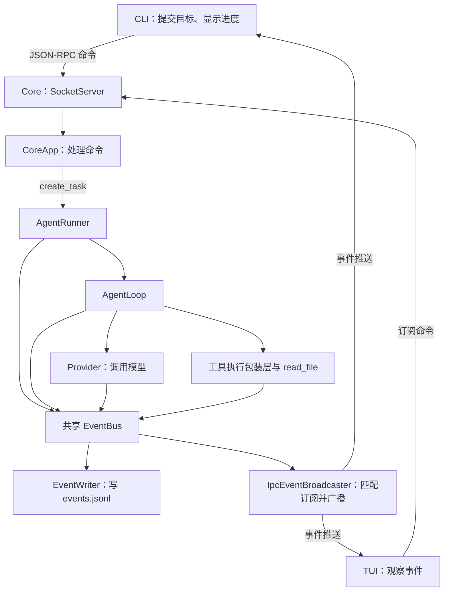
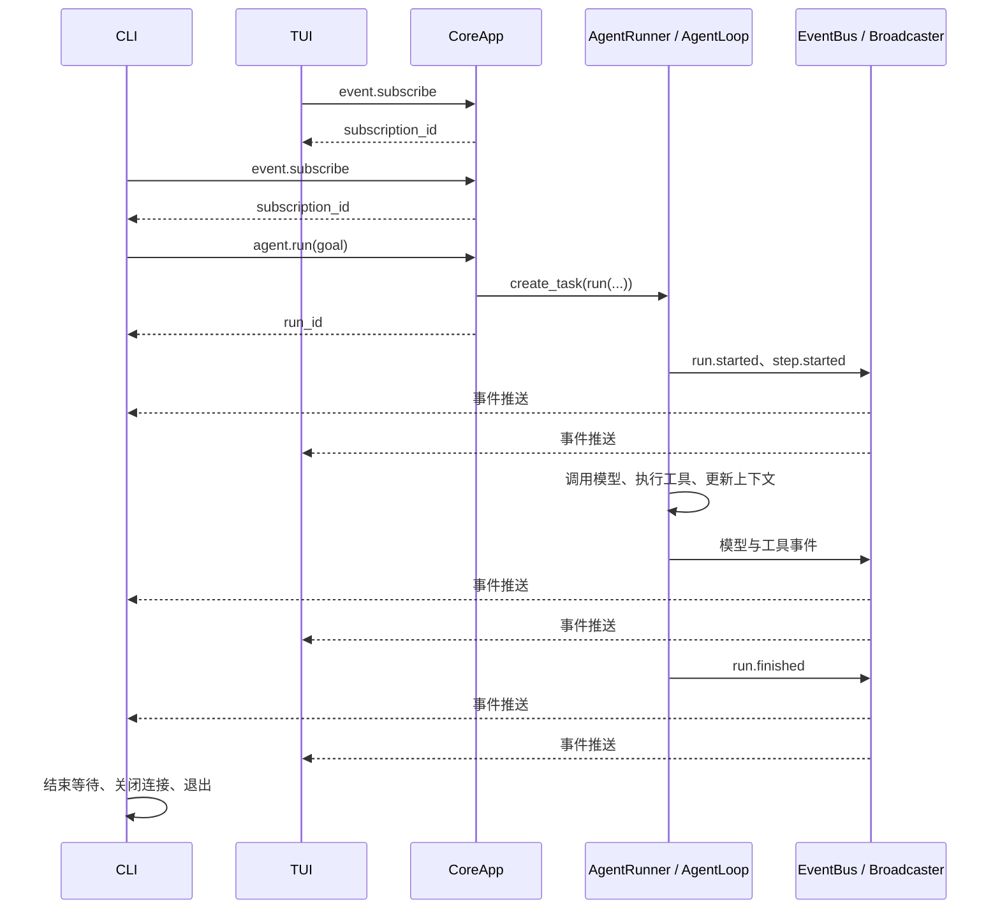

# KamaClaude · S2 双进程与事件订阅

S2 把 S1 的 Agent 执行逻辑放进常驻 Core：CLI 负责提交目标和显示结果，TUI 负责观察执行过程，Core 负责调用模型、执行工具、保存事件和推送进度。

本文按**当前 `stage/s2` 分支代码**讲解，包含从 S1 同步的 OpenAI、DeepSeek Provider 和 Windows 前台启动适配。建议先跑通一次任务，再对照关键代码逐段阅读。

## 先回答几个核心问题

### 1. S1 已经能完成任务，为什么还要做 S2？

S1 的 `kama run` 在 CLI 进程中创建 `AgentRunner`，执行任务和打印进度都依赖这个进程。S2 将 Runner 交给 Core 管理，CLI 通过 RPC 请求 Core 启动任务。

这样，客户端连接和任务执行开始拥有不同的生命周期：关闭观察窗口，不会按设计直接取消 Core 中的任务；另一个客户端也能订阅同一任务的事件。后续增加终端界面、其他客户端和任务管理，都有了独立的服务入口。

这里还没有实现 Core 崩溃后的任务恢复。事件文件能保存历史，但不能替代执行检查点。

### 2. “双进程”是不是每来一个任务都创建一个进程？

不是。这里指的是**服务端 Core 与客户端分属不同进程**。一次任务通过 `asyncio.create_task()` 调度到 Core 的事件循环中，不会为它新建操作系统进程。

同时打开 Core、CLI、TUI 时，实际有三个进程。S2 允许多个客户端连接和观察，但 Core 只允许一个顶层 Agent 任务处于执行状态。

### 3. `agent.run` 返回 `run_id`，是不是任务已经成功？

返回 `run_id` 表示 Core 已创建这次运行对应的后台任务。此时模型可能还没有回答，工具也可能尚未执行。

执行过程由后续事件报告，正常执行路径最后通过 `run.finished` 给出 `status`、`reason` 和 `steps`。必须区分“启动请求得到响应”和“业务任务成功结束”。当前代码对初始化异常的兜底还不完整，不能保证任何异常都一定产生结束事件。

### 4. 同一个 TCP 连接怎么同时接收命令响应和执行进度？

客户端只有一个持续读取消息的协程 `run_event_loop()`。读到 JSON-RPC 响应，就按请求 `id` 找到等待中的 `Future`；读到 `kind="event"` 的事件包，就交给本地事件回调。

`Future` 可以理解为“尚未填写结果的收据”：发送命令时登记一张收据，响应到达时按编号填写结果，原来等待的协程就可以继续执行。

### 5. 为什么既使用 JSON-RPC，又使用 NDJSON？

它们解决不同的问题。JSON-RPC 定义命令名、参数、请求 ID、结果和错误；NDJSON 通过“每行一个 JSON 对象”划定 TCP 字节流中的消息边界。

代码中的 `model_dump_json().encode() + b"\n"` 负责发送一条完整消息，`reader.readline()` 负责读取一条消息。JSON 字符串里的换行会被转义，不会被当成两条消息。

S2 的命令请求和响应采用 JSON-RPC 2.0 外壳；事件推送使用项目自定义的 `{"kind":"event","event":{...}}` 外壳，**不是 JSON-RPC notification**。两种消息共用 NDJSON 传输。

### 6. 为什么 CLI 要先订阅，再发起任务？

如果先启动任务，Core 可能已经发出 `run.started`，客户端却还没注册订阅，最早的事件就看不到了。当前 CLI 的顺序是：连接、注册本地回调、启动接收循环、等待订阅成功、发送 `agent.run`、等待结束事件。

其中“注册本地回调”与“服务端订阅”也不同：`on_event()` 决定收到事件后在本地调用谁，`event.subscribe` 决定 Core 是否向这个连接发送事件。

### 7. EventBus 和 IpcEventBroadcaster 分别负责什么？

`EventBus` 在 Core 进程内部把事件对象依次交给订阅函数。`IpcEventBroadcaster` 是其中一个订阅者，负责筛选客户端订阅、序列化事件并写入 TCP 连接。`EventWriter` 则把事件写进文件。

因此同一个模型输出事件可以被广播给多个窗口，也可以被保存。当前实现依次 `await` 订阅函数和连接写入，慢客户端仍可能影响执行速度，尚未做到耗时隔离。

### 8. TUI 能输入目标吗？断线重连会自动补齐事件吗？

S2 TUI 是事件观察界面，只有连接状态和事件日志，目标仍通过 `kama run --goal` 提交。它会在断线后每两秒尝试重连，但只有启动时指定 `--replay RUN_ID`，才请求该任务的历史事件。

历史回放还没有事件序号、确认位置和可靠的历史/实时交接。重连不等于不丢不重地恢复显示，更不等于恢复已经停止的任务。

## S1 到 S2，到底迁移了什么

| 方面 | S1 | 当前 S2 |
| --- | --- | --- |
| 谁创建 Runner | CLI | Core 的 `agent.run` handler |
| 谁调用模型、执行工具 | CLI 进程 | Core 进程 |
| 谁拥有事件总线 | 一次本地运行 | Core 持有共享总线并传给 Runner |
| CLI 如何拿到进度 | 订阅进程内事件对象 | 接收 TCP 推送的事件字典 |
| 多个界面观察 | 尚未接入跨进程广播 | CLI、TUI 可同时订阅 |
| 运行历史 | `events.jsonl` | 保留落盘，增加经 Core 回放 |
| 客户端关闭 | 影响本地执行生命周期 | 不直接取消 Core 内任务 |
| 并发任务 | 单次本地运行 | Core 拒绝第二个尚未结束的顶层运行 |

AgentLoop 的“调用模型 → 执行工具 → 结果追加上下文 → 再调用模型”仍然保留。S2 的学习重点是它现在由谁启动，以及进度如何跨进程送到界面。

## 先看整体结构



图中 RPC 请求和事件推送是不同逻辑方向；对同一个客户端，它们使用同一条 TCP 连接。

### 一次任务的完整时序



这是正常路径的逻辑示意。客户端应能处理响应与事件交错，不能把“下一行必定是这个请求的响应”作为实现前提；尤其历史回放事件会在订阅响应之前发送。

## 事件系统完整拆解：从订阅到 CLI 显示

可以先用下面这段话检查自己是否理解：

> CLI 建立 TCP 连接，注册本地事件回调并启动接收循环，然后向 Core 发送订阅请求，声明关心的 topics 和 scope。订阅成功后，CLI 再发送 agent.run。任务在 Core 中执行，执行组件将事件发布到 Core 内部的 EventBus；总线调用广播器，广播器把符合订阅条件的事件通过该客户端已有的 TCP 连接推送回去。CLI 的唯一接收循环区分命令响应和事件，分别唤醒等待命令结果的协程，或调用事件回调更新进度。

这就是当前 S2 的主要事件链路。这里的“实时监控”指 Core 主动推送事件，CLI 不需要反复发送“任务现在怎么样了”的查询请求；它不代表已经实现严格实时或可靠送达。

### 1. 哪些东西在 Core，哪些东西在 CLI

| 所在进程 | 组件 | 实际职责 |
| --- | --- | --- |
| Core | Runner、AgentLoop、Provider、工具执行包装层 | 在执行到对应位置时创建并发布运行、步骤、模型、工具事件 |
| Core | `EventBus` | 把 Python 事件对象交给已注册的内部处理函数 |
| Core | `EventWriter` | 把事件保存到本次运行的 `events.jsonl` |
| Core | `IpcEventBroadcaster` | 保存客户端订阅，匹配事件类型与运行范围，写入对应 TCP 连接 |
| CLI | `SocketClient` | 发送命令，持续读取响应和推送事件，完成本地分发 |
| CLI | `on_event`、`StdoutPrinter` | 处理事件字典，打印文本、步骤和工具状态，判断运行是否结束 |

因此，“总线和各种事件都在 Core 中”对于**正常 CLI → Core 执行路径的事件产生与发布**是正确的：CLI 没有再创建一套 Agent EventBus，也没有直接调用 Core 中的 Python 事件对象。

事件类定义在 [core/bus/events.py](./src/kama_claude/core/bus/events.py)，属于源码中的数据结构定义；进程边界要看运行时谁创建、谁调用。Core 创建的是 Pydantic 事件对象，TCP 上传输的是序列化字节，CLI 解析后拿到的是新的 Python 字典。客户端与 Core 没有共享这一块对象内存。

CLI 里的 `finished = asyncio.Event()` 也不要混在一起：它是本地协程等待/唤醒用的同步工具，不是 `RunFinishedEvent`，也不是另一条事件总线。

### 2. 两种“订阅”必须分开理解

**第一种：Core 进程内部的函数订阅。**

Core 初始化时把广播器注册到总线：

```python
self._bus.subscribe(self._broadcaster.handle)
```

Runner 执行时，文件写入器也会注册到同一总线：

```python
writer.subscribe(bus)  # 内部调用 bus.subscribe(writer.handle)
```

这里保存的是 Python 函数引用。源码 [events/bus.py](./src/kama_claude/core/events/bus.py) 的核心实现很直接：

```python
# subscribe(handler) 的关键语句
self._subscribers.append(handler)

# publish(event) 的关键语句
for handler in self._subscribers:
    await handler(event)
```

所以，发布事件并不是启动某个独立的消息中间件，而是依次调用这些异步函数。**EventBus 当前不按 topic 筛选；它把事件交给所有已注册的内部处理函数。**内部发布路径本身也不缓存历史，文件记录由 EventWriter 负责。

**第二种：客户端通过 RPC 注册网络事件订阅。**

CLI 发送：

```python
await client.send_command("event.subscribe", {
    "topics": ["run.*", "step.*", "tool.*", "llm.token", "llm.usage"],
    "scope": "global",
})
```

Core 的 `_subscribe_handler()` 取得当前连接 writer，再调用：

```python
sub_id = self._broadcaster.subscribe(writer, cmd.topics, cmd.scope)
```

广播器保存的是“哪个连接想接收什么事件”，大致包括：

```text
subscription_id：这条订阅的标识
writer：向这个客户端发送数据的连接写入端
topics：客户端关心的事件类型模式
scope：客户端关心的运行范围
```

**CLI 的这次订阅保存在广播器中，不是把 CLI 的回调函数注册到了 Core 的 EventBus。**函数引用不会通过 TCP 传过去，传过去的只是 topics、scope 等 JSON 数据。

同样，CLI 调用 `client.on_event(on_event)` 只是登记本地处理函数，不会自动向服务器发起订阅。要收到并处理事件，本地回调和服务端订阅两步都要准备好。

### 3. 一条事件究竟怎样走到 CLI

以任务开始时的 `run.started` 为例。Runner 发布事件的关键语句是：

```python
await bus.publish(RunStartedEvent(run_id=run_id, goal=goal, ts=_now()))
```

**第一步：Core 提前保存广播器的方法，发布事件时才调用它。**

在 `CoreApp.__init__()` 中，先创建总线和广播器，再把两者关联起来：

```python
self._bus = EventBus()
self._broadcaster = IpcEventBroadcaster()
self._bus.subscribe(self._broadcaster.handle)
```

这里的 `self._broadcaster.handle` 没有括号，表示把这个实例的方法作为回调保存到总线中；此时没有执行广播，也没有发送网络数据。

之后 `bus.publish(event)` 遍历内部订阅者：

```python
for handler in self._subscribers:
    await handler(event)
```

当 `handler` 取到之前保存的广播器方法时，`await handler(event)` 就相当于 `await self._broadcaster.handle(event)`。因此，发布者不需要每次再手动调用广播器；所谓“总线通知广播器”，就是遍历保存的方法并调用它，并没有隐藏的消息转发机制。

**第二步：广播器提前记住每个客户端的连接和筛选条件。**

这由前面的 `event.subscribe` 请求完成，Core 的关键处理语句是：

```python
writer = get_connection_writer()
sub_id = self._broadcaster.subscribe(writer, cmd.topics, cmd.scope)
```

广播器的 `subscribe()` 会把它们保存成一条 `_Subscription`：

```python
sub = _Subscription(sub_id=sub_id, writer=writer, topics=topics, scope=scope)
self._subscriptions.append(sub)
```

这里的 writer 是**服务端向当前客户端发送数据的连接写入端**。CLI 和 TUI 分别连接 Core，各自对应自己的 writer。广播器保存 writer，才能在未来事件发生时找到应该向哪个连接写数据。

注意两个列表不同：EventBus 的 `_subscribers` 存放内部处理函数；广播器的 `_subscriptions` 存放客户端连接及其筛选条件。前者决定事件交给哪些内部组件处理，后者决定哪些客户端能收到事件。

**第三步：事件发布后，广播器逐条检查订阅并发送。**

整个过程可以沿着下面这条路径追踪：

```text
Core 进程
  AgentRunner 创建 RunStartedEvent 对象
    → bus.publish(event)
      → broadcaster.handle(event)
          检查客户端的 topics 和 scope
          匹配后包装为 EventPushEnvelope
          将 JSON + 换行写入该客户端的 TCP 连接
      → EventWriter.handle(event)
          将事件写入 events.jsonl

                         TCP 进程边界

CLI 进程
  run_event_loop() 持续读取一行数据
    → _dispatch(line) 解析 JSON
      → 发现 kind == "event"
        → 取出 event 字典
          → await on_event(event)
            → await printer.handle(event)
              → 终端显示 [run] 和 run_id
```

广播器在 Core 初始化时先注册，当前运行的 Writer 随后注册；总线按注册顺序执行。它们是同一条发布路径上的两个处理函数，并不是先落盘后才允许广播。

网络上的这条消息形如：

```json
{"kind":"event","event":{"type":"run.started","run_id":"run-demo","goal":"读取 pyproject.toml","ts":"2026-10-19T09:00:00+00:00"}}
```

注意外层 `kind` 与内层 `type` 的区别：`kind="event"` 帮助 SocketClient 判断这是事件推送；`type="run.started"` 帮助广播器和界面判断具体发生了什么。

把 [ipc_broadcaster.py](./src/kama_claude/core/transport/ipc_broadcaster.py) 的 `handle()` 展开看，核心实现如下，省略了类型标注、日志及连接异常清理：

```python
async def handle(self, event):
    event_dict = event.model_dump()
    event_type = event_dict.get("type", "")
    run_id = event_dict.get("run_id")

    for sub in list(self._subscriptions):
        if not self._matches_topic(event_type, sub.topics):
            continue
        if not self._matches_scope(run_id, sub.scope):
            continue

        envelope = EventPushEnvelope(event=event_dict)
        sub.writer.write(envelope.model_dump_json().encode() + b"\n")
        await sub.writer.drain()
```

这段代码分为五个动作：

1. `model_dump()` 将 Core 内部的 Pydantic 事件对象转换为字典，取出用于匹配的 type 和 run_id。
2. 遍历订阅记录，同时检查 topic 和 scope；不匹配就跳过，不会向这个连接发包。
3. 用 `EventPushEnvelope` 包装事件，添加 `kind="event"` 外壳，方便客户端区分事件与 RPC 响应。
4. `model_dump_json().encode() + b"\n"` 将包转换为 JSON 字节并追加 NDJSON 分隔符，再交给该订阅对应的 writer。
5. `await drain()` 在需要时等待发送缓冲压力缓解，再继续处理后面的订阅。它不是 CLI 已经收到或显示成功的确认。

例如发布一条 `run_id="run-demo"` 的 `run.started` 事件，广播器保存了三条订阅：

| 客户端 | topics | scope | 本次是否发送 |
| --- | --- | --- | --- |
| CLI A | `run.*` | `global` | 是，写入 CLI A 对应的 writer |
| TUI B | `run.*`、`tool.*` | `run:run-demo` | 是，另写一份到 TUI B 对应的 writer |
| 客户端 C | `tool.*` | `global` | 否，`run.started` 不匹配 `tool.*` |

因此，这里的“广播”实际是**应用代码遍历匹配的订阅，通过各自已有的 TCP 连接分别发送一份事件**。TCP 没有替项目自动广播，客户端也不需要为每种事件新建连接。

完整实现遇到连接写入失败时，会先记录失效 writer，再在遍历后移除该 writer 的全部订阅，避免遍历过程中直接修改原订阅列表。正常断连也会由 SocketServer 清理订阅。事件处理与连接发送都按当前协程顺序执行，并没有自动并行发送给所有客户端。

最后，CLI 的 `run_event_loop()` 读到这一行，交给 `_dispatch()`；后者识别 `kind="event"`，取出 event 字典并调用本地 `on_event()`。此时事件才进入 CLI 的显示逻辑，而 Core 的原始事件对象始终没有跨进程共享。

### 4. topic 决定事件种类，scope 决定运行范围

topic 是对事件 `type` 的字符串匹配。它不是另外创建的一个 Python 事件对象，也不是一条单独的 TCP 连接。

| 订阅条件 | 会匹配什么 |
| --- | --- |
| `run.*` | `run.started`、`run.finished` |
| `step.*` | `step.started`、`step.finished` |
| `tool.*` | `tool.call_started`、`tool.call_finished`、`tool.call_failed` |
| `llm.token` | 文本增量事件；一段增量不一定只对应一个模型 token |
| `llm.usage` | 模型用量事件 |

当前 CLI 订阅上述模式，但它没有订阅 `llm.model_selected`。因此不能把 `on_event` 理解为“Core 发布的所有事件都会经过这里”；只有符合这个连接订阅条件、成功传到客户端的事件才会被交给它。

广播器还检查 scope：`global` 接收所有运行中匹配 topic 的实时事件，`run:某个ID` 则再限制 run_id。**topic 和 scope 必须同时匹配**，不是满足其中一个就发送。

CLI 当前使用 global，并没有在回调中按自己的 run_id 再过滤。理解现有流程时要记住这个边界；代码中存在 run_id，不代表客户端已经完整实现了运行隔离。

### 5. 一条 TCP 连接，两类消息，两种等待

接收循环不会为每个 topic 再开一个连接，也不会为命令响应另开一个连接。同一条连接上交错到达的消息统一交给 `_dispatch()`：

```text
收到一行 JSON
  ├─ 有 jsonrpc 字段：命令响应
  │    根据 id 找到 _pending 中的 Future
  │    set_result 或 set_exception
  │    唤醒正在 await send_command(...) 的协程
  │
  └─ kind 为 event：事件推送
       调用本地 on_event 回调
       打印执行进度
       若 type 为 run.finished，再设置本地 finished 标志
```

对比下面两行，就能看出两种等待的差别：

```python
await client.send_command("agent.run", {"goal": goal})  # 等启动命令响应
await finished.wait()                                 # 等运行结束事件
```

第一行由 RPC 响应完成对应 Future 后继续，第二行由事件回调调用 `finished.set()` 后继续。**拿到 run_id 和拿到最终运行状态，是两个不同结果。**

`_pending` 保存等待响应的请求，不保存事件订阅；`_event_handlers` 保存客户端本地回调；Core 广播器的 `_subscriptions` 保存连接和筛选条件；Core EventBus 的 `_subscribers` 保存内部处理函数。这四个集合所在的位置和用途不同。

接收循环中的 `await reader.readline()` 没有数据时会挂起让出执行权，不是一直占着 CPU 查询状态。`create_task()` 使它能与“发送命令并等待结果”的协程配合运行，也不意味着新建了线程或进程。

### 6. 为什么必须是这个启动顺序

正常 CLI 运行的顺序是：

```text
建立连接
→ 注册本地 on_event
→ 创建持续接收数据的协程任务
→ 发送 event.subscribe 并等待响应
→ 发送 agent.run 并等待响应
→ 等待 run.finished
→ 清理接收任务、关闭连接、退出 CLI
```

接收循环先于订阅请求启动，因为 `send_command()` 的响应也由它接收；订阅成功先于任务启动，因为任务开始后马上就可能发布事件。这里的接收循环不仅监听执行进度，也负责让 RPC 请求完成。

历史回放会在订阅响应之前发送事件，客户端不能靠“消息到达顺序”判断消息身份。唯一读循环按消息外壳和请求 ID 分发，才能同时支持这些情况。

### 7. 多客户端观察和连接关闭时会怎样

CLI、TUI 分别建立自己的 TCP 连接，也分别注册自己的订阅。一个事件匹配两边订阅时，广播器向两个 writer 各写一份数据；这里的“广播”是应用层逐连接发送，不是 TCP 自带的广播，也不是把事件无条件发给所有连接。

客户端断开后，服务端清理该连接的订阅，但不会因此取消 Core 中的 Agent 任务。没有 CLI 订阅时，执行组件仍然可以发布事件，EventWriter 仍然可以记录历史。观察端不是执行循环的所有者。

当前广播与内部处理是串行等待的，慢连接可能拖慢执行；断线重连默认也不会补发遗漏历史。事件系统已经分开了执行与显示的职责，但还不能保证任何情况下都不丢、不重、互不阻塞。历史回放和相应改进见后文。

## 快速开始：用三个终端观察同一任务

### 1. 准备环境和配置

需要 Python 3.12.x 和 uv。下面的准备命令使用 Windows PowerShell；macOS / Linux 安装依赖后，用 `cp .env.example .env` 创建配置（已有文件时保留），同样可以打开多个终端以前台方式运行。所有终端先进入本项目目录。

```powershell
uv sync

# 已有 .env 时保留原文件
if (-not (Test-Path -LiteralPath .env)) {
    Copy-Item -LiteralPath .env.example -Destination .env
}
```

当前 `runner.py` 默认实例化的是 **DeepseekProvider**，但 `.env.example` 和配置内置模型仍保留 Anthropic 示例。第一次运行需要在 `.env` 中设置匹配的密钥和模型：

```dotenv
DEEPSEEK_API_KEY=替换为你的密钥
KAMA_LLM_DEFAULT_MODEL=替换为该接口支持的DeepSeek模型ID
KAMA_HOST=127.0.0.1
KAMA_PORT=7437
KAMA_MAX_STEPS=20
```

上面的密钥和模型值都是占位文字，必须替换。不要只复制 Anthropic 示例后直接运行 DeepSeek。`.env` 被 Git 忽略，不应提交密钥。

### 2. 终端 A：启动 Core

```powershell
uv run kama-core
```

看到监听 `127.0.0.1:7437` 的日志后保持终端开启。Windows 已同步前台 Core 的 Ctrl+C 退出适配；要停止 Core，在此终端按 Ctrl+C。

### 3. 终端 B：先打开观察界面

```powershell
uv run kama-tui
```

等待状态栏显示已连接。TUI 此时还没有发起任务，它只是订阅了事件。按 `q` 可以退出观察界面。

### 4. 终端 C：检查连接并提交目标

```powershell
uv run kama ping
uv run kama run --goal "使用 read_file 读取 pyproject.toml，告诉我项目名称和 Python 版本要求"
```

`ping` 不需要模型密钥；运行 Agent 需要可用密钥和网络，可能产生模型调用费用。模型是否调用工具由其响应决定，目标中明确要求读文件便于观察工具闭环。

正常情况下，CLI 和 TUI 能看到相同 `run_id` 的运行与工具事件；运行结束后 CLI 退出，Core 和 TUI 仍继续运行。CLI 按收到的文本增量打印；TUI 先缓冲文本，遇到下一个非文本事件或断线时才刷新，当前还不是逐片立即刷新控件。

### 5. 查看历史事件

事件文件保存在 Core 工作目录下：

```text
runs/
└── 20261019-090000-abc123/
    └── events.jsonl
```

用实际输出的 run_id 替换下面的示例：

```powershell
uv run kama-tui --replay "20261019-090000-abc123"
```

该命令仍然需要 Core 在线，由 Core 读取历史并推送；它不是直接打开本地文件的离线查看器。TUI 回放后仍订阅全局实时事件，因此也可能继续看到之后其他运行的事件。

### 后台管理命令的使用边界

S2 增加了 `kama core start`、`kama core status`、`kama core stop`，分别封装子进程启动、端口探测和 PID 终止。现有实现仍带有 Unix 的会话/信号处理方式，**Windows 学习时使用上面的前台启动与 Ctrl+C 退出方式**。

`core status` 仅检查端口能否连接，并没有发送业务 ping；`core start` 打印 started 时也没有等待业务健康检查完成。前台启动不会写入这组命令使用的 PID 文件，不能假设 `core stop` 能管理任意方式启动的 Core。

## 运行目录和 Provider：配置应该改哪里

### 执行路径以 Core 为准

| 内容 | 当前代码如何确定位置 |
| --- | --- |
| `.env` | 各进程通过自身工作目录读取 `.env`；模型执行使用 Core 的配置与环境 |
| `~/.kama/config.toml` | 用户目录中的默认配置文件，可用 `KAMA_CONFIG` 指定其他位置 |
| `read_file("pyproject.toml")` | 相对 Core 的当前工作目录解析 |
| `runs/<run_id>/events.jsonl` | 默认写到 Core 当前工作目录的 `runs/` 下 |
| 回放文件 | Core 根据 run_id 在上述默认运行目录中查找 |

例如 Core 从项目根目录启动，CLI 从其他目录发出读取 `README.md` 的目标，工具仍读取 Core 工作目录中的文件。当前 `agent.run` 只有目标参数，没有把客户端当前路径自动传给 Core。

Core 在启动时读取配置，模型对象在任务开始时创建并使用 Core 的进程环境。修改 `.env` 后应重启 Core；仅重开 CLI，不会让已经运行的 Core 自动读取新密钥或新模型。

### 三个 Provider 已同步，默认选择仍由代码决定

实现集中在 [provider.py](./src/kama_claude/core/llm/provider.py)。

| 类 | 当前适配方式 | 密钥变量 |
| --- | --- | --- |
| `AnthropicProvider` | Anthropic SDK，流式输出并解析工具调用 | `ANTHROPIC_API_KEY` |
| `OpenaiProvider` | 文件内部转换消息和工具格式，调用 Chat Completions 流式接口 | `OPENAI_API_KEY` |
| `DeepseekProvider` | 继承 AnthropicProvider，替换客户端密钥与兼容接口地址 | `DEEPSEEK_API_KEY` |

当前没有 `KAMA_LLM_PROVIDER` 配置项。仅修改 `KAMA_LLM_DEFAULT_MODEL` 会改变模型 ID，不会把 DeepseekProvider 自动切换成 OpenaiProvider。

要切换执行后端，需要修改 Runner 的默认 Provider 构造，或者在 Core 创建 `AgentRunner` 时显式传入 `provider=`。CLI 本身已不运行 Agent，不能通过在客户端本地创建 Provider 来替换 Core 的后端。OpenaiProvider 采用延迟导入，`openai` SDK 目前未声明在项目依赖中，实际启用该类还需要安装该包；默认 DeepSeek 路径复用已声明的 `anthropic` SDK。

## 协议长什么样：看懂四类消息

### 订阅命令

```json
{"jsonrpc":"2.0","id":"req-sub","method":"event.subscribe","params":{"topics":["run.*","step.*","tool.*","llm.token","llm.usage"],"scope":"global"}}
```

`topics` 决定关注哪些事件类型，`scope` 决定关注哪些运行。下面是订阅成功响应：

```json
{"jsonrpc":"2.0","id":"req-sub","result":{"subscription_id":"sub-demo","replayed_count":0}}
```

### 发起任务与响应

```json
{"jsonrpc":"2.0","id":"req-run","method":"agent.run","params":{"goal":"读取 pyproject.toml"}}
```

```json
{"jsonrpc":"2.0","id":"req-run","result":{"run_id":"run-demo"}}
```

### 事件推送

```json
{"kind":"event","event":{"type":"run.started","run_id":"run-demo","goal":"读取 pyproject.toml","ts":"2026-10-19T09:00:00+00:00"}}
```

```json
{"kind":"event","event":{"type":"run.finished","run_id":"run-demo","status":"success","reason":null,"steps":2,"ts":"2026-10-19T09:00:03+00:00"}}
```

### 错误响应

```json
{"jsonrpc":"2.0","id":"req-other","error":{"code":-32603,"message":"Internal error"}}
```

这是错误外壳示例。S2 在已有任务执行时抛出 `RuntimeError`，随后被服务器转换为通用内部错误；尚未定义专门的“任务忙”业务错误码。

三个 ID 不要混淆：`id` 关联一次 RPC 请求和响应，`run_id` 关联一次 Agent 运行及其事件，`subscription_id` 标识服务端保存的一条订阅。一个运行可以被多个客户端观察，一个连接也可以发多个 RPC 请求。

## 关键代码逐段讲解

以下片段保留关键行为；伪代码省略了部分类型、错误处理和资源清理。完整实现以链接的源码为准。

### 1. CLI `_run_async`：把本地执行改成远程触发

源码：[cli/commands/run.py](./src/kama_claude/cli/commands/run.py)。核心顺序的伪代码：

```python
await client.connect()
client.on_event(on_event)
loop_task = asyncio.create_task(client.run_event_loop())

await client.send_command("event.subscribe", {
    "topics": ["run.*", "step.*", "tool.*", "llm.token", "llm.usage"],
    "scope": "global",
})
await client.send_command("agent.run", {"goal": goal})
await finished.wait()
```

接收循环必须先开始。`send_command()` 本身不会读取 socket，只会等待自己的 Future；如果先等待命令、后启动接收循环，响应即使到了，也没有代码读取并完成 Future。

`on_event` 先调用 `StdoutPrinter.handle()` 显示进度，再检查 `run.finished`：失败时将退出码设为 1，调用 `finished.set()` 唤醒等待。正常返回后 CLI 取消接收任务并关闭连接。`cmd_run()` 负责同步入口和 Ctrl+C 时的退出码 130。

当前 CLI 没有保存 `agent.run` 返回的 run_id，也没有按它筛选 `run.finished`。看到任意结束事件就结束等待，是一个明确的改进点。

### 2. `send_command`：先登记 Future，再发包

源码：[socket_client.py](./src/kama_claude/core/transport/socket_client.py)。发送路径的真实关键语句：

```python
req_id = str(uuid.uuid4())
request = JsonRpcRequest(id=req_id, method=method, params=params)
fut = asyncio.get_running_loop().create_future()
self._pending[req_id] = fut
self._writer.write(request.model_dump_json().encode() + b"\n")
await self._writer.drain()
return await fut
```

`_pending` 是“请求编号 → 等待结果”的映射。先登记再发包，避免响应很快到达时找不到等待者。`write()` 把字节放入发送缓冲；`drain()` 在需要时等待缓冲压力缓解，不表示服务端已经完成业务处理。

`await fut` 只暂停当前调用协程，接收循环仍然运行。当前方法没有单独的请求超时；连接未断但服务器一直不回复时，等待可能没有上限。

### 3. `run_event_loop` 和 `_dispatch`：同一连接的统一收件箱

同一文件中的逻辑可以概括为：

```text
持续读取一行 NDJSON
    ├─ 是 JSON-RPC 响应
    │    根据 id 从 pending 取出 Future
    │    成功：set_result(result)
    │    失败：set_exception(IpcError(...))
    └─ 是 kind=event
         取出 event 字典，依次 await 本地事件回调
连接结束：取消尚未完成的 Future，清空 pending
```

假设同时等待请求 A 和 B，服务器先推事件、再回复 B、最后回复 A：事件只交给回调，B 的响应只完成 B 的 Future，A 仍继续等待，互不抢读。

不要让每个 `send_command` 都单独调用 `readline()`，否则可能抢走别人的消息。事件回调也要尽快返回：它运行在这个唯一读循环中，若在回调中等待同连接上的新命令响应，会堵住处理该响应的读取路径。

### 4. `_agent_run_handler`：接收目标，交给 Core 后台执行

源码：[core/app.py](./src/kama_claude/core/app.py)。核心代码节选：

```python
cmd = AgentRunCommand.model_validate(params)
if self._current_run_task is not None and not self._current_run_task.done():
    raise RuntimeError("a run is already in progress")

run_id = new_run_id()
runner = AgentRunner(self._config, bus=self._bus)
self._current_run_task = asyncio.create_task(
    runner.run(cmd.goal, run_id=run_id)
)
return AgentRunResult(run_id=run_id)
```

参数通过 Pydantic 校验后，Core 检查上一次协程任务是否结束。`task.done()` 只表示协程已结束，可能是成功、异常或取消，不能据此判断业务成功。

`create_task()` 将 Runner 调度到同一个事件循环中，handler 可以快速返回 run_id。若这里直接 `await runner.run(...)`，该 handler 会一直等待完整运行结束才返回，接口语义就不同了。

`_current_run_task` 也保留了任务引用，用于下一次请求的并发检查。S2 尚未提供运行列表、队列或 `agent.cancel` 命令。

### 5. Runner 为什么必须复用 Core 的 EventBus

源码：[runner.py](./src/kama_claude/core/runner.py)。Core 在初始化时接好广播器：

```python
self._bus = EventBus()
self._broadcaster = IpcEventBroadcaster()
self._bus.subscribe(self._broadcaster.handle)
```

Runner 使用传入的总线，并为本次运行接入事件写入器：

```python
bus = self._bus if self._bus is not None else EventBus()

async with EventWriter(run_path / "events.jsonl") as writer:
    writer.subscribe(bus)
    await bus.publish(RunStartedEvent(run_id=run_id, goal=goal, ts=_now()))
    # 随后初始化 Provider、注册工具、驱动 AgentLoop，结束后发布 run.finished
```

如果 Runner 每次都创建独立 EventBus，Core 上注册的广播器就收不到它的事件：文件可能正常写入，CLI 和 TUI 却没有进度。共享的是同一个 Python 对象，不是另一个跨进程消息队列。

`EventWriter` 的上下文管理负责打开和关闭文件；当前总线没有退订接口，已关闭 Writer 的 handler 仍留在订阅列表中。多次运行后无效订阅会累计，后续应补上订阅生命周期管理。

### 6. AgentLoop：执行闭环仍然来自 S1

源码：[loop.py](./src/kama_claude/core/loop.py)、[context.py](./src/kama_claude/core/context.py)。主要流程伪代码：

```text
只要 context 还是 running：
    step 加一，发布 step.started
    调用 provider.chat(历史消息, 工具描述)
    把模型回复的文本与 tool_use 保存为 assistant 消息
    如果模型要求使用工具：
        逐个执行工具
        用 tool_use_id 关联，将结果追加到消息历史
    如果 stop_reason 为 end_turn：标记 success
    否则如果达到 max_steps：标记 failed
    发布 step.finished
```

工具执行结果必须进入历史，下一次模型调用才知道读到了什么，形成“计划 → 行动 → 观察”的闭环。多个工具结果可以合并到同一条 user 消息的 `tool_result` 列表里，实际调用 OpenAI 时再由 Provider 转为其协议格式。

默认最多 20 步，限制的是模型循环轮数，并非 token 预算或总运行秒数。同一步既达到步数上限又返回 `end_turn` 时，代码优先判成功。模型调用异常会标记 `llm_error` 并跳出，此路径不会补发该步的 `step.finished`。

### 7. `ContextVar`：订阅 handler 怎么知道回给哪个客户端

源码：[socket_server.py](./src/kama_claude/core/transport/socket_server.py)。连接处理层知道 writer，业务 handler 的参数却只有 params，于是用上下文变量传递：

```text
SocketServer 处理某条连接的请求：
    _writer_var.set(这条连接的 writer)
    await handler(params)

CoreApp._subscribe_handler：
    writer = get_connection_writer()
    用这个 writer 注册订阅
```

`ContextVar` 的值随当前异步执行上下文传递。不同连接由各自的协程任务处理，能取得各自的 writer；如果改成普通全局 `current_writer`，多个连接交错执行时可能覆盖彼此。

它只解决连接上下文的传递，不代表用户身份，也不提供权限校验。连接关闭时，服务器会移除该 writer 的订阅并关闭服务端连接。

### 8. Broadcaster：先匹配 topic，再匹配 scope

源码：[ipc_broadcaster.py](./src/kama_claude/core/transport/ipc_broadcaster.py)。过滤和发送的伪代码：

```text
对订阅列表的快照逐个检查：
    event.type 不匹配 topics → 跳过
    event.run_id 不匹配 scope → 跳过
    将事件包装为 EventPushEnvelope
    writer.write(JSON + 换行)
    await writer.drain()
    连接写失败 → 记录死连接
最后统一移除死连接的订阅
```

| 参数示例 | 实际含义 |
| --- | --- |
| `topics=["run.*"]` | 接收 `run.started`、`run.finished` 等匹配事件 |
| `topics=["llm.token"]` | 只匹配文本增量事件 |
| `scope="global"` | 不限制 run_id |
| `scope="run:run-demo"` | 仅接收 run_id 为 `run-demo` 的实时事件 |

topic 使用 `fnmatch` 通配符匹配。订阅记录包括 ID、writer、topics 和 scope；`unsubscribe(writer)` 会移除该连接的全部订阅。

发送是串行的，没有为每个连接分配独立发送队列。一个长期不读数据的客户端可能让 `drain()` 等待，继而拖慢 EventBus 和模型输出的处理。

### 9. 历史回放：读文件、推事件，再注册实时订阅

源码：[core/app.py](./src/kama_claude/core/app.py) 中 `_subscribe_handler` 和 `_replay_events`。关键顺序：

```text
校验 event.subscribe 参数
取得当前连接 writer
如果有 replay_from_run：
    找到 runs/<run_id>/events.jsonl
    读取历史行，跳过空行和无法解析的 JSON
    按 topics 筛选并逐条推送事件
注册实时订阅
返回 subscription_id 和 replayed_count
```

回放先于 RPC 响应，因此客户端即使正在等待订阅结果，也必须持续分发事件。`replayed_count` 只是服务端回放的条数，不表示客户端已经成功渲染，也不是断点位置；文件不存在时返回 0。

当前回放路径只按 topics 筛选，scope 过滤应用于之后的实时广播。回放读取与实时订阅之间没有可靠交接机制，也没有事件序号。TUI 带 `--replay` 重连时会再次请求同一个 run 的完整历史，界面可能出现重复。

当前 `read_text()` 未显式指定 UTF-8，在默认编码非 UTF-8 的 Windows 环境中，含中文的历史可能读失败。这是现有边界，本文没有修改实现。

### 10. TUI：让网络循环和界面各自继续工作

源码：[tui/app.py](./src/kama_claude/tui/app.py)。

| 核心方法 | 职责 |
| --- | --- |
| `compose()` | 创建顶部 Label 状态栏与 RichLog 日志区 |
| `on_mount()` | 用 Textual worker 启动 `_socket_loop()` |
| `_socket_loop()` | 连接、启动接收循环、订阅、等待断线、清理并重试 |
| `_handle_event()` | 根据事件类型更新日志，文本增量先进入缓冲 |
| `_flush_tokens()` | 输出累计文本并清空缓冲 |

worker 是界面框架管理的异步工作单元，不表示新建进程。网络读取在等待数据时让出事件循环，界面仍可响应退出等操作。

断线重连会创建新的 SocketClient；旧连接的 pending 请求不会自动迁移到新连接。当前 TUI 只恢复连接和订阅，不会自动重试之前的任务，也没有目标输入框。

## 建议的源码阅读顺序

1. [CLI `_run_async`](./src/kama_claude/cli/commands/run.py)：确认客户端已经不再创建 Runner。
2. [SocketClient](./src/kama_claude/core/transport/socket_client.py)：看 pending Future 与唯一读循环如何配合。
3. [CoreApp](./src/kama_claude/core/app.py)：看命令注册、任务创建和订阅处理。
4. [AgentRunner](./src/kama_claude/core/runner.py)：看共享总线、文件写入与模型循环的组装。
5. [EventBus](./src/kama_claude/core/events/bus.py) 和 [广播器](./src/kama_claude/core/transport/ipc_broadcaster.py)：追踪一个事件从对象到网络包的过程。
6. [SocketServer](./src/kama_claude/core/transport/socket_server.py)：理解 writer 上下文和断连清理。
7. [TUI](./src/kama_claude/tui/app.py)：理解界面如何消费事件流。
8. [S2 学习文档](./docs/learning/S2-双进程与事件订阅.md)：补充核心方法精读、实验和面试自测。其中标注的 origin 提交是原阶段基线，当前分支新增适配以本文和源码为准。

建议打断点观察 `send_command → _agent_run_handler → broadcaster.handle → _dispatch → on_event`。重点记录三件事：当前在哪个进程、数据此时是 Python 对象还是 JSON、执行正在等待哪一个协程或 Future。

## 练习与验证

### 不调用模型的基础检查

```powershell
uv run python -m pytest tests/unit -v
uv run python -m pytest tests/integration/test_ping_roundtrip.py -v
uv run ruff check src tests scripts
uv run mypy src
```

单元测试使用替身覆盖协议、广播、客户端分发等逻辑；ping 集成测试由 fixture 启动实际 Core，检查 TCP 请求往返，不需要先手动启动测试用 Core，也不调用模型。

`tests/integration/test_s2_dual_process.py` 会发送真正的 `agent.run`。虽然部分断言只等待模型调用前的 `run.started`，后台 Runner 仍会继续初始化 Provider；如果环境有可用密钥，可能调用真实模型。不要把这些测试当作已经隔离模型的纯 IPC 测试。

### 跑通后应该亲自验证的现象

| 练习 | 观察目标 |
| --- | --- |
| 先开 TUI，再从 CLI 发目标 | 两边看到相同 run_id，验证广播 |
| 任务运行时关闭 TUI，再重新打开 | Core 不因观察端断连而主动取消任务；新窗口默认只看订阅后的事件 |
| 用 `--replay` 打开已结束任务 | 历史由 Core 推回，回放不会重新执行工具 |
| 任务尚未结束时再提交一个目标 | 第二次请求被拒绝，验证单任务限制 |
| 修改 `.env` 后只重启 CLI | 运行中的 Core 仍持有原配置；重启 Core 后再观察变化 |

CLI 的 Ctrl+C 退出也不是服务端取消命令。若要观察任务是否继续，保持 Core 和另一个观察端在线；若 Core 自身退出，不能期待任务自动恢复。

## 本阶段可以做哪些改进

下面列出的都是当前实现能定位到的边界，可按“先复现 → 再实现 → 用确定性测试验收”的方式练习。

| 优先级 | 问题 | 实现方向 | 验收标准 |
| --- | --- | --- | --- |
| 高 | CLI 未按自己 run_id 判断结束 | 保存运行 ID，处理响应前到达事件的关联，再只接受本任务终态 | 其他任务的结束事件不会让本次 CLI 提前退出 |
| 高 | RPC 和任务等待缺少超时/断线兜底 | 为请求增加超时及 pending 清理；同时等待连接状态和运行结束 | 不回复或中途断线时有界退出，明确说明执行状态是否已知 |
| 高 | 初始化失败可能没有 `run.finished` | 把 Provider 初始化纳入统一异常处理，收集后台 task 异常 | 缺密钥、初始化失败、模型报错都有可观察终态 |
| 高 | 慢客户端可能拖慢整个执行链 | 每连接独立有界发送队列，定义队列满时的处理策略 | 一个客户端停读时，其他客户端和模型任务仍能前进 |
| 中 | 重连回放缺少可靠位置 | 为事件增加序号、支持从指定序号回放，设计历史/实时交接 | 断线前后的事件按序展示，不重复、不遗漏 |
| 中 | 共享总线中的 Writer 订阅累计 | 订阅返回句柄，运行结束后退订，并按 run_id 过滤写入 | 连续运行多次后订阅数回到基线，事件文件归属正确 |
| 中 | 缺少明确的任务取消能力 | 增加取消命令，由 Core 管理 task 并发布取消终态 | 关闭观察窗口与主动取消有不同语义；取消后资源得到清理 |
| 中 | Windows 后台管理和回放编码仍有边界 | 分平台处理子进程管理，统一显式 UTF-8 读取 | Windows 启停不误操作进程，中文事件可回放 |
| 后续 | 执行目录隐含在 Core 工作目录中 | 在运行请求中引入明确工作区，并验证工具访问范围 | 从不同客户端目录提交时仍能清楚、可控地定位文件 |

不要一次把这些都塞进 S2。优先完成一个能复现、能解释、能验收的改进，再考虑放进个人 S8。简历可以说明实现了独立 Core、基于请求 ID 的响应分发、事件订阅广播和历史回放；在没有补齐相应机制前，不应写成支持并行任务、可靠断点续传或崩溃恢复。

## 核心问题与参考回答

**如何用一分钟讲清 S2？**

S2 将 Agent 执行迁到独立 Core，CLI 通过 JSON-RPC 发起任务并取得运行 ID。Core 用 asyncio 后台任务驱动模型和工具，事件经过共享总线写入 JSONL，并按订阅推给 CLI、TUI。客户端用单一读循环区分 RPC 响应和事件，响应通过请求 ID 完成对应 Future。当前支持多客户端观察和历史回放，但一次只执行一个顶层任务。

**为什么不能让每个请求自己读响应？**

同一 TCP 流中混有多个请求的响应和服务器事件，各调用方分别读会争抢数据。统一读取后按请求 ID 分发，才能正确处理交错到达的消息。

**CLI 断开后任务为什么可能继续？**

Runner 所属的 task 在 Core 事件循环中，客户端断连只触发连接和订阅清理，没有执行取消任务的业务操作。Core 自身退出或任务发生异常则是另外的生命周期事件。

**历史回放和恢复任务有什么区别？**

回放是重新发送已保存的事件，帮助重建观察视图；恢复任务要保存并恢复执行状态、上下文及工具副作用处理。S2 只有前者的基础实现，不能依靠 `events.jsonl` 自动接着执行。

**S2 的事件系统是否已经让模型与界面完全解耦？**

职责上已经分离：模型与工具发布事件，界面订阅事件。耗时上仍相互影响，因为总线依次等待处理器，广播器又等待每条连接的 drain；需要独立队列和背压策略才能进一步隔离慢消费者。

## 文档与 Git 约定

本阶段 `docs/` 只跟踪 `docs/learning/S2-*.md`，其他阶段学习资料可以继续留在本地，但由 `.gitignore` 排除。各阶段保留自己的 README 和忽略规则；向其他阶段或 dev 合并时，应保留目标分支的文档规则，避免把来源阶段白名单一并覆盖过去。已经被 Git 跟踪的文件不会因新增忽略规则自动消失，需要另行移出索引。

- [S2 学习文档](./docs/learning/S2-双进程与事件订阅.md)：方法精读与实验。
- [RUNBOOK.md](./RUNBOOK.md)：配置和开发命令参考；涉及运行入口、Provider 和平台差异时，以当前分支源码和本文说明为准。
- [WIRE_PROTOCOL.md](./WIRE_PROTOCOL.md)：由代码生成的协议文档；修改模型后使用 `scripts/gen_protocol_doc.py` 更新。
