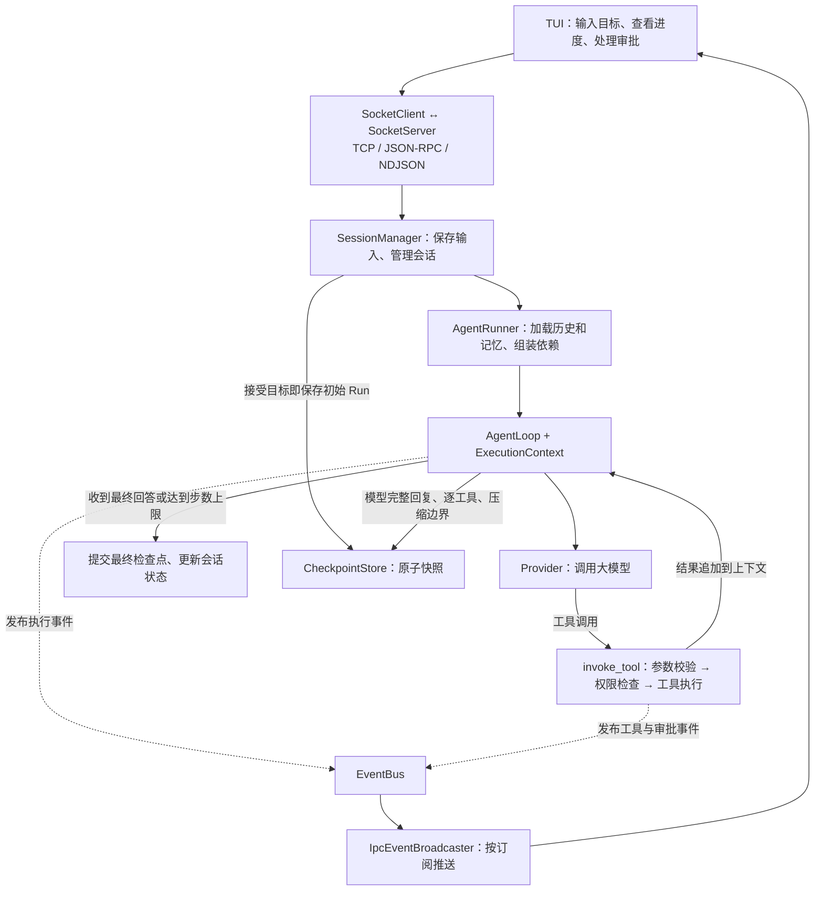

# KamaClaude

一个基于 Python 的本地 AI Agent 项目：用户通过终端输入目标，Core 调用大模型，由模型选择工具完成任务，前端实时展示回答、工具进度和权限审批。

本分支为 **S8：基于检查点的会话断点恢复**。在 S0–S7 的通信、Agent 循环、TUI、会话、权限、记忆与压缩、Skills、子 Agent 和 MCP 基础上，支持 TUI 断线后重新观察，以及 Core 重启后由用户确认继续主 Agent 任务。

## 先抓住这几个关键点

- **前后端分进程**：`kama-tui` 是主要交互界面；`kama-core` 执行任务。两者通过 TCP 连接，以 JSON-RPC 表达请求，以 NDJSON 的换行分隔消息；CLI 用于快速调试。
- **Session → Run → Step**：Session 是一段会话；每次用户输入触发一个 Run；一个 Run 可以包含多个 Step，每个 Step 调用一次模型，并处理这次回复里的工具调用。
- **Runner 组装，Loop 执行**：Runner 准备历史、模型、工具和记录器；Loop 反复执行“调用模型 → 执行工具 → 追加结果”，直到模型结束或达到步数限制。
- **模型提出调用，程序真正执行**：模型只返回工具名和参数；代码负责查找工具、校验参数、检查权限、执行并返回结果。
- **请求和事件分开理解**：请求用于发起操作、取得响应；事件用于持续报告 token、工具状态、审批和任务结束。它们共用同一条 TCP 连接。

## 一次任务怎样完整执行



1. **连接并打开会话**：TUI 连接 Core 并启动接收循环；选择旧会话或创建新会话，再通过 `session.open` 同步快照并绑定会话事件。断线后重新绑定原会话。
2. **发送用户输入**：TUI 调用 `session.send_message`。SocketServer 按方法名分发给 CoreApp，再进入 SessionManager；同一会话通过锁防止同时执行多个 Run。
3. **准备上下文**：SessionManager 解析 `/skill`，将用户输入和初始 Run 原子提交到 `checkpoint.json` 后才登记后台任务。Runner 加载历史、笔记、全局/项目记忆，创建工具注册表和 ExecutionContext。
4. **开始模型与工具循环**：Loop 把消息和工具 Schema 交给 Provider。模型返回工具调用时，`invoke_tool()` 校验参数、检查权限、限时执行工具，并将结果追加到上下文，供下一步模型继续判断。
5. **实时反馈与审批**：执行过程向 EventBus 发布事件；广播器将匹配订阅的事件推给 TUI。需要审批时，Core 等待 Future，TUI 发回 `permission.respond` 后继续执行。
6. **按需扩展与压缩**：模型可以调用 MCP 工具或 `spawn_agent`；启用自动压缩时，Loop 会在工具结果追加后检查上下文占比。用户也能在会话空闲时输入 `/compact` 手动压缩。
7. **结束或中断**：模型返回 `end_turn` 时标记成功，达到步数上限时失败；异常中断保留恢复位置。先提交结果再发布终态；chat 会话等待输入，one_shot 会话关闭。中断任务由用户确认后续跑。

`session.send_message` 的响应要等本次 Run 执行完，但中间事件会持续推送。CLI 的 `agent.run` 则先返回 `run_id`，再通过事件观察任务结束。

## 关键组件与代码入口

### 前端、通信和会话

| 组件 | 负责什么、怎样衔接 | 代码入口 |
| --- | --- | --- |
| TUI / CLI | Textual 实现终端界面，展示流式输出、工具与任务状态、审批选项；CLI 复用通信客户端，便于调试 | [tui/app.py](./src/kama_claude/tui/app.py)、[cli/main.py](./src/kama_claude/cli/main.py) |
| SocketClient / SocketServer | 编解码 NDJSON、发送请求和分发响应；客户端按请求 ID 完成等待中的 Future，同时处理事件推送；服务端并发处理请求，使审批响应能在任务执行中被接收 | [transport/](./src/kama_claude/core/transport/) |
| 协议模型 | Pydantic 定义命令、结果、事件与消息信封，约束前后端交换的数据结构 | [bus/](./src/kama_claude/core/bus/) |
| CoreApp | Core 启动入口；创建共享总线、会话/权限/MCP 管理器和 TCP 服务，注册 RPC 方法，退出时清理资源 | [app.py](./src/kama_claude/core/app.py) |
| SessionManager | 管理磁盘会话索引、会话锁和后台 Run；提供列表、打开、手动恢复、关闭和压缩 | [session/manager.py](./src/kama_claude/core/session/manager.py) |
| SessionStore | 优先读取权威检查点，导入旧历史并导出兼容文件；单独保存会话笔记 | [session/store.py](./src/kama_claude/core/session/store.py) |

### 模型执行、工具和权限

| 组件 | 负责什么、怎样衔接 | 代码入口 |
| --- | --- | --- |
| CheckpointStore | 原子保存上下文、执行阶段、工具结果和修订号，恢复不依赖 Trace | [checkpoint.py](./src/kama_claude/core/checkpoint/checkpoint.py) |
| SessionRecovery | 识别 Core 重启遗留的运行，校验继续、重试未知工具或终止的决定；不创建 Task | [recovery.py](./src/kama_claude/core/checkpoint/recovery.py) |
| AgentRunner | 每次 Run 的组装入口；准备 Context、TaskManager、Provider、工具表、压缩器和事件文件，调用 Loop 并保存结果 | [runner.py](./src/kama_claude/core/runner.py) |
| RunPersistence | 绑定本轮 Context 与会话存储，直接提交检查点并导出历史 | [persistence.py](./src/kama_claude/core/checkpoint/persistence.py) |
| ExecutionContext | 持有工作历史和唯一的 RunCheckpoint（context.run）；提供消息操作、状态方法和提示构建 | [context.py](./src/kama_claude/core/context.py) |
| AgentLoop | 驱动多步交互；记录模型回复，执行工具调用并回填 `tool_result`，检查结束条件与自动压缩条件 | [loop.py](./src/kama_claude/core/loop.py) |
| LLMProvider | 提供统一 `chat()` 接口和 `LlmResponse`；Anthropic、OpenAI、DeepSeek 适配各自格式，模型流式输出转为事件 | [llm/](./src/kama_claude/core/llm/) |
| BaseTool / ToolRegistry | BaseTool 声明名称、描述、参数 Schema 和执行方法；Registry 按名称注册/查找工具，并向模型提供 Schema | [tools/base.py](./src/kama_claude/core/tools/base.py)、[tools/registry.py](./src/kama_claude/core/tools/registry.py) |
| invoke_tool | 工具统一执行入口：参数校验 → 权限检查 → 超时控制 → 调用；发布事件，将错误转为 ToolResult，部分运行错误和限流错误可退避重试 | [tools/invocation.py](./src/kama_claude/core/tools/invocation.py) |
| 内置工具 / TaskManager | 文件读取、目录浏览、文件写入、命令执行、笔记保存；四个 Task 工具通过 TaskManager 维护任务清单和状态。清单条目区别于 `asyncio.Task` | [tools/builtin/](./src/kama_claude/core/tools/builtin/)、[task/](./src/kama_claude/core/task/) |
| PermissionManager / policy / storage | policy 定义规则与决策类型，storage 读写持久化决策；运行时由 Manager 的 `check_and_wait()` 检查规则/缓存，必要时等待用户审批 | [permissions/](./src/kama_claude/core/permissions/) |

### 记忆与扩展能力

| 组件 | 负责什么、怎样衔接 | 代码入口 |
| --- | --- | --- |
| Memory / Notes | Runner 将全局、项目 Markdown 和会话笔记加入系统提示；`note_save` 可保存会话笔记。当前是文本注入，没有向量检索 | [memory/loader.py](./src/kama_claude/core/memory/loader.py)、[note_save.py](./src/kama_claude/core/tools/builtin/note_save.py) |
| Budget / Compactor | Budget 截断加载历史中的过长工具结果；Compactor 调模型生成摘要。手动压缩备份并改写会话历史，自动与手动压缩后的工作历史都提交检查点，后续 Run 与 Core 重启继续使用 | [compact/](./src/kama_claude/core/compact/) |
| SkillLoader | 从项目、用户、内置目录按优先级读取 Markdown Skill；`/名称 参数` 为本次 Run 提供提示模板和工具白名单 | [skills/](./src/kama_claude/core/skills/) |
| AgentProfileLoader | 从 TOML 读取子 Agent 角色的提示和工具白名单，内置 planner、executor、reviewer；它与 Skill 模板承担不同的配置职责 | [agents/](./src/kama_claude/core/agents/) |
| SpawnAgentTool / BackgroundTaskRegistry | `spawn_agent` 在同一 Core 进程内创建独立上下文、工具表和 Loop；前台调用等待结果，后台调用返回 ID，再由 `agent_result` 查询 | [subagent/](./src/kama_claude/core/subagent/) |
| McpServerManager / McpClient / McpTool | Manager 管连接生命周期；Client 完成握手、工具发现和调用；McpTool 将外部工具包装成 BaseTool，进入统一工具执行路径 | [mcp/](./src/kama_claude/core/mcp/) |

### 事件与可观测性

| 组件 | 负责什么、怎样衔接 | 代码入口 |
| --- | --- | --- |
| EventBus | Core 内部的发布/订阅总线，按注册顺序 `await` 订阅者；让执行逻辑只需发布事件，由各订阅者负责展示或记录 | [events/bus.py](./src/kama_claude/core/events/bus.py) |
| IpcEventBroadcaster | 本身是总线订阅者；保存客户端连接及订阅条件，按 topic 和 scope 过滤后，经 TCP 将事件推送到客户端 | [transport/ipc_broadcaster.py](./src/kama_claude/core/transport/ipc_broadcaster.py) |
| EventWriter / TraceWriter / TracingProvider | EventWriter 记录业务事件；TraceWriter 通过队列记录 IPC、事件、模型调用等链路信息；TracingProvider 包装真实 Provider 以记录模型请求/响应 | [events/writer.py](./src/kama_claude/core/events/writer.py)、[trace/](./src/kama_claude/core/trace/) |
| Config / Logging | 汇总默认值、全局/项目 TOML、`.env` 和系统环境变量；初始化 Core 日志。已有系统环境变量优先于 `.env`，TUI 单独写日志文件 | [config.py](./src/kama_claude/core/config.py)、[logging_setup.py](./src/kama_claude/core/logging_setup.py) |

事件广播可以记成：`Loop / 工具 → EventBus.publish() → 广播器.handle() → TCP → 客户端接收循环 → TUI 更新`。总线在 Core 内，前端通过广播器间接接收事件。

权限审批在此基础上形成往返：`工具等待 Future → permission.requested 事件 → TUI 选择 → permission.respond 请求 → Manager 完成 Future → 放行或拒绝工具`。

## 启动与使用

环境：Python **3.12**、uv，支持 Windows、macOS 和 Linux。从项目根目录运行，项目配置及相对文件路径均受当前工作目录影响；Windows Core 可通过 Ctrl+C 进入清理流程。

```text
uv sync
```

在项目根目录创建 `.env`，例如使用仓库当前默认的 DeepSeek Provider：

```dotenv
DEEPSEEK_API_KEY=替换为你的密钥
KAMA_LLM_DEFAULT_MODEL=deepseek-flash
KAMA_MAX_STEPS=20
```

模型名为项目示例，需按实际账号可用模型填写。Runner 默认实例化 `DeepseekProvider`，但配置内模型默认值和 `.env.example` 仍是 Anthropic 示例，因此需显式设置模型名。当前没有通过环境变量切换 Provider 的开关。

终端一启动 Core：

```text
uv run kama-core
```

终端二启动主要交互界面：

```text
uv run kama-tui
```

默认连接 `127.0.0.1:7437`。启动时可选择历史会话；Ctrl+O 切换会话，Ctrl+Q 退出界面但保留会话，Ctrl+W 显式关闭会话。中断任务点击“继续任务”，结果未知的工具需核实后重试或终止。可输入普通目标、`/review` 等 Skill，或在会话空闲时用 `/compact` 压缩历史；工具审批在 TUI 中完成。

CLI 调试也需要 Core 运行：

```text
uv run kama ping
uv run kama run --goal "请使用 read_file 读取 README.md，并介绍这个项目"
uv run kama chat
```

三家 Provider 均位于 [provider.py](./src/kama_claude/core/llm/provider.py)：Anthropic 使用 Messages API，OpenAI 在类内转换消息与工具格式，DeepSeek 复用 Anthropic 兼容接口。切换其他平台需在代码中注入对应 Provider；OpenAI 适配还需安装 `openai` SDK，当前依赖未自动包含它。

## 数据保存在哪里

`~` 表示当前用户主目录；以下为默认位置，可配置的路径以实际配置为准。

| 路径 | 内容 |
| --- | --- |
| `~/.kama/sessions/<session_id>/checkpoint.json` | 权威工作历史、会话与 Run 状态、工具游标和结果 |
| 同目录 `meta.json` | 兼容元数据输出；恢复以检查点为准 |
| 同目录 `thread.jsonl` / `notes.md` | 模型对话历史 / 主动保存的会话笔记 |
| 同目录 `runs/<run_id>/events.jsonl` | 本次 Run 的业务事件；`.tasks/` 保存任务清单 |
| `~/.kama/context.md` / `.kama/context.md` | 全局记忆 / 当前项目记忆，需自行维护文件 |
| `~/.kama/policy.toml` | 持久化权限决策 |
| `~/.kama/traces/daemon.jsonl` | IPC、事件和模型调用追踪 |
| `~/.kama/logs/core.log` / `tui.log` | 后端与前端的程序日志 |

Core 可用 `KAMA_SESSIONS_DIR` 指定会话根目录。直接在代码中运行不带 Session 的 Runner 时，Run 文件默认保存在当前目录的 `runs/<run_id>/`。

## 当前边界与后续改进

- **断点恢复**：已支持主 Agent 的逐模型/逐工具检查点、TUI 重连和 Core 重启后的手动恢复；不恢复外部进程，不自动重放结果未知的操作，不恢复未完成子任务树。
- **上下文保存**：自动/手动压缩后的工作历史由检查点保存，不再按旧下标追加；自动压缩默认仍关闭，请求前预算和摘要质量仍可改进。
- **后台子任务**：任务注册表属于每个 Runner，而会话每次输入都会创建新 Runner，跨 Run 查询和生命周期管理仍需完善；子 Agent 共享进程和工作区，不提供进程级隔离。
- **权限与 MCP**：审批是应用层控制，尚无操作系统沙箱；MCP 当前支持 stdio 和自定义 TCP NDJSON 连接，未实现 Streamable HTTP，工具结果的 `isError` 等语义仍需完善。

## 开发与文档

```text
uv run python -X utf8 -m pytest tests/unit tests/integration/test_s8_recovery.py tests/integration/test_s5_permission_flow.py tests/integration/test_s4_session_ipc.py tests/integration/test_s2_dual_process.py tests/integration/test_ping_roundtrip.py -q
uv run ruff check src tests scripts
uv run mypy src
uv run python -X utf8 scripts/gen_protocol_doc.py --check
```

测试命令验证代码行为，真实模型端到端测试还需对应 API key 和模型配置。当前非付费验证为 340 项通过；mypy 和协议检查通过。全仓仍有 19 条既有 Ruff 问题，S8 改动文件检查通过；Windows 下协议文档检查使用 `-X utf8` 避免默认编码差异。

- [S8 中断与恢复链路速查](./docs/S8-中断与恢复链路速查.md)：从选择历史会话到恢复执行，以及中断前后的状态变化。
- [S8 断点恢复使用与实现](./docs/S8-断点恢复使用与实现.md)：使用方法、提交边界、恢复接口和验证。
- [二次开发改进大纲](./docs/S8-二次开发改进大纲.md)：S0–S7 的改进选题记录，按改进前的基线阅读。
- [RUNBOOK.md](./RUNBOOK.md)：配置、运行与故障排查。
- [WIRE_PROTOCOL.md](./WIRE_PROTOCOL.md)：根据协议模型生成的 IPC 说明。

本分支新增文档限于 `docs/S8-*.md`；面试文档更新放在 `dev`。`dev` 独立维护项目总览，不合入 S8 学习说明与链路速查。本地 `workspace/` 练习、运行数据和密钥不上传；忽略规则不影响已跟踪文件，合并时仍需核对文档范围。
