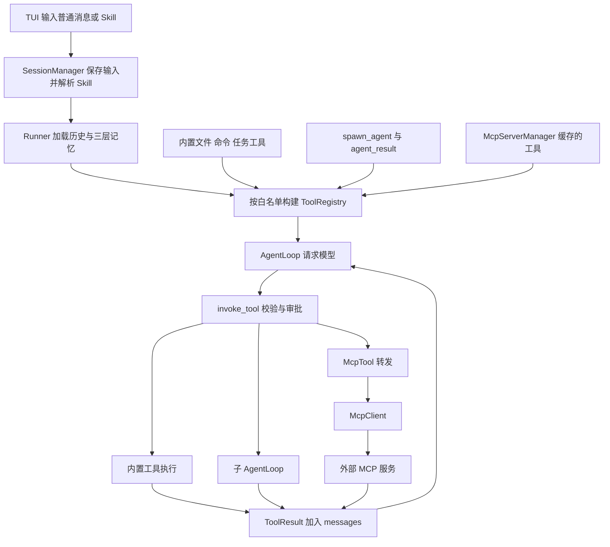
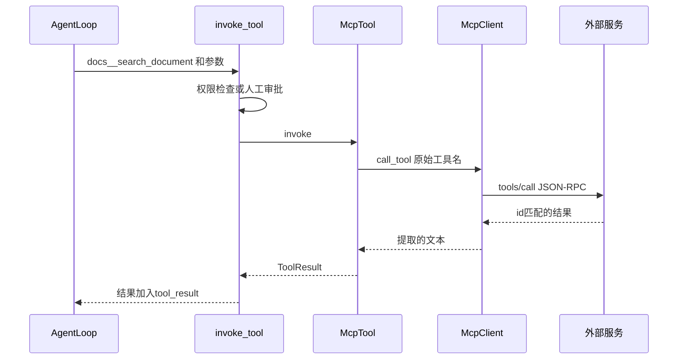

# KamaClaude · S7 Skills、子 Agent 与 MCP

S7 在已有会话、工具审批、记忆和压缩之上增加三种扩展：Skill 描述一类任务的工作方式；子 Agent 用独立上下文执行子任务；MCP 将外部服务的工具包装进现有 ToolRegistry。

本文按当前 `stage/s7` 实际代码讲解，包含前序同步的 DeepSeek/OpenAI、Windows Core 清理和手动压缩后端兼容。TUI 是主要交互入口。阅读时优先追踪“谁提供提示词、谁注册工具、谁真正执行”，不要把配置文件里的说明当成程序已经强制实现的行为。

推荐入口：[SessionManager.send_message](./src/kama_claude/core/session/manager.py) 观察 Skill 解析，再到 [AgentRunner._build_registry](./src/kama_claude/core/runner.py) 看内置工具、子 Agent 工具和 MCP 工具怎样汇合。

**当前边界：后台子任务注册表尚未形成跨轮共享与持久恢复；Skill 参数渲染与实际模型输入没有完全对齐；MCP 只实现当前代码中的 stdio/TCP 与部分工具能力；S6 自动压缩的历史保存缺陷仍然存在。后文会把这些问题与改进方案分开说明。**

## 先回答几个核心问题

### 1. Skill、工具和 Agent Profile 分别是什么？

| 概念 | 作用 | 例子 |
| --- | --- | --- |
| Tool | 可以实际执行的能力，有名称、参数描述和 invoke | read_file、spawn_agent、MCP 工具 |
| Skill | 一类任务的提示模板与工具白名单 | /review、/summarize |
| Agent Profile | 子 Agent 的角色提示与工具范围 | planner、executor、reviewer |

Skill 本身不执行 Python 工具，也不自动创建新进程。它改变主任务的提示和工具注册。Profile 用于子 Agent；配置中的 model 字段目前没有驱动后端切换。

### 2. /orchestrate 是程序写死的三阶段流水线吗？

不是。它提供协调者提示和 spawn_agent 等工具，引导模型按规划、执行、审查组织工作。模型仍然决定是否调用、调用顺序与具体参数，不能仅凭输入了命令就认定三个角色都已运行。

### 3. 子 Agent 是新的进程吗？

当前不是。它在 Core 中创建新的 ExecutionContext、EventBus、工具表和 AgentLoop；后台模式额外创建 asyncio.Task。父子共享进程，通常也操作同一工作目录。上下文分开不等于文件系统隔离。

### 4. 子 Agent 会看到父任务完整历史和三层记忆吗？

不会自动继承。子 Context 主要从传入的 prompt 和角色 system 开始，不走完整 Runner 的历史与记忆加载流程。父任务需要在 prompt 中提供目标、约束和必要数据。子工具表也不是父表的完整副本。

### 5. MCP 模块是自己提供一个服务端吗？

本项目主要作为 MCP 客户端连接外部工具服务。server.py 的 McpServerManager 是管理多个服务连接的对象，不是外部服务的实现。默认服务列表为空，需要配置对应服务才会发现工具。

### 6. 模型会直接连接 MCP 服务吗？

不会。模型只看到工具 schema 并返回调用请求。Core 的 McpTool、McpClient 才负责发送 tools/call，再把结果作为 ToolResult 交回模型。

### 7. 工具白名单能代替 S5 权限审批吗？

不能。白名单决定本轮注册哪些工具；权限检查决定某次具体调用是否放行。MCP、spawn_agent、agent_result 等没有登记默认策略时会走 ASK 兜底；已有长期决定也参与判断。角色中写“只读”也不能把允许的任意 bash 自动变成严格只读工具。

### 8. 后台任务返回 run_id，下一轮就一定能拿到结果吗？

当前不能保证。注册表在 AgentRunner.__init__ 中创建，而 SessionManager 每轮通常创建新 Runner。当前 Runner 内部可以注册和查询任务，但跨轮、断线、Core 重启后的定位与恢复仍需补齐，不能只依据“跨 run 共享”的注释推断。

### 9. S7 是不是完整的多 Agent 平台和 MCP SDK？

当前是教学实现：支持基本角色、前后台子任务和部分 MCP 工具调用，没有完整的任务持久化、严格资源隔离、所有协议传输与内容类型支持。准确理解已有边界，比只记功能名称更重要。

## S6 → S7 的变化地图

| 部分 | S6 | 当前 S7 |
| --- | --- | --- |
| 主任务入口 | 普通消息、/compact | 解析 /技能名 参数 |
| 系统提示 | 基础提示与三层记忆 | 增加 system_prompt_override |
| 工具注册 | 内置工具、note_save | 白名单过滤、子 Agent 工具、MCP 包装工具 |
| 子任务 | 没有独立执行循环入口 | spawn_agent、agent_result |
| 角色 | 无角色加载器 | TOML 配置，项目/全局/内建查找 |
| 外部工具 | 主要在仓库内实现 | MCP 服务连接、工具发现、调用适配 |
| 模型消息 | 文本和 tool_use | 增加 thinking_blocks 的保留与回传 |
| TUI | 聊天、审批、压缩 | 斜杠命令补全、Skill 与子任务事件展示 |
| Socket | 原有帧上限与清理 | 64 MiB 单帧上限、活跃连接关闭 |

Skills 和子 Agent 不会替代 S5 的工具校验、审批和重试。S6 的背景文件、手动压缩与默认关闭的自动压缩也继续存在。

## 整体流程：三块能力在哪里接入



### Core 启动时

1. 加载配置、日志和 Trace，准备总线、权限管理器、会话存储。
2. 创建 McpServerManager。按配置依次连接服务、初始化、发现工具，缓存客户端与包装工具。
3. 创建 SessionManager，传入 Runner 工厂；工厂把同一个 MCP 管理器传给每轮 Runner。
4. 创建 SocketServer，注册聊天、审批、压缩等 RPC，开始监听。

MCP 连接主要在 Core 启动时建立，不是每个 run 都重新启动服务。某个服务失败时记录日志并继续尝试其他配置；当前失败路径的资源收尾仍有不足。

### 输入 /review src 之后

1. TUI 通过 session.send_message 发送原始内容。
2. SessionManager 检查会话、持锁，将原始输入先写 thread，登记 run_id。
3. 发现 / 前缀，查找 Skill，准备 goal、system_prompt_override、tool_whitelist，发布 skill.invoked。
4. Runner 读取历史、全局/项目 context 与会话 notes，创建 Context。
5. Runner 创建 Provider，再按白名单注册工具；有 MCP 管理器则从缓存获取外部工具。
6. AgentLoop 用覆盖后的 system 与当前消息请求模型；模型选择工具，仍经过 invoke_tool。
7. 内置工具本地执行，spawn_agent 进入子循环，McpTool 转发到服务。
8. 结果回到主 Context，模型继续，最终保存本轮消息并等待下一次输入。

上述是接线关系，不代表 Skill 模板中的参数一定已正确进入最终 system。当前原始历史优先于 goal、override 未统一渲染的问题在后文展开。

## 快速开始与观察方法

### 环境和启动

使用 Python 3.12.x、uv。Windows 可以使用前台 Core 与 TUI；后台 core start/stop 仍存在 Unix 进程管理假设。以下是 PowerShell 命令，先进入仓库根目录：

```powershell
uv sync
if (-not (Test-Path -LiteralPath .env)) {
    Copy-Item -LiteralPath .env.example -Destination .env
}
```

编辑 `.env`，占位符需要替换：

```dotenv
DEEPSEEK_API_KEY=<你的密钥>
KAMA_LLM_DEFAULT_MODEL=<该接口实际支持的模型ID>
KAMA_HOST=127.0.0.1
KAMA_PORT=7437
KAMA_MAX_STEPS=20
KAMA_PERMISSION_TIMEOUT_S=60
KAMA_COMPACT_THRESHOLD=0
KAMA_LOG_LEVEL=INFO
```

当前 Runner 与手动压缩工厂默认使用 DeepSeek，不会仅根据密钥存在与否自动切换 Provider。内置默认模型名仍偏向 Anthropic，使用其他后端需要显式填写模型。OpenaiProvider 延迟加载 SDK，需要使用时另外安装 SDK 并调整后端创建位置。

配置优先级：默认值 → `~/.kama/config.toml` → `.env` → 已有系统环境变量。下面的 MCP 服务配置放入 TOML，而不是把整段数组表写进 `.env`。

终端一：

```powershell
uv run kama-core
```

终端二：

```powershell
uv run kama ping
uv run kama-tui
```

Core 前台支持 Ctrl+C 清理。子 Agent 文件操作、项目 Skill、项目角色和 `.kama/context.md` 都以 Core 工作目录为基准，不是自动根据 TUI 的启动位置或 session 目录定位项目。

### 观察 Skills 和补全

TUI 输入 `/`，查看候选描述；方向键、Tab 或 Enter 可以选择。选中后只填入 `/技能名 `，需要补充参数再提交，不代表选择瞬间已经执行。

可以尝试：

```text
/review src/kama_claude/core/mcp
```

观察 skill.invoked、实际模型请求和工具列表。审查只是一种提示要求，bash 等仍经过审批；不能仅凭最终文字就证明白名单与模板正确生效。`/compact` 继续由前端作为内建命令单独处理。

### 观察子 Agent

可以明确要求模型实际调用 spawn_agent：

> 请创建一个 planner 子 Agent，读取配置模块并给出改进计划。把路径和“不要修改文件”的约束完整传给它，等待结果后再总结。

检查 subagent.started/finished 与子 run 的事件文件。后台实验应在同一个父 run 内发起并通过 agent_result 查询；跨轮共享目前不可靠。即使工具已注册，模型也可能不选择调用，需要查看实际工具事件。

### MCP 配置示例

以下配置是结构示意，端口和命令必须换成真实、兼容当前实现的服务。

TCP 模式连接已经运行的服务：

```toml
[[mcp.servers]]
name = "docs"
transport = "tcp"
host = "127.0.0.1"
port = 9000
```

stdio 模式启动服务子进程：

```toml
[[mcp.servers]]
name = "local_docs"
transport = "stdio"
command = "C:/path/to/python.exe"
args = ["C:/path/to/mcp_server.py"]
env = { DEMO_MODE = "1" }
```

这里只配置客户端如何连接，仓库不会因此自动生成外部服务。当前没有 HTTP transport，不能把任意 HTTP MCP URL 当作 host 使用。修改配置后重启 Core，观察连接、发现工具与失败日志；外部服务的可执行文件、依赖和访问权限需要自行准备。

## 关键代码一：Skill 文件怎样变成任务配置

源码：[skills/loader.py](./src/kama_claude/core/skills/loader.py)、[session/manager.py](./src/kama_claude/core/session/manager.py)。

### Skill 数据结构与文件

Skill 保存 name、description、system_prompt_template、allowed_tools。内建目录含 init、review、summarize、orchestrate。一个自定义文件可以是：

```markdown
---
name: explain
description: 读取指定模块并解释入口与调用关系
allowed_tools:
  - read_file
  - list_dir
---
你负责解释代码。先说明整体流程，再解释核心方法。
目标：$ARGUMENTS
```

保存到项目 `.kama/skills/explain.md`，或 `.kama/skills/explain/SKILL.md`。frontmatter 是当前自写解析器支持的简单格式，不是完整 YAML 语法支持。

### 核心方法

| 方法 | 作用 |
| --- | --- |
| _parse_skill_file | UTF-8 读取，提取 frontmatter 和正文；支持简单 description 块标量 |
| resolve | 项目 → 用户全局 → 内建，返回第一个命中的 Skill |
| _search_paths | 为每级目录生成 name.md 与 name/SKILL.md 候选 |
| list_all | 列出可用名称 |
| list_all_skills | 解析名称与描述，提供 TUI 候选 |
| render_prompt | 用参数字符串替换正文中的 $ARGUMENTS |

三层目录：项目 `.kama/skills`、用户 `~/.kama/skills`、模块下 builtin。高优先级文件存在但解析失败时，resolve 当前直接返回 None，不会继续尝试低优先级版本。

### SessionManager 的解析顺序与边界

```text
原始消息已保存到 thread
    ↓
若以 / 开头，拆出 skill_name 和 arguments
    ↓
找到 Skill：
  goal = render_prompt(skill, arguments)
  system_prompt_override = 原始模板
  tool_whitelist = allowed_tools 或 None
    ↓
调用 Runner
```

当前问题在于：Runner 读取的历史已经包含原始 `/命令 参数`，Context 优先使用非空 prefill_messages；渲染后的 goal 不会自动再替换当前用户消息。override 也仍是原始模板，可能保留 `$ARGUMENTS`。模型可能从原始输入推断目标，但不能据此认定模板参数已正确注入。

此外，未知 Skill 通常作为普通内容继续运行；直接通过 RPC 输入只有 `/` 的消息时，parts[0] 还可能越界。后续应统一命令校验、渲染后的实际输入和用户可见错误。

## 关键代码二：Runner 怎样统一注册工具

源码：[runner.py](./src/kama_claude/core/runner.py)、[context.py](./src/kama_claude/core/context.py)。

system_prompt_override 非空时替代默认基础提示，随后仍追加全局 context、项目 context 和 session notes。它不会关闭三层记忆，也没有实现提示冲突的强制规则检查。

Runner 在 Provider 准备好后注册工具，主要分为：

```text
文件、命令工具
任务清单工具
session 条件满足时的 note_save
provider/bus/run_id 条件满足时的 spawn_agent、agent_result
MCP 管理器发现并缓存的 McpTool
```

白名单判断的核心片段：

```python
allowed = set(tool_whitelist) if tool_whitelist else None

def _ok(name):
    return allowed is None or name in allowed
```

当前空列表也被当成“没有限制”，不能用 `[]` 表达“禁止所有工具”。MCP 名称需要使用完整的 `服务名__工具名`。白名单只控制注册，不是操作系统沙箱，也不替代调用参数与授权检查。

TaskManager 仍按 run 创建。后台子任务注册表则在每个 Runner 初始化时创建一次；同一个 Runner 的子任务工具共享它，但常规多轮会话会创建新的 Runner。

## 关键代码三：角色配置怎样作用于子 Agent

源码：[agents/loader.py](./src/kama_claude/core/agents/loader.py)。

角色 TOML 示例：

```toml
[agent]
description = "读取并核查指定产出"
system_prompt = "核对实际文件与目标，输出证据和未完成事项。"
allowed_tools = ["read_file", "list_dir"]
model = "example-model"
```

AgentProfileLoader.load 依次查项目 `.kama/agents/角色名.toml`、用户 `~/.kama/agents/角色名.toml`、builtin。_parse 使用 tomllib 读取 [agent]，得到描述、system、工具列表和 model。

| 内建角色 | 提示定位 | 实际工具范围示意 |
| --- | --- | --- |
| planner | 分析目标与制定计划 | 读文件、列目录、部分任务工具 |
| executor | 按计划执行操作 | 文件、命令、部分任务工具 |
| reviewer | 核查产出 | 读文件、列目录、bash |

model 字段目前只解析保存，子任务仍使用传入的 Provider。角色未找到时可以退回默认子任务行为，不一定返回严格错误。文字中的“只读”不会自动限制 bash 的命令语义。

## 关键代码四：spawn_agent 怎样执行前台子任务

源码：[subagent/tool.py](./src/kama_claude/core/subagent/tool.py)。

主要参数是 description、prompt、run_in_background、subagent_type。description 用于进度展示，prompt 才是传给子 Agent 的完整目标与背景。

```text
校验参数和嵌套深度
    ↓
加载可选角色 Profile
    ↓
生成 child_run_id
    ↓
创建只有子任务 prompt、角色提示等内容的新 Context
    ↓
创建 child_bus、子工具表、child_loop
    ↓
发布 subagent.started
    ↓
前台 await child_loop.run(child_context)
    ↓
发布 subagent.finished
    ↓
将最终文本或失败包装成父任务的 ToolResult
```

子任务没有走完整 AgentRunner，因此不会自动加载父历史、三层记忆、note_save、父 MCP 工具和压缩器。_build_child_registry 单独构建文件、命令、任务工具，按 Profile 过滤，并在允许深度内加入嵌套派生与查询工具。

子任务复用父 Provider 和权限管理器，使用自己的 Context、总线、工具表、TaskManager 与事件目录。它在同一个 Core 内执行，不是独立进程；文件访问仍可能互相影响。深度限制防止无限派生，不等于并发量和总 token 预算已经受控。

### 子事件怎样出现在父界面

```python
async def _bridge(event):
    await self._parent_bus.publish(event)

child_bus.subscribe(_bridge)
```

child_bus 发布事件时，桥接函数转发到 parent_bus，随后由广播器发给 TUI。subagent.started/finished 还携带父子 run 关联，界面据此展示子任务进度。事件桥接不意味着父 Context 自动获得子任务每一条历史，父模型主要通过返回 ToolResult 得到结果。

## 关键代码五：后台运行与 agent_result

后台分支会：

```python
task = asyncio.create_task(background_coroutine)
task_registry.register(child_run_id, task, child_context)
```

然后立即返回 child_run_id，父 Agent 可以继续执行。这里的立即是工具内部启动后的返回；外层工具调用仍可能先经过 S5 的审批。

BackgroundTaskRegistry 的方法很少：register 保存 `(task, context)`，get 按 run_id 查询，all 返回所有条目。all 本身不会取消任务；需要有调用方明确执行清理，不能仅根据类注释推断退出已完整处理。

AgentResultTool.invoke 的分支如下：

| 状态 | 返回 |
| --- | --- |
| 没找到 run_id | 错误，只有已登记后台任务可查 |
| task 未完成 | still running |
| task 被取消 | 取消错误 |
| task 有未处理异常 | 异常错误 |
| 正常协程结束 | context.result 或默认提示 |

当前最后一条并没有完整校验 context.status：子 Loop 可能正常返回但业务状态 failed，查询结果仍不一定标为错误，需要后续完善。

**生命周期边界：** 注册表属于 Runner。常规新一轮会换 Runner，之前的后台 ID 不会自动转移；任务也没有磁盘恢复。父 run 结束、连接断开、Core 退出时的后台管理尚未形成完整闭环。当前适合在同一父运行中演示，不应声称支持可靠跨会话任务中心。

## MCP 模块：先分清两条通信链

```text
TUI ←→ Core
  SocketClient / SocketServer
  聊天命令、审批响应、界面事件

Core ←→ 外部 MCP 服务
  McpClient
  initialize、tools/list、tools/call
```

模型只输出工具调用名称与参数，真正连接服务的是 Core。stdio 模式的外部服务是新子进程；TCP 模式连接已有服务，这与在 Core 内运行的子 Agent 不同。

### 三个文件分别做什么

| 文件 | 核心对象 | 职责 |
| --- | --- | --- |
| [mcp/client.py](./src/kama_claude/core/mcp/client.py) | McpClient | 管道/TCP、JSON-RPC 收发与响应匹配 |
| [mcp/server.py](./src/kama_claude/core/mcp/server.py) | McpServerManager | 多服务连接、工具发现、缓存、关闭 |
| [mcp/tool.py](./src/kama_claude/core/mcp/tool.py) | McpTool | 将外部工具适配成 BaseTool |

server.py 没有实现一个外部 MCP 服务端。一个 McpClient 对应一个服务连接，一个服务可以产生多个 McpTool，共享这个客户端。

## 关键代码六：MCP 连接、握手与工具发现

### start_all 和 _connect

Core 调用 manager.start_all(config.mcp.servers)，依次：

```text
根据 transport 建立连接
    ↓
initialize 请求与 initialized 通知
    ↓
tools/list 获取工具描述
    ↓
每项工具包装为 McpTool
    ↓
缓存 client 与工具列表，供 Runner 使用
```

stdio 的 connect_stdio 使用 create_subprocess_exec，将参数列表直接传给进程，合并当前环境与配置 env。保存 stdout 作为 reader，使用进程 stdin 写请求；stderr 单独后台消费。

TCP 的 connect_tcp 用 asyncio.open_connection 获取 reader/writer，不启动服务进程。两种模式都调用 _initialize。

### 初始化的两个消息

当前代码发送的版本值是固定的，下面是结构示例：

```json
{
  "jsonrpc": "2.0",
  "id": 1,
  "method": "initialize",
  "params": {
    "protocolVersion": "2024-11-05",
    "capabilities": {},
    "clientInfo": {"name": "kama-claude", "version": "0.1"}
  }
}
```

收到响应后再发送无 id 的通知：

```json
{"jsonrpc":"2.0","method":"notifications/initialized","params":{}}
```

请求需要匹配响应，通知不等待对应响应。当前没有完整验证所有协商能力与版本，不应把握手返回当成完整协议支持。

### list_tools 与 McpToolDef

list_tools 调用 `_call("tools/list", {})`，从结果 tools 数组中提取 name、description、inputSchema，转换成 McpToolDef。管理器用这些描述创建 McpTool。

工具发现阶段还没有执行具体业务工具，也没有让模型调用。Core 退出时 stop_all 遍历已登记客户端执行 close。启动中途失败的客户端可能还没登记，资源清理仍需加强。

## 关键代码七：McpTool 怎样适配普通工具

假设服务名为 docs，服务原工具名为 search_document，则本项目暴露给模型的是：

```text
docs__search_document
```

前缀避免多个服务同名工具冲突。构造方法把服务 description、input_schema 放入 BaseTool 属性，并持有对应 client。

Runner 在每轮工具表里注册它；真正调用时：

```python
content = await self._client.call_tool(
    self._tool_def.name,
    dict(params),
)
return ToolResult(content=content)
```

发给服务的仍是原始 search_document，不是带 docs__ 的名称。模型不需要知道这次工具经过了哪条网络连接，AgentLoop 也无需为每个服务写分支。

McpTool.params_model=None，表示没有 Pydantic 本地参数模型；服务的 inputSchema 会展示给模型，但当前调用入口没有对该 JSON Schema 做完整本地校验。外部工具仍走权限检查，不能认为发现成功就自动授权。

## 关键代码八：McpClient 怎样调用并匹配响应



### _call：串行发送并读取自己的响应

```python
self._id += 1
request_id = self._id

async with self._lock:
    await self._write_line(request_json)
    # 循环读取，寻找 ID 与 request_id 相符的响应
```

锁覆盖发送到收到结果的整个过程，因此同一个 McpClient 同时只有一个在途请求，不是 SocketClient 那种独立接收循环加多个 pending Future 的设计。

当前读取循环：非 JSON 行跳过；没有 id 的消息按服务通知忽略；ID 转成字符串后匹配，以兼容数字 3 与字符串 "3"；匹配到顶层 error 则抛 McpToolError，否则返回 result。不同 ID 的响应没有完整的暂存与分发机制。

tools/call 请求示例：

```json
{
  "jsonrpc": "2.0",
  "id": 3,
  "method": "tools/call",
  "params": {
    "name": "search_document",
    "arguments": {"query": "配置优先级"}
  }
}
```

### _write_line、_read_line 与 drain

发送时序列化 JSON、追加换行并编码，write 写入缓冲区，drain 在缓冲区达到背压条件时等待。drain 不表示服务已收到或执行完，请求完成由后面的响应匹配决定。

stdio 写入子进程 stdin；TCP 写入网络 writer。读取使用 readline，跳过空白行，只有 b"" 才视为 EOF。单次 readline 最多等待 30 秒，读取上限 64 MiB；其他消息会让循环再次读取，所以它不是整个请求的严格 30 秒总时限。外层 invoke_tool 还有自己的工具执行时限。

### 为什么单独读取 stderr

stdio 服务的 stdout 承载协议消息，stderr 承载日志。后台 _drain_stderr 持续消费日志，避免管道写满后服务阻塞。当前容忍 stdout 的非 JSON 行，不代表应当把大量普通日志写入协议输出。

### call_tool 的结果与错误

当前只拼接 content 数组中 type=text 的内容，忽略图片等其他类型。JSON-RPC 顶层 error 会抛 McpToolError；但 tools/call 结果内的 isError 标记还没有被检查，可能把部分工具业务失败当成成功。

McpTool 捕获连接、RPC 和其他普通异常，转换为 error_type=runtime_error 的 ToolResult，因而可能进入 S5 自动重试。有副作用的外部工具可能不适合重复执行，当前没有按工具幂等性细分。

### close 与 stop_all

先取消 stderr 读取任务；stdio 尝试 terminate 并等待最多 5 秒，失败时尝试 kill；TCP 关闭 writer 并等待关闭。stop_all 对已登记客户端逐个清理。失败后的子进程回收、重连、工具缓存失效和全调用截止时间仍可完善。

## TUI、thinking 消息和传输修改

TUI 的 ChatTextArea 在输入以 / 开头且没有空格时发出 SlashChanged 界面消息；App 挂载 SlashCompleteWidget 并按前缀筛选。选择后由 Selected 消息填入 `/名称 `。这条 Textual 本地消息链不是 Core 的事件总线。

候选来自内建 compact 与 SkillLoader.list_all_skills，通常在应用初始化时构建；运行中新建 Skill 不一定立即刷新菜单。前后端若从不同工作目录启动，也可能看到不同项目级 Skill。

skill.invoked 展示技能名称与参数，subagent.started/finished 展示父子运行关系。子总线桥接仍可能让没有充分按 run 过滤的全局事件影响其他界面，不能据此认定多会话展示已经完全隔离。

S7 新增 LlmResponse.thinking_blocks，Anthropic/DeepSeek 路径提取 thinking 与 signature，AgentLoop 将其放在 assistant 内容前面回传。保留消息块不等于自动开启所有模型的思考模式，也不表示 OpenAI 与 Anthropic 格式可无条件互换。

Socket 的单帧上限提高到 64 MiB，并在停止时关闭活跃 writer；这不是应用整体内存与请求并发上限。Core 的 Windows 信号处理、finally 清理和 MCP stop_all 已合在同一退出路径中。

## 文件位置与排错入口

```text
Core工作目录/.kama/
  context.md                 项目背景
  skills/名称.md             项目 Skill
  skills/名称/SKILL.md       另一种 Skill 格式
  agents/角色.toml           项目角色

用户目录/.kama/
  config.toml                MCP 等配置
  context.md                 全局背景
  policy.toml                工具长期权限决定
  skills/                    用户全局 Skill
  agents/                    用户全局角色
  sessions/会话ID/
    meta.json
    thread.jsonl
    notes.md
    runs/父runID/events.jsonl
    runs/子runID/events.jsonl
    runs/子runID/.tasks/      实际创建任务后才出现
  traces/daemon.jsonl         默认 Trace
  logs/core.log              Core 日志
  logs/tui.log               TUI 日志
```

子任务结果不是自动完整追加成父 thread 的独立对话。前台通常以 spawn_agent 的 tool_result 返回；后台需要父模型查询，注册表本身没有持久化。事件文件也不能替代任务恢复索引。

没有 MCP 工具时，先看 Core 启动连接与工具发现日志；出现工具但不执行，检查 Skill 白名单、权限与模型实际选择；后台 ID 查不到，检查是否换了 Runner，而不是只看文件目录是否仍在。

## 不连接真实模型或外部服务的学习实验

下面的独立脚本在临时项目中加载一个 Skill 和角色，再用假客户端验证 MCP 工具前缀、注册与调用转发。不启动子 Agent、不请求模型、不连接 MCP 服务，也不修改真实项目配置。

```python
import asyncio
import os
from pathlib import Path
from tempfile import TemporaryDirectory
from types import SimpleNamespace
from unittest.mock import AsyncMock

from kama_claude.core.agents.loader import AgentProfileLoader
from kama_claude.core.events.bus import EventBus
from kama_claude.core.llm.types import ToolCallBlock
from kama_claude.core.mcp.client import McpToolDef
from kama_claude.core.mcp.tool import McpTool
from kama_claude.core.skills.loader import SkillLoader
from kama_claude.core.tools.invocation import invoke_tool
from kama_claude.core.tools.registry import ToolRegistry


# 使用临时项目与假客户端验证文件加载和 MCP 适配。
async def main():
    original = Path.cwd()
    with TemporaryDirectory() as temporary:
        root = Path(temporary)
        skill_file = root / ".kama/skills/explain.md"
        skill_file.parent.mkdir(parents=True)
        skill_file.write_text(
            "---\nname: explain\ndescription: 解释模块\n"
            "allowed_tools:\n  - read_file\n---\n目标：$ARGUMENTS",
            encoding="utf-8",
        )
        profile_file = root / ".kama/agents/auditor.toml"
        profile_file.parent.mkdir(parents=True)
        profile_file.write_text(
            '[agent]\ndescription="核查"\nsystem_prompt="核对产出"\n'
            'allowed_tools=["read_file"]\n',
            encoding="utf-8",
        )
        try:
            os.chdir(root)
            loader = SkillLoader()
            skill = loader.resolve("explain")
            assert skill is not None
            assert loader.render_prompt(skill, "config.py") == "目标：config.py"
            profile = AgentProfileLoader().load("auditor")
            assert profile is not None and profile.allowed_tools == ["read_file"]

            client = SimpleNamespace(call_tool=AsyncMock(return_value="找到配置说明"))
            tool = McpTool(client, "demo", McpToolDef(
                name="search", description="搜索说明",
                input_schema={"type": "object", "properties": {"query": {"type": "string"}}},
            ))
            registry = ToolRegistry()
            registry.register(tool)
            result = await invoke_tool(
                registry,
                ToolCallBlock(id="call-demo", name="demo__search", input={"query": "配置"}),
                EventBus(), "run-demo",
            )
            assert not result.is_error and result.content == "找到配置说明"
            client.call_tool.assert_awaited_once_with("search", {"query": "配置"})
            print("Skill、角色加载与 MCP 工具适配均通过")
        finally:
            os.chdir(original)


asyncio.run(main())
```

这个实验只证明 render_prompt 方法自身可替换参数，不能证明 SessionManager 已把结果正确放入真实模型请求。示例没有注入 PermissionManager，因此也没有演示审批；完整运行应核对真实 Core 的注入链。

## 阅读顺序与验证命令

1. [session/manager.py](./src/kama_claude/core/session/manager.py)：普通消息与 Skill 解析的分支。
2. [runner.py](./src/kama_claude/core/runner.py)：提示覆盖、白名单和三种工具来源。
3. [skills/loader.py](./src/kama_claude/core/skills/loader.py)、[agents/loader.py](./src/kama_claude/core/agents/loader.py)：文件如何变成配置对象。
4. [subagent/tool.py](./src/kama_claude/core/subagent/tool.py)、[registry.py](./src/kama_claude/core/subagent/registry.py)：前台等待、后台任务、事件桥接与结果查询。
5. [mcp/tool.py](./src/kama_claude/core/mcp/tool.py)：从普通 ToolResult 理解适配层。
6. [mcp/server.py](./src/kama_claude/core/mcp/server.py)、[client.py](./src/kama_claude/core/mcp/client.py)：发现工具，再追握手与 _call。
7. [tui/app.py](./src/kama_claude/tui/app.py)：命令补全、界面消息和子任务事件。

| 已有测试 | 重点 |
| --- | --- |
| tests/unit/test_skill_loader.py | Skill 解析、路径优先级与参数替换 |
| tests/unit/test_agent_profile_loader.py | 角色加载与覆盖 |
| tests/unit/test_spawn_agent_tool.py | 子任务前后台、深度与查询 |
| tests/unit/test_mcp_tool.py | 包装名称、参数转发、错误转换 |
| tests/unit/test_stage_provider_compat.py | 压缩后端按需创建、OpenAI system 与用量 |
| tests/unit/test_core_app.py | Windows/Unix 退出、服务器与 MCP 清理 |

```powershell
uv run pytest tests/unit tests/integration/test_s5_permission_flow.py -q
uv run pytest tests/integration/test_ping_roundtrip.py tests/integration/test_s4_session_ipc.py -q
uv run ruff check src tests/unit tests/integration scripts
uv run mypy src
uv run python -X utf8 scripts/gen_protocol_doc.py --check
```

单元测试使用假 Provider/客户端，不等于已验证任意真实模型或 MCP 服务。真实 Core fixture 仍有 3 秒启动时限，慢机器可能需要区分启动等待失败与业务断言失败。仓库仍有原有 Ruff 问题，不能将测试通过表述为所有检查都通过。

## 可以改进的地方与验收标准

| 方向 | 当前问题 | 建议与验收 |
| --- | --- | --- |
| Skill 输入闭环 | 渲染后的 goal 与原始历史、override 不一致 | 定义实际 user/system 输入并统一渲染；检查真实 Provider 收到参数、历史只存一次、未知与空命令有明确错误 |
| 白名单语义 | None 与空列表都放行，角色文字不约束 bash | 区分未配置和禁止全部，校验工具名与权限；空列表、角色只读、MCP 前缀都有测试 |
| 后台任务生命周期 | Registry 随 Runner 创建，缺跨轮恢复与统一取消 | 提升到会话或 Core 级服务，记录归属并做持久化；后续轮次可查，断线与退出不留无主任务 |
| 子任务状态和预算 | 正常协程结束不等于成功，缺统一 token/并发预算 | 查询返回结构化业务状态，汇总父子成本与限制；失败不冒充成功，取消能传播 |
| 角色模型与能力 | model 只解析；子工具不完整继承 | 明确是否支持独立模型与可继承能力；验证 Provider 选择与记忆、MCP 范围，不依赖注释推断 |
| MCP 错误与内容 | 忽略 result.isError，主要支持文本 | 区分协议、工具和传输错误，保留结构化内容；isError=true 不返回成功，其他内容有明确支持策略 |
| MCP 参数和连接可靠性 | 无完整本地 schema 校验，初始化失败可能漏清理 | 校验参数、版本和能力，设置总截止时间、重连与缓存失效；失败后子进程与连接能回收 |
| 外部工具重试 | runtime_error 统一重试可能重复副作用 | 按工具声明幂等性和可重试条件；重复请求不会重复写入或提交 |
| 前端与可观测性 | 全局事件、菜单缓存与父子 Trace 归属仍有边界 | 按会话/父子运行过滤，刷新 Skill 来源，记录完整调用关联；并发会话不串界面 |
| S6 历史保存 | 自动压缩替换 messages 后旧 prefill_len 失效 | 标记历史重写、持久化压缩快照；后续两轮都能读到摘要和新增结果 |

此外仍有前序阶段的会话恢复、未配对工具调用持久修复、审批断线清理等问题。这些是可选个人改进方向，先做复现、取舍和验收，再描述为已完成的工作。

## 核心问题与面试参考答案

**Skill 与普通提示词有什么差别？**

本项目的 Skill 把提示正文、描述和工具范围封装成可发现的文件配置，提供项目、全局、内建查找与 TUI 入口。它仍依赖模型执行，不等于代码级工作流引擎；参数是否注入要看真实请求链。

**为什么子 Agent 要独立 Context？**

独立上下文可以聚焦子任务，避免直接携带父历史；代价是父任务必须明确传递约束和数据。它与进程、文件系统或权限隔离是不同层次，不能混为一谈。

**前台与后台子任务的关键差别是什么？**

前台 await 子循环完成后返回 ToolResult；后台创建 Task 并登记 Context，先返回 ID，再查询状态。后台多了归属、取消、持久化、资源上限和结果过期管理，当前注册表还未完整覆盖跨轮生命周期。

**MCP 为什么要有 McpTool 这一层？**

适配层把服务工具名、描述和 schema 转成 BaseTool，执行时再还原原始名称并转发。这样 ToolRegistry、invoke_tool、权限与事件链可以复用，无需让 AgentLoop 知道每个外部服务的连接细节。

**为什么 MCP _call 要加锁？**

当前客户端由发起请求的协程直接读响应，没有统一接收分发循环。锁让同连接请求串行，避免互相抢读；代价是慢请求阻塞同服务后续调用，之后可设计 ID 分发与严格截止时间。

**MCP 工具发现是否等于授权执行？**

发现只提供工具描述。注册还受 Skill 白名单限制，执行还受权限判断；服务端也应自行控制能力边界。当前 Pydantic 校验对 MCP 包装器未启用，不能把 inputSchema 仅展示给模型当成后端已验证参数。

**怎样判断这套多 Agent 协作有效？**

检查实际子任务调用、独立输入与输出、父子事件关联、最终产出和约束遵守；同时验证失败、超时、取消、跨轮查询。角色名称或一段“已协调完成”的文字不能替代执行证据。

**简历可以怎样准确描述个人贡献？**

描述实际解决的问题、设计取舍和验证，例如“修复后台任务跨轮查询，统一会话级注册与取消，补充父子运行回归”，而不是笼统声称实现完整平台。没有完成的协议、恢复和隔离能力不应写成既有成果。

## 相关文档

- [S7 阶段学习文档](./docs/learning/S7-Skills子Agent与MCP.md)
- [RUNBOOK.md](./RUNBOOK.md)：运行与排错参考，以当前分支为准。
- [WIRE_PROTOCOL.md](./WIRE_PROTOCOL.md)：从协议模型生成，不要手工修改。

本分支 docs 仅上传 S7 对应学习文档，其他阶段本地学习资料不属于本阶段提交内容。
