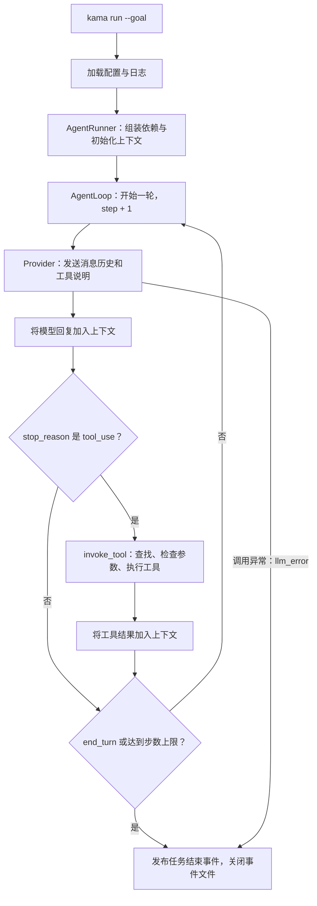

# KamaClaude S1 · Agent 最小执行闭环

> 从一个用户目标出发，让模型提出工具调用，由程序执行工具，再将结果交回模型，直到任务结束。


## 先回答几个核心问题

### 1. S1 相比 S0，真正增加了什么？

**答：** S0 验证客户端与 Core 怎样通信；S1 建立一次任务内部的模型与工具执行循环。

S0 的 `ping → pong` 由预先定义的函数完成。S1 的 `kama run --goal "..."` 会把目标发给模型，让模型根据工具说明决定是否申请工具调用，再由程序执行并回传结果。模型可以根据结果继续调用工具，也可以给出最终回答。

因此，学习 S1 的主线是：**目标 → 模型回复 → 工具执行 → 更新上下文 → 再次调用模型**。

### 2. S1 的任务是否已经通过 TCP 交给 Core 执行？

**答：** 还没有。当前 `kama run` 在 CLI 进程内直接创建 `AgentRunner` 并运行任务，不依赖 `kama-core`。

S0 的 Core、TCP 和 `kama ping` 路径仍然存在，但它们与 S1 的本地任务执行入口是两条路径。不能因为类放在 `core/` 目录中，就认为它一定运行在独立的 Core 进程里。执行位置取决于谁创建它、从哪个入口调用。

### 3. AgentRunner、AgentLoop 和 Provider 分别负责什么？

**答：** Runner 管理完整任务的准备与收尾，Loop 驱动每轮交互，Provider 适配模型 API。

- `AgentRunner.run()`：生成运行 ID、组装依赖、连接事件订阅者、创建上下文，最后记录结束状态。
- `AgentLoop.run()`：重复调用模型、保存模型回复、执行工具、保存工具结果，并判断是否结束。
- Provider 的 `chat()`：完成一次模型调用，把平台响应转换为统一的 `LlmResponse`；当前默认使用 `DeepseekProvider`。

一次 Runner 调用包含一次完整的 Loop 调用；一次 Loop 调用可以包含多次 Provider 调用。`while` 的一次迭代称为一个 step，通常包含一次模型调用，以及该轮提出的工具执行。

### 4. 模型为什么能记住上一轮的工具结果？

**答：** 程序把结果加入 `ExecutionContext.messages`，下一轮调用模型时再发送这份历史。

Provider 不维护独立的对话记忆。消息历史按照“用户目标 → 模型的工具调用 → 工具结果 → 模型的新回复”逐步增长。`tool_use_id` 将某个工具结果与对应调用关联起来；同一轮多个工具结果会放进同一条结果消息。

当前上下文保存在内存中。任务事件写入文件，不等于完整对话已持久化，也不代表程序重启后可以恢复同一个任务。

### 5. 模型会自己执行 read_file 吗？

**答：** 模型只提出调用要求，实际文件读取由 Python 程序完成。

`ToolRegistry.tool_schemas()` 把工具名称、用途和参数结构交给模型。模型返回工具调用后，`invoke_tool()` 根据名称查找工具，检查必填参数，执行工具并处理超时或异常。`ReadFileTool.invoke()` 才是真正读取文件的方法。

工具执行失败通常会被整理为 `is_error=True` 的结果，回传模型供其调整；模型 API 调用异常则会使循环将任务标记为 `llm_error` 并结束。

### 6. 为什么需要事件系统？与上下文有什么区别？

**答：** 上下文用于让模型继续工作，事件用于让用户和程序观察执行过程。

`EventBus` 将任务开始、步骤变化、模型文字、工具耗时和用量等事件交给订阅者。`StdoutPrinter` 负责终端展示，`EventWriter` 负责写入 `events.jsonl`，业务代码无需到处直接处理打印和文件记录。

当前总线是进程内的回调列表：按注册顺序 `await` 每个订阅者，没有独立消息队列、并行分发或历史补发。`events.jsonl` 也不是完整上下文快照，例如工具成功事件并不保存完整的文件内容。

### 7. 任务怎样结束？最大步数是不是 token 预算？

**答：** 收到 `end_turn` 时标记成功；达到 `max_steps`、模型调用失败或任务取消时，按相应原因结束。最大步数与 token 预算是不同的限制。

默认 `max_steps=20`，限制循环轮数。Anthropic/DeepSeek 请求中的 `max_tokens=4096`、OpenAI 请求中的 `max_completion_tokens=4096` 限制单次模型调用的生成输出，当前没有任务总 token 或费用预算控制。若同一轮既收到 `end_turn` 又达到最大步数，代码优先判定成功。

“成功”目前表示模型返回了结束标记，尚未通过独立规则或测试验证用户目标真的完成。其他模型停止原因也没有在 Anthropic 路径中得到完整分类处理。

### 8. OpenAI 和 DeepSeek 怎样接入？可以通过配置切换吗？

**答：** 当前已有 `AnthropicProvider`、`OpenaiProvider` 和 `DeepseekProvider` 三个实现，默认 CLI 路径创建 `DeepseekProvider`，尚未增加配置切换入口。

`OpenaiProvider` 在同一个文件内转换消息、工具定义及流式响应；`DeepseekProvider` 通过 DeepSeek 的 Anthropic 兼容地址复用 `AnthropicProvider.chat()`。二者均返回统一的 `LlmResponse`，不要求修改 AgentLoop 或上下文格式。

`AgentRunner` 支持通过 `provider` 参数注入其他实现，但设置某个平台的密钥或修改模型名，不会自动切换 Provider。OpenAI SDK 仍需额外安装，当前 `pyproject.toml` 尚未声明该依赖。具体方式见下方“模型平台适配”。

## 本阶段完成了什么

| 能力 | 当前实现 |
| --- | --- |
| 任务入口 | `kama run --goal "..."` |
| 多轮执行 | 模型调用与工具执行循环 |
| 模型适配 | Anthropic、OpenAI、DeepSeek；默认 DeepSeek，可注入其他 Provider |
| 上下文管理 | 保存目标、消息历史、步数、状态和结束原因 |
| 工具注册与调用 | 工具说明生成、按名称查找、执行与错误结果封装 |
| 内置工具 | `read_file` |
| 流式展示 | 模型文字片段通过事件逐段显示 |
| 过程记录 | `runs/<run_id>/events.jsonl` |
| 执行控制 | 最大步数、工具调用超时、取消处理 |

会话恢复、工具审批、完整文件访问边界、上下文压缩，以及通过 Core 执行任务的交互式 TUI，均不属于当前已经完成的能力。

## 整体执行流程



该图展示主执行路径。正常走到一轮末尾时都会发布 `step.finished`，并不只在整个任务结束时发布；模型调用异常或取消时可能提前离开该轮。

### 用“读取文件并介绍项目”走一遍

```text
kama run --goal "请使用 read_file 读取 README.md，并介绍这个项目"
```

假设模型先申请读文件，再给出回答：

| 顺序 | 发生的事 | 消息历史的变化 |
| --- | --- | --- |
| 初始化 | Runner 创建上下文 | 加入用户目标 |
| 第一轮模型调用 | 模型申请 `read_file(path="README.md")` | 加入 assistant 的工具调用 |
| 工具执行 | Python 实际读取文件 | 加入携带 `tool_use_id` 的工具结果 |
| 第二轮模型调用 | 模型根据文件内容给出回答 | 加入 assistant 的最终文字 |
| 收尾 | `end_turn`，任务标记成功 | Runner 发布结束事件并关闭文件 |

最终历史大致如下。这里的 `user` 工具结果是程序回传的数据，不是用户又输入了一句话。

```json
[
  {"role": "user", "content": "读取 README.md，介绍项目"},
  {"role": "assistant", "content": [
    {"type": "tool_use", "id": "call_01", "name": "read_file", "input": {"path": "README.md"}}
  ]},
  {"role": "user", "content": [
    {"type": "tool_result", "tool_use_id": "call_01", "content": "README.md 的实际内容……"}
  ]},
  {"role": "assistant", "content": [
    {"type": "text", "text": "这个项目是……"}
  ]}
]
```

第一轮请求发送初始目标；第二轮请求发送前三条历史。模型可能采用不同的执行步骤，这个示例用于解释数据流。

## 核心模块与方法

| 模块 | 核心方法 | 阅读重点 |
| --- | --- | --- |
| [CLI 入口](./src/kama_claude/cli/main.py) | `main()` | 解析 `run --goal`，加载配置并分发命令 |
| [任务命令](./src/kama_claude/cli/commands/run.py) | `cmd_run()`、`StdoutPrinter.handle()` | 启动异步任务，按事件类型显示进度 |
| [任务组装](./src/kama_claude/core/runner.py) | `AgentRunner.run()` | 创建运行目录、总线、Provider、工具、上下文与文件记录器 |
| [执行循环](./src/kama_claude/core/loop.py) | `AgentLoop.run()` | 模型调用、工具执行、历史更新与终止条件 |
| [执行上下文](./src/kama_claude/core/context.py) | `add_assistant_message()`、`add_tool_result()` | 模型回复形成一条消息，同轮工具结果合并到一条结果消息 |
| [模型接口](./src/kama_claude/core/llm/base.py) | `LLMProvider.chat()` | 各 Provider 遵循的调用约定；通过 Protocol 描述接口 |
| [模型适配](./src/kama_claude/core/llm/provider.py) | `AnthropicProvider.chat()`、`OpenaiProvider.chat()`、`DeepseekProvider.__init__()` | 适配平台 API；DeepSeek 复用 Anthropic 的消息处理与事件逻辑 |
| [统一返回类型](./src/kama_claude/core/llm/types.py) | `LlmResponse`、`ToolCallBlock`、`UsageStats` | 将完整回复拆为文字、工具调用、停止原因和用量 |
| [工具注册表](./src/kama_claude/core/tools/registry.py) | `register()`、`get()`、`tool_schemas()` | 保存工具实现，并提供模型需要的说明 |
| [工具调用入口](./src/kama_claude/core/tools/invocation.py) | `invoke_tool()`、`_fail()` | 必填参数检查、超时控制、耗时记录、错误结果与事件 |
| [读文件工具](./src/kama_claude/core/tools/builtin/read_file.py) | `ReadFileTool.invoke()` | 文件读取、UTF-8 解码、返回内容截断 |
| [事件总线](./src/kama_claude/core/events/bus.py) | `subscribe()`、`publish()` | 保存回调并按顺序分发事件 |
| [事件文件](./src/kama_claude/core/events/writer.py) | `handle()`、`__aenter__()`、`__aexit__()` | 每行写一个 JSON 事件，并管理文件打开与关闭 |

建议先沿 `cmd_run → AgentRunner.run → AgentLoop.run` 读主流程，再分别进入 Provider、工具和事件模块。

## 上下文与事件怎样配合

```text
模型回复、工具返回内容 ──→ ExecutionContext.messages ──→ 下一轮模型请求

任务与步骤变化、文本、耗时、用量 ──→ EventBus ──→ StdoutPrinter
                                                 └─→ EventWriter
```

常见事件及发布位置：

| 事件 | 发布者 | 含义 |
| --- | --- | --- |
| `run.started`、`run.finished` | Runner | 整次任务开始、结束 |
| `step.started`、`step.finished` | Loop | 一轮交互开始、结束 |
| `llm.model_selected` | Provider | 本次准备使用的模型 |
| `llm.token` | Provider | 收到一个流式文字片段，不保证严格对应一个 token |
| `llm.usage` | Provider | 一次模型调用的用量 |
| `tool.call_started` | 工具调用入口 | 开始一次工具调用 |
| `tool.call_finished`、`tool.call_failed` | 工具调用入口 | 工具调用成功、失败 |

文件中的 JSONL 与 S0 的 NDJSON 使用相同的“每行一个 JSON”组织方式，但这里用于事件记录，不是在 TCP 上传输任务。

## 模型平台适配

三个 Provider 均位于 [provider.py](./src/kama_claude/core/llm/provider.py)，遵循相同的 `chat(messages, tool_schemas, bus, run_id)` 接口：

| 平台 | 实现类 | 接口与消息处理 | API key | 模型名示例 |
| --- | --- | --- | --- | --- |
| Anthropic | `AnthropicProvider` | Messages API；使用现有内容块结构 | `ANTHROPIC_API_KEY` | `claude-sonnet-4-6` |
| OpenAI | `OpenaiProvider` | Chat Completions；在类内转换工具定义、工具消息与流式调用参数 | `OPENAI_API_KEY` | `gpt-4.1-mini` |
| DeepSeek（当前默认） | `DeepseekProvider` | `https://api.deepseek.com/anthropic`；继承 Anthropic Provider 的 `chat()` | `DEEPSEEK_API_KEY` | `deepseek-flash` |

OpenAI 的工具参数以 JSON 字符串传递，工具结果使用 `role="tool"`；Provider 负责将这些格式与项目内部的 `tool_use`、`tool_result` 互相转换。DeepSeek 使用 Anthropic 兼容入口，复用已有流式文本、工具调用解析和事件发布，不额外增加一套格式转换。

DeepSeek 兼容接口会忽略 `cache_control` 和工具结果的 `is_error`，因此错误描述仍需保留在结果内容中；也不能把 Anthropic 的缓存控制标记等同于 DeepSeek 的缓存行为。接口依据：[DeepSeek 官方兼容说明](https://api-docs.deepseek.com/guides/anthropic_api/)、[OpenAI 官方 Chat Completions](https://developers.openai.com/api/reference/resources/chat/subresources/completions/methods/create)。

当前 `AgentRunner.run()` 的默认构造行是：

```python
provider = self._provider or DeepseekProvider(self._config.llm.default_model)
```

需要从 Python 入口使用其他平台时，可以显式注入，例如下面的 OpenAI 调用方式；执行该入口前需要安装 `openai` SDK 并设置 `OPENAI_API_KEY`：

```python
import asyncio

from kama_claude.core.config import get_config
from kama_claude.core.llm.provider import OpenaiProvider
from kama_claude.core.runner import AgentRunner

config = get_config()
provider = OpenaiProvider(model="gpt-4.1-mini")
runner = AgentRunner(config, provider=provider)
asyncio.run(runner.run("请使用 read_file 读取 README.md，并介绍这个项目"))
```

也可以按同样方式注入 `AnthropicProvider` 或 `DeepseekProvider`。注入时以 Provider 构造参数中的模型名为准。`KAMA_LLM_DEFAULT_MODEL` 只影响 Runner 默认创建的 Provider，代码没有 `KAMA_LLM_PROVIDER` 开关。

## 快速开始

需要 Python 3.12.x 和 uv。在仓库根目录执行下面的命令。当前默认任务路径需要可用的 DeepSeek API key；实际模型调用会产生服务端用量。

### Windows PowerShell

```powershell
uv sync

# 仅在不存在时创建，避免覆盖已有配置
if (-not (Test-Path -LiteralPath .env)) {
    Copy-Item -LiteralPath .env.example -Destination .env
}
```

编辑 `.env`，设置 DeepSeek 密钥并显式指定对应模型；`.env.example` 中仍保留原来的 Anthropic 示例，需要按下面的实际运行配置调整：

```dotenv
DEEPSEEK_API_KEY=替换为你的密钥
KAMA_LLM_DEFAULT_MODEL=deepseek-flash
KAMA_MAX_STEPS=20
```

运行任务，无需提前启动 Core：

```powershell
uv run kama run --goal "请使用 read_file 读取 README.md，并用中文介绍这个项目"
```

如需中止，在运行该命令的终端按 Ctrl+C；CLI 对取消使用退出码 130。

### macOS / Linux

```bash
uv sync
if [ ! -e .env ]; then
    cp .env.example .env
fi
# 编辑 .env，填写 DEEPSEEK_API_KEY，并将 KAMA_LLM_DEFAULT_MODEL 设为 deepseek-flash
uv run kama run --goal "请使用 read_file 读取 README.md，并用中文介绍这个项目"
```

### 查看输出与记录

终端输出示意，具体模型文字、步数和耗时以实际执行为准：

```text
[run] 20261018-090000-abc123
[step 1] planning...
[tool] read_file {"path": "README.md"}
[tool] read_file ✓  3ms
[step 1] done
[step 2] planning...
这个项目是……
[step 2] done
[run] success  2 steps  4.2s
```

事件文件位于当前工作目录下的 `runs/<run_id>/events.jsonl`。相对文件路径同样以当前工作目录为基准，因此示例应在仓库根目录运行。

### S0 通信入口与 Windows 范围

`kama --version` 不需要模型密钥。验证 S0 的 `kama ping` 则需要另开终端启动 `kama-core`。

当前 S1 分支的 Core 仍无条件调用 `loop.add_signal_handler()`，没有包含 S0 学习分支中的 Windows 启停适配。Windows 下先使用上述 `kama run` 路径，不能把 S0 分支的兼容修改视为已经自动带到 S1。本 README 未改变这部分代码。

## 配置说明

配置覆盖顺序：**内建默认值 → TOML → `.env` → 已有系统环境变量**。代码先加载 `.env` 以取得可能设置的 `KAMA_CONFIG`，再读取 TOML，最后应用环境变量覆盖；`.env` 不覆盖已有系统环境变量。

| 配置 | 默认值或来源 | 用途 |
| --- | --- | --- |
| `DEEPSEEK_API_KEY` | 无默认值 | 当前默认 DeepSeek 客户端的认证密钥 |
| `OPENAI_API_KEY` | 无默认值 | 显式使用 `OpenaiProvider` 时的认证密钥 |
| `ANTHROPIC_API_KEY` | 无默认值 | 显式使用 `AnthropicProvider` 时的认证密钥 |
| `KAMA_LLM_DEFAULT_MODEL` | 代码默认仍为 `claude-sonnet-4-6` | 默认入口已切到 DeepSeek，运行示例显式覆盖为 `deepseek-flash` |
| `KAMA_MAX_STEPS` | `20` | 必须为正整数，限制循环轮数 |
| `KAMA_CONFIG` | `~/.kama/config.toml` | TOML 配置路径 |
| `KAMA_LOG_LEVEL` | `INFO` | 日志级别 |
| `KAMA_LOG_FILE` | `~/.kama/logs/core.log` | 日志文件，空字符串表示不写文件 |
| `KAMA_HOST`、`KAMA_PORT` | `127.0.0.1`、`7437` | Core 通信配置，不决定模型 API 地址 |

TOML 示例：

```toml
[agent]
max_steps = 10

[llm]
default_model = "deepseek-flash"
router = "static"
```

`router` 目前只是配置字段，Runner 按 `default_model` 创建固定的 DeepSeek Provider，没有实现动态模型路由或按模型名自动选择平台。密钥通过环境变量或 `.env` 提供。

## 验证与测试

先运行使用模拟 Provider 的单元测试，无需模型密钥：

```text
uv run python -m pytest tests/unit -v
uv run ruff check src tests scripts
uv run mypy src
```

其中 `test_context.py` 验证消息历史与同轮结果合并，`test_loop.py` 验证循环和终止条件，`test_invocation.py` 验证工具错误与超时，`test_runner.py` 验证任务生命周期及事件文件。

需要验证真实模型的读文件完整链路时，可使用上方配置和 CLI 命令。历史端到端测试 [test_run_e2e.py](./tests/integration/test_run_e2e.py) 仍以 `ANTHROPIC_API_KEY` 判断是否跳过，但 Runner 默认平台已经是 DeepSeek，测试的密钥门禁与模型配置尚待同步，不能将跳过视为 DeepSeek 验证通过。`test_ping_roundtrip.py` 测试 Core 通信，受上述 Windows 启停限制影响。

协议文档检查命令，Windows 使用 UTF-8 模式避免默认编码问题：

```text
uv run python -X utf8 scripts/gen_protocol_doc.py --check
```

当前 S1 的 `WIRE_PROTOCOL.md` 与生成输出已有表格排版和字段标记差异，因此该检查可能报告不同步。这不表示模型执行失败；协议文档的重新生成与差异审查需要单独处理。

## 当前边界与可改进之处

| 当前实现 | 可以继续改进的方向 |
| --- | --- |
| Runner 默认固定使用 DeepSeek；可注入其他 Provider，尚无配置切换入口 | 在后续明确需要时增加 Provider 选择与依赖管理，并同步集成测试条件 |
| 工具入口只检查必填参数是否存在 | 校验参数类型、枚举、额外字段等完整 schema 约束 |
| `read_file` 拒绝含 `..` 的路径，但未限制绝对路径或符号链接目标 | 基于工作目录解析真实路径并检查访问边界 |
| `read_file` 先同步读取全部字节，再截取最多 512 KiB 返回 | 限量读取并避免阻塞事件循环 |
| 使用 `wait_for` 控制工具超时 | 明确协作式取消边界；同步阻塞操作不能仅靠该超时及时中断 |
| 消息历史只在内存中保存 | 设计会话存储、恢复与完整上下文记录 |
| 总线顺序等待订阅者，未统一隔离订阅者异常 | 根据实际需求设计异常处理、队列与背压 |
| 收到 `end_turn` 就标记成功，只限制最大轮数 | 增加结果验收、停止原因分类和任务预算管理 |

## 继续阅读

- [RUNBOOK.md](./RUNBOOK.md)：配置与操作参考；当前 S1 的执行位置和能力以本 README 与源码为准。
- [WIRE_PROTOCOL.md](./WIRE_PROTOCOL.md)：消息模型及事件结构，生成文件应与代码一起维护。
- [上下文测试](./tests/unit/test_context.py)：通过具体断言理解消息怎样增长。
- [循环测试](./tests/unit/test_loop.py)：通过模拟回复理解工具调用、结束、步数上限和取消。

后续 S2 将继续处理任务执行迁入 Core、客户端事件订阅与 TUI 交互，使 S0 的通信骨架与 S1 的执行循环连接起来。
