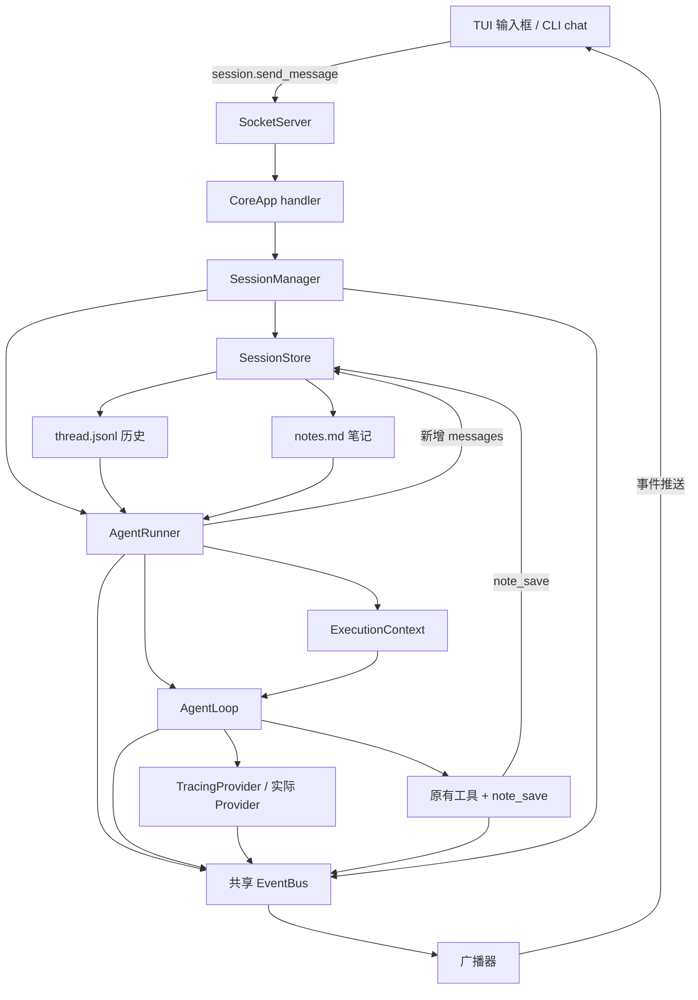
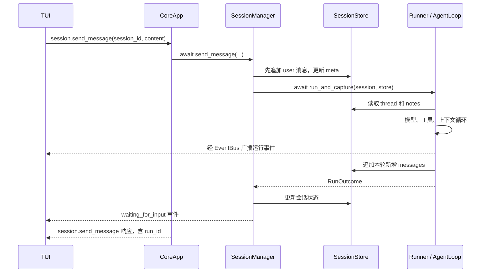

# KamaClaude · S4 会话与持久化记忆

S4 在 S3 的 Agent 执行与事件展示之上增加 Session：同一会话可以连续发送多条消息，每条消息触发一次 run，后续运行会加载之前的对话历史和主动笔记。TUI 增加输入框，成为可持续对话的终端前端。

本文按**当前 `stage/s4` 实际代码**讲解，包含已从前序阶段同步的 OpenAI、DeepSeek Provider 与 Windows 前台 Core 退出适配。适合先学过 S2 的通信和事件系统、S3 的工具与任务管理，再从“第二轮怎样看到第一轮”入手阅读。

建议的第一个入口是 [SessionManager.send_message](./src/kama_claude/core/session/manager.py)：它把用户输入、会话锁、历史保存、Runner 执行和等待下一轮串在了一起。

## 先回答几个核心问题

### 1. S4 相比 S3，核心新增是什么？

S3 主要组织一次 run：模型决策、调用工具、更新上下文并结束。S4 在多次 run 上面增加 session，用一个稳定的会话 ID 关联历史、笔记和各轮运行。

AgentLoop 的主要执行循环继续复用；新增的重点是每轮开始前从哪里取上下文，以及结束后怎样把新增内容存回去。

### 2. session、run、清单 Task 和 asyncio.Task 有什么区别？

| 概念 | 含义 | 例子 |
| --- | --- | --- |
| session | 持续对话的容器 | 讨论同一个项目的几轮问答 |
| run | 处理一条用户消息的一轮完整执行 | 第一次分析配置，第二次修改总结 |
| 清单 Task | 模型通过任务工具维护的工作记录 | #1 读取配置，#2 编写总结 |
| asyncio.Task | Python 调度的协程任务 | Core 中后台运行的协程 |

一个 session 可以包含多个 run；一个 run 可以有多步模型调用和多条清单 Task。清单 Task 不会自动创建新进程或新 AgentLoop。

### 3. session 就是一条 TCP 连接吗？

不是。连接负责收发消息，session 是业务对象。RPC 使用 session_id 指明操作哪段对话，并不把会话本身等同于某个 socket。

但“业务上分开”不等于恢复流程已经完成：当前 TUI 每次连上 Core 都创建新 chat session，断线重连不会自动接回旧 session。

### 4. 历史 messages 和 notes 是两种什么记忆？

thread.jsonl 保存详细对话，包括用户消息、assistant 回复、tool_use 和 tool_result；notes.md 保存模型主动提炼的重要事实或决定，下一轮放进 system prompt。

前者回答“之前完整聊过什么”，后者突出“哪些事实值得持续提醒”。当前没有向量检索、自动历史压缩、笔记去重或模型训练；notes 也是当前会话内的笔记，并非跨所有会话自动共享的全局知识库。

### 5. 有 note_save 工具，模型就一定会保存笔记吗？

不会。注册工具是提供能力，是否调用仍由模型选择。验证时可以明确要求它实际调用 note_save，并检查工具事件和 notes.md。

第二轮能回答第一轮的约定，不足以单独证明笔记生效，因为完整对话历史本身也可能包含这个约定。

### 6. session.send_message 返回 run_id，表示刚启动还是已执行完？

当前实现会等待整轮执行结束后，再返回 run_id。原有 agent.run 则创建后台任务，快速返回 run_id。两条 RPC 的响应时机不同，不能只看返回字段相同就认为语义相同。

等待 session.send_message 响应时，SocketClient 的接收循环仍会处理事件推送，模型输出和工具进度可以先于 RPC 响应到达客户端。

### 7. 历史存到文件了，为什么还不能重启后续聊？

SessionStore 能读写文件，但 SessionManager 启动时的 `_sessions` 是空字典，`_get_session()` 只查内存，没有完整实现从磁盘恢复旧 session 的路径。

所以文件仍在，不代表旧 session_id 在新 Core 中仍然可用。自动恢复还需要磁盘加载、会话状态修复、客户端重新关联等配套工作。

### 8. 同一会话能同时处理两条消息吗？

当前每个 session 有一个 asyncio.Lock，send_message 持锁直到本轮处理结束。锁已被占用时，再请求会返回 SESSION_BUSY，而不是排队开启另一轮。

不同 session 使用不同锁，可以并发运行；但共享总线、前端全局订阅和文件访问仍存在隔离边界，不能据此认定整个系统已经完全隔离。

### 9. 同一 session 的几轮会复用同一份任务清单吗？

当前 TaskManager 仍按 run 创建，任务文件位于各自的 `runs/<run_id>/.tasks/`。下一轮拥有新的任务目录，task_list 不会自动列出上一轮清单。

模型可以通过历史看到上轮工具调用结果，但这与任务工具共享同一个跨轮次存储并不是一回事。

## S3 → S4 的变化地图

| 部分 | S3 | 当前 S4 |
| --- | --- | --- |
| 运行组织 | 一次目标对应一次 run | 一个 session 包含多次 run |
| Core 入口 | agent.run 直接创建 Runner | agent.run 也创建 one_shot session，复用会话执行路径 |
| 对话历史 | 主要在本轮 ExecutionContext 中 | thread.jsonl 保存，下一轮重新读取 |
| 主动记忆 | 没有会话笔记工具 | 新增 note_save 和 notes.md |
| 上下文初始化 | 通常从当前 goal 开始 | 可以由 prefill_messages 注入已有历史 |
| 系统提示词 | 主要使用固定内容 | Context 拼接会话笔记，经 system 参数传给 Provider |
| TUI | 事件观察、工具块展示 | 新增输入框、会话状态、Markdown 收尾渲染 |
| CLI | kama run 单次执行 | 新增 kama chat 多轮调试入口 |
| 协议 | run、step、tool 等命令/事件 | 新增四个 session RPC 和五种 session 事件 |
| 存储组织 | 通常位于 Core 工作目录的 runs/ | 经 Core 会话路径执行时位于用户目录的 sessions/<id>/runs/ |

OpenAI、DeepSeek 类与 Windows 前台适配已经在前序阶段同步；S4 针对 Provider 的新增重点是动态 system 提示词的传递，不是重新接入三家后端。

## 整体结构与一条消息的路径



命令和事件仍共用各客户端自己的 TCP 连接。EventBus 是 Core 内部的函数订阅分发，广播器负责跨进程发送；会话不会为每个工具新建一条连接。

### 第二轮怎样看到第一轮

假设第一轮用户说“这个项目的事件文件使用 JSONL”，第二轮问“刚才约定了什么格式”。第二轮会经过：

1. SessionManager 根据 session_id 找会话与锁，检查是否忙、是否已关闭。
2. 把第二轮用户输入先追加到 thread.jsonl。
3. 生成 run_id，登记到 session.run_ids，保存 meta。
4. Runner 读取完整 thread，包括第一轮内容和刚追加的第二轮问题。
5. Runner 读取 notes，构造带 prefill_messages 和 session_notes 的 Context。
6. Context 使用已有历史，不再重复追加 goal。
7. AgentLoop 调用模型，模型实际收到历史，因此可以参考第一轮。
8. 模型回复或工具结果追加到本轮 messages，循环结束。
9. Runner 只把本轮新增消息追加回 thread。
10. chat session 进入 waiting_for_input，发布事件，TUI 恢复输入；RPC 随后返回。



图中省略了部分具体事件与文件操作次序。源码中 waiting_for_input 事件发布后才写入该次最终 meta；不要把收到事件当成多个文件已经事务性提交的证明。

## 快速开始：优先从 TUI 体验多轮会话

### 1. 准备环境和模型配置

需要 Python 3.12.x 和 uv。Windows PowerShell 中先进入项目目录：

```powershell
uv sync
if (-not (Test-Path -LiteralPath .env)) {
    Copy-Item -LiteralPath .env.example -Destination .env
}
```

macOS / Linux 同样可以用前台方式分别启动 Core 和 TUI；创建配置可使用 `cp .env.example .env`，已有文件时保留原内容。

当前 Runner 默认实例化 DeepseekProvider，而内置模型和 .env.example 仍保留 Anthropic 示例。请在 .env 中设置匹配的值：

```dotenv
DEEPSEEK_API_KEY=替换为你的密钥
KAMA_LLM_DEFAULT_MODEL=替换为该接口支持的DeepSeek模型ID
KAMA_HOST=127.0.0.1
KAMA_PORT=7437
KAMA_MAX_STEPS=20
KAMA_TRACE_ENABLED=true
KAMA_TRACE_INCLUDE_LLM_PAYLOAD=true
```

密钥和模型值是占位文字，需要替换。当前没有 KAMA_LLM_PROVIDER 配置项，只改模型名不会自动切换 Provider 类。OpenaiProvider 仍采用延迟导入，实际启用还需要安装未声明在项目依赖中的 openai SDK。

Core 在启动时加载配置。切换分支或修改 .env 后，应重启 Core；运行中的进程不会自动使用新的源码和配置。

### 2. 终端 A：启动 Core

```powershell
uv run kama-core
```

保持运行，按 Ctrl+C 退出。Windows 前台启动/退出适配已同步；后台 `kama core start/stop` 仍带有 Unix 的会话与信号处理方式，Windows 学习时使用前台入口。

### 3. 终端 B：打开 TUI 并连续输入

```powershell
uv run kama-tui
```

TUI 会连接、订阅事件、创建 chat session，并显示输入框。可以依次发送：

```text
第一轮：请实际调用 note_save，保存这个约定：本项目生成的文本文件统一使用 UTF-8。
第二轮：我们刚才保存了什么文件编码约定？请按约定回答。
```

观察第一轮是否出现 note_save 工具调用，再查看当前 session 的 notes.md。第二轮答对并不能单独证明笔记读取正常，因为它也能从 thread 历史中看到第一轮要求。

| 操作 | 当前实现 |
| --- | --- |
| Enter | 提交非空输入 |
| Shift/Alt/Super+Enter、Ctrl+J | 代码中作为换行处理，实际识别受终端按键支持影响 |
| Ctrl+Q | 尝试关闭当前 session，然后退出 TUI |
| 点击已完成工具块 | 展开或收起完整参数、结果与耗时 |

当前执行期间输入框会禁用；收到 session.waiting_for_input 后恢复。关闭窗口或断线不等于向 Core 发送了可靠的运行取消请求，退出也不保证忙碌会话已成功关闭。

### 4. CLI 用于补充调试

```powershell
uv run kama ping
uv run kama chat
uv run kama run --goal "读取 pyproject.toml，说明项目名称"
```

kama chat 创建多轮 chat 会话，kama run 经 agent.run 创建 one_shot 会话。两种路径现在都使用会话存储。ping 不调用模型；实际聊天和 Agent 运行需要密钥、网络，并可能产生模型调用费用。

## 文件保存在哪里：会话数据与日志要分开看

默认结构：

```text
用户目录/.kama/
├── sessions/
│   └── <session_id>/
│       ├── meta.json
│       ├── thread.jsonl
│       ├── notes.md                  调用 note_save 后才产生
│       └── runs/
│           └── <run_id>/
│               ├── events.jsonl
│               └── .tasks/
│                   └── task_1.json   调用 task_create 后才产生
├── traces/
│   └── daemon.jsonl
└── logs/
    └── core.log
```

| 文件 | 内容与用途 |
| --- | --- |
| meta.json | 会话 ID、模式、状态、标题、时间和 run_ids |
| thread.jsonl | 模型消息历史，供后续轮次重建上下文 |
| notes.md | 主动保存的事实，供后续 system prompt 注入 |
| events.jsonl | run、step、tool、llm 等执行事件 |
| task_*.json | 本轮运行中的工作清单记录 |
| daemon.jsonl | Trace：IPC、内部事件、模型接口层请求与响应 |
| core.log | Python logging 普通运行日志，如启动、关闭、错误堆栈 |

SessionStore 的 meta、thread、notes 读写显式使用 UTF-8；TaskManager 和部分 Trace/回放路径仍存在默认编码读写，不能认为 S4 已修复所有 Windows 中文编码问题。

会话存储位置与工具工作目录是两个概念：read_file、write_file、list_dir 和 shell 的相对路径仍以 Core 启动目录为准。当前请求没有为每个会话显式设置独立 workspace。

经 Core 执行的 S4 run 通常位于上述 session 目录；直接在 Python 中调用不带 session/store 的 Runner 时，才保留旧的 runs/ 目录分支。

## 关键代码一：SessionManager 管什么

源码：[session/manager.py](./src/kama_claude/core/session/manager.py)。它负责生命周期与调用协调，实际文件读写交给 SessionStore，实际模型和工具执行交给 Runner。

### create：创建内存对象、锁和磁盘元信息

关键行为的教学伪代码：

```text
生成 sess-... ID
构造 Session(mode, status=active, title, 时间, run_ids=[])
保存到 _sessions
为该 ID 建立 asyncio.Lock
调用 store.write_meta(session)
发布 session.created
返回 Session
```

源码的 Session dataclass 位于 [session/model.py](./src/kama_claude/core/session/model.py)。`to_dict()` 和 `from_dict()` 负责对象与可存储字典之间的转换；它们不是自动执行的数据库映射层。

### send_message：最适合入手的主方法

以下为保留主要顺序的伪代码，省略了时间更新和部分事件：

```python
session = self._get_session(sid)
lock = self._locks[sid]
if lock.locked():
    raise HandlerError(SESSION_BUSY, "session busy")

async with lock:
    if session.status == "closed":
        raise HandlerError(SESSION_CLOSED, "session already closed")
    self._store.append_message(sid, "user", content)
    run_id = run_id or new_run_id()
    session.run_ids.append(run_id)
    self._store.write_meta(session)
    runner = self._runner_factory()
    await runner.run_and_capture(content, run_id=run_id, session=session, store=self._store)
    # 按 mode 关闭或等待下一轮，发布事件并保存 meta
    return run_id
```

`async with lock` 保证正常返回、异常或取消离开该作用域时释放锁；它不会自动回滚已经写入的用户消息、meta 或笔记。

runner_factory 是一个创建 Runner 的函数，调用时得到本轮 Runner。这样管理器不用把 Provider、工具和循环的组装逻辑都写在自己里面，也方便测试注入替身。

### 状态、锁与错误码

| 名称 | 当前含义 |
| --- | --- |
| active | 创建时的初始状态 |
| waiting_for_input | chat 轮次完成后等待输入 |
| closed | 已关闭，不能再发送消息 |
| SESSION_NOT_FOUND / -32010 | 内存中找不到会话 |
| SESSION_CLOSED / -32011 | 会话已关闭 |
| SESSION_BUSY / -32012 | 会话锁正在被占用 |

当前 waiting_for_input 会话收到下一条消息时发布 session.resumed，但没有把 status 明确改回 active。判断正在执行主要靠锁，而不是 meta.status。不要把这些字段画成已经严格实现的完整状态机。

### 其他核心方法

| 方法 | 行为 |
| --- | --- |
| `_get_session(sid)` | 只查 `_sessions` 内存字典；没有磁盘惰性加载 |
| `get_history(sid)` | 先确认会话存在，再委托 Store 返回消息 |
| `close(sid)` | 检查锁，标记 closed，保存 meta，发布关闭事件 |

close 没有实现“取消正在执行的 run 再关闭”；锁占用时当前会返回 busy。关闭后也没有立刻删除历史文件或内存索引。

## 关键代码二：Runner 怎样加载并增量保存上下文

源码：[runner.py](./src/kama_claude/core/runner.py)。S4 为 run_and_capture 增加 session、store 参数。

### 有会话时，先读取已有数据

真实关键语句节选：

```python
run_path = store.runs_dir(session.id) / run_id
history = store.read_messages(session.id)
notes = store.read_notes(session.id)
```

随后创建 Context：

```python
context = ExecutionContext(
    run_id=run_id,
    goal=goal,
    max_steps=self._config.agent.max_steps,
    prefill_messages=history,
    session_notes=notes,
)
prefill_len = len(history)
```

SessionManager 已经提前保存当前用户消息，因此 history 不是“只包含旧轮次”，而是“旧历史 + 本次输入”。这与 Context 不重复追加 goal 的行为配套。

### Context 优先使用 prefill，避免用户消息重复

源码：[context.py](./src/kama_claude/core/context.py)。

```python
if self.prefill_messages:
    self.messages = [dict(m) for m in self.prefill_messages]
elif not self.messages:
    self.messages.append({"role": "user", "content": self.goal})
```

这里复制了各消息外层字典，并非对所有嵌套 content 做深拷贝。没有历史时保留原来的 goal 初始化路径，有历史时直接使用它。

### prefill_len：只保存新增尾部

例如本轮开始前 history 有 4 条，执行后 messages 有 7 条：

```text
messages[0:4]  = 已存在的历史
messages[4:7]  = 本轮新增的 assistant、tool_result 等
```

保存时：

```python
store.append_messages(
    session.id,
    context.messages[prefill_len:],
    run_id=run_id,
)
```

这样避免把完整历史再追加一次。该切片依赖 S4 中 messages 主要在尾部追加的前提；以后若替换或压缩历史，需要重新设计增量保存边界。

### run.finished 不等于历史已经提交

当前 Runner 先发布 run.finished、关闭事件文件，随后再 append_messages。因此收到结束事件时，不能直接认定本轮 thread 已经写完。

SessionManager 会等待 Runner 返回后再处理等待输入/关闭等会话状态。模型执行、事件发送、历史追加与 meta 更新目前不是一个原子事务。

## 关键代码三：SessionStore 怎样重建消息

源码：[session/store.py](./src/kama_claude/core/session/store.py)。

| 核心方法 | 主要行为 |
| --- | --- |
| `__init__()` | 确保 session 存储根目录存在 |
| `session_dir()`、`runs_dir()` | 组合指定会话的目录路径 |
| `write_meta()`、`read_meta()` | UTF-8 写入或读取 meta.json，转换 Session 对象 |
| `append_message()` | 向 thread 追加一条带 ts、role、content 的记录，可选 run_id |
| `append_messages()` | 遍历本轮新增消息，逐条调用 append_message |
| `read_messages()` | 读 thread，跳过坏 JSON 或未知 role，再修剪未配对尾部 |
| `_trim_orphan_tool_use()` | 找到最后一个工具调用平衡位置，必要时裁掉尾部 |
| `read_notes()` | 读 notes 全文，文件不存在时返回空字符串 |
| `append_note()` | 追加带时间和 run_id 的笔记段落 |

### 磁盘记录与模型 messages 不是同一份外壳

thread 中的一行可以是：

```json
{"ts":"2026-10-28T09:00:00+00:00","role":"user","content":"本项目使用 JSONL 保存事件。"}
```

read_messages 返回给模型的是 role、content，不会把 ts 和文件中的 run_id 原样作为模型消息字段传进去。并非每条磁盘记录都必然带 run_id，例如当前用户输入的追加调用没有传该参数。

工具相关历史可以是：

```json
{"role":"assistant","content":[{"type":"tool_use","id":"call-1","name":"read_file","input":{"path":"pyproject.toml"}}]}
```

```json
{"role":"user","content":[{"type":"tool_result","tool_use_id":"call-1","content":"项目配置内容"}]}
```

这些是项目内部沿用的内容块表示，实际接入 OpenAI 时由对应 Provider 转换为其消息格式。

### 为什么修剪未配对的 tool_use

假设上轮结束时只留下 assistant 的 tool_use，却没有对应 tool_result。下一轮直接发送这段历史，可能导致工具消息配对错误。

修剪方法维护两个变量：

```text
pending：尚未匹配到结果的工具调用 ID 集合
last_balanced：最近一次 pending 为空的消息结束位置
```

扫描规则：

```text
看到 assistant 的 tool_use → 将 ID 放进 pending
看到 user 的 tool_result → 从 pending 移除对应 ID
pending 为空 → 更新 last_balanced
扫描结束仍不为空 → 返回 messages[:last_balanced]
```

它修剪的是返回给调用方的消息列表，不会自动重写原 thread 文件，也不会重新执行工具。它是尾部恢复策略，不是对任意历史结构的完整协议校验；跳过坏行同样可能影响历史完整性。

## 关键代码四：note_save 如何影响下一轮

源码：[tools/builtin/note_save.py](./src/kama_claude/core/tools/builtin/note_save.py)。它绑定当前 store、session_id 和 run_id，执行逻辑很短：

```text
取得 content 并去除首尾空白
空内容 → 返回错误 ToolResult
调用 store.append_note(session_id, content, run_id)
返回 ToolResult(content="saved")
```

Runner 只有在具备 session、store、run_id 时注册这个工具。它与原来的八个工具一样经过 invoke_tool，并将结果交还模型、发布工具事件。

下一轮 Runner 读 notes 后，Context.system_prompt 将其拼入基础提示词：

```text
基础系统提示词

## Session Notes
已保存的笔记

提醒模型通过 note_save 保存重要事实
```

AgentLoop 每轮调用 Provider 时传入：

```python
system=context.system_prompt(base_prompt)
```

实际传递链为 AgentLoop → TracingProvider → 实际 Provider。Anthropic/DeepSeek 使用 system 内容块，OpenaiProvider 将传入的 system 放到转换后消息开头；未提供或为空时仍使用默认提示词。

当前 notes 在 run 开始时读取一次。中途调用 note_save 会改磁盘文件，但不会同步更新当前 Context.session_notes；新笔记主要在下一轮 run 重新加载。它也没有去重、冲突合并、长度预算和按相关性检索。

## 关键代码五：TUI 怎样组织多轮输入

源码：[tui/app.py](./src/kama_claude/tui/app.py)。

### 连接后先订阅，再创建 chat session

_socket_loop 的主要顺序：

```text
创建 SocketClient 并连接
启动唯一接收循环，注册本地事件回调
订阅 session.*、run.*、step.*、tool.*、llm 等事件
发送 session.create(mode=chat)
保存返回的 session_id，启用并聚焦输入框
等待接收循环结束；断线则清理并每两秒重连
```

这里继续复用 S2 的命令响应/事件分发，不是另外建立了一套聊天传输协议。当前订阅 scope 仍是 global，也没有完整过滤所有事件的 session 归属。

### ChatTextArea：界面事件与业务事件分开处理

ChatTextArea 继承 TextArea，捕获 Enter 后发布自己的 Submitted 消息。应用的 `on_chat_text_area_submitted()` 处理这条 Textual 界面消息：

```text
忽略空输入，检查连接、session_id 和 busy
设 busy，清空并禁用输入框
添加本地用户消息组件，刷新标题
await client.send_command(session.send_message, ...)
RPC 错误时恢复输入并展示错误
```

后台 SocketClient 接收的是 Core 的业务事件字典，再调用 `_handle_event()`。Textual 的 Submitted 消息与 Core 的 session.message_received 是不同来源的数据，不能混为同一种事件。

### 输入恢复与 Markdown 展示

| 方法或事件 | 行为 |
| --- | --- |
| compose | 增加 ChatTextArea，与标题和滚动区一起构成界面 |
| session.waiting_for_input | 清 busy，启用并聚焦输入框，标题显示 ready |
| session.closed | 禁用输入框，显示会话关闭 |
| `_break_llm()` | 调用 finalize_markdown，再结束当前文本块引用 |
| `LLMStreamBlock.finalize_markdown()` | 用 Rich Markdown 渲染累计文本；不会修改模型历史 |
| `action_quit()` | 尝试 session.close，再退出；没有可靠的强制取消语义 |

当前 TUI 重连时会清掉旧 session_id，再创建新会话，旧界面内容存在不代表已经恢复旧业务会话。_busy、当前文本块和工具块等状态也需要在完善恢复时按会话统一管理。

CLI 的 [chat.py](./src/kama_claude/cli/commands/chat.py) 提供补充调试路径：用 run_in_executor 读取终端输入，避免同步 input 阻塞 socket 接收循环；每次输入发送给同一个 chat session，退出循环后尝试关闭会话。

## RPC 与事件示例：观察响应时机

### 创建会话

```json
{"jsonrpc":"2.0","id":"req-create","method":"session.create","params":{"mode":"chat","title":"学习 S4"}}
```

```json
{"jsonrpc":"2.0","id":"req-create","result":{"session_id":"sess-demo","status":"active"}}
```

### 发送消息

```json
{"jsonrpc":"2.0","id":"req-send","method":"session.send_message","params":{"session_id":"sess-demo","content":"请解释上一轮保存的约定。"}}
```

等待期间会收到 kind=event 的执行推送；当前实现待本轮处理完成后才回复：

```json
{"jsonrpc":"2.0","id":"req-send","result":{"run_id":"run-demo"}}
```

会话等待输入的事件示例：

```json
{"kind":"event","event":{"type":"session.waiting_for_input","session_id":"sess-demo","last_run_id":"run-demo","ts":"2026-10-28T09:00:03+00:00"}}
```

session 事件使用 session_id，其中 waiting_for_input 用 last_run_id 关联刚结束的运行；不要假设每个事件都包含同名 run_id 字段。事件外壳仍是自定义 EventPushEnvelope，不是 JSON-RPC notification。

### 其他命令与两种等待

| 命令 | 参数重点 | 当前响应语义 |
| --- | --- | --- |
| session.create | mode、title | 创建后返回 session_id 和 status |
| session.send_message | session_id、content | 等待本轮执行结束后返回 run_id |
| session.get_history | session_id | 返回可用于模型调用的 messages |
| session.close | session_id | 成功关闭后返回 closed；忙时可能报错 |
| agent.run | goal | 创建 one_shot 后台运行，快速返回 run_id |

SocketClient 通过请求 id 完成对应 Future，业务结束事件则由回调处理。等待一个 RPC Future 和等待一条 run/session 终态事件，是不同的同步机制；当前客户端仍缺少完善的逐请求超时和断线兜底。

## 历史、事件、Trace 和普通日志各自负责什么

```text
模型消息 → SessionStore → thread.jsonl → 下一轮模型上下文
主动笔记 → note_save → notes.md → 下一轮 system prompt
业务事件 → EventBus → EventWriter / 广播器 → events.jsonl / 前端
接口与事件记录 → TraceWriter → daemon.jsonl
logger.info/error/... → logging handlers → stderr / core.log
```

Trace 通过包装 Provider 记录输入 messages、tool_schemas、system 及统一响应，还记录 IPC 和内部事件；它不是供应商原始 HTTP 抓包。KAMA_TRACE_INCLUDE_LLM_PAYLOAD=false 会减少模型 payload，但不等于清除其他文件中的消息和工具输出。

普通日志入口在 [logging_setup.py](./src/kama_claude/core/logging_setup.py)。Core 与 CLI 都会初始化 logging，默认向 stderr 与滚动文件输出。logger.info 不会自动成为 log.line 事件，也不会自动进入 Trace；当前没有把所有普通日志桥接到 EventBus 的处理器。

Core 的回放会先检查旧 runs 路径，再查 session 目录中的 events.jsonl。回放不等于恢复会话和执行，也没有可靠游标或历史/实时交接来保证不重不漏。

## 不调用模型的学习练习与检查

### 离线练习：历史与笔记怎样进入 Context

下面的完整 Python 片段使用临时目录，不需要 API 密钥，也不会写入真实会话目录：

```python
from pathlib import Path
from tempfile import TemporaryDirectory
from kama_claude.core.context import ExecutionContext
from kama_claude.core.session.model import Session
from kama_claude.core.session.store import SessionStore

with TemporaryDirectory() as temporary:
    store = SessionStore(Path(temporary))
    session = Session(
        id="sess-demo", mode="chat", status="active", title="学习 S4",
        created_at="2026-10-28T09:00:00+00:00", updated_at="2026-10-28T09:00:00+00:00",
    )
    store.write_meta(session)
    store.append_message(session.id, "user", "记住：文件使用 UTF-8。")
    store.append_note(session.id, "文件使用 UTF-8。", run_id="run-demo")
    context = ExecutionContext(
        run_id="run-next", goal="使用什么编码？", max_steps=20,
        prefill_messages=store.read_messages(session.id),
        session_notes=store.read_notes(session.id),
    )
    print(len(context.messages))                         # 1，没有再自动追加 goal
    print("Session Notes" in context.system_prompt("base"))  # True
    print(store.read_meta(session.id).mode)               # chat
```

这里故意只向 thread 追加了一条用户消息，用来观察 Context 有 prefill 时不会补 goal。真实 send_message 会先把当前问题追加进 thread，再由 Runner 加载。

### 源码阅读与针对性测试

1. [SessionManager.send_message](./src/kama_claude/core/session/manager.py)：先看完整协调流程。
2. [Runner.run_and_capture](./src/kama_claude/core/runner.py)：看历史加载、增量保存与运行目录。
3. [SessionStore](./src/kama_claude/core/session/store.py)：看消息外壳、UTF-8 和工具尾部修剪。
4. [ExecutionContext](./src/kama_claude/core/context.py) 与 [note_save](./src/kama_claude/core/tools/builtin/note_save.py)：看两种记忆怎样进入模型请求。
5. [TUI](./src/kama_claude/tui/app.py)：追踪提交、busy 与等待输入事件。
6. [CoreApp](./src/kama_claude/core/app.py) 与 [命令契约](./src/kama_claude/core/bus/commands.py)：核对 RPC 路由和响应时机。

```powershell
uv run python -m pytest tests/unit -v
uv run python -m pytest tests/integration/test_ping_roundtrip.py tests/integration/test_s4_session_ipc.py -v
uv run ruff check src tests/unit tests/integration scripts
uv run mypy src
```

单元测试使用替身；上述 S4 IPC 用例只测试创建、历史和关闭，不发送消息给真实模型。它不能单独证明真实多轮模型调用成功。不要把整个 integration 目录当作不调用模型的测试集合，发送 agent.run 或聊天的用例仍需核对密钥与执行前提。

值得重点读的现有测试包括 test_session_history_and_notes_injected、test_read_messages_trims_orphan_tool_use_tail 和 test_input_submit_appends_user_turn_and_disables_prompt。个人语法练习应与正式测试区分，避免被 pytest 错误收集。

## 本阶段可改进的地方

| 优先级 | 当前边界 | 实现方向 | 验收标准 |
| --- | --- | --- | --- |
| 高 | 磁盘历史存在但旧 session 无法自动恢复 | 加载 meta 建立索引，明确 resume 命令与中断状态，客户端保存并恢复会话 ID | 重启 Core 后可显式恢复旧会话，重复恢复不重复追加消息 |
| 高 | 多 session 的事件可能混显、混写 | 建立 session/run 归属路由，Writer 过滤 run_id 并退订，前端只消费所属事件 | A/B 并发时历史、事件文件、文本、工具结果与状态互不串线 |
| 高 | 状态字段与锁语义不一致 | 规范状态迁移，发送前进入运行状态，异常/取消也更新可观察终态 | meta、锁和界面忙闲状态一致，失败后不会永久禁用输入 |
| 高 | 消息、run 记录、笔记与 meta 非事务写入 | 设计提交顺序、原子写入或日志恢复，定义完成事件对应的持久化边界 | 中途故障可识别已提交部分，重试不会造成双写 |
| 中 | 历史尾部只做基础修剪 | 校验工具请求/结果配对，记录修剪原因与位置，保留原始数据 | 损坏历史可诊断，不静默丢失无关完整消息 |
| 中 | Notes 无长度预算与冲突处理 | 增加去重、来源、版本或时间策略，限制注入规模 | 重复事实不无限追加，冲突可解释，超长笔记不撑满上下文 |
| 中 | 请求等待与退出缺少超时兜底 | 统一 RPC 超时、断线状态、关闭和取消语义 | 无响应连接不会永久卡住发送或退出，任务执行状态被准确提示 |
| 中 | task/Trace 等编码不统一 | 显式统一 UTF-8，并提供现有旧编码文件的迁移办法 | 新中文数据跨环境可读，已有文件不因直接换编码而损坏 |

若作为个人 S8 改进，建议选择“会话恢复”或“多会话事件隔离”做完整闭环：既改后端，也验证 TUI 的断线、输入恢复与历史展示，而不只新增一个界面按钮。

## 核心问题与参考回答

**如何用一分钟介绍 S4？**

S4 在每次 Agent run 之上引入 session，同一会话的多轮输入通过 SessionManager 协调，SessionStore 保存完整消息与主动笔记。Runner 开始前加载历史和 notes，结束后增量保存新消息，TUI 可以连续输入并观察执行。当前已有持久化基础，但重启恢复和多会话隔离还不完善。

**模型是靠什么记住上一轮的？**

后端在下一轮请求中重新提供消息历史和笔记。模型不是因为 TCP 长连接或相同 session_id 就自动记住内容，session_id 是宿主系统关联数据的标识。

**为什么先写用户消息，再创建 Context？**

保证 Runner 加载的完整 thread 包含当前问题；Context 使用 prefill 时不再追加 goal。这两处必须配合，否则会遗漏或重复用户输入。

**prefill_len 为什么能避免重复写历史？**

它标记运行开始时已有消息数量。S4 主要向尾部追加消息，保存该索引之后的部分即可。若以后压缩或替换历史，这个切片前提需要重新审视。

**Notes 与完整历史有什么不同？**

历史保留对话与工具交互细节，Notes 用于强调可复用事实。当前 Notes 是主动保存、全文注入，并不包含自动检索、去重和冲突解决。

**同一 session 的锁是否保证了整个系统安全并发？**

它只约束该会话的消息处理与关闭操作。不同会话仍共享事件总线、前端订阅和工作目录，需要分别解决路由、存储和副作用冲突。

**为什么已经有 read_meta，重启后仍查不到会话？**

存储方法存在不代表业务路径使用了它。当前 SessionManager 查找只访问内存，启动和查询流程没有建立完整的磁盘恢复机制。

**S4 可以怎样写在简历里？**

可以描述多轮会话生命周期、文件持久化的消息与显式笔记、上下文重建、按会话并发约束，以及终端交互界面。自动故障恢复、可靠断点续传、语义检索等，需要补齐实现与验证后再描述。

## 文档与 Git 约定

本分支 docs 只跟踪 `docs/learning/S4-*.md`，其他阶段学习资料可以保存在本地。合并时保留目标分支自己的 README、.gitignore 和文档范围。

- [S4 学习文档](./docs/learning/S4-会话与持久化记忆.md)：补充逐方法精读和实验，标注的 origin 提交是原阶段基线。
- [RUNBOOK.md](./RUNBOOK.md)：配置与操作参考，阶段能力和平台细节以当前代码为准。
- [WIRE_PROTOCOL.md](./WIRE_PROTOCOL.md)：协议模型生成的文档，改动契约后使用 `scripts/gen_protocol_doc.py` 更新。
