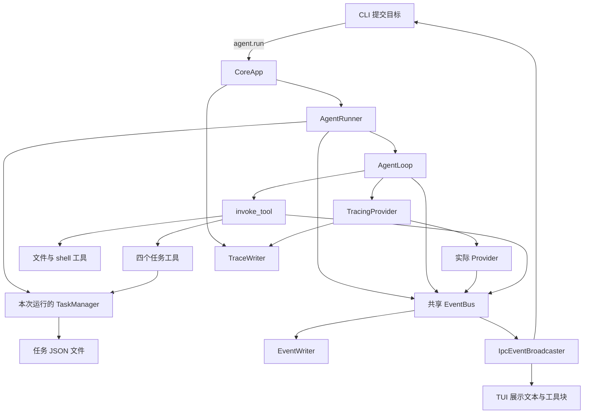

# KamaClaude · S3 任务工具与执行过程展示

S3 沿用 S2 的双进程架构：CLI 提交目标，Core 调用模型并执行工具，CLI 和 TUI 通过事件观察进度。在此基础上，增加八个工具、运行内的任务清单、可展开的工具展示和统一 Trace 时间线。

本文面向刚学完 S2 的读者，按**当前 `stage/s3` 实际代码**讲解。当前分支已同步 OpenAI、DeepSeek Provider 和 Windows 前台 Core 退出适配；早期阶段文档中的默认值或接口描述，应结合当前源码核对。

## 先回答几个核心问题

### 1. S3 相比 S2，最重要的变化是什么？

S2 解决“任务在 Core 中执行，进度如何跨进程传回来”。S3 继续复用这条链路，让 Agent 可以查看目录、写文件、执行命令，并通过任务工具把工作步骤保存成结构化记录。

与此同时，TUI 将文本和工具调用显示成独立组件，Trace 将客户端通信、内部事件与模型调用记录到统一时间线。AgentLoop 的“模型决策 → 执行工具 → 追加结果 → 再调用模型”仍是执行主线。

### 2. 一次 run、任务清单中的 Task、asyncio.Task 有什么区别？

| 名称 | 含义 | 示例 |
| --- | --- | --- |
| 一次 Agent run | 用户提交目标后的一轮完整执行，由 run_id 标识 | 分析配置并生成总结 |
| `core.task.model.Task` | 本轮执行中的一条工作清单记录，由整数 ID 标识 | #1 读取配置，#2 编写总结 |
| `asyncio.Task` | Python 事件循环调度的协程任务 | Core 中执行 `runner.run()` 的后台任务 |

一轮 run 可以创建多条清单记录；创建清单记录本身不会启动另一个 AgentLoop，也不会新建进程。

### 3. TaskManager 是自动调度器吗？

当前主要负责记录和查询。模型通过工具创建任务、修改状态、查看未完成依赖，仍由模型决定下一步实际执行什么。

管理器没有就绪队列，也没有根据依赖自动启动工作的调度循环。它不会完整阻止“前置任务没完成，却把后续任务改为进行中”的操作，也没有完整环检测。因此应理解为任务管理与依赖记录，不能直接称为成熟的 DAG 调度引擎。

### 4. 为什么把任务管理也做成工具？

模型已经通过工具协议调用宿主能力，任务管理可以复用同一接口。模型描述 `task_create` 的参数，工具将参数交给 TaskManager，再把新任务的信息作为 ToolResult 返回给模型。

这样计划有了可查询的状态，而不只是一段自然语言。后续模型调用也可以用 `task_list` 或 `task_get` 重新检查工作进度。

### 5. 八个工具会同时执行吗？

当前同一轮模型响应中的工具调用，仍由 AgentLoop 逐个 `await invoke_tool(...)`。S3 放开的是多个顶层 run 的协程并发，不等于一轮中的多个工具自动并行，也不代表创建了多个执行线程。

并发运行仍共享 Core 的总线、工作目录等资源，事件归属和文件冲突需要额外处理。

### 6. task_create 是新的 TCP RPC 命令吗？

它是交给模型使用的工具名。CLI 通过 TCP 发送 `agent.run`，Core 中的模型随后请求 `task_create`，AgentLoop 才在 Core 内调用对应工具。

当前 Core 注册的主要 RPC 仍是 `core.ping`、`event.subscribe`、`agent.run`。不能将工具名 `task_create` 改写为 `task.create`，就假设服务器提供了这个 RPC。

### 7. S3 TUI 可以输入目标了吗？

当前仍没有目标输入框。它增加的是终端滚屏式展示、同一文本块上的增量更新，以及可点击展开的工具参数、输出和耗时。目标仍由 CLI 的 `kama run --goal` 提交。

理解界面时要区分“更完整地观察执行过程”和“具备多轮对话输入与会话管理”。后者不是当前 S3 的实现。

### 8. 已经有 events.jsonl，为什么还增加 Trace？

`events.jsonl` 记录运行过程中的业务事件。Trace 还记录 RPC 命令与响应、模型请求与响应等信息，便于追查某一步为什么发生。

两者有重叠但用途不同。Trace 不是自动恢复任务的检查点，也不等于模型供应商的底层 HTTP 抓包。

### 9. 所有 Task 都 completed，一轮 run 就会结束吗？

不会自动结束。当前 AgentLoop 没有用 TaskManager 的清单状态作为退出条件，主要仍由模型返回 `end_turn` 标记成功，或由步数上限、异常、取消等路径终止。

模型即使把清单全部标为 completed，也可能继续输出；模型返回 `end_turn` 时，清单中也可能仍有未完成项。是否强制两者一致，是可以改进的地方。

## S2 → S3 的变化地图

| 部分 | S2 | 当前 S3 |
| --- | --- | --- |
| 文件与系统工具 | 主要是 read_file | 增加 list_dir、write_file、bash |
| 任务规划记录 | 主要存在于对话历史中 | 四个任务工具读写 JSON 任务清单 |
| Runner | 驱动一次运行 | 增加 run_and_capture，返回 RunOutcome |
| Core 的运行管理 | `_current_run_task` 限制单个活跃运行 | `_running_runs` 集合管理多个运行协程 |
| 工具完成事件 | 主要报告状态和耗时 | 增加 output，用于展示工具结果 |
| TUI | RichLog 事件日志 | 流式文本块、可折叠工具块 |
| 可观察性 | 运行事件文件 | 增加 IPC、事件、LLM 三层 Trace |
| 通信基础 | TCP + NDJSON | 继续使用；RPC 与事件推送共用连接 |

## 整体结构：先找到自己正在读哪一层



图中省略了部分 Trace 接入点：SocketServer 记录命令和响应，广播器记录事件推送，Core 的事件订阅函数记录内部事件。四个任务工具操作同一个 Manager；不是每个工具各自建立独立清单。

## 快速开始：让 CLI 和 TUI 观察同一轮执行

### 1. 环境与配置

需要 Python 3.12.x 和 uv。以下准备命令使用 Windows PowerShell，所有终端先进入项目目录：

```powershell
uv sync
if (-not (Test-Path -LiteralPath .env)) {
    Copy-Item -LiteralPath .env.example -Destination .env
}
```

macOS / Linux 也可以分别打开终端以前台方式运行；创建配置可使用 `cp .env.example .env`，已有配置时保留原文件。

当前 Runner 默认创建 **DeepseekProvider**，但内置模型和 `.env.example` 仍保留 Anthropic 示例。需要在 `.env` 中设置匹配的密钥与模型：

```dotenv
DEEPSEEK_API_KEY=替换为你的密钥
KAMA_LLM_DEFAULT_MODEL=替换为该接口支持的DeepSeek模型ID
KAMA_HOST=127.0.0.1
KAMA_PORT=7437
KAMA_MAX_STEPS=20
KAMA_TRACE_ENABLED=true
KAMA_TRACE_INCLUDE_LLM_PAYLOAD=true
```

密钥和模型值是占位文字，必须替换。Trace 默认保存到用户目录的 `~/.kama/traces/daemon.jsonl`；要指定其他位置可设置 `KAMA_TRACE_FILE`。关闭 `KAMA_TRACE_INCLUDE_LLM_PAYLOAD` 会让模型 Trace 保留摘要，但不会自动清除其他事件或文件里的工具输出。

Core 启动时读取配置。修改 `.env` 后需要重启 Core，不能仅重开 CLI 就期待正在运行的服务重新加载。

### 2. 终端 A：启动 Core

```powershell
uv run kama-core
```

保持终端开启，按 Ctrl+C 退出。已同步 Windows 前台退出适配；`kama core start/stop` 的后台管理仍带有 Unix 的会话与信号处理方式，Windows 学习时使用上述前台方式。

### 3. 终端 B：先打开 TUI

```powershell
uv run kama-tui
```

等待显示已连接。这个窗口观察事件；按 `q` 退出，已完成的工具块可以点击展开。

### 4. 终端 C：验证连接并发起任务

```powershell
uv run kama ping
uv run kama run --goal "先创建读取配置和编写总结两个任务，后者依赖前者。读取 pyproject.toml，将项目名称和 Python 版本要求写入 study-output/s3-summary.md，过程中更新任务状态，最后列出任务清单。"
```

`ping` 不调用模型；Agent 运行需要可用密钥与网络，并可能产生模型调用费用。上面的目标会要求模型写入学习用文件，写入路径相对 Core 工作目录。工具调用顺序由模型决策，不保证每次都与后文示例完全一致。

默认最多 20 次模型循环。复杂目标可能需要更多轮次，不应把“清单有两条”误认为“模型最多只调用两次”。

## 用一个例子理解整轮执行

假设模型按目标创建两条任务：

```text
#1 读取配置          pending
#2 编写总结          pending，blocked_by=[1]
```

可能的执行过程是：

```text
CLI 连接 → 启动接收循环 → 订阅 → agent.run
Core 创建 run_id，调度 Runner，向 CLI 返回 run_id
Runner 创建 TaskManager、工具注册表、事件写入器和模型适配器

模型请求 task_create：创建 #1
模型请求 task_create：创建 #2，依赖 #1
模型请求 task_update：#1 → in_progress
模型请求 read_file：读取 pyproject.toml
模型请求 task_update：#1 → completed，自动从 #2 的依赖中移除 1
模型请求 task_update：#2 → in_progress
模型请求 write_file：写入总结
模型请求 task_update：#2 → completed
模型请求 task_list：检查清单
模型返回 end_turn，AgentLoop 标记成功

Runner 发布 run.finished，关闭本轮事件文件
CLI 收到结束事件，清理连接后退出；Core 和 TUI 继续运行
```

模型一次响应可以请求多个工具，所以这里每一行工具调用不一定各占一轮。当前每次响应内的工具执行仍是串行的。

数据会出现在几个不同位置：

```text
Core 工作目录/
├── study-output/
│   └── s3-summary.md            工具实际写出的结果
└── runs/
    └── <run_id>/
        ├── events.jsonl        业务事件序列
        └── .tasks/
            ├── task_1.json     第一条清单记录
            └── task_2.json     第二条清单记录

用户目录/.kama/traces/
└── daemon.jsonl                默认统一 Trace
```

文件存在不代表任务能在 Core 重启后自动接着执行。当前没有将完整执行上下文恢复并重新调度的机制。

## 关键代码讲解一：Core 和 Runner 如何组装运行

### CoreApp._agent_run_handler：管理活跃运行协程

源码：[core/app.py](./src/kama_claude/core/app.py)。关键语句节选：

```python
run_id = new_run_id()
runner = AgentRunner(self._config, bus=self._bus, trace=self._trace)
run_task = asyncio.create_task(runner.run(cmd.goal, run_id=run_id))
self._running_runs.add(run_task)
run_task.add_done_callback(self._running_runs.discard)
return AgentRunResult(run_id=run_id)
```

S3 移除了 S2 的单运行拒绝检查，用集合保留活跃 task 的引用。`add_done_callback` 在协程结束时移除它，结束包括成功、异常或取消，不等于任务一定成功。

`create_task()` 在同一个 Core 事件循环中调度工作，不为每次运行创建新进程。Core 退出时会取消集合中的任务并 gather 等待收尾，再关闭服务器和 Trace。Windows 路径也保留在 `finally` 清理范围内。

### AgentRunner._build_registry：把能力注册成统一工具

源码：[runner.py](./src/kama_claude/core/runner.py)。关键语句节选：

```python
registry.register(ReadFileTool())
registry.register(BashTool())
registry.register(WriteFileTool())
registry.register(ListDirTool())
registry.register(TaskCreateTool(task_manager))
registry.register(TaskUpdateTool(task_manager))
registry.register(TaskListTool(task_manager))
registry.register(TaskGetTool(task_manager))
```

四个任务工具持有同一个 TaskManager 实例，保证创建、查询和修改的是同一清单。Registry 按工具名查找对象，并把各工具的名称、描述与 input_schema 汇总给模型。

模型使用的是工具描述；真正执行的是 Core 中注册的 Python 对象。描述里声称的约束，也需要结合工具实现检查，不能只看自然语言描述就认定后端已严格验证。

### run_and_capture：完整运行逻辑与最终结果

主要顺序的教学伪代码：

```text
确定 run_id，创建运行目录
创建 TaskManager(run_path / ".tasks")
复用 Core 传入的 EventBus
创建 ExecutionContext，把用户目标加入消息历史
打开 EventWriter，并订阅总线
发布 run.started
创建实际 Provider；启用 Trace 时再包装 TracingProvider
构建八工具注册表，执行 AgentLoop
处理取消并发布 run.finished
关闭事件文件，返回 RunOutcome
```

`run()` 只是 await `run_and_capture()` 并忽略返回值；`run_and_capture()` 返回 `status`、`result`、`reason`。AgentLoop 遇到 `end_turn` 时把最后文本放到 `context.result`，Runner 再放进 RunOutcome。

当前 `agent.run` 调用的是 `runner.run()`，没有等待并把 RunOutcome 当作 RPC 答案返回。客户端仍先拿 run_id，再通过事件观察执行与终态。

## 关键代码讲解二：任务清单如何保存、修改与查询

### Task：一条结构化记录

源码：[task/model.py](./src/kama_claude/core/task/model.py)。任务 JSON 示例：

```json
{
  "id": 2,
  "subject": "编写总结",
  "description": "根据配置生成项目摘要",
  "status": "pending",
  "blocked_by": [1],
  "created_at": "2026-10-23T09:00:00+00:00",
  "updated_at": "2026-10-23T09:00:00+00:00"
}
```

Task 是 dataclass。`to_dict()` 转为可写入 JSON 的字典，`from_dict()` 从磁盘数据重建对象并转换部分字段类型。`TaskStatus` 的 Literal 类型主要服务静态检查，不会自动让所有磁盘数据都经过完整运行时校验。

### TaskManager 的核心方法

源码：[task/manager.py](./src/kama_claude/core/task/manager.py)。

| 方法 | 输入与关键行为 | 返回或副作用 |
| --- | --- | --- |
| `__init__()` | 接收任务目录，创建目录，扫描最大 ID | 初始化 `_next_id` |
| `_max_id()` | 从 task_*.json 文件名提取数字 | 空目录返回 0，否则返回最大值 |
| `_load(id)` | 找对应文件、解析 JSON、重建 Task | 返回 Task；不存在时抛 ValueError |
| `_save(task)` | 将 to_dict 后的数据写入文件 | 覆盖 task_<id>.json |
| `create(...)` | 检查初始依赖文件存在，构造 pending 任务 | 保存后递增 ID，返回 Task |
| `get(id)` | 委托 `_load()` | 返回指定 Task |
| `update(...)` | 修改状态、增减依赖、更新时间 | 保存并返回 Task |
| `list_all()` | 读取任务文件，按数值 ID 排序 | 返回 Task 列表，跳过部分坏记录 |
| `_clear_dependency(id)` | 从其他任务 blocked_by 中移除已完成 ID | 可能修改多份文件 |
| `format_list()` | 将任务映射成 `[ ]`、`[>]`、`[x]` 文本 | 返回便于模型阅读的摘要 |

### create：先保存，再递增编号

核心流程伪代码：

```text
检查 blocked_by 中每个依赖文件是否存在
构造 Task(id=next_id, status=pending, ...)
保存 task_<id>.json
next_id 加一
返回 Task
```

扫描已有 ID 可以让重新打开同一个目录的 Manager 继续编号。但没有跨进程锁或事务，多个独立写者同时操作同一目录时仍可能争用编号。不同 run 的 TaskManager 各用自己的目录，可以各自拥有 #1。

### update：完成任务时会清除其他任务对它的阻塞记录

关键顺序的伪代码：

```text
读取要更新的任务
若提供 status：
    校验属于 pending / in_progress / completed
    修改状态
    若为 completed：从其他任务的 blocked_by 中移除本任务 ID
合并新增依赖，并去重
移除指定依赖
更新时间，保存当前任务，返回
```

这里没有严格的状态迁移表，也没有完整检查新增依赖是否存在、是否形成环。清除依赖只意味着“不再受这个未完成项阻塞”，不会自动执行下一个任务。

完成后删除 blocked_by 中的 ID，也意味着没有单独保留原始依赖图；事后无法只靠当前 blocked_by 还原全部计划关系。多个文件的修改也不是一个事务，部分保存失败可能导致状态不一致。

### 一个不调用模型的练习

下面是可独立运行的 Python 片段，使用临时目录，不会修改项目文件：

```python
from pathlib import Path
from tempfile import TemporaryDirectory
from kama_claude.core.task.manager import TaskManager

with TemporaryDirectory() as temporary:
    manager = TaskManager(Path(temporary) / ".tasks")
    first = manager.create("Read config")
    second = manager.create("Write summary", blocked_by=[first.id])
    print(manager.get(second.id).blocked_by)  # [1]
    manager.update(first.id, status="completed")
    print(manager.get(second.id).blocked_by)  # []
    print(manager.get(second.id).status)      # pending，仍未自动启动
```

再尝试在第一个任务完成之前，把第二个设为 in_progress。观察当前实现会不会拒绝它，以此区分“记录了依赖”和“强制执行依赖约束”。

## 关键代码讲解三：模型怎样操作任务和文件

### 四个任务工具是 TaskManager 的适配层

| 工具与源码 | invoke 的主要逻辑 | 结果格式 |
| --- | --- | --- |
| [task_create](./src/kama_claude/core/tools/builtin/task_create.py) | 解析 subject、description、blocked_by，调用 create | 新任务的 JSON 字符串 |
| [task_update](./src/kama_claude/core/tools/builtin/task_update.py) | 解析 task_id、status 和依赖增减，调用 update | 更新后任务的 JSON 字符串 |
| [task_list](./src/kama_claude/core/tools/builtin/task_list.py) | 调用 format_list | 可读清单摘要 |
| [task_get](./src/kama_claude/core/tools/builtin/task_get.py) | 解析 task_id，调用 get | 任务详情 JSON 字符串 |

它们的公共职责是“通用参数字典 → Manager 的 Python 参数 → Task/摘要 → ToolResult 文本”，不会另写一套存储逻辑。

例如 task_create 的调用路径：

```text
模型生成工具调用
→ AgentLoop 根据 name 查 Registry
→ invoke_tool 调用 TaskCreateTool.invoke(params)
→ TaskManager.create(...)
→ 保存文件，返回 Task
→ 工具将 task.to_dict() 序列化到 ToolResult.content
→ AgentLoop 追加 tool_result，下一轮模型看到创建结果
```

部分参数转换发生在工具自己的 try 之前；转换失败仍可能向外抛出，再由统一 invoke_tool 捕获。工具返回 ToolResult，不代表任意错误都一定在工具内部处理。

### 文件与 shell 工具的实际边界

| 工具与源码 | 核心实现 | 当前限制 |
| --- | --- | --- |
| [read_file](./src/kama_claude/core/tools/builtin/read_file.py) | read_bytes 后截取并用 UTF-8 解码 | 最多返回前 512 KiB，但先读取了整个文件 |
| [write_file](./src/kama_claude/core/tools/builtin/write_file.py) | 创建父目录，UTF-8 覆盖写入 | 内容编码后最多 1 MiB；已有内容会被覆盖 |
| [list_dir](./src/kama_claude/core/tools/builtin/list_dir.py) | 递归生成目录树 | 默认深度 2、最大 4，累计最多约 200 项 |
| [bash](./src/kama_claude/core/tools/builtin/bash.py) | 创建 shell 子进程，communicate 收集输出 | 默认内部超时 60 秒，参数最多 120 秒，返回输出做截断 |

文件工具会拒绝路径中的 `..`，但这不等于完整工作区沙箱：当前实现还没有完整拒绝绝对路径或验证符号链接后的访问范围。shell 工具也没有限制到一个受控文件系统范围。

### invoke_tool：统一处理执行、错误、超时和事件

源码：[tools/invocation.py](./src/kama_claude/core/tools/invocation.py)。关键行为：

```text
发布 tool.call_started
按名称查工具，检查必需参数是否存在
用 wait_for 限时执行 tool.invoke(params)
若结果是错误：发布 tool.call_failed，返回错误 ToolResult
若成功：发布 tool.call_finished，包含 output=result.content
异常或超时：转换成错误事件与错误 ToolResult
```

当前统一外层超时是 **120 秒**，BashTool 内部默认是 **60 秒**，其 timeout 参数上限是 120 秒。两层等待不是总耗时保证；取消与子进程收尾还可能需要额外时间。不要沿用早期文档中外层 10 秒的描述。

必需参数检查目前主要判断字段是否存在，并不是完整执行 JSON Schema 校验。BashTool 内部 kill 的是当前子进程句柄，外层取消和全部后代进程的清理还没有统一处理。

shell 输出是先完整收集再截断，截断前按字节数判断，之后却切解码后的字符串，因此不能把展示限制当成严格的内存或字节上限。

## 关键代码讲解四：AgentLoop 和上下文仍是执行主线

源码：[loop.py](./src/kama_claude/core/loop.py)、[context.py](./src/kama_claude/core/context.py)。循环的教学伪代码：

```text
只要 context.status 还是 running：
    step 加一，发布 step.started
    调用 provider.chat(历史消息, 工具描述, step)
    保存模型的 assistant 文本与 tool_use
    若 stop_reason 为 tool_use：
        逐个调用工具
        将结果按 tool_use_id 追加到消息历史
    若 stop_reason 为 end_turn：
        保存最终文本到 context.result，标记 success
    否则若达到 max_steps：标记 failed
    发布 step.finished
```

任务管理工具与文件工具走的是同一条调用链。没有一套独立的“任务 AgentLoop”自动消费 TaskManager 的清单。

工具结果有两个主要去向：一份成为上下文中的 tool_result，让下一轮模型据此决策；一份进入 tool.call_finished.output，让界面可以显示。它们用途不同，不能只更新 UI 却忘记把结果交还模型。

模型调用异常会标记 llm_error 并跳出；取消会向上层传播。Provider 初始化仍在 Runner 的主要循环异常兜底之外，某些初始化失败不能保证产生 run.finished，这是运行生命周期的改进点。

## 关键代码讲解五：事件怎样成为 TUI 中的组件

源码：[tui/app.py](./src/kama_claude/tui/app.py)。

### LLMStreamBlock：连续文本更新同一个组件

关键语句节选：

```python
self._text += token
self.update(self._text)
```

收到 llm.token 时，如果没有当前文本块就创建一个，然后调用 append_token。遇到非 token 事件，`_break_llm()` 清掉当前块的引用，下次文本再创建新块；已显示的旧文本仍留在界面，不会因此被删除。

这里的 token 是展示片段，不保证每次恰好对应模型的一个分词单位。

### ToolCallBlock：先登记，后按调用 ID 找回

收到工具开始事件时的关键语句：

```python
tc_block = ToolCallBlock(tool_name, params)
self._pending_tool_blocks[tool_use_id] = tc_block
self._append(tc_block)
```

收到完成事件后：

```python
tc_done = self._pending_tool_blocks.pop(tool_use_id)
tc_done.set_result(output, elapsed_ms)
```

完整实现会先检查 ID 是否存在。失败事件也按同一个 ID 更新对应块，并标记错误，而不是靠“最近创建的工具块”猜测结果归属。

| 核心方法 | 职责 |
| --- | --- |
| `ToolCallBlock.compose()` | 创建摘要与详情两个子控件 |
| `_summary()` | 拼接工具名、参数预览、输出预览、耗时和状态 |
| `set_result()` | 保存完成数据，已挂载时刷新摘要 |
| `on_click()` | 完成后切换 expanded 类，展开完整参数、输出和耗时 |
| `KamaTuiApp._append()` | 挂载组件到滚动容器并滚动到底部 |
| `_handle_event()` | 按事件 type 创建或更新组件 |
| `_socket_loop()` | 管理连接、接收任务、订阅和两秒重连 |

点击展开只改变本地显示，不会重新执行工具。TUI 是事件消费者，工具执行仍在 Core 中。

当前 `_current_llm` 是一个全局当前块，工具块映射也只用 tool_use_id，且订阅 scope 为 global。多个 run 交错输出时可能混在一起；支持协程并发，不代表前端已经按 run 完整隔离。

## 关键代码讲解六：Trace 怎样记录三层时间线

### TraceRecord：用统一外壳保存不同层的数据

源码：[trace/record.py](./src/kama_claude/core/trace/record.py)。

| 字段 | 含义 |
| --- | --- |
| `ts` | 记录时间 |
| `direction` | CLIENT→CORE、CORE→CLIENT、CORE、CORE→LLM、LLM→CORE |
| `layer` | ipc、event、llm |
| `kind` | command、response、error、push、event、api_call、api_response 等 |
| `run_id`、`step` | 能关联时记录运行和模型轮次，字段允许为空 |
| `client_id` | 能关联时记录连接信息 |
| `data` | 该类记录的具体内容 |

不是每条记录都有完整的 run_id 或 step，不能仅凭字段存在就假定所有链路已经自动关联。

### TracingProvider：包住模型调用，记录前后数据

源码：[trace/provider.py](./src/kama_claude/core/trace/provider.py)。核心行为伪代码：

```python
self._trace.emit(request_record)
started = time.monotonic()
result = await self._inner.chat(messages, tool_schemas, bus, run_id, step=step)
latency_ms = int((time.monotonic() - started) * 1000)
self._trace.emit(response_record)
return result
```

这是对 Provider 的包装：外部仍调用 chat，内部增加记录，再委托给实际后端。开启 payload 时记录消息、工具描述及统一响应；关闭时保留数量、结束原因、用量、耗时等摘要。记录的是本项目接口层数据，不是完整的供应商 HTTP 报文。

当前异常路径没有统一补发模型错误记录，若 inner.chat 抛错，正常 api_response 记录不会执行。排查时看到请求没有对应正常响应，也要检查这个实现边界。

### TraceWriter：调用点入队，后台协程消费

源码：[trace/writer.py](./src/kama_claude/core/trace/writer.py)。主要关系：

```text
start()：创建目录，create_task(_drain())
emit(record)：queue.put_nowait(record)
_drain()：await queue.get()，写入一行 JSON，flush，task_done()
stop()：await queue.join()，再取消并等待消费协程
```

`queue.join()` 等待的是每个入队项目都执行了 task_done，不只是“队列里暂时没东西”。当前队列没有大小上限，文件写入仍是同步操作；队列将职责分开，但没有让磁盘写入变成独立线程。

这里的 `_drain()` 是项目自定义的队列消费方法，和网络 `StreamWriter.drain()` 不同。后者负责发送端流量控制，缓冲压力大时等待降到可继续写入的程度，不保证接收端已经处理完事件。

当前 Trace 文件和任务 JSON 的若干读写未统一显式指定 UTF-8。在 Windows 等默认编码非 UTF-8 的环境下，应留意中文、特殊字符和跨环境读取的兼容性。

## 将 S2 的事件系统与 S3 的新能力串起来

正常客户端顺序仍是：

```text
connect
→ on_event 注册本地回调
→ create_task(run_event_loop)
→ event.subscribe 并等待订阅响应
→ agent.run 并等待启动响应
→ 等待 run.finished
```

唯一读循环读取 NDJSON，带 jsonrpc 的响应按请求 id 完成对应 Future；kind=event 的消息交给本地事件处理函数。事件推送使用自定义 EventPushEnvelope，不是 JSON-RPC notification。

Core 内部的事件路径现在可以概括为：

```text
Runner / Loop / Provider / invoke_tool 创建事件对象
→ await EventBus.publish(event)
    ├── Trace 事件订阅函数：包装为 TraceRecord 并入队
    ├── IpcEventBroadcaster.handle：匹配 topics 与 scope，再逐连接写入
    └── 本轮 EventWriter.handle：写入 events.jsonl

客户端 TCP 接收循环
→ _dispatch
→ on_event
→ CLI 打印，或 TUI 更新对应组件
```

启用 Trace 时，其事件订阅先注册，广播器随后注册，运行开始时再加入 Writer。总线依次 await 处理函数，广播器也依次等待各连接 drain。慢客户端仍可能通过这条等待链拖慢执行。

更需要注意的是，共享总线会把事件交给所有活动 Writer，而当前 EventWriter 没有按 run_id 过滤，也没有在关闭后退订。并发 run 时，事件文件可能混入其他运行事件；连续运行时，关闭 Writer 的无效订阅也会累计。这是 S3 很适合亲自复现的改进点。

`kama-tui --replay "实际的RUN_ID"` 可以经在线 Core 请求历史事件，但没有可靠的事件游标或历史/实时交接机制。它不会恢复模型上下文或重新启动任务，也不保证重连显示不重不漏。

## 运行配置和 Provider 适配

| 内容 | 当前行为 |
| --- | --- |
| 默认模型适配器 | Runner 创建 DeepseekProvider，默认模型名仍需自行配置匹配 |
| Anthropic / OpenAI / DeepSeek | 三个类均在 [provider.py](./src/kama_claude/core/llm/provider.py) |
| 后端选择 | 当前没有 KAMA_LLM_PROVIDER，修改模型 ID 不会自动切换类 |
| OpenAI 依赖 | 类采用延迟导入，openai SDK 仍未声明在项目依赖中，实际启用需要安装 |
| S3 的 step 参数 | Provider.chat 接受该关键字，供 Trace 关联循环轮次 |
| 工作目录 | 文件工具、shell 默认工作目录和 runs 相对 Core 的启动位置 |
| 运行间隔离 | 每 run 有自己的 TaskManager 目录，但仍共享 Core 工作目录和事件总线 |

要替换真实执行后端，需要修改 Runner 默认构造，或在 Core 创建 Runner 时传入 provider。CLI 中单独创建一个 Provider 不会改变已经运行的 Core。

## 源码阅读顺序与验证练习

建议按“组装 → 数据 → 调用 → 展示 → 记录”的顺序读：

1. [runner.py](./src/kama_claude/core/runner.py)：找到 TaskManager、工具注册、TracingProvider 的接入点。
2. [task/model.py](./src/kama_claude/core/task/model.py) 和 [task/manager.py](./src/kama_claude/core/task/manager.py)：跟踪一次 create、update 的文件变化。
3. [task_create.py](./src/kama_claude/core/tools/builtin/task_create.py) 与 [invocation.py](./src/kama_claude/core/tools/invocation.py)：追踪模型参数如何变成实际操作，结果怎样返回。
4. [loop.py](./src/kama_claude/core/loop.py)：确认 Task 清单不参与自动调度，最终结果仍来自模型响应。
5. [tui/app.py](./src/kama_claude/tui/app.py)：跟踪同一个 tool_use_id 从开始到完成的组件变化。
6. [trace/provider.py](./src/kama_claude/core/trace/provider.py) 和 [trace/writer.py](./src/kama_claude/core/trace/writer.py)：区分入队、落盘和模型调用。
7. [core/app.py](./src/kama_claude/core/app.py)：把多个 run、共享总线和退出清理串起来。

基础验证命令：

```powershell
uv run python -m pytest tests/unit -v
uv run python -m pytest tests/integration/test_ping_roundtrip.py -v
uv run ruff check src tests/unit tests/integration scripts
uv run mypy src
```

单元测试使用替身验证逻辑，ping 集成测试启动真实 Core 验证 TCP 往返，不调用真实模型。个人语法练习文件应与正式测试区分，避免误被 pytest 当成测试收集。

不要直接把整个 integration 目录视为不调用模型的验证：`test_s2_dual_process.py` 会发送 agent.run；其他端到端测试也需要核对密钥和 Provider 前提。原有 `test_s3_task_graph.py` 中的一些用例仍请求 task.create/task.start 等 RPC，与当前注册命令不匹配，不能当作现有任务工具链路的通过证明。

适合动手的实验：

| 实验 | 观察重点 |
| --- | --- |
| 不调用模型，直接创建两条有依赖的任务 | 前置完成后 blocked_by 被清除，后续仍是 pending |
| 将被阻塞任务直接改成 in_progress | 识别当前后端没有强制门禁 |
| 注入 FakeProvider 依次请求 task_create、read_file、write_file | 验证真实工具、结果追加与最终文本，排除模型随机性 |
| 给 TUI 先后发送两个工具开始事件，再反序发送完成事件 | 验证按调用 ID 更新，不按到达位置猜测 |
| 同时运行两个 FakeProvider，检查各自 events.jsonl | 复现共享总线下的事件归属问题 |
| 对比模型 Trace 请求和响应的 run_id、step | 确认多轮模型调用怎样关联 |

## 本阶段可以做的改进

优先选择一个能复现、能解释、能验收的问题完成闭环，不必一次扩展成大型调度平台。

| 优先级 | 问题 | 实现方向 | 验收标准 |
| --- | --- | --- | --- |
| 高 | 并发运行的事件可能混写、混显 | Writer 按 run_id 过滤并支持退订；CLI/TUI 按运行管理状态和组件 | A/B 事件交错时，文件、文本、工具结果与终态均不串线 |
| 高 | 依赖只记录，缺少强制约束 | 校验依赖存在性、自依赖和环；增加明确状态迁移；保留原始依赖图 | 阻塞任务不能违规开始，非法图被拒绝，完成后仍能查询原依赖 |
| 高 | 工具超时与取消缺少统一清理 | 统一两层超时，在取消和异常路径清理进程及后代 | 超时/取消后没有遗留执行进程，结果和终态可观察 |
| 中 | 任务 JSON 更新不是事务 | 单文件临时写后替换；多记录更新增加一致性方案和版本校验 | 写入中断不破坏旧记录，依赖清除与状态修改保持一致 |
| 中 | Trace 队列无上限，写入故障处理不足 | 有界队列、明确丢弃/等待策略，监控消费任务异常并处理关闭 | 磁盘失败时不无限积压，stop 不因无人消费而永久等待 |
| 中 | 默认编码和同步磁盘操作 | 显式统一 UTF-8，为耗时 I/O 选择合适的隔离方式 | 中文与特殊字符跨环境可读，大文件处理不长时间堵住事件循环 |
| 中 | 文件访问与命令执行边界不完整 | 明确 workspace，校验解析后的路径，设计权限与副作用策略 | 绝对路径、符号链接绕过和跨任务覆盖可被检测与控制 |
| 中 | 初始化异常可能缺少结束事件 | 扩大运行异常兜底范围，记录后台任务异常 | 缺密钥、初始化失败也有可关联的失败结果与结束事件 |

任务清单完成条件也可以单独改进：明确“模型结束但仍有 pending 项”应视为成功、警告还是失败，再用测试验证，不要只依赖提示词要求模型自觉遵守。

## 核心问题与参考回答

**如何用一分钟介绍 S3？**

S3 在独立 Core 执行 Agent 的基础上，将工具扩展为文件、shell 和任务管理八类操作。每轮运行拥有自己的 JSON 任务清单，模型通过工具维护计划；执行结果进入上下文和事件流，TUI 用文本块与工具块展示过程，Trace 统一记录通信、事件和模型调用。当前任务依赖主要是记录，不是完整的自动调度器。

**为什么四个任务工具共享一个 TaskManager？**

它们需要操作同一份运行状态与存储目录，并共用编号管理。共享依赖让创建后立即查询、更新的语义一致，也便于注入替身测试。

**有 blocked_by 就能保证执行顺序吗？**

不能。字段只表达关系，后端还要在状态变更和实际执行入口验证前置状态，并处理无效引用与环。当前实现没有完成这些强制约束。

**run_and_capture 的返回值和 agent.run 的 RPC 响应是什么关系？**

前者是 Python 调用层的完整运行结果，后者当前仍只是启动确认和 run_id。Core 调用 run 方法时没有将 RunOutcome 返回给这条 RPC，界面通过事件获取进度和终态。

**为什么工具结果既保存到消息历史，又放进事件？**

消息历史让模型知道工具实际做了什么，支持下一轮决策；事件让客户端与记录组件观察同一事实。两者分别服务执行闭环和可观察性。

**TracingProvider 为什么不直接写进每个 Provider？**

包装层可以在统一 chat 接口前后添加记录，避免各后端重复实现 Trace；调用方仍使用同一接口。它记录接口层数据，不负责替代每家供应商的消息格式适配。

**Trace 入队了，是否已经写到文件？**

没有。emit 只入队，消费协程随后写入并调用 task_done；正常 stop 会等待这些工作完成。后台写入失败时仍需要额外的错误处理和关闭策略。

**可以在简历中写 DAG 调度和可靠恢复吗？**

当前适合描述为模型可操作的任务管理、JSON 持久化、事件驱动的工具展示，以及统一 Trace。要写 DAG 调度、可靠恢复或完善并发隔离，需要补齐对应实现并提供可复现验收。

## 文档与 Git 约定

当前分支的 `docs/` 只跟踪 `docs/learning/S3-*.md`，其他阶段资料可以继续保存在本地。合并到 dev 或其他阶段时，保留目标分支自己的 README、`.gitignore` 和文档范围，避免把阶段学习资料一并带过去。

- [S3 学习文档](./docs/learning/S3-任务工具与终端交互.md)：补充方法精读与实验；其 origin 基线描述及外层超时等旧值，以当前代码和本文为准。
- [RUNBOOK.md](./RUNBOOK.md)：配置和开发命令参考；涉及当前阶段能力与平台差异时结合源码阅读。
- [WIRE_PROTOCOL.md](./WIRE_PROTOCOL.md)：由模型定义生成的协议文档，修改契约后用 `scripts/gen_protocol_doc.py` 更新。
