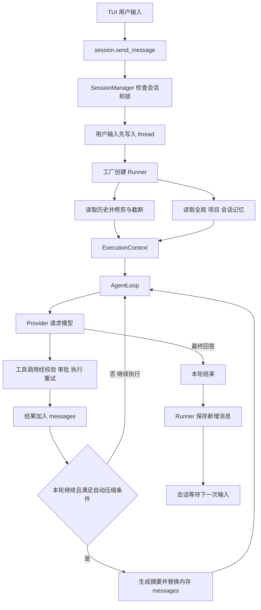
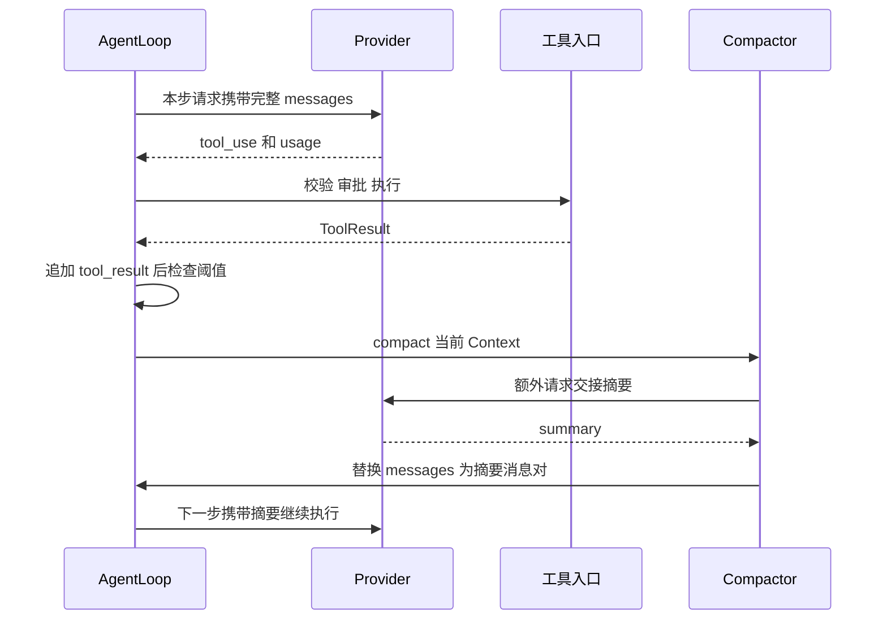

# KamaClaude · S6 上下文治理与压缩

S6 在 S5 的多轮会话、工具审批和错误处理上，增加全局与项目记忆加载、历史工具结果截断、上下文占用展示，以及自动、手动两条对话压缩路径。目标是让任务执行时携带必要背景，并控制越来越长的对话历史。

本文按当前 `stage/s6` 实际代码讲解，包含已同步的 DeepSeek/OpenAI 适配、Windows 前台 Core 支持与压缩后端兼容调整。TUI 是主要交互入口；前后端仍通过 TCP、JSON-RPC 2.0、NDJSON 通信。

建议从 [AgentRunner.run_and_capture](./src/kama_claude/core/runner.py) 开始阅读：先看它怎样准备一轮任务，再追踪 [AgentLoop](./src/kama_claude/core/loop.py) 中的自动压缩和 [SessionManager.compact](./src/kama_claude/core/session/manager.py) 中的手动压缩。

**当前边界：自动压缩默认关闭，压缩后的跨轮历史保存仍有缺陷；手动 `/compact` 会备份并覆盖 thread。两条路径的保存语义不同。本文会说明问题与改进方案，不把它们当作已经修复的能力。**

## 先回答几个核心问题

### 1. S6 相比 S5，主要解决什么问题？

S5 管理工具能否执行、需要谁审批，以及失败后怎样重试。S6 管理发给模型的内容：背景从哪里加载，历史太长时怎样缩短，以及用户怎样观察上下文用量。原来的权限和工具执行链继续复用。

### 2. session、run、step 和 Context 分别是什么？

| 名称 | 含义 | 生命周期 |
| --- | --- | --- |
| session | 关联多轮对话的业务容器 | 跨多次输入 |
| run | 处理一条用户消息的一轮执行 | 从开始到成功、失败或取消 |
| step | AgentLoop 的一次模型请求及后续处理 | 一轮内部可以有多步 |
| ExecutionContext | 本轮消息、记忆、步数和结果的内存对象 | 每个 run 重新创建 |

自动压缩会更换 Context.messages，不会因此创建新 session 或重置本轮步数。用于摘要的模型请求是额外内部调用，不是 AgentLoop 新增的业务 step。

### 3. 全局记忆和项目记忆在哪里？

全局文件是 `~/.kama/context.md`，项目文件是 Core 工作目录下的 `.kama/context.md`。Runner 每轮读取它们，Context 将内容放进 system prompt。没有文件就返回空字符串，不会自动创建，也没有专门的保存全局/项目记忆工具。

这不是向量检索或模型训练。当前就是加载 Markdown 文本作为背景；note_save 仍只写当前会话的 notes.md，不会自动把笔记升级为全局知识。

### 4. 三层记忆和 thread 历史有什么不同？

全局 context、项目 context、会话 notes 被放进 system；thread 中的用户、assistant、工具调用与结果被放进 messages。压缩主要替换 messages，不会清空 Context 中这三层背景字段。

system 中的章节顺序是基础提示 → 全局 → 项目 → 会话笔记；这只是文本拼接顺序，没有实现冲突规则校验或程序级覆盖优先级。

### 5. 超长工具结果截断就是对话压缩吗？

不是。截断只保留过长 tool_result 的前缀，不调用模型；压缩会额外请求模型，根据整段消息生成交接摘要。截断默认按字符计数，不能把 8000 字符说成 8000 token。

### 6. 自动压缩和手动压缩是不是同一段代码？

它们共用 Compactor.compact_messages 生成摘要，但外围处理不同：自动压缩经 compact 替换内存消息、写 summary 文件、发事件；手动压缩直接调用 compact_messages，再让 SessionStore 备份并覆盖 thread。

### 7. 自动压缩后，下个 run 会自动读取 summary 文件吗？

不会。新 run 仍通过 SessionStore 读取 thread，并没有自动用 summary_*.md 替换历史。当前自动路径还会破坏 Runner 依赖的旧 prefill_len 下标，可能导致本轮新增消息漏存。因此它只能在当前 run 内减小后续请求，尚未形成可靠的跨轮压缩闭环。

### 8. context_pct 达到阈值就能保证不会超限吗？

不能。当前比例来自已完成模型请求的用量与代码中的模型窗口映射，未知模型使用默认窗口；工具结果随后还会增加内容。它不是精确的发送前 token 预算，也不代表模型输出长度。自动压缩还要求本轮继续且刚完成工具调用。

### 9. 摘要一定比原文短、一定不丢信息吗？

都没有保证。代码要求摘要非空，但未严格验证其比原文更短；原文 token 数按字符数粗估。摘要是有损总结，关键约束和具体数据需要验证保真度，不能只根据压缩成功提示认定任务状态完整。

## S5 → S6 的变化地图

| 部分 | S5 | 当前 S6 |
| --- | --- | --- |
| 系统背景 | 基础提示与会话笔记 | 增加全局、项目 context.md |
| 历史读取 | 解析、过滤、修剪未配对工具调用 | 增加超长工具结果内存截断 |
| 用量信息 | 输入、输出、缓存 token | UsageStats 和 llm.usage 增加 context_pct |
| 自动压缩 | 没有 | AgentLoop 在符合条件的工具步之后压缩 |
| 手动压缩 | 没有 | 新增 session.compact 与 TUI /compact |
| 历史替换 | 普通追加 | 手动压缩备份旧 thread，再写摘要消息对 |
| 观察界面 | 模型、工具、审批等 | 上下文占用条、压缩结果提示 |
| 模型流异常 | 既有调用逻辑 | Anthropic/DeepSeek 路径对指定网络异常有限重试 |

OpenAI、DeepSeek 类、S5 权限审批和 Windows 退出支持来自前序同步。当前压缩默认使用 DeepSeek；手动压缩后端在第一次需要时创建，使 Core 可以在没有模型密钥时先启动并处理 ping 等命令。

## 先把整条运行流程串起来

### 一次输入怎样变成模型请求，再变成历史



图中的“保存新增消息”是现有收尾代码；自动压缩后，这一步仍有下标失效问题，后文单独展开。事件发布与 Trace 观察贯穿执行过程，不是等整个任务结束才一次性展示。

### 用连续两轮举例

第一轮用户说“阅读配置模块并总结”；第二轮说“按照项目约定修改它”。正常未触发自动压缩时，第二轮经过：

1. TUI 发送相同 session_id 和新的问题，SocketServer 路由到 CoreApp handler。
2. SessionManager 找会话、检查忙碌和关闭状态，持有该会话锁。
3. 将第二轮问题追加到 thread，生成新 run_id，更新 meta。
4. 调用 _runner_factory 创建新 Runner；新对象不等于新进程，也不丢失磁盘历史。
5. Runner 读取 thread，包括第一轮与刚追加的第二轮问题；读取时先修剪未配对工具调用，再截断过长工具结果。
6. 读取全局 context、项目 context 和本会话 notes，创建新的 Context，记录 prefill_len。
7. 每次模型调用都发送当前 messages、工具描述以及拼接后的 system。
8. 模型要求工具时，继续走 S5 的参数模型校验、权限判断、人工审批与有限重试；结果作为 tool_result 加入 messages。
9. 工具结果追加完成后，检查是否满足自动压缩条件；满足则额外生成摘要，替换当前消息，再进入下一步。
10. 模型 end_turn 时成功结束；接口错误、取消、超过步数等按原运行规则处理。
11. Runner 发布 run.finished，随后保存新增历史；SessionManager 对 chat 会话发布 waiting_for_input，保存 meta，再返回 RPC 响应。

run.finished 发布在历史追加之前，不是“文件已经持久化完成”的屏障。等待 session.send_message 响应时，SocketClient 的独立接收循环仍能接收事件并更新 TUI。

## 快速开始：先验证手动压缩

### 环境与启动

使用 Python 3.12.x、uv。下面以 Windows PowerShell 为例，先进入仓库根目录：

```powershell
uv sync
if (-not (Test-Path -LiteralPath .env)) {
    Copy-Item -LiteralPath .env.example -Destination .env
}
```

编辑 `.env`，将示例占位符替换为实际密钥和该接口支持的模型 ID：

```dotenv
DEEPSEEK_API_KEY=<你的密钥>
KAMA_LLM_DEFAULT_MODEL=<实际可用的模型ID>
KAMA_HOST=127.0.0.1
KAMA_PORT=7437
KAMA_MAX_STEPS=20
KAMA_PERMISSION_TIMEOUT_S=60
KAMA_COMPACT_THRESHOLD=0
KAMA_LOG_LEVEL=INFO
```

当前默认后端在 Runner 和 Core 的压缩工厂中选择，不会仅根据环境里有哪些密钥自动切换。内置默认模型名仍偏向 Anthropic，因此使用 DeepSeek 时要显式填写合适的模型。OpenaiProvider 为延迟导入 SDK，使用它时需要另外安装 OpenAI SDK，并调整相应后端创建位置。

配置顺序：内置默认 → `~/.kama/config.toml` → `.env` → 已有系统环境变量。启动后的配置不会因为编辑文件自动热更新。

终端一：

```powershell
uv run kama-core
```

终端二：

```powershell
uv run kama ping
uv run kama-tui
```

Windows 的前台 Core 已适配 Ctrl+C。后台 core start/stop 仍含 Unix 进程管理假设，学习时优先使用前台方式。相对文件路径以 Core 工作目录为基准，TUI 在哪里启动不会自动改变工具的执行目录。

### 手动创建记忆文件

项目记忆位置示例：

```text
KamaClaude/
  .kama/
    context.md
```

文件内容可以是：

```markdown
本项目使用 Python 3.12。
文本文件统一使用 UTF-8。
修改代码前先说明相关模块与影响。
```

全局记忆放在用户主目录的 `.kama/context.md`，例如说明沟通语言与通用偏好。两个文件需要自行创建，不应覆盖已有内容；里面的文本会发送给模型。note_save 则由工具追加会话 notes，三种来源不要混淆。

连续两轮提问，观察项目约定是否被遵循；要证明加载成功，可以检查开启完整 LLM payload 时的 system Trace。模型回答正确也可能来自普通历史，不能单靠回答推断某个记忆来源已生效。

### 手动压缩实验

1. 在同一个 TUI 会话连续完成几轮问答，保留明确的目标、约束和剩余任务。
2. 本轮执行结束、输入框恢复后，输入精确的 `/compact`。
3. 等待摘要 token 数与估算节省量的提示，检查该会话目录的 thread 及备份。
4. 再问“原始目标是什么，剩余任务有哪些”，核对关键事实是否仍然存在。

当前 TUI 只识别精确的 `/compact`，没有解析 `/compact 某个重点`。RPC 支持 focus，但 TUI 默认发送空字符串。压缩会额外请求模型，太短的历史未必值得压缩；目前也没有严格的收益检查。

自动压缩要在 Core 启动前设置 `KAMA_COMPACT_THRESHOLD=0.8` 等非零值，并满足后文的运行条件。它是实验能力，跨轮持久化问题未修复，不要仅为了看到提示就认为整个流程可靠。

## 关键代码一：三层记忆怎样加载

源码：[memory/loader.py](./src/kama_claude/core/memory/loader.py)、[runner.py](./src/kama_claude/core/runner.py)、[context.py](./src/kama_claude/core/context.py)。

Runner 每轮调用：

```python
global_ctx = load_context_file(Path("~/.kama/context.md").expanduser())
project_ctx = load_context_file(Path(".kama/context.md"))
notes = store.read_notes(session.id)
```

load_context_file 先 expanduser，文件不存在则返回空字符串，否则以 UTF-8 读取并 strip。项目路径是相对 Core 当前工作目录，不是自动寻找 Git 根目录，也不是使用 session 的存储目录。

| 内容 | 来源 | 谁写入 | 下一轮放在哪里 |
| --- | --- | --- | --- |
| 全局记忆 | ~/.kama/context.md | 当前主要由用户维护 | system 的 Global Context |
| 项目记忆 | Core 工作目录/.kama/context.md | 当前主要由用户维护 | system 的 Project Context |
| 会话笔记 | session 目录/notes.md | note_save | system 的 Session Notes |
| 对话历史 | session 目录/thread.jsonl | SessionManager、Runner | messages |

Context 的拼接逻辑可以理解为：

```text
parts = [基础提示词]
非空 global_context → 追加 Global Context 章节
非空 project_context → 追加 Project Context 章节
非空 session_notes → 追加 Session Notes 和保存笔记提醒
返回所有文本的拼接结果
```

这些文件每个 run 读取一次；运行期间修改不会自动更新本轮 Context。README、AGENT.md 等文件也不会因为存在就被这套 loader 自动加载。

## 关键代码二：读取历史时怎样控制工具结果长度

源码：[compact/budget.py](./src/kama_claude/core/compact/budget.py)、[session/store.py](./src/kama_claude/core/session/store.py)。

read_messages 的顺序是：

```text
解析 thread JSONL
    → 过滤无法解析或角色异常的行
    → _trim_orphan_tool_use
    → truncate_tool_results
    → 返回模型消息列表
```

truncate_tool_results 只处理 role=user、content 为列表中的字符串 tool_result：

```text
长度 ≤ 8000 字符 → 保留
长度 > 8000 字符 → 保留前 4000 字符，加省略说明
普通 user 文本、assistant 文本 → 不做同样截断
```

它构造新的列表和需要修改的消息块，不会在这一步覆盖磁盘原文。省略说明提示完整输出可从运行事件查找，但事件记录也不是无限输出保证，例如 BashTool 自身已有输出上限。

当前入口使用函数默认的 8000/4000，config 中的 tool_result_limit、tool_result_keep 尚未传进这次调用。因此修改对应配置不等于这里就改变长度；本轮刚生成的工具结果也不会立即经过这道历史读取截断。

继承自前序的修剪问题仍在：未配对 tool_use 如果始终留在文件中，读取时可能持续裁掉其后的新消息。它与上下文压缩是两个需要分别修复的问题。

## 关键代码三：上下文占用从哪里来

源码：[llm/provider.py](./src/kama_claude/core/llm/provider.py)、[llm/types.py](./src/kama_claude/core/llm/types.py)。

Provider 将模型响应的用量转换为 UsageStats，并发布 llm.usage。S6 新增的字段是：

```python
context_pct = input_tokens / context_window
```

代码通过模型名表查 context_window，未知模型回退到默认值。Anthropic/DeepSeek 路径采用响应的 input_tokens，OpenAI 使用 prompt_tokens；当前没有统一的精确预算器去核算 system、工具、缓存与下一步输出预留。

TUI 根据比例显示占用条。它表示输入上下文占用参考，不是“任务完成百分比”，也不是“本次回答已输出多少”。它来自上一请求返回的用量，后续新增工具结果还可能让下一次请求更大。

自动阈值由 Runner 显式传入 AgentLoop。虽然 AgentLoop 构造方法的默认值是 0.80，应用实际采用 config.compaction.auto_threshold，内置值为 0.0，所以默认关闭。

## 关键代码四：Compactor 怎样把历史变成摘要

源码：[compact/compactor.py](./src/kama_claude/core/compact/compactor.py)。

### _messages_to_text：先把模型消息展开成可总结文本

普通消息保留角色与文字；assistant 的工具调用保留名称、ID、参数；user 的工具结果保留对应调用 ID 和内容。示意：

```text
[USER]
请修改配置模块。

[ASSISTANT]
<tool_call name=read_file id=call-1>
{'path': 'config.py'}
</tool_call>

[USER]
<tool_result id=call-1>
文件内容……
</tool_result>
```

因此总结包含工具发生过什么，而不只是用户与模型的自然语言问答。

### compact_messages：共享的摘要生成方法

它接收 messages、provider、可选 focus，大致执行：

```text
按消息内容字符数除以 4，粗估原 token 数
    ↓
历史展开成文本，拼接交接摘要提示词
    ↓
focus 非空时加入重点提醒
    ↓
额外请求模型，tool_schemas=[]，使用总结专用 system
    ↓
异常或摘要为空 → 返回 None
    ↓
返回 CompactionResult
```

摘要要求包含六类信息：原始目标、已完成步骤、关键约束与发现、文件状态、剩余任务、关键数据。模型输出仍需要验证，章节要求不等于程序已经检查每项内容完整。

请求片段如下，省略了请求文本的构造：

```python
response = await provider.chat(
    messages=compress_request,
    tool_schemas=[],
    bus=silent_bus,
    run_id="compact",
    step=0,
    system="You are a helpful assistant that summarizes conversations.",
)
```

silent_bus 没有接入正常前端订阅，避免摘要 token 混入业务回答。它不保证完全没有 Trace：自动路径传入的 Provider 可能已被 TracingProvider 包装，手动路径当前使用单独按需创建的原始后端，两者观察路径也不同。

| 返回字段 | 含义 | 精确程度 |
| --- | --- | --- |
| summary_text | 摘要文字 | 模型生成，需要检查保真度 |
| original_token_estimate | 原消息内容字符长度 / 4 | 粗估，未完整覆盖请求开销 |
| summary_tokens | 有 usage 时取输出 token，否则按摘要字符数估算 | 与原文估算口径不完全一致 |

方法不会修改传入的 Context，也不会自动写回 thread。源码注释称“纯函数式”，指的是结果返回形式；它实际会调用外部模型，因此不是严格意义上的无副作用纯函数。

### compact：自动路径的包装方法

它先调用 compact_messages，成功后：

```python
context.messages = [
    {"role": "user", "content": result.summary_text},
    {
        "role": "assistant",
        "content": "Understood, I'll continue from this summary.",
    },
]
```

第二条是程序生成的固定确认文本，不是又调用一次模型。接着 _write_summary 写 session 目录的 summary_时间戳.md，再发布 context.compacted。此时 Context 的 goal、step、状态、记忆字段没有重新初始化。

摘要写文件失败会记录日志，但并不自动回滚已经替换的内存消息。压缩成功也未比较摘要是否真的更短，这些需要作为后续可靠性设计的一部分。

## 自动压缩：执行中的一条支线

位置：[AgentLoop.run](./src/kama_claude/core/loop.py)。当前条件按原逻辑表达为：

```python
if (
    not context.is_done()
    and response.stop_reason == "tool_use"
    and self._compactor is not None
    and self._compact_threshold > 0
    and response.usage is not None
    and response.usage.context_pct >= self._compact_threshold
):
    await self._compactor.compact(context, self._provider)
```

它放在本步工具结果追加后、下一步请求模型之前。好处是 tool_use 已有相应 tool_result，避免在尚未知道执行结果时直接丢掉调用细节。当前同一模型回复的工具仍逐个执行，压缩并不改变审批与执行顺序。



图中是所有条件满足时的分支。最终回答已经 end_turn、达到步数上限或比例未达到阈值时，不会按这条路径继续压缩。摘要生成失败返回 None，自动路径保留原消息继续运行。

## 手动压缩：整理已经保存的会话历史

位置：[TUI app](./src/kama_claude/tui/app.py)、[CoreApp](./src/kama_claude/core/app.py)、[SessionManager](./src/kama_claude/core/session/manager.py)、[SessionStore](./src/kama_claude/core/session/store.py)。

TUI 将 `/compact` 识别为前端指令，用 worker 发送：

```python
result = await client.send_command(
    "session.compact",
    {"session_id": session_id, "focus": ""},
)
```

当前 worker 不表示新进程，只是避免等待 RPC 时占住界面消息处理。Core 注册的 handler 校验参数，再调用 manager.compact。manager 的顺序为：

```text
查找会话和锁，忙则 SESSION_BUSY
    ↓
第一次需要时通过 provider_factory 创建压缩后端
    ↓
持有会话锁，读取历史
    ↓
调用 compact_messages 生成摘要
    ↓
失败返回 -32021；没有可用 provider 返回 -32020
    ↓
write_compacted 备份旧文件并写摘要消息对
    ↓
返回 summary_tokens 和 saved_tokens
```

持锁避免同会话边追加历史边覆盖文件。saved_tokens 通过 max(0, 原文估算 - 摘要 token) 得到，即使显示 0，也不代表代码拒绝了无收益压缩。

write_compacted 的磁盘变化是：

```text
压缩前：thread.jsonl 保存原始历史

压缩后：
  thread_时间戳.jsonl.bak  ← 旧文件重命名而来
  thread.jsonl             ← 新建，保存摘要和固定确认文本
```

下一轮 Runner 读取 thread，因此手动压缩有跨轮效果。它没有经过 Compactor.compact，不会自动执行该方法里的 summary 文件写入和 context.compacted 发布；当前 TUI 根据 RPC 返回值展示手动压缩成功。

## 两种压缩的差异与当前保存缺陷

| 对比 | 自动压缩 | 手动压缩 |
| --- | --- | --- |
| 触发 | AgentLoop 的工具步之后 | 空闲时的 /compact 或 RPC |
| 输入 | 当前 Context.messages | store.read_messages 读到的历史 |
| 共享方法 | compact_messages | compact_messages |
| 外层调用 | Compactor.compact | SessionManager.compact |
| 替换位置 | 当前内存 messages | 磁盘 thread |
| 主要记录 | summary_*.md、压缩事件 | thread 备份、RPC 返回统计 |
| 后续运行 | 同一个 run 继续 | 下一轮加载摘要历史 |
| 默认情况 | 应用配置关闭 | 用户主动调用 |

### 为什么自动压缩后，下一轮可能重新加载旧历史？

Runner 开始时记录：

```python
prefill_len = len(history)
```

结束时仍执行：

```python
store.append_messages(
    session.id,
    context.messages[prefill_len:],
    run_id=run_id,
)
```

这个算法依赖“原来的历史仍是消息列表前缀”。自动压缩替换了整个列表后，前提不再成立。例如：

```text
开始时 10 条历史 → prefill_len=10
自动压缩成 2 条 → 继续生成最终回答，总计 3 条
结束时 messages[10:] → 空列表
```

当前 run 后半段确实用摘要减少了请求内容，但它没有正确成为下一轮的磁盘历史，本轮模型回复和工具结果还可能漏存。用户输入已被 Manager 提前保存，这与后续输出是否成功保存是两件事。下轮仍读 thread，不会自动加载 summary 文件，所以可能重新携带旧长历史、再次压缩。

### 改进方案示意，尚未实施

```text
Context 记录本轮是否发生历史替换
    ↓
发生过压缩：备份旧历史，持久化当前完整消息快照
没有压缩：继续按原 prefill_len 追加新增消息
```

不能只把 prefill_len 改成 0 后继续 append，否则会变成“旧长历史 + 摘要 + 新消息”。真正的修复需要定义何时替换、失败与取消时怎样保存、压缩后的工具配对如何验证，并用连续后续轮次的测试证明效果。

## 配置、文件与观察位置

### 压缩配置

```toml
[compaction]
auto_threshold = 0.0
tool_result_limit = 8000
tool_result_keep = 4000
```

| 配置/环境变量 | 当前含义 | 注意 |
| --- | --- | --- |
| auto_threshold / KAMA_COMPACT_THRESHOLD | 0 关闭，否则作为占用阈值 | 应用默认关闭；不是强制防超限检查 |
| tool_result_limit / KAMA_COMPACT_TOOL_LIMIT | 配置层可解析截断触发长度 | 历史读取入口尚未使用此值 |
| tool_result_keep / KAMA_COMPACT_TOOL_KEEP | 配置层可解析保留长度 | 历史读取入口仍用默认 4000 |
| KAMA_PERMISSION_TIMEOUT_S | 工具审批等待时间 | 与压缩阈值、模型 token 无关 |
| KAMA_MAX_STEPS | 本轮最多业务模型步数 | 摘要调用没有独立计入该步数 |

### 数据位置

```text
用户主目录/.kama/
  context.md                         全局背景，用户维护
  policy.toml                        S5 的长期权限决定
  sessions/会话ID/
    meta.json                        会话信息
    thread.jsonl                     下一轮读取的模型对话历史
    notes.md                         note_save 保存的会话笔记
    thread_时间戳.jsonl.bak           手动压缩的原历史备份
    summary_时间戳.md                 自动压缩的摘要记录
    runs/运行ID/
      events.jsonl                   运行事件
      .tasks/                        实际创建后才有的任务文件
  traces/daemon.jsonl                 默认 Trace，位置可配置
  logs/core.log                      Core 普通日志，位置可配置
  logs/tui.log                       TUI 文件日志，位置可配置

Core工作目录/.kama/context.md         项目背景，用户维护
```

不是每个文件都会立即出现：notes、任务、备份、summary 都取决于实际调用。当前核心文件使用 UTF-8 的范围不等于所有旧阶段记录都已统一编码。

TUI 展示 llm.usage 的 context_pct、context.compacted 的摘要统计，并通过手动 RPC 结果显示节省估算。将界面占用值重置成 0，只表示重置显示状态，不代表服务端已精确测出新请求占用为零。

普通日志、事件、模型历史与 Trace 各有用途。完整 LLM payload 的 Trace 可以检查 system 和 messages，摘要 silent_bus 也不等于整个系统无记录。

## Provider 与前序能力怎样衔接

Anthropic/DeepSeek 路径使用 S6 的 context_pct，并对指定 httpx 网络读流异常做有限重试；最多三次尝试，实际两次等待为 1 秒、2 秒。为避免重复 token，当前只在第一次尝试发布文本事件，重试成功时前端也可能看不到完整的新文本，需要后续完善流恢复策略。

该路径的输出上限调整为 8192；OpenAI 保留自身请求与结束原因处理，同时已补齐上下文比例与动态 system 传递。不要把各后端的重试、输出上限和长度结束处理理解为完全一致。

S5 的工具重试与模型网络重试是两层机制；摘要额外调用也可能经历后端重试。权限判断仍只管实际工具执行，不会把摘要模型调用变成一次 write_file 审批。

Windows 的信号清理、同连接命令并发处理和 TUI 审批流程均已保留。手动压缩后端按需创建，与普通 Runner 使用同一默认后端选择，避免 Core 在启动阶段额外要求 Anthropic 密钥。

## 不请求真实模型的学习实验

下面的独立脚本只使用临时目录和假 Provider，验证项目记忆加载、system 拼接、手动压缩备份，以及下一次读取摘要。它不连接 Core，不执行工具，不修改真实会话文件。

```python
import asyncio
from pathlib import Path
from tempfile import TemporaryDirectory
from types import SimpleNamespace
from unittest.mock import AsyncMock, Mock

from kama_claude.core.context import ExecutionContext
from kama_claude.core.events.bus import EventBus
from kama_claude.core.llm.types import LlmResponse, UsageStats
from kama_claude.core.memory.loader import load_context_file
from kama_claude.core.session.manager import SessionManager
from kama_claude.core.session.store import SessionStore


# 用临时文件与假模型验证记忆加载和手动压缩的跨轮读取。
async def main():
    with TemporaryDirectory() as temporary:
        root = Path(temporary)
        project_file = root / ".kama" / "context.md"
        project_file.parent.mkdir(parents=True)
        project_file.write_text("项目文件使用 UTF-8。", encoding="utf-8")

        context = ExecutionContext(
            run_id="demo-run", goal="整理配置", max_steps=20,
            global_context="默认使用中文。",
            project_context=load_context_file(project_file),
            session_notes="本次先检查配置模块。",
        )
        system = context.system_prompt("基础提示")
        assert "Global Context" in system
        assert "UTF-8" in system
        assert "Session Notes" in system

        provider = SimpleNamespace(chat=AsyncMock(return_value=LlmResponse(
            stop_reason="end_turn",
            text="目标：整理配置；约束：UTF-8；剩余：验证优先级。",
            usage=UsageStats(input_tokens=100, output_tokens=20),
        )))
        store = SessionStore(root / "sessions")
        manager = SessionManager(store, Mock(), EventBus(), provider=provider)
        session = await manager.create("chat", "压缩实验")
        store.append_message(session.id, "user", "原始历史。" * 100)

        result = await manager.compact(session.id, focus="保留约束")
        history = store.read_messages(session.id)
        assert len(history) == 2
        assert "验证优先级" in history[0]["content"]
        assert list(store.session_dir(session.id).glob("thread_*.jsonl.bak"))
        assert result.summary_tokens == 20
        assert provider.chat.call_args.kwargs["tool_schemas"] == []
        print("三层记忆拼接、压缩备份、摘要历史读取均通过")


asyncio.run(main())
```

要观察当前自动保存缺陷，可以另外用消息列表推导：压缩后列表只有 3 条，而 prefill_len=10，切片结果为空。真正修复时应使用 Fake Provider 驱动连续多轮，而不仅测试一次切片或检查 summary 文件存在。

## 推荐阅读顺序与验证命令

1. [runner.py](./src/kama_claude/core/runner.py)：历史、三层记忆、Context、Compactor 和收尾保存的组装入口。
2. [context.py](./src/kama_claude/core/context.py)：system 与 messages 的区别，哪些字段会被替换。
3. [budget.py](./src/kama_claude/core/compact/budget.py)：不用模型的字符截断。
4. [compactor.py](./src/kama_claude/core/compact/compactor.py)：展开历史、生成摘要、替换内存与记录。
5. [session/manager.py](./src/kama_claude/core/session/manager.py) 和 [store.py](./src/kama_claude/core/session/store.py)：手动压缩的会话锁与磁盘保存。
6. [loop.py](./src/kama_claude/core/loop.py)：自动触发条件、工具配对与本轮继续执行。
7. [tui/app.py](./src/kama_claude/tui/app.py)：/compact 输入识别、worker、RPC 返回和用量展示。

| 已有测试 | 关注点 |
| --- | --- |
| tests/unit/test_memory_loader.py | 记忆文件读取、缺失和空内容 |
| tests/unit/test_context_system_prompt.py | 三层背景拼接 |
| tests/unit/test_budget.py | 工具结果截断 |
| tests/unit/test_compactor.py | 摘要请求、消息替换、文件、事件与失败保留 |
| tests/unit/test_stage_provider_compat.py | 手动后端按需创建、摘要落盘、OpenAI 用量字段 |
| tests/integration/test_s5_permission_flow.py | 继承的工具审批执行链 |

```powershell
uv run pytest tests/unit tests/integration/test_s5_permission_flow.py -q
uv run pytest tests/integration/test_ping_roundtrip.py tests/integration/test_s4_session_ipc.py -q
uv run ruff check src tests/unit tests/integration scripts
uv run mypy src
uv run python -X utf8 scripts/gen_protocol_doc.py --check
```

协议文档由模型生成；修改命令或事件后需要重新生成。真实 Core 的测试 fixture 写死 3 秒启动等待，本机曾观察到启动超过 3 秒，需区分启动等待失败与业务断言失败。S6 仍有原有 Ruff 问题，不能将测试通过理解为全部静态检查通过；没有测试覆盖到的跨轮保存缺陷也仍然存在。

## 可以改进的地方与验收标准

| 改进方向 | 当前问题 | 建议与验收 |
| --- | --- | --- |
| 自动压缩跨轮持久化 | prefill_len 在列表替换后失效，summary 未被下一轮加载 | 标记历史重写并持久化完整快照；强制触发压缩后连续运行两轮，摘要与新输出都能读取 |
| 精确请求预算 | 依赖上一请求用量、窗口映射与字符估算 | 统一后端窗口配置、token 估算与输出预留；大工具结果进入下一请求前也能判断 |
| 接通截断配置 | limit/keep 只被解析，调用仍用默认值 | 明确依赖传递与参数约束；改变配置后验证实际截断长度变化 |
| 摘要收益和保真 | 只判非空，没有约束覆盖验证 | 检查摘要长度、关键约束与未完成任务；空、变长、漏关键数据时不替换历史 |
| 原子保存与恢复 | 先 rename 再写，失败可能缺失活动文件，时间戳有碰撞可能 | 唯一备份名、临时文件和原子替换；模拟写失败后原文可恢复且新输入不丢失 |
| 统一手动与自动流程 | 文件、事件、Trace 路径不一致 | 共享明确的压缩事务与事件语义；两种入口都能定位摘要输入、结果与保存状态 |
| 前端压缩状态 | worker 未完整维护专门忙碌状态，短时间可重复发起 | 增加 compacting 状态与错误恢复；重复提交、断线、取消后界面和后端锁状态一致 |
| 流式重试显示 | 后续尝试不发布文本，界面可能停留在残缺输出 | 设计文本替换或重试块边界；模拟中途断流，最终展示与保存回复一致 |
| 记忆维护 | 手动 Markdown，没有加载来源与冲突管理 | 显示来源、控制注入预算和敏感信息；验证不同项目背景不会因工作目录混淆 |

此外仍需处理历史未配对工具调用的持久修复、S5 审批断线清理和会话恢复等继承问题。选择个人改进时，先给出复现和验收，再写实现；不要把候选方向表述成已经完成的功能。

## 核心问题与面试参考答案

**S6 的“记忆”怎样实现？**

每个 run 从全局和项目 context.md、会话 notes.md 加载文本，注入 system；对话历史放在 messages。它是文件驱动的提示词构建，没有向量检索和模型训练，也没有自动跨层升级笔记。

**为什么截断与压缩要分开？**

截断成本低，直接减少单个工具输出，但可能丢掉尾部关键内容；模型摘要试图保留整段任务状态，代价是额外调用和有损总结。当前分别作用于历史读取和压缩入口，覆盖范围不同。

**为什么自动压缩放在工具结果之后？**

这样已有工具调用和结果配对，摘要能知道执行结果。它发生在当前 run 内，不重新创建业务会话；但当前用量来自此前请求，尚不能保证下一请求绝不超限。

**为什么不能只保存 summary.md 就算完成持久化？**

下一轮实际读取的是 thread。没有把摘要写入活动历史或设计压缩检查点加载逻辑，摘要文件就只是观察记录。还要保存压缩后新增回复，并处理原增量下标失效问题。

**怎样修复 prefill_len 问题，为什么不能直接清零？**

压缩改变了整个历史前缀，应显式记录历史已重写，采用备份后的快照替换；未重写时继续增量追加。只清零再 append 会保留旧长历史并重复添加摘要，不能真正缩短下一轮上下文。

**如何验证压缩效果？**

除了 token 或字符减少，还要检查目标、约束、已完成和剩余任务保真；覆盖失败保留、磁盘恢复和后续多轮运行。一次摘要文件存在或单次单元测试通过都不足以证明端到端可靠。

**怎样准确表述自己的 S6 改进？**

先说明具体缺陷，例如自动压缩后新增消息漏存，再说明采用的保存策略、失败恢复与连续多轮测试。只描述实际完成的工作与测得的结果，避免把文件注入说成完整长期记忆系统，或把比例展示说成严格 token 预算。

## 相关文档

- [S6 阶段学习文档](./docs/learning/S6-上下文治理与压缩.md)
- [RUNBOOK.md](./RUNBOOK.md)：运行与操作参考，具体行为以当前分支为准。
- [WIRE_PROTOCOL.md](./WIRE_PROTOCOL.md)：自动生成的命令与事件定义。

本分支的 docs 仅上传 S6 对应学习文档；其他阶段本地学习资料不属于本阶段提交内容。
