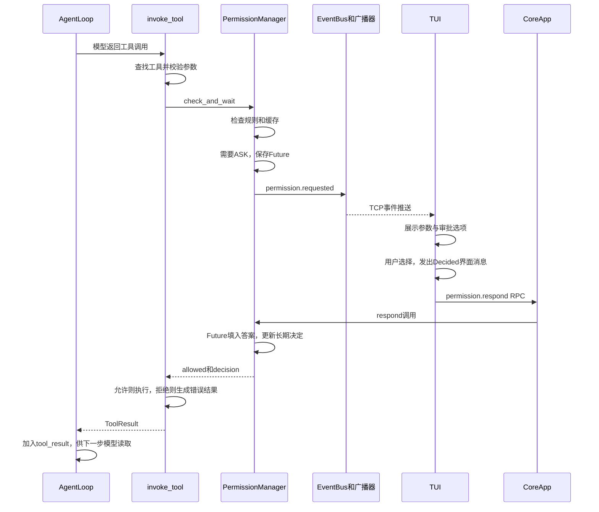

# KamaClaude · S5 工具权限与失败处理

S4 让同一个 session 可以连续对话，并保存历史与笔记。S5 在工具真正执行之前增加参数校验、权限策略和人工审批，在执行失败时按错误类型决定是否重试。TUI 是主要交互入口，Core 仍通过 TCP、JSON-RPC 2.0 和 NDJSON 与客户端通信。

本文按当前 `stage/s5` 代码讲解。OpenAI、DeepSeek Provider、多轮会话和 Windows 前台 Core 适配已从前序阶段同步；它们是本阶段的基础，不是 S5 新增的权限能力。

建议从 [invoke_tool](./src/kama_claude/core/tools/invocation.py) 开始：它把“找到工具 → 校验参数 → 检查权限 → 执行与重试 → 返回结果”串在一起，再沿着调用进入 PermissionManager。

## 先回答几个核心问题

### 1. 模型已经决定调用工具，为什么还要询问用户？

模型输出的是工具名称与参数，实际读写文件、执行命令的是 Core。模型的决定不等于用户授权。S5 在执行边界检查权限，允许自动放行低风险操作，也允许用户拒绝本次操作。

当前默认询问 bash 和 write_file；read_file、list_dir、note_save 默认允许。默认策略表未登记的工具走 ASK，因此四个任务工具也可能触发审批。

### 2. ASK 是拒绝，还是暂停？

ASK 表示需要用户作决定。PermissionManager 创建 Future，发出 permission.requested 事件，再等待答案。用户允许后才执行；拒绝或超时后返回错误 ToolResult。等待的是当前协程，Core 的事件循环仍能处理其他消息。

### 3. post_message 为什么能触发 on_permission_select_decided？

这是 Textual 的消息分发约定。PermissionSelect.Decided 是 TUI 内部的界面消息，框架根据命名找到 on_permission_select_decided。App 在该方法中调用 SocketClient.send_command，才把决定发送给 Core。post_message 本身不走 TCP。

### 4. 为什么 SocketServer 也必须修改？

session.send_message 会等待整轮运行完成；运行又可能等待 permission.respond。如果同一连接必须等第一条命令完成后才读取下一条，审批响应就无法被处理。S5 为每条命令创建协程任务，让读循环继续接收后续请求。

### 5. “始终允许”只在当前会话有效吗？

当前不是。always_allow 同时更新会话缓存和按工具名保存的跨会话缓存，并尝试写入 `~/.kama/policy.toml`。例如始终允许 write_file，会影响其他会话的 write_file，不仅是当前文件。bash 的显式拒绝规则、目录范围强制询问仍有更高优先级。

### 6. 工具失败会让整个 run 立即失败吗？

通常不会。invoke_tool 把可处理的失败转换为错误 ToolResult，AgentLoop 将它作为 tool_result 交回模型，模型可以修正参数、换方法或解释原因。模型接口异常、取消、超过步数限制等仍属于另一层运行终止逻辑。

### 7. 自动重试是在重新请求模型吗？

不是。工具执行阶段对 runtime_error、rate_limited 最多重试两次，即最多执行三次，等待时间为 2 秒、4 秒；参数错误、权限拒绝和超时不走该重试路径。只有最终结果返回 AgentLoop 后，才可能进入下一次模型请求。

### 8. S5 已经实现完整沙箱了吗？

没有。当前是应用层权限控制，bash 的目录范围判断依赖正则启发式规则，主要针对 Unix 风格命令。它没有完整解析 shell，也没有提供操作系统级文件隔离。工具描述、路径检查和审批策略各有作用，不能把它们等同于完整沙箱。

## S4 → S5 的变化地图

| 部分 | S4 | 当前 S5 |
| --- | --- | --- |
| 会话与记忆 | session、thread.jsonl、notes.md | 继续复用 |
| 工具入口 | 基础必填检查、限时调用、错误返回 | Pydantic 校验、权限审批、分类处理与重试 |
| 权限规则 | 没有审批管理器 | ALLOW / DENY / ASK、命令正则、缓存 |
| 长期授权 | 没有 | policy.toml 保存按工具名作出的决定 |
| TUI | 聊天输入、模型文本、工具展示 | 审批摘要与选择控件、键盘操作、worker 发送 |
| RPC | session 等命令 | 新增 permission.respond |
| 事件 | run、step、tool、session 等 | 新增三种 permission 事件，失败事件增加 attempt |
| 同一连接的命令处理 | await 当前 handler，再读下一条 | create_task 处理当前请求，继续读取 |
| 断线容错 | 基础收尾 | 关闭连接和发送成功响应时捕获更多网络异常 |
| TUI 日志 | 没有独立的本阶段文件日志入口 | 默认写入 ~/.kama/logs/tui.log |

SessionManager、SessionStore 和 AgentLoop 的主要职责没有改变；新增的 PermissionManager 经 CoreApp → Runner → AgentLoop → invoke_tool 向下传递。

## 一次工具审批的完整路径



这里省略了 SocketClient、SocketServer 的中间转发。事件是 Core → TUI 的推送；permission.respond 是 TUI → Core 的命令。它们共用已建立的 TCP 连接，但采用各自的消息封装。

## 快速开始与手工验证

### 环境和配置

使用 Python 3.12.x、uv；Windows 可使用前台 Core 与 TUI。下面的命令使用 PowerShell，先进入仓库根目录：

```powershell
uv sync
if (-not (Test-Path -LiteralPath .env)) {
    Copy-Item -LiteralPath .env.example -Destination .env
}
```

编辑 `.env`。当前 Runner 默认创建 DeepseekProvider，需要填写实际可用的 DeepSeek 密钥和模型 ID；下面尖括号内的内容必须替换：

```dotenv
DEEPSEEK_API_KEY=<你的密钥>
KAMA_LLM_DEFAULT_MODEL=<该接口实际支持的模型ID>
KAMA_HOST=127.0.0.1
KAMA_PORT=7437
KAMA_MAX_STEPS=20
KAMA_PERMISSION_TIMEOUT_S=60
KAMA_LOG_LEVEL=INFO
```

`.env.example` 中的模型示例仍偏向 Anthropic，不代表 Runner 会按密钥自动选择 Provider。OpenaiProvider 和 AnthropicProvider 已保留，但默认后端的选择仍在 Runner 中；OpenAI SDK 为延迟导入，需要使用时另外安装。

配置优先级是：内置默认值 → `~/.kama/config.toml` → `.env` → 已有系统环境变量。修改后重启相应进程。审批时限也可以在配置文件中写成：

```toml
[permission]
timeout_s = 60.0
```

0 表示不设置审批超时；它不代表工具可以无限执行。审批时限和工具执行时限是两套计时。

### 启动两个终端

终端一，运行 Core：

```powershell
uv run kama-core
```

终端二，检查连接并启动主要前端：

```powershell
uv run kama ping
uv run kama-tui
```

Windows 的前台 Core 已适配 Ctrl+C 清理。后台 core start/stop 仍有 Unix 进程管理假设，学习时优先使用前台方式。读写工具的相对路径基于 Core 的工作目录；会话保存在用户目录，并不意味着工具自动在会话目录执行。

### 验证“允许一次”和“拒绝一次”

在 TUI 输入：

> 请实际调用 write_file，把 hello 写入当前目录的 s5-demo.txt，然后告诉我结果。

出现审批后选择 Allow once，观察 permission 事件、工具结果以及文件。再要求模型把内容改成 world，这次选择 Deny，检查文件内容没有因这次调用改变。

| 选项 | 快捷键 | 影响 |
| --- | --- | --- |
| Allow once | y / 1 | 只允许本次 |
| Always allow | a / 2 | 允许本次，并记住这个工具的决定 |
| Deny | n / 3 | 只拒绝本次 |
| Always deny | d / 4 | 拒绝本次，并记住这个工具的决定 |

也可以上下键选择后按 Enter。始终类选项会影响后续实验，想反复观察弹出审批，优先选一次性决定。如果已保存长期授权，可以在了解已有内容后调整 policy.toml，再重启 Core；运行中手动改文件不会自动刷新内存。

是否调用工具仍由模型决定。没有出现审批时，先确认模型实际发出了工具调用，再检查是否已有缓存或默认允许。不要仅根据模型文字声称“已写入”判断验证成功。

CLI 的 kama chat 增加了审批打印和响应分支，但当前仍在发送消息后直接 await 整轮结束，期间主循环不能及时读取审批输入，可能一直等到审批超时。它不能替代本阶段 TUI 的交互验证。

## 代码结构与阅读顺序

```text
core/
  app.py                    组装权限管理器，注册 permission.respond
  runner.py                 将权限管理器传入 AgentLoop
  loop.py                   向 invoke_tool 传入管理器与 session_id
  permissions/
    policy.py               决策类型、默认规则、命令检查、参数摘要
    storage.py              长期决定字典与 policy.toml 的转换
    manager.py              规则优先级、Future、缓存和审批结果处理
  tools/
    base.py                 params_model 和 ToolResult.error_type
    invocation.py           参数校验、审批、执行、重试和事件
    builtin/                各工具的参数模型及实际执行
  transport/socket_server.py 同连接命令并发处理、断线容错
tui/
  app.py                    审批控件、界面消息、发送决定与 worker
  __main__.py               TUI 独立文件日志
```

建议先看 invocation 抓住全局顺序，再看 policy、storage、manager，最后从 TUI 的按键一直追到 Core 的 respond。完整的文件入口见后面的链接。

## 关键代码一：policy 怎样判断规则

源码：[permissions/policy.py](./src/kama_claude/core/permissions/policy.py)。

### 决策和策略是两个层次

PermissionDecision 定义 ALLOW、DENY、ASK；ToolPolicy 描述某个工具采用的默认决定与正则列表：

```python
@dataclass
class ToolPolicy:
    default: PermissionDecision
    allow_patterns: list[str] = field(default_factory=list)
    deny_patterns: list[str] = field(default_factory=list)
```

default_factory 为每个实例创建独立列表。当前默认表中两个 pattern 列表都为空；下面只是自定义规则的示意，并不代表配置文件已经支持它们：

```python
policy = ToolPolicy(
    default=PermissionDecision.ASK,
    allow_patterns=[r"^git status$"],
    deny_patterns=[r"forbidden_command"],
)
```

### matches_outside_cwd 和 evaluate

matches_outside_cwd 使用编译后的正则，发现 Unix 风格绝对路径、`~`、`../`、HOME/PWD 变量或显式 cd 时，返回 True。这是保守的文本判断，例如打印 HOME 也可能触发询问，并非证明命令一定越界。

evaluate 的顺序是：

```text
取得工具策略，未登记则 ASK
    ↓
bash 命中 deny_patterns → DENY
    ↓
bash 命中目录范围启发式规则 → ASK
    ↓
bash 命中 allow_patterns → ALLOW
    ↓
返回工具 default
```

前面的判断一旦返回，后面不再执行。两个 pattern 列表当前针对 bash.command，不是 read_file、write_file 的通用路径白名单。

### param_preview 只负责展示

它为 bash 选 command、文件工具选 path、note_save 选 content，截取较短摘要；没有已知字段时使用参数字典的字符串。`!r` 使用 repr 形式展示字符串，有助于看出引号与转义。摘要被截断不会截断真实工具参数，也不参与放行判断。

## 关键代码二：storage 怎样保存长期决定

源码：[permissions/storage.py](./src/kama_claude/core/permissions/storage.py)。

默认文件是 `~/.kama/policy.toml`，内容示例：

```toml
[always]
bash = "deny"
write_file = "allow"
```

它对应的内存数据是：

```python
{"bash": "deny", "write_file": "allow"}
```

| 方法 | 输入 → 输出 | 关键行为 |
| --- | --- | --- |
| load_policy_file | 可选路径 → 决定字典 | expanduser 展开用户目录；不存在则返回空字典；UTF-8 逐行读取 |
| save_policy_file | 完整决定字典、可选路径 → 文件 | 创建父目录，排序生成条目，以 UTF-8 覆盖写入 |

load 中的 in_always 表示“当前是否正在读取 [always] 小节”；partition("=") 拆出工具名和值，只有 allow、deny 被接受。这里是简化的手工解析，不是完整 TOML 解析器，带行尾注释等写法不一定被支持。

save 接收的是全部长期决定，不只是本次新选择。例如原有 bash=deny，再加入 write_file=allow，会一起重写。它实际上覆盖整个文件，不会保留其他自定义小节和注释，也没有临时文件加原子替换的保护。

文件只保存按工具名记录的 allow/deny，不保存正则策略、工具参数、会话历史或审批过程。Core 创建 PermissionManager 时加载一次；手动改文件需要重新加载，当前没有热更新。

## 关键代码三：PermissionManager 的完整工作方式

源码：[permissions/manager.py](./src/kama_claude/core/permissions/manager.py)。

### 初始化：分清三张字典

| 属性 | 键和值 | 作用 |
| --- | --- | --- |
| _pending | tool_use_id → _PendingRequest | 找到还在等待答案的审批 Future |
| _session_always | (session_id, tool_name) → allow/deny | 当前会话的决定缓存 |
| _persistent_always | tool_name → allow/deny | 跨会话决定的内存副本，可从磁盘加载、写回 |

_PendingRequest 保存 future、session_id、tool_name。工具名称不能代替 tool_use_id，因为同一个工具可能同时或先后发起多次不同调用。

_policies 保存规则表，默认浅拷贝 DEFAULT_POLICIES。_timeout_s 保存审批等待时间；policy_file=None 时不会自动加载默认文件，Core 的真实入口会显式传入用户目录中的文件路径。

### evaluate 与 check_and_wait 不要混淆

manager.evaluate 只包装 policy.evaluate，提供不等待的静态判断，不包含缓存和人工审批。真正的执行入口调用 check_and_wait，它自己维护完整的判断顺序：

```text
1. bash 拒绝正则命中 → 自动拒绝
2. bash 疑似越出工作目录 → 跳过后续缓存与默认规则，直接询问
3. 当前会话缓存命中 → 使用缓存
4. 跨会话长期决定命中 → 使用缓存
5. bash 允许正则命中 → 自动允许
6. 工具默认 ALLOW / DENY → 自动决定
7. 默认 ASK 或未知工具 → 人工询问
```

因此，当前会话缓存优先于跨会话缓存；也不是所有 DENY 都高于用户缓存，最先强制执行的是 bash 的 deny_patterns，工具 default 在后面判断。

方法返回 `(allowed, decision)`，例如 `(True, "auto_allow")`、`(False, "deny_once")`，分别表达“是否执行”和“决定来源”。

### ASK：先登记 Future，再发布请求

下面是核心逻辑的简化片段：

```python
future = loop.create_future()
self._pending[tool_use_id] = _PendingRequest(
    future=future,
    session_id=session_id,
    tool_name=tool_name,
)

await event_emitter(permission_event)
raw = await asyncio.wait_for(future, timeout=self._timeout_s)
```

真实代码在 timeout_s=0 时改用直接 await future，并在超时后清理 pending、返回 `(False, "timeout")`。

先登记再通知，是为了保证快速到达的答案也能找到请求。event_emitter 是外部传入的异步函数：manager 提供事件字典，invoke_tool 的回调把它转换成 PermissionRequestedEvent，加入 run_id 后发布到总线。manager 不需要直接持有 Socket。

`Callable[[dict[str, Any]], Awaitable[None]]` 表示：函数接收一个字典，返回可等待的对象，完成后没有有用返回值。

### respond：只负责把答案填回 Future

```python
req = self._pending.pop(tool_use_id, None)
if req is not None and not req.future.done():
    req.future.set_result(decision)
```

pop 同时取出和移除请求；未知 ID 记录警告。set_result 让 check_and_wait 中的 await 恢复，它不会直接调用工具。

### _apply_response：解释答案并更新长期决定

| 决定 | 本次执行 | 更新缓存与尝试落盘 |
| --- | --- | --- |
| allow_once | 允许 | 否 |
| deny_once | 拒绝 | 否 |
| always_allow | 允许 | 两种缓存都更新，写 policy.toml |
| always_deny | 拒绝 | 两种缓存都更新，写 policy.toml |

check_and_wait 收到 Future 的结果后调用它，再把判断返回 invoke_tool。磁盘保存失败只记录异常，不会回滚已经更新的内存决定，所以当前进程中有效不等于重启后一定保留。

### cancel_session：已有方法不等于已接入断线流程

它找出某个 session 的 pending 请求，逐个填入 deny_once，让等待者按拒绝路径继续。这里没有使用 future.cancel，也不会取消整个 run。

当前源码还没有把这个方法接入实际断线清理。客户端断开后不能保证立即拒绝审批；默认时限可以结束等待，timeout_s=0 则可能一直等待。协程取消、事件发布失败的 pending 清理也还需要统一 finally 处理。

## 关键代码四：参数模型与 invoke_tool

源码：[tools/base.py](./src/kama_claude/core/tools/base.py)、[tools/invocation.py](./src/kama_claude/core/tools/invocation.py)。

### params_model 的类型是什么意思

```python
params_model: ClassVar[type[BaseModel] | None] = None
```

它声明一个可选的类属性，保存的是 Pydantic 模型类，不是模型实例：

```python
class BashTool(BaseTool):
    params_model = BashParams
```

`ClassVar` 表示类级配置；`type[BaseModel]` 表示 BaseModel 本身或其子类；`| None` 允许不提供；`= None` 是默认赋值。注解本身不会校验数据，真正校验发生在 model_validate。

例如 BashParams 要求 command 是字符串，timeout 默认 60，允许范围 1～120：

```python
class BashParams(BaseModel):
    model_config = ConfigDict(extra="ignore")
    command: str
    timeout: int = Field(default=60, ge=1, le=120)
```

input_schema 用来告诉模型怎样填写参数；params_model 用来在后端实际检查。当前 invocation 只做预校验，没有把返回的模型实例作为统一规范化参数往后传，各内置工具执行时会再次解析。没有 params_model 的工具不会自动拥有同等校验能力。

### invoke_tool 的执行顺序

```text
发布 tool.call_started
    ↓
registry.get 找工具；找不到立即返回错误
    ↓
有 params_model 则校验；ValidationError → schema_error
    ↓
有 PermissionManager 则检查和等待权限
    ↓
拒绝或审批超时 → permission_denied，不执行工具
    ↓
允许后进入工具执行重试循环
    ↓
最终返回 ToolResult，AgentLoop 追加 tool_result
```

工具开始事件在参数校验和审批之前发布，所以看到 tool.call_started 不代表实际操作已经执行。PermissionManager 在直接构造 Runner 时是可选依赖，未传入会跳过审批；真实 Core 入口会注入它。

审批超时在 manager 内返回 timeout，但 invocation 将未授权结果统一转换为 permission_denied；它与工具执行耗时产生的 timeout 不是同一个层次。

### 错误分类与重试

| 错误类型 | 例子 | 当前执行重试策略 |
| --- | --- | --- |
| schema_error | 缺参数、参数值越界 | 不重试 |
| permission_denied | 用户拒绝、审批超时 | 不执行、不重试 |
| timeout | 工具执行超时 | 不重试 |
| runtime_error | 工具异常、bash 非零退出 | 进入执行循环后可重试 |
| rate_limited | 工具抛出 RateLimitedError | 可重试 |

未知工具虽然也归为 runtime_error，但在进入执行循环前就返回，不会重试。这里的 rate_limited 针对工具执行错误，不是 LLM 接口的自动重试配置。

```text
第 1 次执行失败 → 若可重试，发布 attempt=1，等 2 秒
第 2 次执行失败 → 若可重试，发布 attempt=2，等 4 秒
第 3 次执行失败 → 发布 attempt=3，返回最终错误
```

审批在循环外完成，因此同一次工具调用的重试不会重新询问。当前外层工具调用默认时限 120 秒，每次 attempt 分别计时，审批和退避等待不包含在这个限时调用中；BashTool 还有自己的 command timeout，默认 60 秒。

中间失败事件给界面和记录使用，不会每次都交给模型。invoke_tool 最后返回的结果才由 AgentLoop 加进消息。runtime_error 分类较宽，对有副作用的操作重复执行可能不合适，这也是后续改进点。

## 关键代码五：TUI 怎样发送用户决定

源码：[tui/app.py](./src/kama_claude/tui/app.py)。

### 从按键到界面消息

PermissionSelect 保存 tool_use_id，on_key 根据 y/a/n/d 或数字、方向键和 Enter 得到决定，然后调用：

```python
def _pick(self, decision: str) -> None:
    self.post_message(
        self.Decided(self, self._tool_use_id, decision)
    )
```

这里发的是 PermissionSelect.Decided。Textual 将消息加入队列，按消息类型命名寻找处理方法；默认冒泡允许外层 App 接收它。PermissionSelect.Decided 对应 on_permission_select_decided，不需要在项目里手动调用这个方法。

### App 收到消息后，才真正发 TCP 命令

```python
await self._client.send_command(
    "permission.respond",
    {
        "tool_use_id": msg.tool_use_id,
        "decision": msg.decision,
    },
)
```

该方法还会移除选择控件、更新 PermissionBlock 的显示。PermissionBlock._resolve 只是界面状态更新，不能代替 Core 中的 Future.set_result。

SocketClient 把命令序列化成 JSON-RPC 并追加换行，用 writer.write 和 drain 发送；接收循环按 RPC id 完成客户端自己的等待对象。Core 再根据 tool_use_id 完成审批 Future。两处 Future 分别负责 RPC 响应和业务审批，不是同一个对象。

### worker 为什么必要

S4 在提交消息的界面处理方法里直接等待 session.send_message 完成。S5 改用 run_worker 执行 _do_send_message，让 App 消息处理能继续响应审批控件。它不是把运行移到新进程，而是调整异步工作组织。

PermissionSelect 挂载在顶层、输入框之前，以减少滚动区对焦点的影响。审批完成后界面可以恢复输入框焦点，但 _busy 仍由会话运行流程维护；允许一次工具调用不代表整轮任务已经结束。

## 关键代码六：SocketServer 为什么改成并发处理命令

源码：[transport/socket_server.py](./src/kama_claude/core/transport/socket_server.py)。

S4 读循环：

```python
await self._handle_line(line, writer)
```

S5 读循环：

```python
asyncio.create_task(self._handle_line(line, writer))
```

旧方式只限制当前连接，不会让整个 Core 停止工作，但会导致同连接审批互相等待：

```text
session.send_message 等待整轮完成
    → 本轮等待审批结果
    → permission.respond 已到达，但读循环仍在等上一条 handler
    → 无法及时读到审批决定
```

create_task 后，执行任务可以挂起等待审批，连接读循环继续读取 permission.respond，并创建另一协程处理。响应可能乱序，SocketClient 用 JSON-RPC id 匹配，不依赖返回顺序。同会话并发运行仍由 SessionManager 的锁拒绝。

另外两处变化是：wait_closed 时捕获更多断线异常；发送成功响应时，客户端已断开则记录 debug 日志。它们不会自动取消运行、取消审批或回滚工具操作。

当前每条命令的 task 没有统一登记、限流和完整收尾，连接关闭也不等于所有请求任务已经取消。这是后续管理任务生命周期的入口。

## 协议示例：不要混淆两种 ID

Core 推送的审批请求采用项目事件封装，不是 permission.respond 的 RPC 响应：

```json
{
  "kind": "event",
  "event": {
    "type": "permission.requested",
    "run_id": "run-demo",
    "tool_use_id": "call-1",
    "tool_name": "write_file",
    "params": {"path": "s5-demo.txt", "content": "hello"},
    "param_preview": "path='s5-demo.txt'",
    "session_id": "sess-demo",
    "ts": "2026-10-29T09:00:00+00:00"
  }
}
```

用户允许一次后发送：

```json
{
  "jsonrpc": "2.0",
  "id": "rpc-approval-1",
  "method": "permission.respond",
  "params": {"tool_use_id": "call-1", "decision": "allow_once"}
}
```

```json
{"jsonrpc":"2.0","id":"rpc-approval-1","result":{"ok":true}}
```

| 字段 | 用途 |
| --- | --- |
| RPC id | 匹配一次网络请求与响应 |
| tool_use_id | 找到正在等待答案的具体工具调用 |
| run_id | 标识本轮执行 |
| session_id | 标识持续多轮的对话 |

ok=true 表示 RPC handler 返回成功，不代表工具已经成功执行。当前未知 tool_use_id 只记录警告，handler 仍返回默认成功；decision 也是普通字符串而非枚举验证，接口反馈仍有改进空间。

permission.granted/denied 表达审批结果，tool.call_finished/failed 表达执行结果。当前 auto_allow/auto_deny 路径不一定发布单独的 permission 结果事件，不能假设每次工具调用都有一套完整审批事件。

## 数据落在哪里，排错看哪里

| 文件 | 内容 | 何时出现 |
| --- | --- | --- |
| ~/.kama/policy.toml | 工具级长期允许/拒绝决定 | 选择始终类决定并保存成功后 |
| ~/.kama/sessions/会话ID/meta.json | 会话模式、状态、run_ids 等 | 创建与更新会话时 |
| 同会话目录/thread.jsonl | 用户、模型、工具调用和结果 | 输入时写用户消息，运行收尾追加新增消息 |
| 同会话目录/notes.md | 模型主动笔记 | 调用 note_save 后 |
| 同会话目录/runs/运行ID/events.jsonl | 包含权限事件的运行观察记录 | 运行时 |
| 同 run 目录/.tasks/ | 任务清单文件 | 实际调用任务工具后 |
| ~/.kama/trace.jsonl | 默认 Trace 文件，位置可配置 | 启用 Trace 时 |
| ~/.kama/logs/core.log | Core 普通日志，位置可配置 | 日志配置允许写文件时 |
| ~/.kama/logs/tui.log | TUI 焦点、选择、发送等文件日志 | 启动 TUI 后 |

TUI 文件日志可以用 KAMA_TUI_LOG_FILE 改路径，日志级别仍由 KAMA_LOG_LEVEL 控制。想观察 debug 信息，需要设置 DEBUG 后重启进程。TUI 日志不写 stderr，避免干扰界面渲染；默认滚动阈值 5 MiB，保留 3 份备份。

事件文件用于观察发生了什么，thread 用于恢复模型上下文，notes 用于下一轮提示，policy 用于记住权限决定，普通日志用于排错。这些文件不会因为都叫“记录”就互相替代。

## 不调用模型的最小审批实验

下面的独立示例只创建临时策略文件，不执行工具、不连接 Core、不请求 LLM。可以保存到临时脚本，使用 `uv run python 脚本路径` 运行。

它验证：ASK 发事件 → respond 恢复 Future → always_allow 写文件 → 新管理器、新会话读取长期决定。

```python
import asyncio
from pathlib import Path
from tempfile import TemporaryDirectory

from kama_claude.core.permissions.manager import PermissionManager


# 发布审批请求时记录内容，并通知演示代码作出选择
async def main():
    with TemporaryDirectory() as temporary:
        policy_file = Path(temporary) / "policy.toml"
        manager = PermissionManager(policy_file=policy_file, timeout_s=2)
        ready = asyncio.Event()

        # 用事件同步审批请求，避免依赖固定 sleep 时间
        async def emit(event):
            print(event["type"], event["tool_use_id"])
            ready.set()

        pending = asyncio.create_task(manager.check_and_wait(
            tool_use_id="call-1",
            tool_name="write_file",
            params={"path": "demo.txt", "content": "hello"},
            session_id="session-A",
            event_emitter=emit,
        ))

        await asyncio.wait_for(ready.wait(), timeout=1)
        manager.respond("call-1", "always_allow")
        assert await pending == (True, "always_allow")
        assert 'write_file = "allow"' in policy_file.read_text(encoding="utf-8")

        restored = PermissionManager(policy_file=policy_file, timeout_s=2)
        result = await restored.check_and_wait(
            tool_use_id="call-2",
            tool_name="write_file",
            params={"path": "other.txt", "content": "world"},
            session_id="session-B",
            event_emitter=emit,
        )
        assert result == (True, "auto_allow")
        print("审批恢复、长期决定保存、跨会话读取均通过")


asyncio.run(main())
```

没有再次打印 permission.requested，说明第二次在缓存判断阶段直接返回，而不是发出审批后自动点击了允许。

## 按顺序学习与验证

1. 在 [invocation.py](./src/kama_claude/core/tools/invocation.py) 找到参数校验、check_and_wait 和重试循环，先分清前后顺序。
2. 在 [policy.py](./src/kama_claude/core/permissions/policy.py) 给 evaluate 手动代入工具名和参数，推导结果。
3. 在 [storage.py](./src/kama_claude/core/permissions/storage.py) 对照字典与 [always] 文件，理解覆盖保存。
4. 在 [manager.py](./src/kama_claude/core/permissions/manager.py) 追踪 pending 的加入、移除、Future 完成与超时。
5. 在 [tui/app.py](./src/kama_claude/tui/app.py) 追踪 on_key → _pick → Decided → on_permission_select_decided → send_command。
6. 在 [core/app.py](./src/kama_claude/core/app.py) 找 permission.respond 注册，再追到 manager.respond。
7. 在 [socket_server.py](./src/kama_claude/core/transport/socket_server.py) 解释为什么 create_task 是这套交互成立的条件。

已有测试可以帮助定位功能：

| 测试 | 重点 |
| --- | --- |
| tests/unit/test_permission_policy.py | 静态规则与目录范围判断 |
| tests/unit/test_permission_manager.py | 缓存、审批响应、超时与长期决定 |
| tests/unit/test_tool_params.py | 工具参数模型校验 |
| tests/unit/test_tool_retry.py | 重试次数、错误类型和退避 |
| tests/integration/test_s5_permission_flow.py | 假模型、真实管理器和工具的完整执行链 |
| tests/integration/test_s4_session_ipc.py | 真实 Core 的会话 RPC |

先运行不依赖外部模型的检查：

```powershell
uv run pytest tests/unit -q
uv run pytest tests/integration/test_s5_permission_flow.py -q
uv run pytest tests/integration/test_ping_roundtrip.py tests/integration/test_s4_session_ipc.py -q
uv run ruff check src tests/unit tests/integration scripts
uv run mypy src
uv run python -X utf8 scripts/gen_protocol_doc.py --check
```

pytest 的真实 Core fixture 当前写死 3 秒启动等待，慢机器可能在 Core 正常启动前失败。之前本机观察到启动约 4 秒，手工启动确认就绪后可以单独核对 RPC；应区分 fixture 启动时限与业务断言失败。S5 原有 Ruff/mypy 问题尚未统一清理，不应将“可以运行”理解为所有静态检查已通过。

## 可以继续改进的地方与验收标准

| 改进 | 当前问题 | 建议实现与验收 |
| --- | --- | --- |
| 审批生命周期 | cancel_session 未接入断线；取消时 pending 清理不足 | 建立连接与会话归属，在断线、取消、退出时清理；等待中的 Future 全部有结果或被显式取消 |
| 审批归属和响应验证 | pending 只按调用 ID 查找，响应没有严格校验决定与来源 | 校验决策枚举、会话和客户端归属；重复、过期、非法响应返回明确错误，多会话互不影响 |
| 缩小长期授权范围 | 按工具名跨会话生效，粒度较粗 | 设计项目、目录、命令模式和有效期；明确告知授权范围，验证授权不能迁移到无关项目 |
| 策略存储可靠性 | 手写解析，整体覆盖，写失败不回滚 | 使用完整 TOML 解析、结构验证和原子写；保留必要配置，模拟损坏与写入失败有明确反馈 |
| Windows 路径与执行隔离 | bash 正则不能覆盖所有 Windows 写法，文件路径限制不完整 | 统一路径解析和目录边界，评估符号链接与 shell 语义；为实际访问边界设计测试，避免只测正则 |
| 有副作用工具的重试 | runtime_error 过宽，同一操作可能重复产生影响 | 增加可重试错误与工具幂等性声明，允许设置重试次数；验证失败后不会重复追加或提交 |
| 请求协程管理 | SocketServer task 无统一登记与并发上限 | 跟踪请求任务、捕获异常并做限流；关闭时等待或取消，验证断线后没有遗留任务 |
| 前端完整性 | CLI 审批读取存在等待冲突，TUI 全局订阅缺少完整归属过滤 | 将 CLI 发送与输入拆开，TUI 按会话/run 过滤事件；两个客户端并行审批不会串界面 |
| 继承自 S4 的历史修复 | 未配对 tool_use 只修剪读取结果，可能持续挡住新消息 | 新输入前持久修复历史或补充明确的中断结果；连续后续两轮都能被模型读取，保留原始记录 |

这些是当前实现的改进候选，不是已经完成的功能。做个人阶段时应选择少量明确问题，保留复现步骤、方案取舍和测试证据，再写入简历。

## 核心问题与面试参考答案

**为什么权限判断放在 invoke_tool，而不只依赖模型提示词？**

提示词只能引导模型输出，不能替代实际执行边界的授权检查。统一入口可以覆盖多种工具，保证未经允许不进入工具执行阶段；但直接调用工具仍可能绕过它，能力暴露也要有边界。

**为什么 Future 适合等待审批？**

发起请求的协程与收到响应的协程不是同一个调用栈。Future 用调用 ID 关联双方：前者 await，后者 set_result。等待释放事件循环执行权，不需要轮询或阻塞线程。

**有了事件广播，为什么还需要 permission.respond 命令？**

广播负责 Core 向用户展示待审批操作；响应命令负责用户向 Core 交付决定。Textual 的 Decided 又是前端内部消息，这三个方向与层次需要分开。

**SocketServer 改成 create_task 后有什么新责任？**

它解决同连接长命令阻止审批命令读取的问题，同时带来响应乱序、任务生命周期、并发限制和关闭清理问题。RPC id 解决响应关联，会话锁解决同会话并行运行，不能用一个机制替代全部控制。

**自动重试与让模型修正方案有什么区别？**

前者在同一次工具调用内部重跑，不增加模型请求；后者将最终错误作为 tool_result 加入上下文，让下一步模型重新决策。参数错误应修参数，拒绝不应靠重试绕过，副作用工具还要考虑重复执行。

**policy.toml 和 notes.md 都会持久化，有什么区别？**

policy 记住允许/拒绝某个工具的决定，参与后端权限判断；notes 保存会话事实，作为下一轮模型提示。笔记里写“允许执行”不会自动改变权限缓存。

**当前权限系统可以怎样准确描述在简历上？**

只有实际完成相应工作后，才描述为“实现或改进工具执行权限与人工审批链，使用 asyncio.Future 关联审批响应，处理参数校验、错误分类和有限重试，并通过 TUI 与 IPC 回归验证”。不要把应用层规则称为完整沙箱，也不要把当前宽粒度授权说成精细访问控制。

## 相关文档

- [S5 阶段学习文档](./docs/learning/S5-工具权限与失败处理.md)
- [RUNBOOK.md](./RUNBOOK.md)：操作参考，具体行为以当前分支代码为准。
- [WIRE_PROTOCOL.md](./WIRE_PROTOCOL.md)：从协议模型生成，不要手工修改。

本分支的 docs 上传策略仅保留 S5 对应学习文档；其他阶段本地资料不作为本阶段提交内容。
