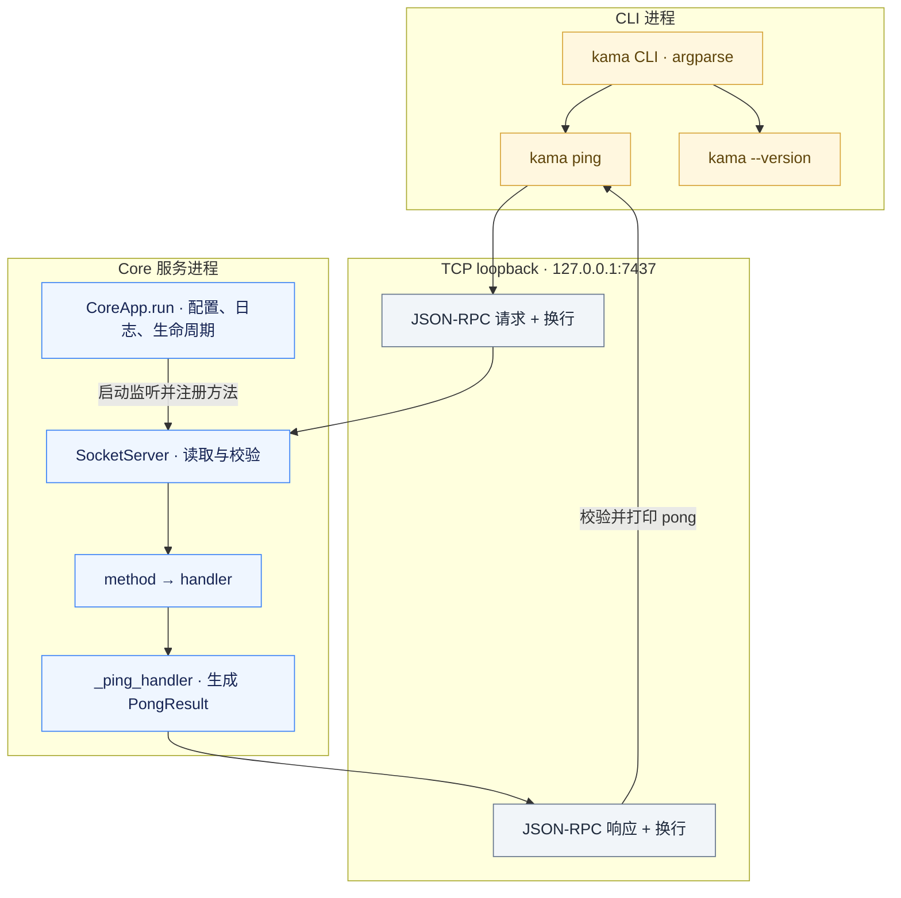
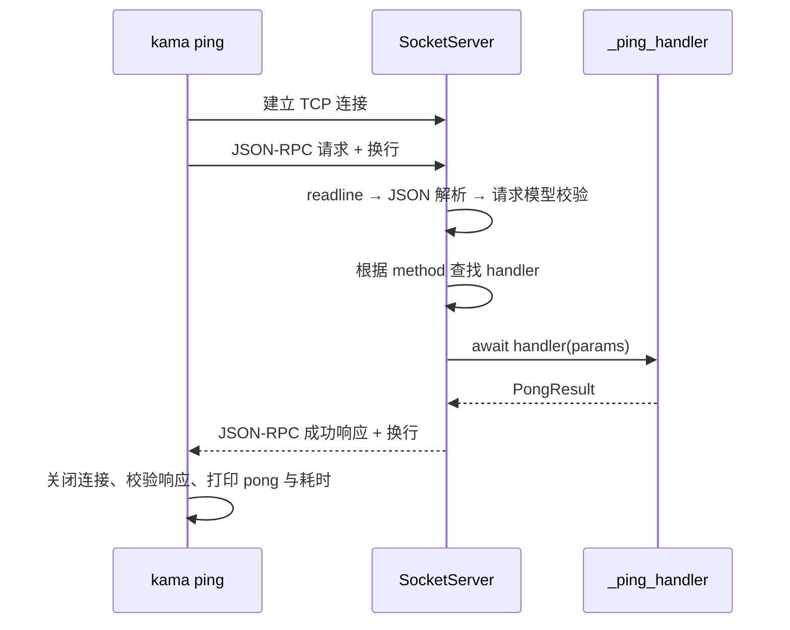

# KamaClaude S0 · 骨架与协议契约

> 从一次真实的 ping/pong 开始，建立客户端与 Core 之间的进程边界、通信格式和退出流程。


## 先回答几个核心问题

### 1. 为什么先建立进程边界？

**答：** 将交互界面与执行服务的职责、生命周期分开。

KamaClaude 面向本地 Agent 的执行与交互。S0 先拆分 **CLI 客户端** 与 **Core 服务进程**，通过本机 TCP 连接交换结构化请求和响应，为后续接入模型、工具和不同前端确定边界。

CLI 负责输入、请求和结果展示；Core 负责监听连接、分发命令和处理业务。两个进程拥有各自的生命周期，客户端关闭连接后，Core 可以继续等待其他客户端。

这种拆分也增加了连接、编码、超时和协议兼容的处理成本，因此先用 ping/pong 验证整条链路，再逐步加入后续能力。

### 2. 为什么选择 TCP？WebSocket 会不会更简单？

**答：** 当前两端都是 Python 程序，只需要本机通信，用标准库 asyncio 加换行分帧就能完成请求与响应，依赖较少。

WebSocket 也是合理选择，成熟库能处理消息边界、握手和连接控制，尤其方便接入浏览器前端。它本身建立在 TCP 上；若以后采用 WebSocket，仍可复用 JSON-RPC 消息和业务 handler。这里的选择依据是当前场景与实现成本，没有以未经测量的性能优势作为理由。[WebSocket 协议说明](https://www.rfc-editor.org/rfc/rfc6455.html)

### 3. 为什么使用 JSON-RPC？还有哪些可选方案？

**答：** 项目的交互主要是“调用方法并取得结果”，JSON-RPC 已经定义了 method、params、id、result、error，能直接对应当前的 handler 注册表，减少自定义消息约定。

JSON 只规定数据怎样表示；JSON-RPC 进一步规定调用和响应怎样组织。它不绑定 TCP，也可以通过其他通道传递。[JSON-RPC 2.0 规范](https://www.jsonrpc.org/specification)

也可以选择自定义 JSON 消息、按 URL 和 HTTP 方法组织的 JSON 接口，或用 gRPC 定义服务。自定义方案要自己维护调用与错误约定；HTTP 接口便于 Web 工具接入；gRPC 适合需要明确接口定义和生成多语言调用代码的场景。S0 采用与当前命令调用方式直接对应的 JSON-RPC。

### 4. TCP、NDJSON、JSON-RPC 分别负责什么？代码中哪里体现了 NDJSON？

**答：** 三者分别负责传输字节、划分消息、表达业务调用。

| 层次 | 负责的问题 | 当前实现 |
| --- | --- | --- |
| TCP | 数据怎样在两个进程之间传递 | start_server、open_connection |
| NDJSON | 一条消息在哪里结束 | 发送时加换行，接收时 readline |
| JSON-RPC | 调用哪个方法、传什么参数、返回什么 | method、params、id、result、error |

TCP 不保留业务消息边界，所以一条 JSON 可能分多次到达，多条 JSON 也可能一起到达。NDJSON 用“每行一个完整 JSON”区分消息，无需单独引入名为 ndjson 的库。

在 [socket_server.py](./src/kama_claude/core/transport/socket_server.py) 中，发送与接收分别体现为：

```python
# _send：JSON 编码后添加帧尾换行
writer.write(msg.model_dump_json().encode() + b"\n")

# _read_loop：按换行读取一条消息
line = await reader.readline()
```

### 5. 已经能解析 JSON，为什么还需要 Pydantic 校验？

**答：** JSON 解析确认数据语法，Pydantic 校验确认数据是否符合请求或结果模型。例如数字 123 是合法 JSON，却不是当前需要的请求对象。

当前链路是 json.loads 解析，再用 JsonRpcRequest.model_validate 校验外壳。业务参数还需要具体命令模型校验；S0 的 PingCommand 已定义，但 ping handler 尚未接入它。因此定义了模型，不代表所有业务参数已经得到验证。

### 6. 使用 asyncio，就能同时执行所有请求吗？

**答：** 它支持在异步 I/O 等待期间调度其他工作，但实际并发边界取决于代码。

不同客户端连接可以交错处理；同一连接中，S0 会 await 当前 _handle_line 完成后再读取下一条，所以请求按顺序分发。同步耗时计算也会占住事件循环。后续增加长任务或审批时，需要继续设计接收、执行与任务清理，而不是只增加 async 关键字。

### 7. 为什么 CLI 和 Core 都调用 writer.close()？

**答：** 它们持有同一条 TCP 连接两端的不同对象，各自清理本地资源。

CLI 完成请求后关闭客户端 writer；Core 感知 EOF，读取循环结束，再由 _handle_connection 的 finally 关闭服务端 writer。关闭某条连接与停止整个服务器监听也是两件事，前者不会让 Core 自动退出。

### 8. 为什么 TCP 能在 Windows 上用，Core 还需要兼容修改？

**答：** 网络接口可用，不代表进程生命周期中使用的所有接口都支持 Windows。原始 S0 无条件调用 loop.add_signal_handler，Windows 不支持它，因此会在启动阶段出错。

当前 Windows 路径使用 Python 3.12 asyncio.run 的 Ctrl+C 取消机制，退出时在 finally 中关闭服务器；macOS/Linux 保留 SIGINT、SIGTERM 通知路径。修改代码后需要重新启动 Core，已经运行的进程不会自动加载新实现。适配范围与验证步骤见下文。

## 本阶段完成了什么

| S0 已完成 | 作用 |
| --- | --- |
| TCP 请求与响应 | 使用真实连接验证进程间通信 |
| JSON-RPC 消息模型 | 明确方法、参数、请求 ID、结果和错误的结构 |
| NDJSON 分帧 | 从 TCP 字节流中区分消息边界 |
| 方法注册与分发 | 将 core.ping 映射到独立的业务 handler |
| 配置与日志 | 管理地址、端口、日志输出及覆盖优先级 |
| Windows 前台启停适配 | 支持启动 Core、ping 和 Ctrl+C 退出 |
| 单元与集成测试 | 分别验证模型、配置、生命周期和真实网络往返 |

当前阶段不需要模型 API key。模型调用、工具循环、事件订阅和交互式 TUI 在后续阶段逐步加入。

## 架构



飞书文档中可直接插入 [S0 流程图 PNG](./docs/learning/assets/s0-flowchart.png)。

## IPC 协议：JSON-RPC over NDJSON

消息语义、传输与分帧分别处理：**JSON-RPC** 描述调用和结果，**TCP** 传输字节，**NDJSON** 用换行区分每条消息。

TCP 不保留应用消息边界，一条请求可能分多次到达，多条请求也可能一起到达。发送端在每个 JSON 后添加换行，接收端读取一行后再解析。

### 协议约定

| 项目 | 当前实现 |
| --- | --- |
| 默认地址 | 127.0.0.1:7437，可通过配置修改 |
| 消息编码 | UTF-8 JSON |
| 帧分隔 | 每条消息末尾添加实际换行字节 `\n` |
| 服务端读取限制 | 1 MiB，见 `_MAX_LINE_BYTES` |
| 请求外壳 | jsonrpc、字符串 id、method、字典 params |
| 成功响应 | jsonrpc、id、result |
| 错误响应 | jsonrpc、id、error |
| 数据模型 | Pydantic v2，校验请求外壳及客户端收到的响应 |

S0 使用 JSON-RPC 2.0 的受限实现，当前不支持批量调用和通知等全部形态。PingCommand 虽已定义，handler 尚未接入该业务参数模型的校验。

### 请求与响应

客户端请求：

```json
{"jsonrpc":"2.0","id":"cli-1","method":"core.ping","params":{"client":"cli/0.0.1"}}
```

成功响应，时间和数值仅为示例：

```json
{"jsonrpc":"2.0","id":"cli-1","result":{"server_version":"0.0.1","uptime_ms":42,"received_at":"2026-10-17T08:00:00+00:00"}}
```

未注册方法的错误响应：

```json
{"jsonrpc":"2.0","id":"cli-1","error":{"code":-32601,"message":"Method not found: core.unknown","data":null}}
```

请求 ID 用来关联响应；协议版本 jsonrpc 与软件版本 server_version 分别表示不同信息。上述 JSON 写入网络时都需要在末尾添加换行。

### 错误分类

| 错误码 | 常量 | 含义与当前接线 |
| --- | --- | --- |
| -32700 | PARSE_ERROR | JSON 无法解析 |
| -32600 | INVALID_REQUEST | 请求外壳校验失败 |
| -32601 | METHOD_NOT_FOUND | 方法未注册 |
| -32602 | INVALID_PARAMS | 已定义，当前 handler 参数错误分支尚未使用 |
| -32603 | INTERNAL_ERROR | handler 抛出其他普通异常 |

当前 handler 抛 ValidationError 时仍返回 -32600，后续可以与业务参数校验一起修正。解析或外壳校验失败时，错误响应的 id 为 null；方法已识别但不存在时保留请求 ID。

### Ping 往返时序



## 核心设计

### 1. 协议外壳与业务结果分开

JsonRpcRequest、JsonRpcSuccess 和 JsonRpcError 负责统一消息结构；PongResult 描述 ping 的业务结果。这样 SocketServer 可以统一处理请求 ID、序列化和错误发送，handler 专注于业务字段。

```python
class JsonRpcRequest(BaseModel):
    jsonrpc: Literal["2.0"] = "2.0"
    id: str
    method: str
    params: dict[str, Any] = Field(default_factory=dict)


class PongResult(BaseModel):
    server_version: str
    uptime_ms: int
    received_at: str
```

以上为模型节选。定义模型与实际调用校验是两步，新增命令时应把业务校验接到 handler 中。

### 2. 通过注册表分发方法

```python
server = SocketServer(config.host, config.port)
server.register("core.ping", self._ping_handler)
```

register 保存 method 与异步函数的映射；收到请求后查找并 await 对应方法。新增命令可以复用通信层，不需要为每个业务单独写 socket 收发逻辑。

### 3. 异步读写与连接清理

连接回调通过 asyncio 调度。等待网络读取时，事件循环可以继续处理其他连接；同一连接的请求在 S0 中按顺序分发。

发送使用 write 与 drain，后者控制写缓冲压力，不表示对端已完成业务。连接处理的 finally 负责关闭 writer，避免只在正常返回时清理。

### 4. Windows 兼容与退出流程

Windows 的 asyncio 不支持 loop.add_signal_handler。当前 Core 对平台分别处理：

- macOS/Linux 注册 SIGINT、SIGTERM，通过 shutdown Event 通知退出。
- Windows 使用 Python 3.12 asyncio.run 的 Ctrl+C 取消机制。
- 两条路径都进入 finally，调用 server.stop 关闭监听；同步入口处理 KeyboardInterrupt。

关键逻辑节选：

```python
try:
    if sys.platform != "win32":
        loop.add_signal_handler(signal.SIGINT, shutdown.set)
        loop.add_signal_handler(signal.SIGTERM, shutdown.set)
    await shutdown.wait()
finally:
    await server.stop()
```

本次适配覆盖 S0 前台 Core 与 ping。后续后台进程管理及工具执行需要在对应阶段继续适配和验证。

### 5. 配置、日志与端口检测

配置优先级从低到高为：

```text
内置默认值 → TOML 配置文件 → .env → 已有系统环境变量
```

load_dotenv 使用 override=False，保留已有系统变量；最终配置统一传给客户端与服务端。日志支持 stderr、可选滚动文件以及文本或 JSON 格式。

启动前会尝试连接目标端口，用于提示已有监听者。这个探测尚未验证对方一定是 Core，实际 bind 也仍可能遇到端口竞争；端口健康检查可以作为后续小改进。

## 文件结构

```text
src/kama_claude/
├── cli/
│   ├── main.py                   # argparse 命令入口
│   └── commands/
│       ├── ping.py               # TCP ping 客户端
│       └── version.py            # 输出软件版本
├── core/
│   ├── app.py                    # 服务装配、Windows 兼容与退出
│   ├── config.py                 # 配置加载和覆盖
│   ├── logging_setup.py          # 日志配置
│   ├── bus/
│   │   ├── envelope.py           # JSON-RPC 请求与响应外壳
│   │   ├── commands.py           # PingCommand、PongResult
│   │   └── events.py             # 事件模型占位
│   └── transport/
│       └── socket_server.py      # TCP、分帧、校验与方法分发
└── tui/                          # 本阶段占位

scripts/
└── gen_protocol_doc.py           # 生成 WIRE_PROTOCOL.md

tests/
├── conftest.py                   # 启动真实 Core 的测试 fixture
├── unit/
│   ├── test_envelope.py          # 协议外壳与错误对象
│   ├── test_commands_events.py   # 业务与事件模型
│   ├── test_config_env.py        # 配置优先级
│   └── test_core_app.py          # 平台分支与退出清理
└── integration/
    └── test_ping_roundtrip.py    # 真实网络往返与错误响应
```

## 环境与快速开始

| 项目 | 要求 |
| --- | --- |
| Python | 3.12.x，项目约束为 >=3.12,<3.13 |
| 依赖管理 | [uv](https://docs.astral.sh/uv/)，安装后可执行 uv --version |
| 系统 | Windows / macOS / Linux |
| 模型配置 | S0 无需 API key |

以下命令在当前 stage/s0 仓库根目录执行。uv sync 会按项目要求准备依赖；用 uv run python --version 确认实际解释器。

### Windows：PowerShell

终端 1，准备环境并以前台方式启动 Core：

```powershell
uv sync
if (-not (Test-Path .env)) { Copy-Item .env.example .env }
uv run kama-core
```

终端 2，同样进入仓库根目录：

```powershell
uv run kama ping
uv run kama --version
```

### macOS / Linux

终端 1：

```bash
uv sync
test -f .env || cp .env.example .env
uv run kama-core
```

终端 2，同样进入仓库根目录：

```bash
uv run kama ping
uv run kama --version
```

ping 的预期输出形式：

```text
pong server=0.0.1 uptime=1234ms latency=5ms
```

uptime 和 latency 随运行变化。版本命令输出 0.0.1。在运行 Core 的窗口按 Ctrl+C 退出后，可以再次启动服务。

自定义端口时，客户端和服务端需要使用相同配置。PowerShell 在两个终端分别设置：

```powershell
$env:KAMA_PORT = '8000'
```

macOS/Linux 对应使用 `export KAMA_PORT=8000`。

## 验证步骤

```bash
uv run pytest tests/ -v
uv run ruff check src tests scripts
uv run mypy src
uv run python scripts/gen_protocol_doc.py --check
```

集成测试会在随机空闲端口启动自己的 Core 子进程，无需提前手动启动 daemon。

本次 Windows 兼容修改已验证：

- 当前 S0 完整测试 23 项通过，包含真实 TCP ping 和错误响应。
- ruff、mypy 检查通过。
- Windows 测试子进程在启动后触发 SIGINT，正常关闭，并可在同一端口再次启动。

Unix 信号分支另有模拟回归；上述 Windows 实测结果不等同于已在真实 macOS/Linux 环境完成所有验收。

## 学习与操作文档

- [S0 骨架与协议契约](./docs/learning/S0-骨架与协议契约.md)：源码调用链、方法精读和改进建议。
- [socket_server.py 逐行讲解](./docs/learning/S0-socket_server逐行讲解.md)：监听、连接、请求分发、响应和资源清理。
- [S0 核心自测与面试标准答案](./docs/learning/S0-核心自测与面试标准答案.md)：12 个核心问题、8 个面试追问。
- [RUNBOOK.md](./RUNBOOK.md)：配置、开发命令和运行参考。
- [WIRE_PROTOCOL.md](./WIRE_PROTOCOL.md)：代码生成的协议文档，变更模型后同步生成。

## 下一个阶段

S1 先在 CLI 进程内建立模型调用、工具执行和结果回填的 Agent 最小闭环；S2 再将执行迁入 Core，接入客户端事件订阅与 TUI。S0 的协议和传输基础会随这些阶段继续演进。
