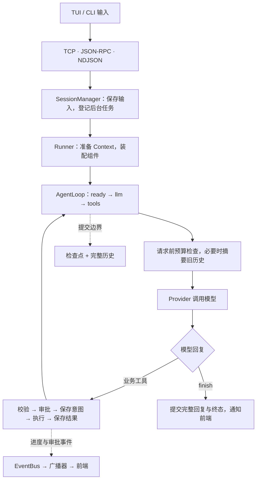

# KamaClaude

一个基于 Python 的本地 Coding Agent。用户通过 TUI 或 CLI 输入目标，独立 Core 调用模型、执行工具并保存运行状态，前端实时显示回复、工具进度和审批。

`dev` 已整合 S0–S11，重点是**可恢复执行、上下文组织、工具权限与 MCP 按需发现**。当前面向单用户、单 Core 使用；项目验证了运行机制，真实复杂任务的成功率与成本收益仍需要独立评估。

## 先理解几个核心问题

**一次对话和一次执行是什么关系？**

Session 是会话，每次用户输入创建一个 Run；Run 内每次模型请求是一个 Step。新 Run 通过 `finish(result)` 提交完整回复或待确认的问题。成功表示本轮回复已提交，chat 会话可以继续输入，不代表业务已经通过独立验收。

**前端关闭后，任务会停止吗？**

Core 持有后台 Task，客户端通过 `asyncio.shield()` 等待。TUI 断线只断开连接；重连会重新打开原会话。Core 重启后，从检查点识别中断状态，由用户选择继续、核实后重试未知工具或终止本轮。

**压缩后还能查看完整对话吗？**

可以。`checkpoint.json` 保存模型工作历史；`thread.jsonl` 始终追加完整原文。压缩只替换工作历史。前端分页读取固定范围的完整原文，加载期间缓冲实时事件，再按事件水位去重。

**接入很多 MCP 工具，会全部塞进模型上下文吗？**

DeepSeek / Anthropic 使用原生延迟加载模式：完整目录及顺序在本轮冻结，MCP 标记 `defer_loading=true`，内置工具和 `search_tool` 常驻。模型调用 `search_tool` 后，本地 BM25＋E5 向量检索、RRF 融合返回 `tool_reference`，下一步再使用对应工具。完整目录仍通过 HTTP 发送；非原生 Provider 使用本地按需展示完整 Schema 的兼容路径。

**加载工具或 Skill，就获得执行权限了吗？**

没有。Skill 提供流程说明，工具搜索只发现定义。实际操作仍经过参数校验、权限审批、路径复核、执行意图保存和结果提交。

## 一次任务的执行主线



普通执行与恢复使用同一条 Loop。`context.run` 是唯一执行状态来源；Runner 负责组装和收尾，Loop 通过注入的组件管理上下文、工具批次、预算和保存。

| 职责 | 代码入口 |
| --- | --- |
| 会话、锁、Core 持有的后台任务 | [session/manager.py](./src/kama_claude/core/session/manager.py) |
| 上下文准备、依赖装配、运行收尾 | [runner.py](./src/kama_claude/core/runner.py)、[assembly.py](./src/kama_claude/core/assembly.py) |
| 阶段推进、模型回复与结束判断 | [loop.py](./src/kama_claude/core/loop.py)、[finish.py](./src/kama_claude/core/tools/builtin/finish.py) |
| 工具批次、恢复游标、逐工具保存 | [tools/batch.py](./src/kama_claude/core/tools/batch.py)、[tools/invocation.py](./src/kama_claude/core/tools/invocation.py) |
| 原子快照、完整历史、恢复决定 | [checkpoint/](./src/kama_claude/core/checkpoint/)、[session/store.py](./src/kama_claude/core/session/store.py) |
| 统一 Provider、受管重试和累计预算 | [llm/](./src/kama_claude/core/llm/)、[run_budget.py](./src/kama_claude/core/run_budget.py) |
| 估算、近期保留、摘要候选与提交 | [compact/](./src/kama_claude/core/compact/) |
| 规则、自动记忆、全局 Skill 加载 | [memory/](./src/kama_claude/core/memory/)、[skills/](./src/kama_claude/core/skills/) |
| MCP 连接、目录哈希、混合检索 | [mcp/](./src/kama_claude/core/mcp/)、[discovery/](./src/kama_claude/core/discovery/) |
| 子 Agent、额度、有界等待、成果交接 | [subagent/](./src/kama_claude/core/subagent/)、[agents/](./src/kama_claude/core/agents/) |
| 工作区、审批、文件与命令工具 | [workspace.py](./src/kama_claude/core/workspace.py)、[permissions/](./src/kama_claude/core/permissions/)、[tools/builtin/](./src/kama_claude/core/tools/builtin/) |
| TUI、通信协议、事件与 Trace | [tui/app.py](./src/kama_claude/tui/app.py)、[transport/](./src/kama_claude/core/transport/)、[events/](./src/kama_claude/core/events/)、[trace/](./src/kama_claude/core/trace/) |

## 启动

需要 Python **3.12** 和 uv，支持 Windows、macOS、Linux。以下命令从本仓库根目录执行，Core 启动目录成为本轮固定 workspace。用于其他仓库时，在已安装本包的环境中从目标目录启动 Core。Windows 的命令工具默认运行本机 cmd；当前没有 Docker 执行环境。

```text
uv sync
```

在启动目录创建 UTF-8 `.env`，填写实际密钥和当前接口可用的模型名：

```dotenv
DEEPSEEK_API_KEY=你的密钥
KAMA_LLM_DEFAULT_MODEL=你的DeepSeek模型名
```

当前 Core 默认装配 `DeepseekProvider`，走 Anthropic 兼容接口。请显式设置模型名，配置类中的历史默认值仍是 Claude 示例。Anthropic、OpenAI 适配器可以通过代码注入；使用 OpenAI 还需安装 `openai` SDK，目前没有 Provider 切换配置项。

分别打开两个终端：

```text
uv run kama-core
uv run kama-tui
```

默认连接 `127.0.0.1:7437`。TUI 启动后选择历史会话或新建会话；`Ctrl+O` 切换会话，`Ctrl+Q` 退出界面并保留会话，`Ctrl+W` 显式关闭空闲会话。中断任务由恢复按钮处理；未知副作用需要先核实。Core 支持 Ctrl+C 收尾。

CLI 调试同样需要 Core：

```text
uv run kama ping
uv run kama run --goal "读取 README.md，解释项目执行主线"
uv run kama chat
```

## 上下文、记忆与 Skill

- **固定前缀**：基础/角色提示＋全局用户 `AGENTS.md`＋项目用户 `AGENTS.md`，同一 Run 内冻结；完整允许工具目录与顺序同样冻结；非原生兼容模式的可见子集可按需变化，恢复使用保存值。
- **自动记忆**：全局 `AGENTS.auto.md` 和项目 `MEMORY.md` 索引通过标准上下文消息注入，不写入完整对话。普通步骤复用快照；真正采用摘要后刷新并与候选历史一起提交。主题详情通过 `memory_read` 按需读取，`memory_write` 维护自动信息和项目主题。
- **输出入口限长**：普通工具正文超过 8,000 字符时，先保存结果并归档全文，再把头尾共 4,000 字符的预览放进工作历史。输出整理失败会中断，已完成工具不重跑。
- **请求前估算**：使用有效的上次实际输入＋输出 Usage，加上新增部分 UTF-8 字节数除以四向上取整；前缀改变则重新全文估算。没有 tokenizer 或动态阈值校准。
- **历史摘要**：默认达到输入硬预算的 80% 时尝试一次；优先保留最近三轮，工具调用与结果不可拆开。旧历史合并成一份六节结构化摘要，校验后才保存。`/compact` 与自动入口共用规则，未达阈值不调用摘要模型。
- **Skill**：只从 `~/.kama/skills/<name>/SKILL.md` 加载。可输入 `/review src`，也可让模型调用 `load_skill(name)`。每个 Run 最多一个活动 Skill，正文随检查点保存，压缩后按需补回。首次补齐 review、summarize、orchestrate、init 示例，已有文件不覆盖。

旧 `context.md`、`notes.md` 不再自动读取或迁移；已删除 `note_save`、`/memory` 和 `memory.inspect`。用户维护的 `AGENTS.md` 对内置写入工具只读。Skill 不覆盖基础 system，不扩大工具白名单。

## 配置与默认参数

默认按“全局 `~/.kama/config.toml` → 项目 `.kama/config.toml` → 环境变量”覆盖；`.env` 不覆盖已有系统环境变量。设置 `KAMA_CONFIG` 时只读取指定 TOML，再应用环境覆盖。解析入口见 [config/](./src/kama_claude/core/config/)。

```toml
[agent]
max_steps = 20
max_run_seconds = 0       # 0 关闭累计时间限制
max_total_tokens = 0      # 0 关闭累计 Token 限制
repeat_failure_limit = 5

[compaction]
auto_threshold = 0.8      # 0 关闭自动摘要，硬预算检查仍生效
context_window_tokens = 65536  # 请按实际模型配置
output_reserve_tokens = 8192
keep_recent_turns = 3
recent_token_budget = 16384
summary_max_tokens = 2048

[subagent]
max_active = 3
max_total = 8

[memory]
global_auto_tokens = 512
project_index_tokens = 1024
```

Run 的累计执行时间包含模型、工具和审批等待；恢复不重置原 Run 的预算。普通模型调用与自动摘要纳入主 Run 预算，子 Agent 暂不汇总到主 Run，手动压缩单独记用量。

MCP 支持标准 stdio 和 Streamable HTTP。HTTP 配置示例需要替换为真实端点：

```toml
[[mcp.servers]]
name = "remote"
transport = "streamable-http"
url = "https://your-mcp-server.example/mcp"

[tool_search]
enabled = true
top_k = 3
max_loaded_schema_tokens = 8192
# model_path = "C:/models/multilingual-e5-small"
```

语义检索使用 Sentence Transformers 的 multilingual-e5-small：`uv sync --extra retrieval` 安装可选依赖。不指定模型目录时首次下载并缓存；指定目录时离线读取。依赖或模型不可用会明确降级为 `keyword_only`。工具目录只在启动和重新连接时同步；完整列表拉取成功后按定义哈希事务更新，检索文本和模型指纹未变时复用向量。

## 文件、命令与审批

工作区内的普通文件读取、查找与搜索默认允许；`write_file`、`edit_file` 默认询问，可选择本次允许、本次拒绝或本会话允许该工具操作这个实际文件。授权键使用后端解析的真实路径，不绑定原始路径字符串。

工作区外读写始终单次审批。执行前重新解析，目标变化则拒绝。Bash 独立检查命令及参数：Windows 使用保守 cmd 解析，POSIX 使用 Bash AST；完整解析且所有命令均匹配允许规则时才自动放行，明确禁止优先，其他情况询问。默认没有命令允许规则。

这些是应用层检查。获批 Shell 和远程 MCP 的实际能力不受文件工具路径校验限制；命令执行和子 Agent 没有系统沙箱。

## 数据保存

| 默认路径 | 内容 |
| --- | --- |
| `~/.kama/sessions/<sid>/checkpoint.json` | 权威工作历史、Run 状态、工具游标、提示与预算快照 |
| 同目录 `thread.jsonl`、`meta.json` | 只追加的完整对话、导出的会话元数据 |
| 同目录 `runs/<run_id>/` | `events.jsonl`、`.tasks/`、长输出 `outputs/`、摘要副本；子 Agent 有 `report.md` |
| `~/.kama/AGENTS.md`、项目 `AGENTS.md` | 用户维护的全局/项目规则 |
| `~/.kama/AGENTS.auto.md` | Agent 维护的精简全局信息 |
| `~/.kama/projects/<project-id>/memory/` | `MEMORY.md` 索引与主题 Markdown；项目 ID 根据规范化项目路径生成 |
| `~/.kama/skills/` | 全局 Skill 目录 |
| `~/.kama/tool_catalog.sqlite3`、`~/.kama/models/` | 工具目录与向量缓存、默认 Embedding 模型缓存 |
| `~/.kama/policy.toml` | 旧策略的明确拒绝记录；当前会话授权只保存在内存 |
| `~/.kama/traces/daemon.jsonl`、`~/.kama/logs/` | Trace、Core/TUI 日志 |

`KAMA_SESSIONS_DIR` 可覆盖会话根目录。独立运行未绑定 Session 的 Runner 时，默认写入当前目录的 `runs/`。

通信单帧上限为 64 MiB，按 UTF-8 字节计量。`session.open` 返回历史首屏、`next_cursor` 和固定 `history_end`；后续通过 `session.get_history` 分页，TUI 自动加载完整快照。每页目标为 1 MiB 或 200 条消息，单条消息不拆分；单条或快照其他字段仍超帧时明确返回错误，不静默截断。无法解析所属请求的超限输入会关闭连接并结束所有等待，Core 业务 Run 保持独立。

## 通信保护与关闭

服务端先校验请求、检查额度，再创建并登记 Task。普通请求默认每连接 8 个、全局 64 个；`permission.respond` 与 `core.ping` 使用独立控制额度，每连接 2 个、全局 8 个。额度包含 handler 执行和等待响应写出；超额返回 `-32034 Server busy`，没有无限排队的请求 Task。

每条连接只有一个 `ConnectionSender`：RPC 响应、事件和历史回放共用 FIFO 发送队列。实时广播快速入队，RPC 和回放等待各自帧写出；切换会话只更新订阅，不销毁发送器。队列最多 128 帧、64 MiB＋1 字节，包含发送中的帧；`drain()` 超时为 5 秒。队列满、超时或写入失败只断开对应连接，并明确结束发送等待。已提交历史与执行状态通过重新打开会话同步，未提交 token 不保证补齐。

Core 退出先停止新业务接入，已有连接仍能回答审批；普通请求返回 `-32035 Server shutting down`。然后取消并保存业务 Run、关闭 MCP，再回收请求和发送器、关闭 TCP 与 Trace。请求取消等待、发送排空及连接关闭各有 2 秒等待上限；不配合取消的协程会被记录并再次取消，不能承诺强制终止。客户端断线时只回收该连接的 RPC，已登记业务 Run 继续由 Core 持有。

请求 Task 与业务 Task 的区别见 [socket_server.py](./src/kama_claude/core/transport/socket_server.py)、[sender.py](./src/kama_claude/core/transport/sender.py) 和 [session/manager.py](./src/kama_claude/core/session/manager.py)。客户端接收回调仍按顺序执行，须快速返回；需要等待 RPC 的工作应安排到独立 worker。

## 验证与边界

```text
uv run pytest tests -m "not integration" -q
uv run ruff check src tests scripts
uv run mypy src
uv run python scripts/gen_protocol_doc.py --check
```

这里的 `integration` 标记专指付费模型测试；非付费命令仍覆盖真实 TCP、Core 进程重启、MCP JSON/SSE 与 TUI。Embedding 真实离线验证需配置 `KAMA_TEST_E5_MODEL_PATH`。测试数量和实测结果以运行输出为准；机制测试不代表真实代码修复成功率或 Prompt Cache 收益。

当前边界：主 Agent 支持检查点恢复，未知副作用仍需用户核实；不恢复外部进程或未完成子任务树。子 Agent 在同一 Core 中运行，独立上下文、共享工作区，受根 Run 数量限制，通过 `agent_result(run_id, wait_s)` 有界等待并交回报告。`finish` 不进行业务自动验收。长会话存储成本和真实任务评估仍是后续改进点。

协议以 [WIRE_PROTOCOL.md](./WIRE_PROTOCOL.md) 为准。历史学习资料见 [项目面试题](./docs/interview/01-项目面试题与参考答案.md)、[模拟面试](./docs/interview/02-模拟面试与复习清单.md)、[相关八股](./docs/interview/03-相关八股与连续追问.md)；阅读时对照当前源码。dev 独立维护总览和面试资料，阶段学习文档保留在对应分支。
