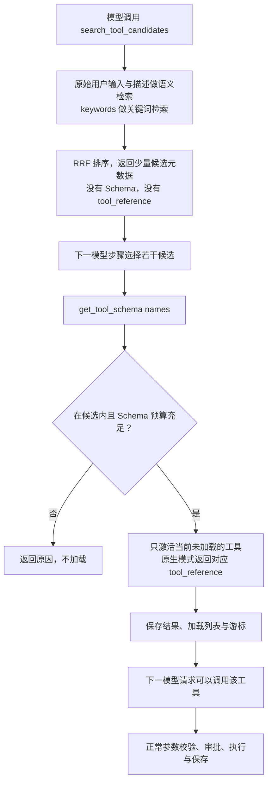

# MCP 工具：先找候选，再按需激活

## 为什么拆成两步

以前 `search_tool` 找到前三个候选后，就为三个工具全部返回引用。即使只需其中一个，其余定义也可能被接口展开，增加模型输入。

现在检索负责推荐，模型负责选择，加载负责返回选中工具的定义或引用。BM25、E5、RRF、SQLite 与哈希缓存不变；Manager → Runner → Loop 的执行主线不变。



## 两个工具的接口

### 1. `search_tool_candidates(description, keywords, topk=3)`

```json
{"description":"读取 GitHub Issue 详情，定位故障","keywords":["github","get_issue"]}
```

描述必填，最多 2,000 字符。关键词必填，1～3 个，每项去掉首尾空白后为 1～100 字符。`topk` 可选，范围 1～10；省略时取 `[tool_search].top_k`，默认 3。检索返回至多 `topk` 个候选，每项只有：

```json
{
  "method":"hybrid",
  "degraded_reason":"",
  "candidates":[
    {"name":"github__get_issue","server":"github","description":"Get issue details","loaded":false}
  ],
  "message":"Select candidates and call get_tool_schema(names) on your next turn. If none fit, refine the query or increase topk (max 10)."
}
```

描述最多返回 240 字符；不返回参数 Schema 或引用。`keyword_only` 表示未使用语义模型。没有候选是正常结果，可以换更具体的描述或关键词。

如果前 3 个候选没有合适工具，可以扩大一次搜索的候选范围：

```json
{"description":"读取指定 GitHub Issue 的评论列表","keywords":["github","comments"],"topk":10}
```

先少量返回，不合适再增加 `topk` 或修改查询。扩大的是返回的候选数量，不是工具白名单或加载额度；最多返回检索实际召回的数量，不用无关工具补足。每路检索原本最多召回 10 项，本轮沿用这一上限，不做全量目录输出。单次指定 `topk` 不改变配置或下一次调用的默认数量。

搜索只记录“本轮向模型返回过哪些候选、首次返回时的 Step”，不修改 `loaded_tool_names`。候选可以稍后选择，不因下一次搜索覆盖；新 Run 重新开始记录。

### 2. `get_tool_schema(names)`

```json
{"names":["github__get_issue","github__list_comments"]}
```

使用完整候选名，包括服务前缀，一次 1～10 个，每个名字最多 512 字符。输入重复名称会按原顺序去重。后端检查：

1. 工具必须属于本轮允许的冻结 MCP 目录。
2. 尚未激活的工具必须在较早的模型 Step 中返回过该候选。首次搜索与猜测加载放在同一回复中会被拒绝，先让模型看到候选再作选择。
3. 按现有预算检查完整 Schema，不能截断定义。

假设 `github__list_comments` 已经激活，只有 `github__get_issue` 需要新加载。原生延迟模式结果为：

```json
[
  {"type":"text","text":"{\"loaded\":[\"github__get_issue\"],\"already_loaded\":[\"github__list_comments\"],\"not_loaded_budget\":[]}"},
  {"type":"tool_reference","tool_name":"github__get_issue"}
]
```

这里没有执行 MCP 业务操作。接口把新引用展开为定义；新工具到下一次请求才可以调用。一次可以返回多个引用。当前上下文已激活的工具只列入 `already_loaded`，不重复返回引用；全部已激活时结果只有说明文本。预算不足时可部分加载，`not_loaded_budget` 明确列出未加载项；包含白名单外名称或未经搜索的新名称则整批拒绝，不偷偷部分加载。

非原生 Provider 不发送 `tool_reference`，加载后在下一次请求的工具数组加入完整定义。原生模式顶层目录、顺序与延迟标记始终不变。两种路径都保留正常权限审批。

## 保存、压缩与恢复

- `run.tool_candidates`：候选名 → 首次出现的 Step。只表示可选择，不等于可执行。
- `run.loaded_tool_names`：**当前上下文**已激活的 MCP 工具，用于去重、Schema 额度与兼容请求；不是历史上曾加载过的全集。
- 工作历史中的 `tool_reference`：原生模式的模型调用资格来源；不能用模型传来的普通文本伪造。

这几项都由工具批次的现有保存入口随工具结果、配对消息与游标提交。保存失败立即停止，不继续请求模型。

仅搜索后发生中断，恢复时可以接着选择；加载后发生中断，恢复使用已提交引用，不重新检索。模型调用恢复不重复增加 Step。候选和已加载列表校验不能越过冻结目录。

压缩继续保留近期实际需要的真实“`get_tool_schema` 调用＋引用结果”消息对；不重新搜索，不从摘要中的名称生成引用。旧历史里的 `search_tool` 引用记录仍可保留，但旧工具不再注册。采用摘要时根据保留的引用重算激活列表，并与工作历史一起提交：移除引用的工具同时从列表移除；仍有引用的工具保持激活。之后可重新选择本轮已发现候选，为已失活工具再次返回引用。压缩失败或检查点保存失败，不采用半套历史与激活状态。

例如原来激活 A、B，压缩后只保留 A 的引用：列表变成 `[A]`。随后 `get_tool_schema({"names":["A","B"]})` 只返回 B 的新引用，A 只出现在 `already_loaded` 中。无需再维护一个 `ToolAvailability.loaded_tools` 集合；临时集合仅用于查询，权威状态始终是同一个 `context.run.loaded_tool_names`。

显式白名单保持现有规则：原生延迟模式为允许的 MCP 目录提供两个发现入口；非原生模式明确列出的 MCP 工具仍可直接展示，发现入口各自遵守白名单。子 Agent 没有因此增加 MCP 能力。

工具接口变化不放宽恢复校验。冻结旧 `search_tool` 定义的中断 Run 会明确拒绝续跑；可以查看历史、终止旧 Run 后重新开始。检查点仍为版本 1，新增候选字段默认空。

## 代码阅读顺序

1. [discovery/tool.py](../src/kama_claude/core/discovery/tool.py)：候选检索与单工具加载。
2. [discovery/exposure.py](../src/kama_claude/core/discovery/exposure.py)：加载额度、请求 Schema 与调用资格。
3. [runner.py](../src/kama_claude/core/runner.py)：注册两个工具，保持冻结定义校验。
4. [tools/batch.py](../src/kama_claude/core/tools/batch.py)：逐工具保存与防止同批提前调用。
5. [llm/tool_loading.py](../src/kama_claude/core/llm/tool_loading.py)：估算时展开引用，压缩时保留真实加载记录。

这次减少的是不必要候选的定义展开，并不保证每个任务总 Token 或费用都下降：选择过程多一次模型往返，需要结合真实任务评估。功能测试不代表实际缓存命中率或语义检索效果。
