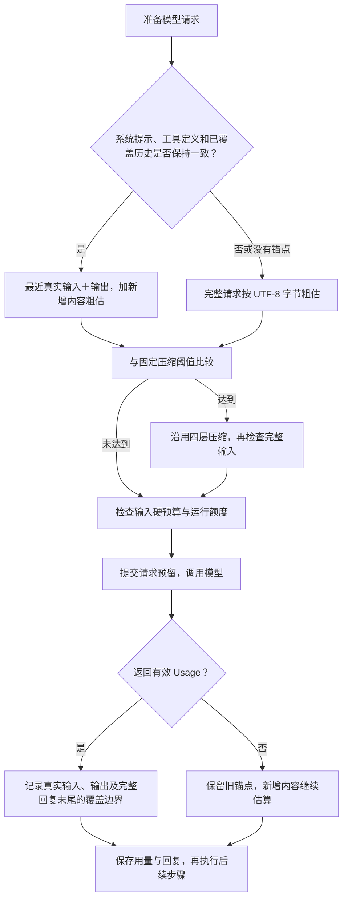

# S10：Usage 锚点与固定压缩阈值

## 1. 解决什么问题

每次请求模型前，需要回答两个问题：本次输入大约有多少 Token，是否需要压缩。

现在使用“最近一次有效真实用量＋之后新增内容估算”，压缩阈值由配置固定决定。删除原先按“实际输入÷全文粗估”缩小阈值、硬预算的逻辑；不使用 tokenizer，不维护误差系数。

这里的最近一次用量是**一条模型请求的输入＋输出**，不是整个 Run 的累计消耗。累计消耗仍用于运行额度，不能拿它判断当前上下文大小。

## 2. 借鉴 Codex 的核心机制

Codex 的 [历史用量计算](https://github.com/openai/codex/blob/main/codex-rs/core/src/context_manager/history.rs) 使用最近一次 `last_token_usage.total_tokens`，再加尚未被有效 Usage 覆盖的历史估算；没有 Usage 的回复不推进覆盖边界。[字节粗估](https://github.com/openai/codex/blob/main/codex-rs/utils/string/src/truncate.rs) 使用 UTF-8 字节数除以 4、向上取整。

其 [压缩上限](https://github.com/openai/codex/blob/main/codex-rs/protocol/src/openai_models.rs) 来自模型和配置，不用“实际量÷粗估量”动态修正。Codex 还处理 reasoning 等专用情况，本项目采用上述核心思路，保留自己的固定 80% 比例和四层压缩，不复制全部实现。引用的是核查时的上游 main，后续上游代码可能变化。

## 3. 一次请求如何推进



长工具结果预览仍在每次请求前先整理。任何一层改写了已覆盖的历史，都会使旧锚点失效；整理后的输入回退全文估算。没有必要为保持锚点而保留超长原文。

### 示例：避免重复计算上次回复

上次请求实际输入为 10,000 Token，输出为 1,000 Token。输出包含一个工具调用；工具执行后新增结果粗估为 800 Token。

```text
本次输入估算 = 10,000 + 1,000 + 800 = 11,800
```

上次 assistant 消息，包括文字、thinking、工具调用参数，都已属于那 1,000 个输出 Token，不再按字节估算一次。工具结果是之后新增的，才补算。

如果下一次回复没有 Usage，旧边界保持不动。再下一次准备请求时，要补算旧边界之后的所有内容，包括这次没有 Usage 的回复，而不只是最后一条工具结果。

## 4. 阈值和失败处理

```text
输入硬预算 = 上下文窗口 − 输出预留 − 1,024
自动压缩阈值 = 输入硬预算 × auto_threshold
```

默认窗口 65,536、输出预留 8,192，所以硬预算为 56,320，80% 阈值为 45,056。真实 Usage 会改变本次输入估算，不会改变这两个界限。

- `auto_threshold=0` 关闭自动压力压缩；长结果整理和硬预算检查仍保留。手动 `/compact` 沿用原有规则。
- 历史压缩、规则与记忆刷新、工具 Schema 或模型改变后，不能复用原锚点。全文粗估包含 system、messages、工具 Schema 和序列化结构。
- 新增部分也先序列化，再计算 `ceil(UTF-8 字节数 / 4)`。这是估算，不保证等于服务端分词结果。
- Usage 缺失或无效不覆盖上次有效锚点；失败请求的运行额度仍保留估算占用，避免被当成免费请求。
- 压缩后仍超过硬预算时中断，不向模型继续提交超限请求。检查点保存失败仍立即传播。

## 5. 保存什么，如何跨 Run 使用

`checkpoint.json` 的 `token_estimation` 记录最近输入、输出 Token、覆盖消息数量及前缀指纹。指纹同时包含 system、工具 Schema 和已覆盖消息，能检测原地修改，不能只靠消息数量判断。

锚点按 Provider、模型、普通请求/摘要用途隔离。估算版本改为 `bytes-v2`，旧版仅覆盖输入的锚点不再复用，首次请求安全回退全文估算；检查点格式仍为版本 1。恢复不会重置 Run 累计预算，也不会重跑已完成工具。

完整 `thread.jsonl` 继续保存原始对话，不受模型工作历史压缩影响。

## 6. 代码阅读顺序

1. [TokenEstimator 与 TokenCounter](../src/kama_claude/core/compact/estimator.py)：匹配锚点、估算新增内容、全文回退。
2. [LlmResponse.content_blocks](../src/kama_claude/core/llm/types.py)：回复统一转为工作历史格式，保证锚点边界与 Loop 一致。
3. [ManagedProvider.chat](../src/kama_claude/core/llm/managed.py)：预留、请求、结算，用完整回复更新覆盖边界。
4. [ContextManager.prepare](../src/kama_claude/core/compact/manager.py) 与 [Compactor.prepare_context](../src/kama_claude/core/compact/compactor.py)：固定阈值、四层整理与硬预算检查。
5. [AgentLoop._record_response](../src/kama_claude/core/loop.py)：用相同消息格式保存回复和工具批次。
6. [UsageAnchor](../src/kama_claude/core/checkpoint/checkpoint.py)：持久化字段；[确定性测试](../tests/unit/test_token_estimator.py)：用量覆盖、失效回退、缺失 Usage、固定阈值和重启数据兼容。

本轮完整非付费回归为 **783 项通过、1 项跳过、1 项付费模型测试排除**；改动文件 Ruff、128 个源码文件 mypy、协议一致性及本地文档链接检查通过。验证使用假模型与现有非付费测试，不代表真实模型效果或实际账单验证。
