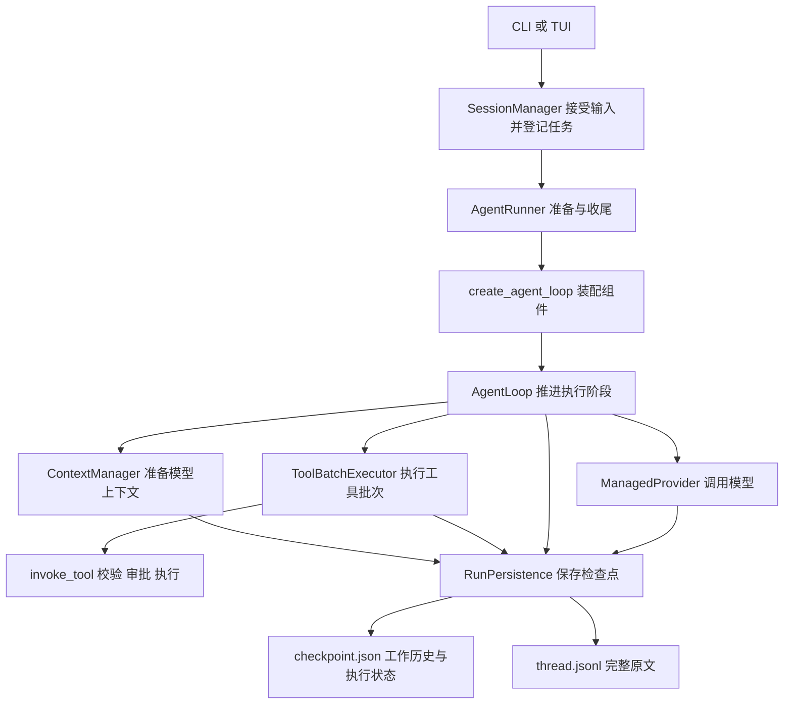

# S10：主线整理与阅读指南

## 1. 先认识这个项目

KamaClaude 是本地 Coding Agent。前端是 CLI/TUI，后端是独立的 Core 进程，二者通过 TCP、JSON-RPC 和逐行 JSON 通信。

用户提交目标以后，Core 反复做三件事：把上下文交给模型、执行模型提出的工具调用、把结果交回模型。模型正常回答结束，或触发预算、取消、中断时，这一轮 Run 结束。

S10 的主线整理、精确文件审批和命令解析已经提交并推送为 `6392937`。当前又在这份基线上完善轻量多 Agent 协作。功能继续包含断点恢复、四层压缩、Markdown 记忆、运行预算、子 Agent、MCP 和权限审批，没有引入新的执行状态或通用 Agent 框架。

## 2. 为什么整理，整理成什么样

S7 的优点是能直接顺着“准备→模型→工具→结果”阅读。S8–S10 增加了恢复和预算等功能后，有些实现细节进入了原本的协调层。

| 原位置 | 原先混在一起的职责 | 现在的归属 |
|---|---|---|
| AgentLoop | 阶段推进、上下文压缩通知、工具游标、子任务结果判断 | Loop 推进阶段，ContextManager 准备上下文，ToolBatchExecutor 管工具批次 |
| Runner 与 SpawnAgentTool | 分别创建预算、估算器、受管 Provider 和 Loop | 共用 `create_agent_loop()` |
| SessionManager.compact | 会话锁、摘要模型创建、候选提交、事件与响应 | 保留会话锁，压缩细节交给 `compact_session()` |
| invoke_tool | 约 200 行串联校验、审批、执行、异常和重试 | 入口按顺序协调，审批、单次执行、受控重试各成完整步骤 |
| TUI App | 连接、会话、控件定义、流式文本和工具展示 | App 管协调，ConversationView 管展示，widgets 定义控件 |
| 单个配置文件 | 模型、读取来源、各小节解析与环境变量覆盖 | config 包按模型、加载、TOML、环境变量分开 |

目标是减少跨职责跳转。没有为了凑行数把每句代码变成方法，也没有为 Context 再包一层 Runtime。



图中所有执行组件引用同一个 `ExecutionContext` 和其中的 `run`。装配函数只返回 Loop，不额外保存一份 Run。

## 3. 一次普通运行如何走

### 第一步：会话管理器接收输入

入口是 [SessionManager.send_message](../src/kama_claude/core/session/manager.py)。它检查会话是否忙、是否需要先恢复，解析 Skill，登记原始用户输入和新的 Run 身份。

随后 Runner 的 `prepare_checkpoint()` 先提交目标和初始上下文，再由 Core 登记后台任务。这样即使前端断开，业务任务仍由 Core 持有；尚未调度就退出，也不会无声丢失目标。

后台 `_run_session()` 取得会话锁并调用 Runner。它不调用模型，也不执行工具。

### 第二步：Runner 准备和装配

阅读 [AgentRunner.run_and_capture](../src/kama_claude/core/runner.py)：

```text
准备 Context 和 RunPersistence
→ 建立 Run 目录、观察者和事件文件
→ 发布开始或恢复事件
→ 组装并运行 Loop
→ 按保存失败、取消、普通异常分别处理
→ 保存终态、导出元数据、通知前端
```

模型创建与恢复身份校验在 [ProviderFactory](../src/kama_claude/core/llm/factory.py)。基础文件/任务工具在 [builtin_tools](../src/kama_claude/core/tools/factory.py) 列出；记忆、MCP 和派生子任务工具仍由对应装配处明确添加。

[create_agent_loop](../src/kama_claude/core/assembly.py) 把同一份预算、估算器、上下文管理器和工具批次执行器注入 Loop。主 Agent 与子 Agent 共用这套装配，子 Agent 不因此获得会话检查点或任务树恢复能力。

### 第三步：Loop 推进一个步骤

先阅读 [AgentLoop.run](../src/kama_claude/core/loop.py)。主循环核心可以概括为：

```python
while not context.is_done():
    if run.phase == "ready":
        start_step()              # 检查预算、Step + 1、保存 llm 阶段
    if run.phase == "llm":
        call_model()              # 准备上下文、模型请求、记录完整回复
    if run.phase == "tools":
        tools.run_pending()       # 从工具游标继续，逐个提交结果
    publish_step_finished()
```

这是省略停止分支和 await 的伪代码，真实入口会立即处理各阶段的中断结果。

三个条件使用独立 `if`：同一轮可以先从 ready 进入 llm，再直接执行这次回复中的工具。恢复到 tools 时直接进入工具阶段，不先调用模型。

`_call_model()` 依次发布步骤开始、准备上下文、调用 Provider，再交给 `_record_response()`。后者保留 thinking、文字和 tool_use，登记完整工具批次并提交。模型完整回复还没有保存成功时，不会执行工具。

### 第四步：准备上下文和调用模型

[ContextManager.prepare](../src/kama_claude/core/compact/manager.py) 负责：

```text
选择估算口径 → 四层整理 → 刷新入口并应用候选 → 硬预算检查 → 保存 → 通知
```

Compactor 只返回候选。压缩修改的是模型工作历史，不是完整原文。旧消息改变后，Usage 锚点会按原规则失效并重新估算。

当前记忆改为“用户规则＋全局自动信息＋项目主题索引”。实际采用压缩候选时，ContextManager 重新加载这些入口，把新提示和新历史一起提交；Loop 在准备完成后取最终 system。没有改变历史则保持原快照，断点恢复也不重新读磁盘。存储、精简预算和只读保护见 [规则与索引式记忆](./S10-规则与索引式记忆.md)。

[ManagedProvider.chat](../src/kama_claude/core/llm/managed.py) 负责请求前预留预算、提交预留、有限重试、有效 Usage 结算和更新用量锚点。锚点覆盖上次输入和完整回复，之后只估算新增内容；压缩阈值保持配置比例，不按估算误差动态调整。Loop 不再通过具体 Provider 类型判断如何发布预算事件。计算示例见 [Usage 锚点与固定压缩阈值](./S10-Usage锚点与固定压缩阈值.md)。

手动 `/compact` 调用同模块的 `compact_session()`。它与自动入口共用 Compactor 和提交后的通知逻辑，但显式使用 SessionStore，不把消耗追加入已经结束的 Run。

### 第五步：按顺序执行工具

[ToolBatchExecutor.run_pending](../src/kama_claude/core/tools/batch.py) 从 `run.tool_index` 开始：

| 工具状态 | 动作 |
|---|---|
| completed | 跳过并推进游标 |
| pending / awaiting_approval | 进入正常工具调用，必要时重新审批 |
| executing / unknown | 停止，保留现场并等待用户核实 |

[invoke_tool](../src/kama_claude/core/tools/invocation.py) 的顺序是：

```text
参数与路径校验 → _authorize 审批
→ _execute_with_retry 复核路径、保存执行意图
→ _execute_attempt 真正执行并分类异常
→ 返回最终 ToolResult
```

保存执行意图的钩子在真实工具函数之前运行。保存失败不能被转换成普通工具错误；取消继续向上抛出。

权限分两条看：文件工具先使用后端实际路径判断边界，内部读取默认允许，内部写入可按“会话＋工具＋具体文件”授权；外部访问始终单次询问。命令交给 [参数规则](../src/kama_claude/core/permissions/bash.py)：Windows 仍用保守 cmd 解析，POSIX 用 tree-sitter-bash 校验简单语法；所有命令及参数均被允许后才自动执行，否则单次询问，明确禁止优先。默认规则为空。前端回传仍由 PermissionManager 唤醒原来的调用，不重新创建 Runner，实际执行器没有切换到 Docker。完整说明见 [工具审批与执行环境](./S10-工具审批与执行环境.md)。

结果返回后，批次执行器一起更新结果、配对消息和游标，再保存，最后发布工具完成事件。明确失败也算 completed；unknown 不推进游标。

子任务结果的业务判断移到 [SubagentTracker](../src/kama_claude/core/subagent/tracking.py)，并在同次结果提交前更新原 Run 中的标记。Loop 不需要认识 `agent_result` 的结果字符串。

派生工具现在先向共享注册表预留根 Run 的数量额度，再准备并登记 Task。子、孙任务共用根身份；超过默认 3 个活跃或 8 个累计派生时直接返回错误。`agent_result` 默认最多等 10 秒，查询超时和取消不会取消后台子任务。子任务先原子保存 `report.md`，然后缓存轻量交接并通知完成。详细链路、取消边界和阅读入口见 [轻量多 Agent 协作](./S10-轻量多Agent协作.md)。

### 第六步：Runner 收尾

正常完成、明确失败和中断继续使用原有状态。`_finish_run()` 保存 Run 与会话终态后再通知；取消在收尾后重新抛出。检查点错误立即上抛，不进入正常成功收尾。

SessionManager 读取已提交状态，发布会话等待输入或关闭事件，不重复拼装 Run 终态。

## 4. 恢复与完整历史的边界

检查点仍为版本 1。恢复规则在 [SessionRecovery](../src/kama_claude/core/checkpoint/recovery.py)，本轮没有另写一个恢复 Loop。

- 恢复到 llm：沿用原 Step，重新准备上下文并请求模型。
- 恢复到 tools：从原游标继续，不重跑 completed 工具。
- 工具结果未知：仍中断并由用户选择重试或终止。
- 系统提示、模型范围、工具 Schema 和预算沿用原有冻结与校验规则。

系统提示有明确刷新边界：新 Run 和实际压缩后构建新快照，普通步骤与中断恢复复用已提交值。基础提示单独保存以便重建，不通过截取旧字符串移除记忆。

两种历史继续分开：

| 数据 | 用途 |
|---|---|
| `checkpoint.messages` | 模型工作历史，可归档预览、裁剪和摘要 |
| `thread.jsonl` | 已提交的完整对话原文，不因压缩被重写 |
| `session.open.messages` | 完整原文，额外带已有的可选 `id`、`run_id` 供前端关联 |

SessionStore 的 `read_history()` 默认只返回 role/content；`include_metadata=True` 才带显示标识。`session.get_history` 仍返回普通对话内容。模型请求取检查点工作历史，不使用这些显示元数据。

## 5. TUI 如何拆分

```text
KamaTuiApp：连接重连、打开会话、恢复决定、RPC 与审批回答
    ↓ 传递展示事件
ConversationView：完整历史、流式文字、工具、Run、预算与压缩展示
    ↓ 使用
widgets：文本/工具控件、审批控件、输入与补全控件
```

阅读 [App](../src/kama_claude/tui/app.py) 的 `_handle_event_inner()`，这里只区分会话操作、审批操作和普通展示事件。再进入 [ConversationView](../src/kama_claude/tui/conversation.py) 查看对应事件组。

工具索引使用 `(run_id, tool_use_id)`，修复不同 Run 相同工具 ID 导致覆盖的问题。历史行已有 Run ID 时沿用；旧行缺少归属时用消息序号生成本地显示键，结果仍在所属的 assistant 工具批次内配对。前端不伪造这些键为真实 Run ID。

Textual 的消息类型和自动处理方法继续使用原类名；移动控件文件不会改成手写回调链。审批仍由 App 发送 RPC，后端接受后才清除控件。

## 6. 配置和 Trace

[config 包](../src/kama_claude/core/config/__init__.py) 保留 `from kama_claude.core.config import KamaConfig, get_config`：

- `models.py`：配置数据与默认值。
- `loader.py`：读取顺序和跨字段检查。
- `toml.py`：按配置小节解析 TOML。
- `environment.py`：按小节应用环境变量。

`.env` 仍先加载，以便定位 KAMA_CONFIG；取值优先级仍是默认、全局 TOML、项目 TOML、环境变量，其中系统变量优先于 dotenv。

[TraceWriter](../src/kama_claude/core/trace/writer.py) 已修复后台失败后的退出等待：

- 打开或写入失败后记录错误，停止接受后续记录，统计丢弃数量。
- stop 同时观察队列排空和后台任务，任务失败不会再死等 queue.join。
- 正常情况下按顺序写完；退出异步等待默认最多 5 秒，超时取消后台任务并清理剩余队列。
- 重复 stop 安全；没有把 Trace 当作恢复事实来源。

这里的等待期限约束异步清理，不表示 Python 能强制中断操作系统底层的阻塞文件 I/O。Trace 明确降级不影响已提交检查点。

## 7. 最短阅读顺序

1. **主循环**：[AgentLoop.run](../src/kama_claude/core/loop.py)，先理解阶段推进。
2. **工具**：[ToolBatchExecutor.run_pending](../src/kama_claude/core/tools/batch.py) → [invoke_tool](../src/kama_claude/core/tools/invocation.py)。
3. **上下文**：[ContextManager.prepare](../src/kama_claude/core/compact/manager.py) → [Compactor.prepare_context](../src/kama_claude/core/compact/compactor.py)。
4. **装配**：[create_agent_loop](../src/kama_claude/core/assembly.py)，看这些组件如何共用预算和 Context。
5. **一轮运行**：[AgentRunner.run_and_capture](../src/kama_claude/core/runner.py) → [SessionManager.send_message](../src/kama_claude/core/session/manager.py)。
6. **前端**：[App](../src/kama_claude/tui/app.py) → [ConversationView](../src/kama_claude/tui/conversation.py)。

第一遍只读第 1、4、5 项，建立完整主线；第二遍按需进入工具、压缩、恢复和审批模块。保存与恢复的底层文件仍是 [RunPersistence](../src/kama_claude/core/checkpoint/persistence.py)、[CheckpointStore](../src/kama_claude/core/checkpoint/checkpoint.py) 和 [SessionStore](../src/kama_claude/core/session/store.py)。

## 8. 验证范围

本轮多 Agent 改进前，已提交版本的完整非付费基线为 **745 项通过、1 项跳过、1 项真实模型测试被排除**。新增测试覆盖有界等待、查询者/子任务分别取消、并发预留、实际嵌套、初始化失败、缓存淘汰与 Runner 更换、恢复累计数、报告先于通知以及报告写入故障。

完整回归继续包含真实进程、TCP、MCP、TUI 与检查点恢复，不调用付费模型。最终结果见 [轻量多 Agent 协作](./S10-轻量多Agent协作.md) 的验证记录；本轮未改 RPC 和事件字段，协议生成结果保持一致。

全仓 Ruff 仍有基线已存在的 `core/skills/loader.py:45` 行长问题；本轮没有修改该文件。跳过的 Windows 文件符号链接用例未表述为通过，junction 用例继续执行。

S10 基线 `6392937` 已提交并推送；其后的多 Agent 改进留在本地工作区，没有再次提交或推送，也没有合并到 dev。
