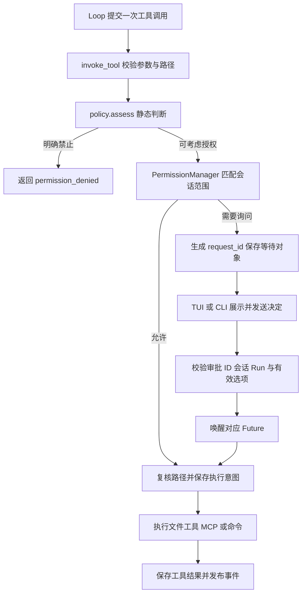

# S10：工具审批与执行环境

## 1. 这一阶段实现了什么

模型可以提出“修改文件、运行命令、调用 MCP”等操作，但提出操作不代表有权执行。S10 在既有工具入口上完善四件事：

1. **明确禁止不能被之前的允许覆盖。** 所有工具使用相同的静态判断入口。
2. **持续授权有具体范围。** 不再批准一次命令，就永久允许整个 bash 工具。
3. **每个审批有自己的身份。** 多个子 Agent 即使返回相同工具 ID，也能分别审批；过期回答不能批准后来的调用。
4. **子进程只获得必要环境。** 默认不把 Core 的模型密钥和其他任意变量交给命令或本地 MCP。

这次保留 Manager → Runner → Loop 主线，文件路径规范化、检查点恢复和未知副作用确认也继续使用原实现。没有增加容器、数据库或新的后台服务。

## 2. 先理解两个边界

**审批决定是否启动操作；沙箱限制操作启动后能做什么。**

例如，用户批准 `python tests/check.py`，脚本仍可以读取文件、访问网络、启动其他进程。固定工作目录、正则匹配和移除环境变量，都不能把这个脚本变成只读程序。

本阶段改进的是应用层审批和环境传递，不是操作系统沙箱。文件工具的路径校验不能约束 shell 内部路径，也不能限制远程 MCP 服务器自身的访问。

## 3. 整体结构与执行顺序



普通模型请求、压缩、Step 推进没有加入新的审批状态。审批 Future 仅在内存中存在；检查点保存的仍是工具 `awaiting_approval` 等原有状态。

## 4. 与 S9 相比新增和改动了什么

| 部分 | S9 | S10 |
|---|---|---|
| 静态权限 | `evaluate()` 和实际等待入口分别判断 | 统一使用 `policy.assess()` |
| 禁止优先级 | 部分工具可能先命中旧允许缓存 | 所有工具先检查硬性禁止 |
| 持续授权 | 按工具名跨会话保存 | 会话、工作区、工具和资源共同匹配，仅存内存 |
| 待审批索引 | 模型提供的 `tool_use_id` | Core 生成的独立 `request_id` |
| 回复校验 | 主要依据工具 ID | 校验审批 ID、会话、Run、有效决策和请求是否过期 |
| 审批展示 | 命令摘要可能被截短 | 审批区域展示完整命令、目录、原因与范围 |
| 重连 | 打开会话时可能覆盖子 Run ID | 保留待审批请求原始身份 |
| 子进程环境 | 继承整个 Core 环境 | 基础变量＋明确透传＋明确传值 |

主要新增文件为 `permissions/scope.py` 和 `process_env.py`。其余改动集中在现有权限管理器、调用入口、前端与配置装配处。

## 5. 统一权限判断

阅读 [policy.py](../src/kama_claude/core/permissions/policy.py) 的 `assess()`。它返回 `PermissionAssessment`：

```python
decision  # allow / ask / deny
reason    # 判断原因，供前端展示
reusable  # 是否允许记录本会话的范围授权
```

顺序为：

```text
工具默认明确 deny 或命中命令 deny_patterns → 拒绝
工作区外文件或命令越界启发式命中            → 强制单次询问
全局记忆写入                              → 默认询问
命令 allow_patterns 或工具默认策略         → 返回对应判断
```

Manager 另外保留旧策略文件中的明确拒绝。**禁止先判断，授权后匹配。** `default=deny` 在这一版表示硬性禁止，不能再通过同一工具的 `allow_patterns` 放行。

`evaluate()` 只读取静态结果，适合检查策略；`check_and_wait()` 才负责匹配会话授权和等待用户。这不是两套静态规则。

命令越界检测仍是启发式，不能识别所有 Windows/POSIX shell 语法。因此不要用它证明命令只访问工作区，也不要配置过宽的命令自动允许规则。

## 6. 持续允许究竟允许了什么

阅读 [scope.py](../src/kama_claude/core/permissions/scope.py) 的 `approval_scope()`。授权键为：

```text
会话 ID + 规范化工作区 + 工具名 + 资源
```

“资源”按工具种类取值：

| 工具 | 资源 | 举例 |
|---|---|---|
| bash | 完整命令字符串 | 允许 `git status` 不会允许 `git status && other-command` |
| read/write/edit 文件 | 规范化目标的父目录 | 允许在 `src/` 中使用 write_file，不包含 `src/nested/`，也不授权 edit_file |
| list/find/search | 本次选定目录 | 仍按原工具参数决定是否递归；授权目录不会自动变成上级目录 |
| 其他工具 | 按 key 排序的完整参数 | 不同记忆 scope/key、不同 MCP 工具或不同参数分别判断 |

文件授权允许同一目录中的不同文件，这是界面明确展示的目录授权。MCP 包装工具名带服务器前缀，所以不同服务器不会仅因原工具同名就复用许可。

四个决策字符串保留，以便现有交互继续使用，但含义调整为：

- `allow_once` / `deny_once`：只决定这次调用。
- `always_allow` / `always_deny`：仅在本会话和上述范围内持续允许/拒绝。

没有会话 ID 的独立调用、工作区外文件访问，以及命中越界启发式的命令，只显示单次选项。授权不写磁盘；关闭会话会清理，Core 重启也会丢失。TUI 临时断线不关闭会话，因此 Core 仍保留该会话的内存授权。

旧 `~/.kama/policy.toml` 不自动改写、不自动删除。旧 `allow` 被忽略并记录提示，旧 `deny` 继续约束操作；新版本不再自动生成工具级永久授权。需要解除旧拒绝时由用户修改原文件并重启 Core。

## 7. 从审批请求到继续执行

阅读 [manager.py](../src/kama_claude/core/permissions/manager.py)。`check_and_wait()` 的正常路径：

1. 深拷贝参数，调用统一策略判断。
2. 若无明确禁止，生成授权范围；范围许可命中时直接返回。
3. 需要询问时生成 UUID 审批 ID，创建 `Future`，保存请求载荷。
4. 发布 `permission.requested`，等待 Future 或审批超时。
5. 收到有效决定后再次检查硬性禁止；必要时记录本会话范围授权，返回是否允许。
6. 无论正常、取消、通知异常还是超时，`finally` 都清理等待对象。

审批请求同时包含三个不同用途的 ID：

```text
request_id  → 找到这一次等待审批的 Future
run_id      → 校验审批属于哪一个主/子 Run
tool_use_id → 对应模型消息和检查点中的工具调用
```

用户回复的 RPC 为：

```json
{
  "request_id": "Core生成的ID",
  "session_id": "sess-...",
  "run_id": "原始主Run或子Run",
  "decision": "allow_once"
}
```

后端 `respond()` 先校验再设置 Future。非法决策、会话/Run 错误不会消费待审批请求。超时、重复和迟到回复返回参数错误，不能唤醒新一轮调用。旧 `tool_use_id` 回复协议不保留回退匹配；升级后需要重启 Core 和前端。

这属于单用户本机 Core 的请求归属校验，不是多用户身份认证。若以后对外开放 TCP，还需要独立的连接认证与访问控制。

`pending_for_session()` 给重连前端返回副本；副本被修改不会改变后端绑定的请求。`SessionManager.open()` 不再把子 Run 的审批 ID 改成主 Run ID。Core 重启则没有旧 Future，恢复到审批位置后生成新请求，旧回答仍无效。

批准后仍会走原有路径复核：链接目标若变化，返回权限拒绝；执行意图保存成功后才调用工具。用户批准不代表工具已经执行成功。

## 8. TUI 和 CLI 的变化

TUI 的 `PermissionSelect` 携带审批 ID、会话与 Run；按钮和快捷键都只使用后端允许的选项。“持续允许”按钮明确写出本会话语义。

审批区域展示完整命令、工作目录、审批原因和授权范围。文件操作展示完整实际路径，编辑操作继续展示修改片段。命令界面明确说明本机 shell 未隔离文件和网络访问。

前端等待 `permission.respond` 成功后才移除控件；RPC 失败保留控件并显示原因。按审批 ID 创建和清理组件，相同模型工具 ID 的并发请求不会互相覆盖；重连重复载荷不会创建重复控件。

CLI chat 只订阅当前会话，保存待审批队列。整轮 `session.send_message` 由单独的异步任务等待，主输入循环继续接收审批决定，避免一边等运行结束、一边无法回答审批。

## 9. 子进程环境如何构建

阅读 [process_env.py](../src/kama_claude/core/process_env.py) 的 `build_process_env()`：

```text
基础环境变量
  + forward_env 明确指定的 Core 变量
  + env 明确传值（覆盖前两者）
  = 交给子进程的环境
```

基础列表保留 PATH、Windows 系统目录、临时目录、用户目录、语言编码等运行信息，不默认透传任意 API Key、GitHub Token、代理认证变量、PYTHONPATH 或 NODE_OPTIONS。

命令配置示例：

```toml
[execution]
forward_env = ["BUILD_PROFILE"]
env = { PYTHONUNBUFFERED = "1" }
```

主 Runner 把同一 ExecutionConfig 交给 BashTool 和 SpawnAgentTool，后者继续传给嵌套子 Agent。模型的工具参数不能增加环境透传名单。

stdio MCP 按服务器单独配置：

```toml
[[mcp.servers]]
name = "my-service"
transport = "stdio"
command = "python"
args = ["server.py"]
forward_env = ["MY_SERVICE_TOKEN"]
env = { SERVICE_MODE = "development" }
```

MCP SDK 还会合并自身的基础环境名单，但不会因此重新继承整个 Core 环境。真实 stdio 服务测试检查了默认不含模型密钥、显式透传变量存在。

配置文件应由用户检查后信任，尤其是外部仓库中的 `.kama/config.toml`：它原本就可以声明本地 MCP 启动程序，现在也能显式声明透传变量。环境过滤不构成不可信项目配置的安全隔离。

不要把真实密钥写进仓库；优先在用户环境设置，再明确选择传给哪个服务。项目内 `.env` 等凭据文件仍可能被本机命令读取；本轮没有增加敏感文件屏蔽或文件系统沙箱。

## 10. 代码阅读顺序

1. [policy.py / assess](../src/kama_claude/core/permissions/policy.py)：先看哪些操作被拒绝、哪些必须问。
2. [scope.py / approval_scope](../src/kama_claude/core/permissions/scope.py)：持续授权匹配的范围。
3. [manager.py / check_and_wait、respond](../src/kama_claude/core/permissions/manager.py)：发起请求、挂起、校验与唤醒。
4. [invocation.py / invoke_tool](../src/kama_claude/core/tools/invocation.py)：审批如何接回工具执行和检查点边界。
5. [TUI app.py](../src/kama_claude/tui/app.py)、[CLI chat.py](../src/kama_claude/cli/commands/chat.py)：事件展示与回复。
6. [process_env.py](../src/kama_claude/core/process_env.py)、[command.py](../src/kama_claude/core/tools/command.py)、[MCP client.py](../src/kama_claude/core/mcp/client.py)：执行前环境如何构建。

Loop 只新增传递本轮工作区；Runner 与子 Agent 只新增执行配置装配，没有加入另一套运行状态。

## 11. 验证与借鉴

改动前非付费基线为 617 项通过、1 项跳过。跳过的是需要 Windows 文件符号链接权限的用例，不能当作已验证；现有 junction 用例继续执行。

最终完整非付费测试为 **640 项通过、1 项跳过、1 项真实模型测试被排除**。改动文件 Ruff、全部 107 个源码文件 mypy、生成协议一致性、README 和本说明的本地链接检查均通过。全仓 Ruff 仍有未修改的 `core/skills/loader.py` 第 45 行行长问题，没有将它计入本轮通过项。

验证重点包括：禁止优先级、命令/目录/会话隔离、MCP 与记忆参数范围、并发同工具 ID、过期和重复回答、取消清理、重连子 Run 身份、TUI 失败保留控件、CLI 审批可输入、真实子进程与 SDK MCP 环境过滤，以及既有恢复、压缩和完整历史回归。

```text
uv run python -X utf8 -m pytest -m "not integration" -q
uv run mypy src
uv run python -X utf8 scripts/gen_protocol_doc.py --check
```

这里的 `integration` 标记用于需要真实模型的测试；目录 `tests/integration` 内未带该标记的进程、TCP、MCP 测试仍会执行。本轮不调用付费模型，不把行为测试解释为操作系统沙箱验证。

参考 OpenCode 的资源规则与独立审批请求、Cline 的能力分类展示、mini-SWE-agent 的显式环境传递。只采用适合当前项目的做法，没有引入它们的整个框架：

- [OpenCode 权限实现 v1.2.15](https://github.com/anomalyco/opencode/blob/v1.2.15/packages/opencode/src/permission/next.ts)
- [Cline 审批说明](https://docs.cline.bot/features/auto-approve)
- [mini-SWE-agent Docker 执行环境](https://github.com/SWE-agent/mini-swe-agent/blob/main/src/minisweagent/environments/docker.py)

文件恢复检查点、进程清理和执行隔离解决不同问题。本轮仍保留“结果未知 → 中断 → 用户核实”的恢复语义，不自动重试可能已经产生副作用的操作。
