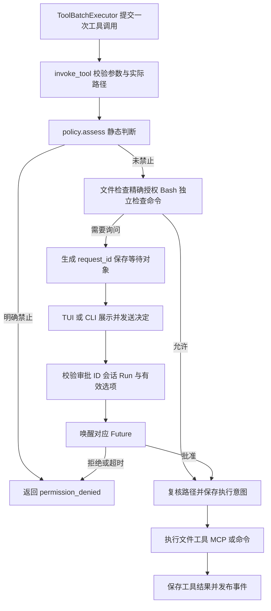

# S10：工具审批与执行环境

本说明介绍当前 S10 审批：文件按具体实际目标授权，Bash 独立逐段判断。通用工具批次位于 `tools/batch.py`，界面控件位于 `tui/widgets/`；整体运行主线见 [主线整理与阅读指南](./S10-主线整理与阅读指南.md)。

## 1. 这一阶段实现了什么

模型可以提出“修改文件、运行命令、调用 MCP”等操作，但提出操作不代表有权执行。S10 在既有工具入口上完善四件事：

1. **明确禁止不能被之前的允许覆盖。** 所有工具使用相同的静态判断入口。
2. **会话文件授权只对应一个工具与一个文件。** 不放行同目录其他文件；Bash 不保存会话授权，每次重新判断命令。
3. **每个审批有自己的身份。** 多个子 Agent 即使返回相同工具 ID，也能分别审批；过期回答不能批准后来的调用。
4. **子进程只获得必要环境。** 默认不把 Core 的模型密钥和其他任意变量交给命令或本地 MCP。

这次保留 Manager → Runner → Loop 主线，文件路径规范化、检查点恢复和未知副作用确认也继续使用原实现。没有增加容器、数据库或新的后台服务。

## 2. 先理解两个边界

**审批决定是否启动操作；沙箱限制操作启动后能做什么。**

例如，用户批准 `python tests/check.py`，脚本仍可以读取文件、访问网络、启动其他进程。固定工作目录、正则匹配和移除环境变量，都不能把这个脚本变成只读程序。

本阶段改进的是应用层审批和环境传递，不是操作系统沙箱。文件工具的路径校验不能约束 shell 内部路径，也不能限制远程 MCP 服务器自身的访问。

## 3. 整体结构与执行顺序



普通模型请求、压缩、Step 推进没有加入新的审批状态。审批 Future 仅在内存中存在；检查点保存的仍是工具 `awaiting_approval` 等原有状态。

## 4. 与 S9 相比新增和改动了什么

| 部分 | S9 | S10 |
|---|---|---|
| 静态权限 | `evaluate()` 和实际等待入口分别判断 | 统一使用 `policy.assess()` |
| 禁止优先级 | 部分工具可能先命中旧允许缓存 | 所有工具先检查硬性禁止 |
| 文件会话授权 | 按工具名跨会话保存 | 会话 ID＋工具名＋后端实际文件路径，仅存内存 |
| 命令允许 | 按命令片段正则判断 | 根据实际 Shell 解析出参数列表，所有命令均命中允许规则才执行；不保存 Bash 会话授权 |
| 待审批索引 | 模型提供的 `tool_use_id` | Core 生成的独立 `request_id` |
| 回复校验 | 主要依据工具 ID | 校验审批 ID、会话、Run、有效决策和请求是否过期 |
| 审批展示 | 命令摘要可能被截短 | 审批区域展示完整命令、目录、原因与范围 |
| 重连 | 打开会话时可能覆盖子 Run ID | 保留待审批请求原始身份 |
| 子进程环境 | 继承整个 Core 环境 | 基础变量＋明确透传＋明确传值 |

当前命令规则集中在 `permissions/bash.py`，Bash AST 在 `bash_parser.py`，Windows cmd 的有限解析在 `cmd_parser.py`；文件授权集合位于 Manager。`permissions/scope.py` 只保留 Task、记忆和 MCP 的既有完整参数授权；环境控制集中在 `process_env.py`。

## 5. 统一权限判断

阅读 [policy.py](../src/kama_claude/core/permissions/policy.py) 的 `assess()`。它返回 `PermissionAssessment`：

```python
decision  # allow / ask / deny
reason    # 判断原因，供前端展示
reusable  # 是否可复用授权；Bash 与外部路径为 False
```

顺序为：

```text
工具明确 deny 或旧策略明确拒绝 → 拒绝
Bash → 独立判断禁止规则、完整解析与逐段允许
工作区外文件 → 强制单次询问
工作区内文件 → 读取默认允许；写入默认询问并检查具体文件授权
全局记忆写入 → 沿用默认询问
其他工具 → 沿用各自默认策略与参数授权
```

Manager 另外保留旧策略文件中的明确拒绝。**禁止先判断，授权后匹配。** `default=deny` 表示硬性禁止，不能再通过同一工具的命令允许规则放行。

`evaluate()` 只读取静态结果，适合检查策略；`check_and_wait()` 才负责匹配会话授权和等待用户。这不是两套静态规则。

不再通过绝对路径、`cd` 或 `..` 猜测 Bash 是否越界。命令的文件、网络访问不受内置文件工具的工作区检查约束；明确允许一个命令不代表证明该命令没有副作用。

## 6. 持续允许究竟允许了什么

### 6.1 文件：同一工具操作同一实际文件

阅读 [manager.py](../src/kama_claude/core/permissions/manager.py) 的 `_file_grants`，它是一个简单集合，键为：

```text
会话 ID + 工具名 + 后端解析出的实际文件路径
```

模型的原始路径只用于展示。后端基于工作区解析 `..`、符号链接和 Windows junction；Windows 按系统规则统一路径大小写，POSIX 保持大小写区别。不存在的新文件解析已有父目录。批准后、执行前再次核对实际目标，变化就返回 `permission_denied`。

| 情况 | 默认行为 | 可选决定 |
|---|---|---|
| 工作区内读取、搜索、列目录 | 允许 | 无 |
| 工作区内写入或编辑，无对应授权 | 询问 | 允许本次、拒绝本次、本会话允许此工具操作此文件 |
| 工作区内写入或编辑，命中对应授权 | 允许 | 无 |
| 工作区外读写 | 始终询问 | 允许本次、拒绝本次 |

例如，允许本会话用 `edit_file` 编辑 `src/a.py` 后，内容变化不影响授权；访问同一文件的不同合法路径写法可复用。编辑 `src/b.py`、用 `write_file` 写入 `src/a.py` 或另一个会话调用，都需要分别判断。没有会话 ID 或可信实际路径时不提供会话授权。

RPC 中仍用 `always_allow` 表示会话允许；文件审批不再提供或接受 `always_deny`。工作区外检查先于授权匹配，原有批准不能绕过边界。

### 6.2 命令：按实际 Shell 解析，再匹配参数规则

阅读 [bash.py](../src/kama_claude/core/permissions/bash.py)：

```text
Windows cmd → 保守解析 → 每条命令的参数列表
POSIX Shell → tree-sitter-bash → 语法白名单 → 每条命令的参数列表
    ↓
明确禁止 > 要求询问 > 允许
    ↓
所有命令都允许 → 自动执行
未知或不支持的语法 → 单次询问，不自动允许
```

工具虽然叫 `bash`，Windows 上实际仍在本机 cmd.exe 执行，POSIX 仍用 /bin/sh。没有切换到 Docker，也没有改命令执行器。解析只服务于审批；批准后交给 Shell 的仍是原始完整命令，不会把解析后的参数重新拼接执行。

**为什么有两个解析入口？** tree-sitter-bash 的语法是 Bash，不能证明 cmd 命令会怎样执行。Windows 继续只识别 ASCII 字面量、空格/制表符与 `&&`、`||`；引号、中文、反引号、`%`、`!`、`^`、控制结构、管道和重定向等均询问。反斜线的 Windows 路径保留为原始参数，不按 Bash 转义处理。

**Bash AST 怎样检查？** [bash_parser.py](../src/kama_claude/core/permissions/bash_parser.py) 先拒绝语法错误，再遍历整棵树，只接受简单命令、列表、管道和字面量节点。支持普通字面量引号、空参数、中文、参数拼接，以及 `&&`、`||`、`;`、管道和换行组成的简单序列。例如 `rg "hello world" src` 解析为 `["rg", "hello world", "src"]`，引号中的 `&&` 不会被误切段。变量/命令替换、重定向、控制流、通配展开和不确定转义不进入自动允许路径。POSIX 仅使用这套与普通 sh 共享的简单语法子集。

新规则匹配的是参数列表前缀，不再对整段命令做允许/禁止正则。`ToolPolicy` 删除旧的 `allow_patterns`、`deny_patterns` 内部字段，统一为 `command_rules`。配置示意：

```python
ToolPolicy(PermissionDecision.ASK, command_rules=[
    CommandRule(("git", "status"), "allow"),
    CommandRule(("git", "diff"), "allow"),
    CommandRule(("git", "push"), "ask"),
    CommandRule(("git", "push", "--force"), "deny"),
])
```

这是 Python 后端装配示例，**不是已经启用的默认规则，也不是 TOML 配置**。默认 `command_rules=[]`，没有内置命令白名单或黑名单，Bash 工具的普通请求仍逐次询问。工具默认值改成 allow 也不能代替明确的命令允许规则。参数前缀按字符串精确比较，区分大小写；绝对程序路径和不同参数顺序不会自动归一化。

`("git", "status")` 可以匹配 `git status --short`，但不匹配 `git status-extra` 或 `echo git status`。这是比原来整段 fullmatch 更宽的授权，配置时需要审查程序及其参数；不要直接允许整个 Python 或 Shell 解释器。多条规则重叠时禁止优先于询问，询问优先于允许；复合命令所有段都允许后才执行，不会先运行已经获准的第一段。

Windows 的允许示例：若分别允许 `git status` 和 `git diff`，`git status && git diff` 可自动执行；缺少后一条许可则整条询问。Bash 的引号、中文和管道增强只属于 Bash 入口，不意味着当前 cmd 也支持自动判断这些语法。

### 6.3 复杂语法和嵌套 Shell 的边界

复杂 Bash 脚本仍能提取各命令开头连续的字面量，但这些线索**只用于禁止，不能用于允许**。例如配置禁止 `("rm", "-rf")` 后，`rm -rf "$target"` 可因已确定的前两个参数被拒绝；`echo 'rm -rf /tmp'` 不会被误当作真正的 rm。遇到动态中间参数就停止提取，不能把 `git "$action" status` 拼成 `git status`。

cmd 解析失败时不使用 Bash AST 猜测隐藏命令，整条交给用户单次确认。因此未识别的动态 cmd 内容无法保证命中特定参数禁止规则。已知 Shell 包装调用不自动放行；本版不实现嵌套脚本递归求值、环境展开、别名解析或完整危险命令识别体系。

Bash 不读取或写入任何会话授权；相同命令下一次仍重新判断。Task、记忆与 MCP 保持既有策略，完整参数授权仍由 [scope.py](../src/kama_claude/core/permissions/scope.py) 处理。

所有新授权不写磁盘；关闭会话会清理，Core 重启也会丢失。TUI 临时断线不关闭会话，因此 Core 仍保留该会话的文件授权。

旧 `~/.kama/policy.toml` 不自动改写、不自动删除。旧 `allow` 被忽略并记录提示，旧 `deny` 继续约束操作；新版本不再自动生成工具级永久授权。需要解除旧拒绝时由用户修改原文件并重启 Core。

## 7. 从审批请求到继续执行

阅读 [manager.py](../src/kama_claude/core/permissions/manager.py)。`check_and_wait()` 的正常路径：

1. 深拷贝参数，调用统一策略判断。
2. 若无明确禁止，内部文件写入匹配具体目标授权；外部文件和 Bash 不匹配会话授权。
3. 需要询问时生成 UUID 审批 ID，创建 `Future`，保存请求载荷。
4. 发布 `permission.requested`，等待 Future 或审批超时。
5. 收到有效决定后再次检查硬性禁止；文件选择会话允许时，保存同一工具与实际文件的授权。
6. 无论正常、取消、通知异常还是超时，`finally` 都清理等待对象。

审批请求同时包含三个不同用途的 ID：

```text
request_id  → 找到这一次等待审批的 Future
run_id      → 校验审批属于哪一个主/子 Run
tool_use_id → 对应模型消息和检查点中的工具调用
```

用户回复的 RPC 为：

```json
{
  "request_id": "Core生成的ID",
  "session_id": "sess-...",
  "run_id": "原始主Run或子Run",
  "decision": "allow_once"
}
```

后端 `respond()` 先校验再设置 Future。非法决策、会话/Run 错误不会消费待审批请求。超时、重复和迟到回复返回参数错误，不能唤醒新一轮调用。旧 `tool_use_id` 回复协议不保留回退匹配；升级后需要重启 Core 和前端。

这属于单用户本机 Core 的请求归属校验，不是多用户身份认证。若以后对外开放 TCP，还需要独立的连接认证与访问控制。

`pending_for_session()` 给重连前端返回副本；副本被修改不会改变后端绑定的请求。`SessionManager.open()` 不再把子 Run 的审批 ID 改成主 Run ID。Core 重启则没有旧 Future，恢复到审批位置后生成新请求，旧回答仍无效。

只有实际需要询问时，才在发出审批前保存 `awaiting_approval`；自动允许的工具直接进入执行前提交。批准后仍会走原有路径复核：链接目标若变化，返回权限拒绝；执行意图保存成功后才调用工具。任何前置保存失败都不能发出下一步审批或执行工具。用户批准不代表工具已经执行成功。

## 8. TUI 和 CLI 的变化

TUI 的 `PermissionSelect` 携带审批 ID、会话与 Run；按钮、方向键和快捷键使用后端 `allowed_decisions` 中的同一组选项。内部文件写入三选项，外部文件和 Bash 两选项；缺少选项时保守显示单次允许/拒绝。文件会话允许按钮明确写出工具名和“此文件”。

审批区域展示完整命令、工作目录、审批原因和授权范围。文件操作同时展示原始路径与完整实际路径，编辑操作继续展示修改片段。命令界面明确说明本机 shell 未隔离文件和网络访问。普通审批继续在原协程中等待和执行，不创建新 Runner，也不调用 session.resume；结果未知的恢复确认是另一条链路。

前端等待 `permission.respond` 成功后才移除控件；RPC 失败保留控件并显示原因。按审批 ID 创建和清理组件，相同模型工具 ID 的并发请求不会互相覆盖；重连重复载荷不会创建重复控件。

CLI chat 只订阅当前会话，保存待审批队列。整轮 `session.send_message` 由单独的异步任务等待，主输入循环继续接收审批决定，避免一边等运行结束、一边无法回答审批。

## 9. 子进程环境如何构建

阅读 [process_env.py](../src/kama_claude/core/process_env.py) 的 `build_process_env()`：

```text
基础环境变量
  + forward_env 明确指定的 Core 变量
  + env 明确传值（覆盖前两者）
  = 交给子进程的环境
```

基础列表保留 PATH、Windows 系统目录、临时目录、用户目录、语言编码等运行信息，不默认透传任意 API Key、GitHub Token、代理认证变量、PYTHONPATH 或 NODE_OPTIONS。

命令配置示例：

```toml
[execution]
forward_env = ["BUILD_PROFILE"]
env = { PYTHONUNBUFFERED = "1" }
```

主 Runner 把同一 ExecutionConfig 交给 BashTool 和 SpawnAgentTool，后者继续传给嵌套子 Agent。模型的工具参数不能增加环境透传名单。

stdio MCP 按服务器单独配置：

```toml
[[mcp.servers]]
name = "my-service"
transport = "stdio"
command = "python"
args = ["server.py"]
forward_env = ["MY_SERVICE_TOKEN"]
env = { SERVICE_MODE = "development" }
```

MCP SDK 还会合并自身的基础环境名单，但不会因此重新继承整个 Core 环境。真实 stdio 服务测试检查了默认不含模型密钥、显式透传变量存在。

配置文件应由用户检查后信任，尤其是外部仓库中的 `.kama/config.toml`：它原本就可以声明本地 MCP 启动程序，现在也能显式声明透传变量。环境过滤不构成不可信项目配置的安全隔离。

不要把真实密钥写进仓库；优先在用户环境设置，再明确选择传给哪个服务。项目内 `.env` 等凭据文件仍可能被本机命令读取；本轮没有增加敏感文件屏蔽或文件系统沙箱。

## 10. 代码阅读顺序

1. [policy.py / assess](../src/kama_claude/core/permissions/policy.py)：先看哪些操作被拒绝、哪些必须问。
2. [bash.py / command_decision](../src/kama_claude/core/permissions/bash.py)：选择实际平台解析入口，按参数前缀取最严格决定；再看 [Bash AST](../src/kama_claude/core/permissions/bash_parser.py) 与 [cmd 有限解析](../src/kama_claude/core/permissions/cmd_parser.py)。
3. [manager.py / check_and_wait、respond](../src/kama_claude/core/permissions/manager.py)：发起请求、挂起、校验与唤醒。
4. [invocation.py / invoke_tool](../src/kama_claude/core/tools/invocation.py)：审批如何接回工具执行和检查点边界。
5. [TUI app.py](../src/kama_claude/tui/app.py)、[审批控件](../src/kama_claude/tui/widgets/permissions.py)、[CLI chat.py](../src/kama_claude/cli/commands/chat.py)：事件展示与回复。
6. [process_env.py](../src/kama_claude/core/process_env.py)、[command.py](../src/kama_claude/core/tools/command.py)、[MCP client.py](../src/kama_claude/core/mcp/client.py)：执行前环境如何构建。

Loop 只新增传递本轮工作区；Runner 与子 Agent 只新增执行配置装配，没有加入另一套运行状态。

## 11. 验证与借鉴

改动前非付费基线为 617 项通过、1 项跳过。跳过的是需要 Windows 文件符号链接权限的用例，不能当作已验证；现有 junction 用例继续执行。

审批功能第一轮验收为 **640 项通过、1 项跳过、1 项真实模型测试被排除**；当时改动文件 Ruff、全部 107 个源码文件 mypy 和协议检查通过。后续主线整理的最终结果为 **647 项通过、1 项跳过**，mypy 覆盖 123 个源码文件，详见主线指南。全仓 Ruff 仍有未修改的 `core/skills/loader.py` 第 45 行行长问题，没有将它计入改动文件通过项。

文件审批调整覆盖：具体文件/工具/会话隔离、不同路径写法与实际目标、内部及外部 junction 审批期间变化、当时的命令全段解析与 fullmatch、前端三选项/两选项，以及 MCP 与记忆原有参数授权。后续 AST 版本改为参数前缀规则；并发请求、过期回答、取消清理、TCP 重连和原有恢复继续回归验证。

本轮最终非付费回归为 **685 项通过、1 项跳过、1 项真实模型测试被排除**。改动文件 Ruff、全部 124 个源码文件 mypy、协议一致性检查和文档链接检查通过。真实 TCP 测试分别覆盖外部读取单次审批和内部写入精确文件会话授权；Windows junction 实际运行，文件符号链接因缺少权限跳过。没有调用付费模型，也没有提交或推送。

后续 AST/参数规则版本为 **745 项通过、1 项跳过、1 项真实模型测试被排除**；全部 126 个源码文件 mypy、改动文件 Ruff、协议与文档链接检查、`uv lock --check` 通过。使用 tree-sitter 0.26.0、tree-sitter-bash 0.25.1 的真实语法树覆盖引号、中文、拼接、管道、动态展开和禁止线索；cmd 用例单独验证反斜线路径与不支持语法。真实本机 Shell 集成验证原始命令执行、所有段审批后才运行、拒绝及检查点失败不执行。没有 Docker 或付费模型验证。

```text
uv run python -X utf8 -m pytest -m "not integration" -q
uv run mypy src
uv run python -X utf8 scripts/gen_protocol_doc.py --check
```

这里的 `integration` 标记用于需要真实模型的测试；目录 `tests/integration` 内未带该标记的进程、TCP、MCP 测试仍会执行。本轮不调用付费模型，不把行为测试解释为操作系统沙箱验证。

参考 OpenCode 的资源规则与独立审批请求、Cline 的能力分类展示、mini-SWE-agent 的显式环境传递。只采用适合当前项目的做法，没有引入它们的整个框架：

- [OpenCode 权限实现 v1.2.15](https://github.com/anomalyco/opencode/blob/v1.2.15/packages/opencode/src/permission/next.ts)
- [Cline 审批说明](https://docs.cline.bot/features/auto-approve)
- [mini-SWE-agent Docker 执行环境](https://github.com/SWE-agent/mini-swe-agent/blob/main/src/minisweagent/environments/docker.py)

命令解析与规则部分借鉴 Codex 的语法白名单、参数前缀和最严格决定；没有移植其多平台沙箱、规则语言或完整危险命令识别体系：

- [Codex Bash 解析源码](https://github.com/openai/codex/blob/695961ee88a2c84c0919814a4345b94a2d10f3ca/codex-rs/shell-command/src/bash.rs)
- [Codex 参数前缀规则](https://github.com/openai/codex/blob/695961ee88a2c84c0919814a4345b94a2d10f3ca/codex-rs/execpolicy/src/rule.rs)
- [py-tree-sitter 官方 API](https://tree-sitter.github.io/py-tree-sitter/)

文件恢复检查点、进程清理和执行隔离解决不同问题。本轮仍保留“结果未知 → 中断 → 用户核实”的恢复语义，不自动重试可能已经产生副作用的操作。
