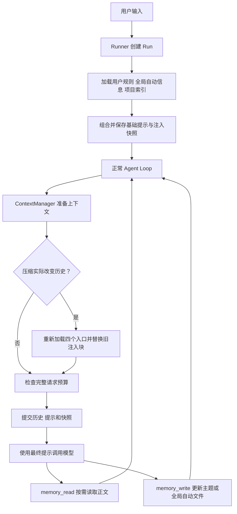

# S10：规则与索引式记忆

## 1. 先理解四个入口

用户规则回答“应该怎样工作”，自动记忆回答“以前积累了什么”。两者分别维护，默认注入精简入口，详细经验按需读取。

| 文件 | 内容与权限 |
|---|---|
| `~/.kama/AGENTS.md` | 跨项目用户规则，用户手工维护，Agent 只读 |
| `~/.kama/AGENTS.auto.md` | Agent 维护的少量跨项目信息，默认 512 估算 token |
| `<项目根>/AGENTS.md` | 项目用户规则，用户手工维护，Agent 只读 |
| `~/.kama/projects/<project-id>/memory/MEMORY.md` | 当前项目主题索引，默认 1,024 估算 token |

全局自动文件只保存经常需要的简短信息，不保存日志、大段解释或项目专属详情。项目索引每项只有类型、概要和相对文件名；解释、依据与适用条件放在主题文件中。

全局规则始终参与新 Run 的提示，项目规则和记忆仅属于当前项目。文件不存在视为空，读取失败明确报错；用户规则没有被静默裁剪或自动修改的入口。

## 2. 旧流程与新流程

| 旧实现 | 当前实现 |
|---|---|
| 全局、项目、会话三层条目，各自尽量塞正文 | 用户规则与自动记忆分开，默认只注入入口和索引 |
| 固定、更新时间决定自动注入内容 | 索引列出主题，模型按任务需要读取正文 |
| 记忆存于各层目录 | 项目记忆统一存到用户目录，以项目 ID 隔离 |
| 全局修改默认审批 | 自动区默认允许维护，静态禁止仍有效，用户规则始终只读 |
| 整个 Run 固定一份提示 | 新 Run 和实际压缩后两个刷新点，普通步骤保持稳定 |
| `/memory` 查看页面与 RPC | 页面和 RPC 已移除，保留记忆工具与磁盘文件 |

旧记忆目录、`context.md`、`notes.md` 不删除、不迁移，也不再读取。没有新增独立会话记忆文件；完整对话仍保存为 thread.jsonl，执行位置仍由检查点维护。

## 3. 整体结构与调用顺序



默认入口不追加为聊天消息，因此不会混入完整历史。按需读取的正文属于正常工具结果，会进入工作历史，也可以被现有压缩流程处理。

四层压缩协调和普通 Loop 主线保持原结构。记忆模块负责加载与组合，ContextManager 决定何时刷新、检查预算和提交。

## 4. 项目归属如何确定

以本轮固定 workspace 为起点查询 Git 根目录，找不到 Git 仓库时使用 workspace。文件工具和命令工具的工作目录没有改变。

ID 为可读目录名加规范根路径的 SHA-256 前 16 位；Windows 按系统大小写规则规范化。同名不同目录不会共享记忆，不同 worktree 默认独立。移动项目会得到新 ID，本版不自动迁移。

Run 保存本轮记忆项目根，主、子、孙任务继承它；执行中即使 Git 边界变化，也不重新解释已有任务的归属。恢复同样沿用保存值。

记忆工具不接受任意文件路径。主题 key 只允许安全文件名，拒绝目录、Windows 保留名、链接、junction 和保留的 MEMORY 名称。索引链接相对于当前 memory 目录，实际工具读取仍按 key 和后端绑定目录完成。

## 5. 主题文件与索引

一条项目记忆对应一个 Markdown 文件，例如 `feedback_testing.md`：

```markdown
# feedback_testing

- 摘要：非付费回归与真实模型验证分开汇报
- 类型：feedback
- 更新时间：2026-11-05T10:00:00+00:00
- 来源：session_id / run_id

---

不能把假模型的行为测试描述为真实模型效果验证。
适用于测试报告和项目说明；报告中需要注明跳过项和外部验证范围。
```

类型为 user、feedback、project、reference。摘要最多 160 字符，单次写入正文最多 4,000 字符。模型负责决定记什么，后端填入实际来源和更新时间。

后端读取主题头部，按类型和 key 生成 MEMORY.md，每项为相对链接加概要，不复制正文。内容没有变化时不重复更新来源与时间。

主题正文是权威数据，索引是可以重建的派生文件。写入前先验证完整候选索引的预算；超过预算要求模型合并、删去失效条目或缩短摘要，不先写正文再截断索引。

正文与索引分别使用临时文件、flush/fsync、原子替换。两份文件不是操作系统级事务：正文提交后索引失败会明确返回部分提交，下一次读取或注入先修复索引。损坏的主题文件报错，不在重建时静默丢弃。

## 6. 模型怎样读写

保留两个工具名，没有新增 RPC。以下是模型工具参数的示意：

```python
memory_read(scope="project")
memory_read(scope="project", query="测试")
memory_read(scope="project", key="feedback_testing")

memory_write(
    scope="project", key="feedback_testing", type="feedback",
    summary="非付费回归与真实模型验证分开汇报",
    content="不能把假模型的行为测试描述为真实模型效果验证。",
)
memory_write(scope="project", key="feedback_testing", action="delete")
```

正文按字符位置分页，每次最多 4,000 字符，返回 next_offset 后可继续读取。查询索引只返回摘要等元数据，关键词也可以匹配正文。

全局自动区是一份简短普通 Markdown，不接受 key：

```python
current = memory_read(scope="global")
memory_write(
    scope="global",
    content="解释代码时先讲主线，再展开关键方法。",
    expected_hash=current["expected_hash"],
)
```

工具实际返回 JSON 文本，示例省略了解析。全局写入替换整个自动文件，必须先读取并携带字节 hash；文件已被其他调用更新时返回 edit_conflict，要求重新读取。重复写入相同内容和重复删除不会改写其他信息。

全局自动区和项目记忆默认允许维护；显式禁止仍有效。模型不能通过参数选择用户规则文件。角色或 Skill 未提供记忆工具时，不会因自动注入而获得额外工具能力。

## 7. 压缩后的重新注入

Run 分别保存基础提示、完整 system_prompt、memory_snapshot 及项目归属。快照记录实际注入文本和各来源的路径与内容 hash，不是另一套长期记忆。

| 时机 | 使用什么 |
|---|---|
| 新 Run | 读取当前四个入口，提交新快照 |
| 普通执行 | 沿用当前已提交快照 |
| 任一压缩层实际采用候选 | 重新读取入口，替换提示块，和候选历史一起提交 |
| 压缩没有改变历史 | 不刷新 |
| 中断恢复 | 使用最近已提交快照，不重新读文件 |

全局自动文件在本轮中被更新后，通过工具结果对当前对话可见；下个新 Run 或下一次实际压缩时更新常驻提示。

自动与手动压缩共用加载和组合逻辑。Loop 在准备结束后取得最终 system，避免局部变量继续引用旧提示。新提示改变前缀指纹后，旧 Usage 锚点不再适用，重新按完整请求估算；本次准备最多执行一次原有压缩流程。

失败处理：

- 初始化加载失败，不创建后台任务，内存会话回到原状态。
- 运行中刷新失败，保留旧历史和旧快照，明确中断并通知失败。
- 检查点保存失败向上传播，不请求下一次模型、不发送压缩成功。
- 刷新后仍超硬预算，保存可恢复状态并停止，不靠重置 Step 或重复摘要绕过预算。
- 手动压缩不改变已结束 Run 的执行终态；预算不足通过压缩响应和失败事件说明。

详细正文不会因为重新注入而全部加载，完整 thread.jsonl 也不会因压缩被改写。

## 8. 只读保护与升级

内置 write_file、edit_file 在审批前和实际写入前检查后端解析路径，保护用户 AGENTS.md 及其链接目标。普通工具也不能覆盖全局 AGENTS.auto.md，只能通过受预算与 hash 约束的记忆入口维护。

这是应用层保护。本机 Shell 和远程 MCP 不受文件工具内部检查的系统级约束；它们仍使用已有审批机制，本版没有增加 Docker 或操作系统沙箱。

配置改为：

```toml
[memory]
global_auto_tokens = 512
project_index_tokens = 1024
```

对应环境变量为 KAMA_MEMORY_GLOBAL_AUTO_TOKENS、KAMA_MEMORY_PROJECT_INDEX_TOKENS，必须为正整数。用户规则完整加载，自动文件超预算明确报错，不自动裁剪用户内容。

旧 session scope、pinned 和三层预算配置已删除。工具 Schema 已变化，旧冻结定义仍严格校验；升级前完成或终止相关旧 Run。检查点版本仍为 1，历史查看与终止旧 Run 保留。

前端 `/memory` 补全、命令拦截、页面及后端 memory.inspect 命令、响应、注册和处理器全部删除。旧 RPC 返回 method not found，普通记忆工具进度继续显示。

## 9. 阅读入口

1. [MemoryStore](../src/kama_claude/core/memory/store.py)：主题、索引、全局 hash 和原子提交。
2. [项目路径与只读保护](../src/kama_claude/core/memory/paths.py)：项目识别、目录隔离和保护路径。
3. [记忆工具](../src/kama_claude/core/tools/builtin/memory.py)：模型能传哪些参数，怎样得到结果。
4. [提示构建](../src/kama_claude/core/memory/context.py)：四个入口如何组成快照。
5. [Runner](../src/kama_claude/core/runner.py) 与 [主子装配](../src/kama_claude/core/assembly.py)：新 Run 初始化和依赖注入。
6. [ContextManager](../src/kama_claude/core/compact/manager.py) → [Loop](../src/kama_claude/core/loop.py)：压缩候选、刷新、保存及最终模型请求。

行为测试见 [存储测试](../tests/unit/test_memory_store.py)、[注入测试](../tests/unit/test_memory_context.py)、[链路测试](../tests/unit/test_memory_workflow.py) 和 [真实进程测试](../tests/integration/test_s9_memory.py)。测试使用假模型，不代表真实模型效果验证。

## 10. 本轮验证记录

- 改造前记忆与 `/memory` 定向基线：42 项通过；此前完整非付费基线为 778 项通过、1 项跳过、1 项真实模型测试排除。
- 改造后完整非付费回归：**781 项通过、1 项跳过、1 项真实模型测试排除**。旧查看页面测试已移除，旧 RPC 集成测试改为验证方法不存在和重启后的冻结快照。
- 覆盖了主题与索引、预算超限、全局 hash 冲突、原子写入和索引部分提交、Git 子目录归属、junction 隔离、只读路径别名、主子 Agent、自动与手动压缩刷新、Usage 锚点失效、保存失败及完整历史保持。
- 改动文件 Ruff、完整源码 mypy（128 个文件）、生成协议一致性、README 与 S10 文档本地链接、Git 差异格式检查通过。
- 跳过项仍为 Windows 文件符号链接权限不足，未表述为通过；目录 junction 用例执行。全仓 Ruff 原有 `core/skills/loader.py:45` 行长问题未在本轮修改。

当前仍为 s10 分支。保留已有多 Agent 工作区改动，旧记忆文件未迁移，本轮未提交、未推送。
