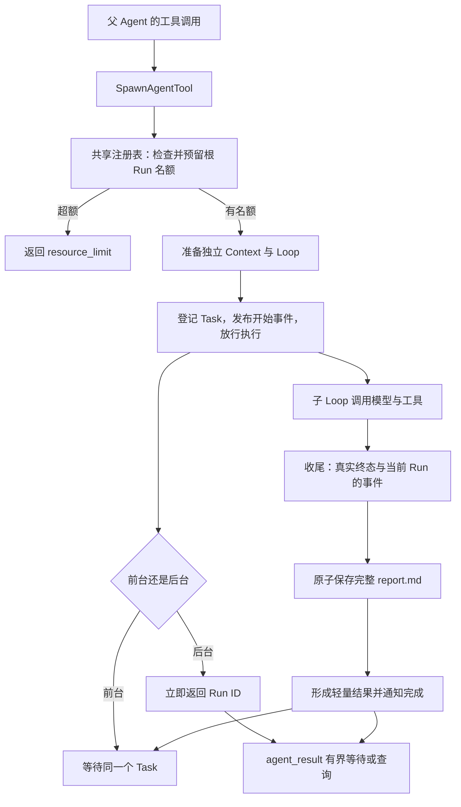

# S10：轻量多 Agent 协作

## 1. 这部分解决什么问题

主 Agent 可以把独立的小任务交给子 Agent。例如主任务是“定位并修复一个错误”，可以派生一个 reviewer 检查相关文件，自己继续定位。子任务有自己的消息、模型调用、Step 和预算，不继承父对话；任务目标和必要信息必须放进 `prompt`。

这一版完善三件事：能等待结果而不频繁空查；避免子任务无限派生；让成果以简短返回和完整报告交接。没有增加额外模型请求、任务 DAG 或群聊。

| 原来 | 现在 |
|---|---|
| `agent_result` 只立即查询 | 默认最多等 10 秒，可指定 0～30 秒 |
| 有深度上限，没有整个任务树的数量限制 | 同一个根 Run 默认最多 3 个活跃后代、8 个累计派生 |
| 直接返回子任务回答，长度不固定 | 返回后端状态、最多 4,000 字符回答、完整报告路径 |
| 子任务回答格式由模型自由决定 | 提示要求五章节 Markdown；缺少章节也不追加模型请求 |

原有角色、权限、工作区、独立预算和最大嵌套深度继续保留。Windows 命令仍在本机 cmd 中执行。

## 2. 主线与模块



正常执行仍是 Manager → Runner → Loop。Loop 不负责调度子任务；只有执行到 `spawn_agent` 或 `agent_result` 工具时才进入子 Agent 模块。

| 文件 | 负责什么 |
|---|---|
| [tool.py](../src/kama_claude/core/subagent/tool.py) | 派生、前后台执行、有界查询、角色和子工具装配 |
| [registry.py](../src/kama_claude/core/subagent/registry.py) | Core 共享任务、根 Run 额度、结果缓存、报告提交与完成通知 |
| [report.py](../src/kama_claude/core/subagent/report.py) | 交接提示、筛选本 Run 命令记录、原子写入 Markdown |
| [result.py](../src/kama_claude/core/subagent/result.py) | 轻量终态与统一 ToolResult，不保留完整 Context |
| [tracking.py](../src/kama_claude/core/subagent/tracking.py) | 将已派生/已收集标记写入父 Run，参与已有检查点保存 |
| [runner.py](../src/kama_claude/core/runner.py) | 注入共享注册表、配置和根 Run 身份，恢复时补齐累计数 |

## 3. 派生到完成，逐步看

### 3.1 先争取名额，再创建任务

`SpawnAgentTool.invoke()` 校验参数、深度和角色，然后生成子 Run ID，调用注册表的 `reserve()`。

`reserve()` 是没有 `await` 的同步方法。同一个 Core 事件循环内，“检查数量→占位”连续完成，两个并发调用不能同时看到同一个空位。预留也计入压力，尚未登记的任务不会被忽略。

之后准备 Context、子工具和 Loop。如果准备失败或取消，`finally` 释放预留，累计派生数不增加。登记 Task 成功才把预留转成正式派生记录。

登记后发布 `subagent.started`。子协程先等待一个 `asyncio.Event`，开始事件发布后再放行。这样父任务先知道派生关系，子任务才开始模型调用；不会出现子任务已经结束、父任务还不知道它存在的次序。

这里的 Event 只是启动顺序控制，不是另一份 Run 执行状态。执行状态仍以 `context.run` 为准。

### 3.2 前后台执行的是同一种子任务

前台：工具等待 Task，父 Agent 等工具结果。

后台：工具立即返回 Run ID，父 Agent 可以继续自己的工作，稍后调用 `agent_result`。Core 共享注册表持有 Task，不依赖某个 Runner 对象一直存在。

两种模式都通过 `_run_child()` 执行 Loop 和异常收尾。取消正在执行、可能有副作用的工具，仍保留 unknown / interrupted 语义；不会为了生成交接而改成成功。

### 3.3 等待结果不会取消后台工作

```python
await agent_result(run_id="...", wait_s=0)   # 立即查询
await agent_result(run_id="...")             # 最多等 10 秒
await agent_result(run_id="...", wait_s=30)  # 最多等 30 秒
```

这是模型工具调用的示意写法，不是新增 RPC。

`wait_result()` 先查所属会话和缓存。结果已经就绪立即返回；仍在执行时，等待 `wait_for(shield(child_task), timeout=wait_s)`：

- 等待超时：返回 still running，并提示继续查询；子任务继续。
- 查询者被取消：向上传播 CancelledError，子任务继续。
- 子任务自身被取消：返回子任务的取消结果和已有报告，不把它误当成查询者取消。
- ID 不存在、结果缓存已过期或属于其他会话：明确返回错误，不重新派生。

完成事件只用于界面观察，不自动加入父模型消息。父模型通过工具返回或 `agent_result` 得到交接。

## 4. 数量限制具体怎么算

```toml
[subagent]
max_active = 3
max_total = 8
```

环境变量为 `KAMA_SUBAGENT_MAX_ACTIVE`、`KAMA_SUBAGENT_MAX_TOTAL`，覆盖 TOML；都必须是正整数。

根 Agent 本身不计数。子 Agent 和孙 Agent 都携带同一个 `root_run_id`，共享根额度。例如根 R 派生 A、B，A 又派生 C，此时活跃数是 3，累计数也是 3。A 正在等 C 也仍占一个活跃名额。

此时再派生 D 立即返回 `resource_limit`，不会排队，也不会发布开始事件。父子占满额度时继续派生同样直接失败，不会因为等待空位相互卡死。

- 完成或取消一个子任务，释放活跃名额；它已经派生过，累计数不减。
- 达到总上限，等待已有任务也不能恢复累计额度；应收集结果并完成这一根 Run。
- 结果缓存最多 100 条，淘汰缓存不删除累计派生记录。
- 更换 Runner 不清零。Core 重启后，Runner 用检查点中 `run.subagents` 的已提交 ID 补齐累计数。
- 关闭会话清理该会话额度；其他会话不受影响。

这只是任务数量限制。每个 Agent 仍独立计算时间和 Token；没有全树总预算。

## 5. 成果报告保存什么

子任务系统提示追加五个标题：结论、证据、已完成、验证、遗留事项。角色原有提示继续保留；模型没有遵守标题也不会为了修格式再请求一次。

结束时，在该子 Run 目录生成 `report.md`。会话运行通常位于 `<会话目录>/runs/<子Run ID>/report.md`，独立 Runner 使用其 runs 目录。返回的是可独立定位的完整路径。

报告分成两种来源：

1. **后端记录**：Run ID、真实终态与原因、实际/估算 Token、统计是否完整、执行秒数、events.jsonl 位置，以及当前 Run 的命令工具状态。
2. **模型回答原文**：完整保留，明确标注没有经过后端独立验证。模型文本放在单独围栏中，不能通过伪造标题冒充报告的后端章节。

命令记录只从事件里读取：有最终成功事件就是工具返回成功，有最终失败事件就记录错误，没有最终结果就明确说明。重试中的失败不当作最终结果。只收集本 Run，不把孙任务命令重复记为自己的执行。

现有事件没有结构化退出码，所以报告不猜退出码，也不把“模型说测试通过”写成后端确认的通过数。事件文件缺失或损坏会明确说明证据不足。

保存顺序：**同目录临时文件 → 完整写入 → flush/fsync → 原子替换 report.md → 缓存轻量结果 → 发布完成事件**。保存失败返回 `report_save_failed`，不能通知成功；未知副作用标记仍保留。这里缓存的是明确的失败诊断，不是成功交接。

父任务得到后端状态、最多 4,000 字符的模型回答摘要和全文位置。这是截取，不是新增 LLM 摘要。超长时明确提示用现有文件工具按需读取；报告在工作区外仍需原有单次路径审批。

## 6. 不变的保护与升级要求

- 权限、冻结工具 Schema、工作区、完整 thread.jsonl 和主 Run 检查点继续沿用原规则。
- `agent_result` 多了 `wait_s`，Schema 会变化。升级前完成或终止相关旧 Run；旧冻结 Schema 不兼容时明确拒绝续跑。
- 检查点版本仍为 1，RPC 名称和事件字段没有变化，生成协议保持一致。
- 仍不支持 Core 重启恢复未完成子任务树。补齐历史派生数量，不等于重新运行历史子任务。
- 工具结果未知仍由用户核实，本轮没有自动回滚或重新执行。

## 7. 推荐阅读顺序

先看 `tool.py` 的 `invoke()`：预留→装配→登记→执行/返回 ID。再看 `AgentResultTool.invoke()` 和注册表 `wait_result()`，理解等待与取消隔离。最后读注册表 `finalize()` → `report.py.write_report()` → `result.py.as_tool_result()`，理解报告先落盘、再交接。

需要研究限额时，再进入 `bind_root()`、`reserve()`、`register()` 和 `_collect()`；不必从 Loop 开始追调度细节。

确定性测试位于 [test_subagent_collaboration.py](../tests/unit/test_subagent_collaboration.py)，覆盖等待、取消、数量隔离、初始化失败、恢复累计数、报告故障和配置校验。不调用真实付费模型，也不据此宣称真实长任务效果已验证。

## 8. 本轮验证记录

- 推送基线 `6392937`：745 项通过、1 项跳过、1 项真实模型测试排除。
- 实现后完整非付费回归：**778 项通过、1 项跳过、1 项真实模型测试排除**。包括现有真实进程、TCP、MCP、TUI、权限与恢复测试。
- 改动文件 Ruff 通过；完整源码 mypy 通过，共 127 个文件；UTF-8 模式的生成协议一致性检查通过；S10 文档本地链接和 Git 差异格式检查通过。
- 跳过项是 Windows 文件符号链接权限不足；没有将该项表述为通过，junction 相关用例仍执行。
- 全仓 Ruff 原有 `core/skills/loader.py:45` 行长问题保持原样，本轮未修改该文件。

基线已推送到 origin/s10；其后的协作改动留在本地，没有再次提交或推送，也没有合并到 dev。
