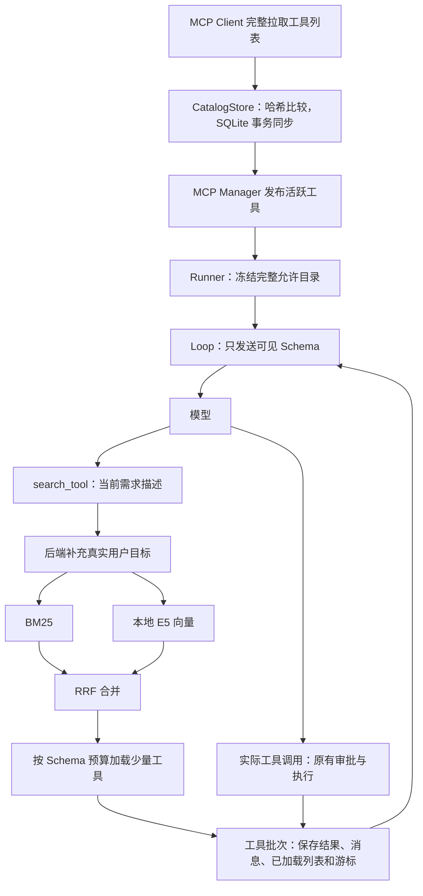

# S11：MCP 工具混合检索、哈希缓存与按需加载

## 1. 本阶段解决什么问题

MCP 服务提供工具名称、描述和 JSON Schema。以前 Core 将发现的工具全部注册，然后每次请求把完整 Schema 列表发给模型。接入多个服务后，即使只用一个工具，也会持续携带其余工具定义。

S11 把“Core 能执行的完整目录”和“本次展示给模型的列表”分开。内置工具仍常驻，MCP 工具由模型描述需求后检索、加载；模型下一次才能直接调用。已有 AgentLoop、权限审批、上下文压缩、完整历史和检查点继续使用。

| 之前 | 现在 |
|---|---|
| MCP 工具只缓存在内存 | 完整定义持久化到 SQLite，活跃连接仍由 MCP Manager 持有 |
| 每次发送全量 Schema | 常驻工具＋已加载 MCP Schema |
| 依靠模型阅读全量工具挑选 | `search_tool(description)` 找到当前所需能力 |
| 没有定义更新判断 | 完整列表、规范哈希、事务同步 |
| 恢复只有冻结目录 | 额外恢复已加载列表和检索背景 |

## 2. 整体结构和执行流程



`SearchTool` 负责发现与加载，`ToolBatchExecutor` 负责提交，Loop 仍然只推进“模型→工具→下一步”。没有增加另一个运行状态对象，已加载列表放在同一个 `context.run` 中。

## 3. 目录与哈希缓存怎么工作

默认数据库是 `~/.kama/tool_catalog.sqlite3`，内部有两类记录：

- `tools`：服务身份、原始名称、公开名称、完整定义、定义哈希、检索文本、检索文本哈希、是否有效。
- `vectors`：模型与预处理指纹、检索文本哈希、JSON 数值向量。不使用 pickle，也不依赖独立向量数据库。

服务身份由配置名、传输端点或启动参数、启动目录生成摘要；连接配置不以明文保存，请求头和环境密钥也不入库。服务器返回的工具定义原样保存。公开名称继续使用原来的 `服务名__工具名`，跨服务拼接重名会明确拒绝，避免覆盖执行目标。

MCP Client 在每次连接时获取所有分页，并保留 SDK 返回的完整定义，包括未直接发送给模型的输出 Schema 等信息。只有完整拉取成功，Manager 才进行同步。

```text
不存在旧记录 → 新增
完整定义哈希相同且仍有效 → 不更新工具记录
定义改变 → 更新记录
旧工具不在本次完整列表中 → 标记失效
同步事务失败 → 全部回滚，不发布半份工具
```

规范化 JSON 排序对象键、保留数组顺序，然后计算 SHA-256。字段顺序变化不算变更，枚举数组等真实内容变化仍会改变哈希。

检索文本只选服务名、工具名、描述、参数名和参数说明。比如参数默认值变化，完整定义哈希会变，检索文本却可以不变，因此不用重新生成向量。模型指纹还包含本地文件和预处理版本，更换模型会使用新的缓存组。

向量在首次搜索需要时生成并保存；相同文本的后续搜索、Core 重启后的搜索都可以复用。每次关键词检索在当前获准目录上构建轻量 BM25 索引，不维护另一个需要迁移的磁盘索引。

本版仅在启动和重新连接时同步，不增加后台定时任务或工具变更通知监听。网络失败不代表服务删除了所有工具；失败时保留数据库缓存，但缓存不能独立建立可执行连接。

## 4. 混合检索的具体过程

模型只传当前步骤需要的能力，例如：

```json
{"description": "获取 GitHub Issue 的详细内容和评论，用于了解复现条件"}
```

后端补充本轮真实用户输入。SessionManager 已在 Skill 展开前保存原文，Runner 将其存入 `run.user_input`；不取最后一条 `role=user`，因为工具结果同样可能使用该角色。独立 Runner 以传入目标作为原文。

查询使用带标签的“任务背景＋当前需求”。背景最多 1,000 字符，描述必须非空且最多 2,000 字符。E5 编码时背景最多 128 Token，剩余空间优先保留当前需求，整体控制在 512 Token。

1. **先过滤目录**：只检索本轮注册并获准使用的 MCP 工具。
2. **关键词召回**：名称保留完整形式，同时拆分下划线、驼峰；中文使用单字和双字组合。使用 BM25Plus 的零 delta 变体，避免小目录常见词出现负 IDF，不给未命中记录额外奖励。
3. **语义召回**：本地 `multilingual-e5-small` 使用 `query:`、`passage:` 前缀，向量归一化后在内存计算余弦相似度。
4. **RRF 合并**：两路各最多 10 条，按排名计算 `Σ 1/(60+rank)`，相同工具只保留一份。不直接相加不同量纲的原始分数。
5. **选择与加载**：默认取前 3 条，再逐个检查完整 Schema 是否放得下。

本地模型直接使用 Sentence Transformers，通过可选 `retrieval` 依赖组安装。按后续确认的使用方式，`model_path` 留空时，首次下载官方 `intfloat/multilingual-e5-small` 到 `~/.kama/models`，以后优先使用完整本地缓存。只下载一份 safetensors 权重和必要配置，不下载其他推理后端的重复权重。

指定 `model_path` 时则严格离线读取该目录；目录错误不触发下载。两种方式都在取得模型后以 CPU、`local_files_only=True`、`trust_remote_code=False` 加载，不需要独立模型服务。模型扫描和推理在工作线程执行；工作线程持有锁，因此等待协程取消也不会让两个请求并发操作同一个模型。

模型编码直接调用库提供的接口，应用不实现神经网络或分词器：

```python
model = SentenceTransformer(cached_directory, device="cpu",
                            local_files_only=True, trust_remote_code=False)
vectors = model.encode(texts, normalize_embeddings=True)
```

首次下载加加载在本次环境约用两分钟，因此搜索工具提供 600 秒等待上限；普通工具默认仍为 120 秒，调用者显式上限优先，整轮时间预算也继续生效。

模型文件、依赖、向量或向量缓存出错时，本次搜索明确显示 `keyword_only` 和原因。BM25 和原有内置工具继续可用；这不代表完成了真实语义检索。

## 5. 加载、调用和保存的边界

Run 中的几项数据承担不同职责：

| 字段 | 用途 |
|---|---|
| `tool_schemas` | 冻结的完整允许目录，用于恢复校验，不直接全量注入 |
| `mcp_tool_names`、`mcp_definition_hashes` | 识别 MCP 与校验完整定义、服务身份 |
| `tool_loading_mode` | `all` 为原全量模式，`on_demand` 为按需模式 |
| `loaded_tool_names` | 按实际加载顺序保存 MCP 名称 |
| `max_loaded_schema_tokens` | 本轮冻结的 MCP Schema 预算 |
| `user_input` | 用户原始目标，恢复时保持不变 |

搜索返回简短名称、说明、检索方式和未加载原因，不再次返回完整 Schema。完整 Schema 只加入下一次模型请求的 `tools`。

`load_tools()` 只修改本轮的已加载列表；搜索返回后，原有 ToolBatchExecutor 一起保存工具结果、完整历史、列表和游标，成功后才通知前端。保存失败立即传播，不能发起下一次模型请求。

同一 Run 不自动卸载，已加载工具不重复追加。默认 MCP Schema 上限为 8,192 个估算 Token，按现有 UTF-8 字节估算计算。超预算就跳过该定义并解释，不截断 JSON Schema。内置工具不计入这项局部上限，但仍计入完整模型输入预算。

白名单显式选择的 MCP 工具直接展示；搜索只能查看同一白名单内的工具，只有白名单允许 `search_tool` 才注册该入口。如果显式白名单本身超过 MCP Schema 预算，会明确报错，需调整白名单或配置。

一次模型回复可以提出多个工具调用。Loop 保存批次时记录工具当时是否已向模型展示，执行器会拒绝未展示的调用。因此模型不能在同一回复中“先搜索，再立刻调用尚未展示的 MCP 工具”，需要等下一次模型请求。

真实工具继续经过原来的权限审批。搜索默认允许，但明确禁止策略仍有效；搜索成功不会授予任何 MCP 执行权限。当前子 Agent 不注册 MCP，保持原有能力。

## 6. 恢复、压缩和目录变更

检查点仍为 `schema_version=1`。恢复时读取已加载列表，不重新检索，不重置 Step、预算，不重跑 completed 工具。列表若有重复或包含冻结目录外工具，检查点校验会拒绝。

恢复继续检查冻结 Schema，并额外检查完整 MCP 定义和服务身份。即使只是输出 Schema 改变，也不会静默续跑。新工具只进入新 Run。旧检查点没有新增字段时默认 `all`，保持原有完整列表，不强制插入搜索工具。

重连更新了工具定义时，旧的已加载工具对象执行前也会检查数据库中的当前哈希；不兼容就返回已知 Schema 错误，不调用远端，不将其误称为未知副作用。

自动压缩、手动 `/compact`、输入硬预算检查和真实模型调用都使用 `visible_schemas()` 派生的相同列表。新增工具改变前缀指纹，旧 Usage 锚点失效，回退全文估算；取得有效 Usage 后再建立新锚点。压缩不会重新把整个工具目录注入，也不会改写完整 `thread.jsonl`。

TUI 没有新增页面：照常显示 `search_tool` 的描述与执行进度，点击展开可以看到检索方式、加载名称及预算拒绝原因。

## 7. 代码阅读顺序与配置

1. [MCP Manager](../src/kama_claude/core/mcp/server.py)：完整发现、事务同步和发布活跃工具。
2. [目录模型](../src/kama_claude/core/discovery/model.py)与 [SQLite 存储](../src/kama_claude/core/discovery/store.py)：两个哈希、记录和向量缓存。
3. [检索器](../src/kama_claude/core/discovery/retrieval.py)与 [离线 E5 适配](../src/kama_claude/core/discovery/embedding.py)：关键词、语义、RRF、降级和线程锁。
4. [搜索工具](../src/kama_claude/core/discovery/tool.py)与 [可见列表](../src/kama_claude/core/discovery/exposure.py)：找到工具、加载 Schema、限制预算。
5. [Runner](../src/kama_claude/core/runner.py)：冻结目录和恢复校验；[工具批次](../src/kama_claude/core/tools/batch.py)：统一提交；[Loop](../src/kama_claude/core/loop.py)：保持原有主线。

配置默认值和安装步骤见 [README](../README.md)。`[tool_search]` 的字段都支持 `KAMA_TOOL_SEARCH_字段大写` 环境变量。`enabled=false` 恢复新 Run 的全量工具展示，已冻结 Run 的模式不随配置变化。

## 8. 验证与评估

实施前完整非付费基线为 **783 项通过、1 项 Windows 文件符号链接权限跳过、1 项付费测试排除**。

新增验证包含 SQLite 真事务回滚、分页/同步失败不误删、模型与文本缓存失效、假向量混合排序、离线参数与 Token 分配、线程取消、Schema 预算、审批、检查点故障和恢复、手动压缩、真实 Textual 展开，以及官方 SDK MCP 服务的 JSON/SSE 真实进程调用。

评估脚本 [eval_tool_search.py](../scripts/eval_tool_search.py) 使用 [固定样本](../tests/fixtures/tool_search_eval.json) 分别运行关键词、语义、混合三种模式，并报告 Recall@3、平均 Schema 估算量、搜索时间和 embedding 重算次数。每种模式使用独立冷缓存。

```powershell
uv run --extra retrieval python scripts/eval_tool_search.py
uv run --extra retrieval python scripts/eval_tool_search.py --model-path C:\models\multilingual-e5-small
```

未准备模型时，曾先验证关键词模式在示例的 8 个查询上 Recall@3 为 0.5，语义与混合明确标记不可用。后续允许首次下载缓存后，再使用真实模型完成对比；结果见最终验证记录。示例集较小，不能据此推断真实任务效果。独立离线模型烟测使用 `KAMA_TEST_E5_MODEL_PATH`；没有显式测试目录时跳过，测试本身不触发下载。

### 最终验证记录

- 使用 Sentence Transformers 5.7.0、真实 `multilingual-e5-small`、CPU 推理；首次下载完成后，设置 `HF_HUB_OFFLINE=1` 与 `TRANSFORMERS_OFFLINE=1` 验证后续运行。
- 向量维度为 384，数值有限；同一记录重复搜索不重算文档向量，新模型实例使用同一 SQLite 缓存时重算次数为 0。
- 完整非付费回归 **824 项通过、1 项因 Windows 文件符号链接权限跳过、1 项付费测试排除**。包含真实 MCP JSON/SSE、TCP/进程恢复与 Textual 测试，未调用付费聊天模型。
- 全部改动文件 Ruff、135 个源码文件 mypy、生成协议一致性、本地文档链接及依赖锁检查通过。未提交或推送。

同一组 8 条查询的真实离线结果：

| 模式 | Recall@3 | 平均所选 Schema 估算 Token | 文档向量重算次数 |
|---|---:|---:|---:|
| 关键词 | 0.5 | 72.25 | 0 |
| 语义 | 1.0 | 148.5 | 8 |
| 混合 | 1.0 | 150.625 | 8 |

完整目录为 8 个工具、398 个估算 Token。语义与混合分别使用独立冷缓存，各自只编码 8 条工具记录，后续查询复用；查询向量仍需逐次编码。脚本的耗时包含首条查询的模型加载与首次编码，受 CPU 和系统缓存影响，不用一次测量判断哪种方法更快。

本组样本中语义与混合召回相同，混合并未表现出更高召回率。该小集合用于检查中文需求、英文工具名、指标和缓存链路；评估结论不能外推到真实大型工具目录。
