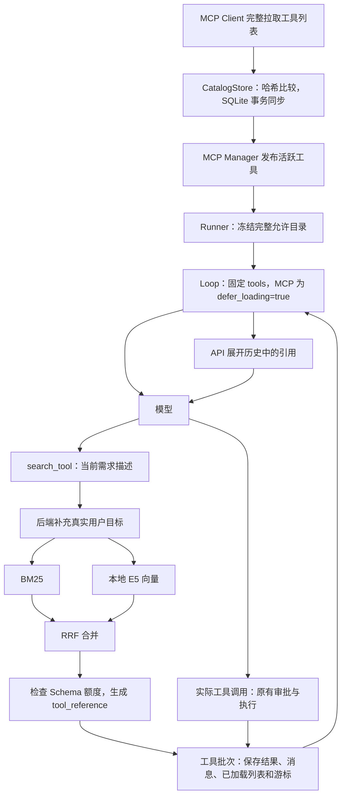
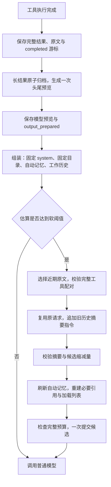

# S11：MCP 工具混合检索、哈希缓存与按需加载

## 1. 本阶段解决什么问题

MCP 服务提供工具名称、描述和 JSON Schema。以前 Core 将发现的工具全部注册，然后每次请求把完整 Schema 列表发给模型。接入多个服务后，即使只用一个工具，也会持续携带其余工具定义。

S11 把“Core 的完整目录”“发送给 API 的定义”和“模型当前能使用的定义”分开。内置工具和 `search_tool` 常驻，MCP 全部延迟。模型描述需求，本地混合检索选工具，工具结果返回引用，API 在下一轮展开。已有 Loop、审批、完整历史和检查点继续使用。

这里有两个独立职责：**本地混合检索决定找谁，原生延迟加载决定怎么把找到的 Schema 交给模型。** 后者不会替代 SQLite、BM25、E5 和 RRF。

| 之前 | 现在 |
|---|---|
| MCP 工具只缓存在内存 | 完整定义持久化到 SQLite，活跃连接仍由 MCP Manager 持有 |
| 全量 Schema 直接进入模型上下文 | HTTP 仍发送完整目录，未引用的延迟 MCP 不进入初始上下文 |
| 依靠模型阅读全量工具挑选 | `search_tool(description)` 找到当前所需能力 |
| 没有定义更新判断 | 完整列表、规范哈希、事务同步 |
| 恢复只有冻结目录 | 额外恢复原生引用、已加载列表和检索背景 |

## 2. 整体结构和执行流程



`SearchTool` 负责本地发现并返回引用，`ToolBatchExecutor` 负责提交，Loop 仍然只推进“模型→工具→下一步”。没有增加另一个运行状态对象，已加载列表放在同一个 `context.run` 中。

## 3. 目录与哈希缓存怎么工作

默认数据库是 `~/.kama/tool_catalog.sqlite3`，内部有两类记录：

- `tools`：服务身份、原始名称、公开名称、完整定义、定义哈希、检索文本、检索文本哈希、是否有效。
- `vectors`：模型与预处理指纹、检索文本哈希、JSON 数值向量。不使用 pickle，也不依赖独立向量数据库。

服务身份由配置名、传输端点或启动参数、启动目录生成摘要；连接配置不以明文保存，请求头和环境密钥也不入库。服务器返回的工具定义原样保存。公开名称继续使用原来的 `服务名__工具名`，跨服务拼接重名会明确拒绝，避免覆盖执行目标。

MCP Client 在每次连接时获取所有分页，并保留 SDK 返回的完整定义，包括未直接发送给模型的输出 Schema 等信息。只有完整拉取成功，Manager 才进行同步。

```text
不存在旧记录 → 新增
完整定义哈希相同且仍有效 → 不更新工具记录
定义改变 → 更新记录
旧工具不在本次完整列表中 → 标记失效
同步事务失败 → 全部回滚，不发布半份工具
```

规范化 JSON 排序对象键、保留数组顺序，然后计算 SHA-256。字段顺序变化不算变更，枚举数组等真实内容变化仍会改变哈希。

检索文本只选服务名、工具名、描述、参数名和参数说明。比如参数默认值变化，完整定义哈希会变，检索文本却可以不变，因此不用重新生成向量。模型指纹还包含本地文件和预处理版本，更换模型会使用新的缓存组。

向量在首次搜索需要时生成并保存；相同文本的后续搜索、Core 重启后的搜索都可以复用。每次关键词检索在当前获准目录上构建轻量 BM25 索引，不维护另一个需要迁移的磁盘索引。

本版仅在启动和重新连接时同步，不增加后台定时任务或工具变更通知监听。网络失败不代表服务删除了所有工具；失败时保留数据库缓存，但缓存不能独立建立可执行连接。

## 4. 混合检索的具体过程

模型只传当前步骤需要的能力，例如：

```json
{"description": "获取 GitHub Issue 的详细内容和评论，用于了解复现条件"}
```

后端补充本轮真实用户输入。SessionManager 已在 Skill 展开前保存原文，Runner 将其存入 `run.user_input`；不取最后一条 `role=user`，因为工具结果同样可能使用该角色。独立 Runner 以传入目标作为原文。

查询使用带标签的“任务背景＋当前需求”。背景最多 1,000 字符，描述必须非空且最多 2,000 字符。E5 编码时背景最多 128 Token，剩余空间优先保留当前需求，整体控制在 512 Token。

1. **先过滤目录**：只检索本轮注册并获准使用的 MCP 工具。
2. **关键词召回**：名称保留完整形式，同时拆分下划线、驼峰；中文使用单字和双字组合。使用 BM25Plus 的零 delta 变体，避免小目录常见词出现负 IDF，不给未命中记录额外奖励。
3. **语义召回**：本地 `multilingual-e5-small` 使用 `query:`、`passage:` 前缀，向量归一化后在内存计算余弦相似度。
4. **RRF 合并**：两路各最多 10 条，按排名计算 `Σ 1/(60+rank)`，相同工具只保留一份。不直接相加不同量纲的原始分数。
5. **选择与加载**：默认取前 3 条，再逐个检查完整 Schema 是否放得下。

本地模型直接使用 Sentence Transformers，通过可选 `retrieval` 依赖组安装。按后续确认的使用方式，`model_path` 留空时，首次下载官方 `intfloat/multilingual-e5-small` 到 `~/.kama/models`，以后优先使用完整本地缓存。只下载一份 safetensors 权重和必要配置，不下载其他推理后端的重复权重。

指定 `model_path` 时则严格离线读取该目录；目录错误不触发下载。两种方式都在取得模型后以 CPU、`local_files_only=True`、`trust_remote_code=False` 加载，不需要独立模型服务。模型扫描和推理在工作线程执行；工作线程持有锁，因此等待协程取消也不会让两个请求并发操作同一个模型。

模型编码直接调用库提供的接口，应用不实现神经网络或分词器：

```python
model = SentenceTransformer(cached_directory, device="cpu",
                            local_files_only=True, trust_remote_code=False)
vectors = model.encode(texts, normalize_embeddings=True)
```

首次下载加加载在本次环境约用两分钟，因此搜索工具提供 600 秒等待上限；普通工具默认仍为 120 秒，调用者显式上限优先，整轮时间预算也继续生效。

模型文件、依赖、向量或向量缓存出错时，本次搜索明确显示 `keyword_only` 和原因。BM25 和原有内置工具继续可用；这不代表完成了真实语义检索。

## 5. 三份清单与一次搜索

先区分三个概念，避免把“发送了”理解成“模型已经加载了”：

| 数据/方法 | 职责 |
|---|---|
| `run.tool_schemas` | 冻结的原始允许目录，恢复时检查是否一致 |
| `request_schemas(run)` | 真实请求中的完整目录；原生模式所有 MCP 为 true、内置为 false，同一 Run 保持不变 |
| `callable_names(run, messages)` | 当前模型实际可调用的名称：内置工具＋请求前历史已引用的 MCP |
| `run.loaded_tool_names` | 记录当前工作历史保留的工具，限制加载额度；采用摘要时重新计算，不能代替真实引用 |
| `run.tool_loading_mode` | 新 DeepSeek/Anthropic Run 为 `deferred`；OpenAI Chat Completions 为 `on_demand`；关闭搜索为 `all` |

一次搜索的核心代码可以理解为：

```python
ranking = await retriever.search(authorized_catalog, original_user_input, description)
selected, rejected = load_tools(run, top_k_names(ranking))
return ToolResult(text_summary, tool_references=selected)
```

实际的检索仍由 BM25＋本地 E5＋RRF 完成。额度默认 8,192 个估算 Token，只计算被发现的 MCP 定义，不截断 Schema；超额工具不返回引用，结果会解释原因。

`ToolResult.content` 继续是可读文本，用于日志和实时事件；`message_content()` 则将有引用的结果转成真正的内容块：

```json
{
  "type": "tool_result",
  "tool_use_id": "search_call_id",
  "content": [
    {"type": "text", "text": "检索方式、加载名称、预算拒绝原因等"},
    {"type": "tool_reference", "tool_name": "github__get_issue"}
  ]
}
```

不能把这段引用 JSON 当字符串返回，服务端需要识别真正的协议块。完整 Schema 已经在固定的顶层工具数组中，API 按名称找到它并展开到对话位置，不需要在下一次请求中追加工具。

所有 MCP（包括显式白名单选中的）都延迟。白名单只限制检索和执行范围，Runner 为它附带必需的 `search_tool`；这不会开放其他 MCP。内置工具默认不延迟，`search_tool` 也不会延迟。

ToolBatchExecutor 仍统一提交结果、配对消息、已加载列表和游标，保存成功后才通知前端。Loop 在请求前确定可调用集合并记录 `exposed`，所以同一条模型回复里“搜索＋调用刚发现工具”仍被拒绝。下一轮才能使用。

**发现不等于授权。** 真正执行继续走参数校验、审批、保存 executing、MCP 请求和结果提交。搜索不能跳过禁止策略，也不增加子 Agent 的 MCP 能力。

## 6. 稳定前缀与保留近期原文的压缩

### 6.1 先区分三个数据位置

| 位置 | 保存什么 | 压缩会修改吗 |
|---|---|---|
| `run.system_prompt` | 基础/角色提示、记忆工具指引、全局与项目的用户规则 | 同一 Run 不修改 |
| `checkpoint.messages` | 模型工作历史：预览、摘要、近期原文和引用 | 会，只采用通过校验的候选 |
| `thread.jsonl` | 用户输入、完整模型回复、完整工具结果 | 不改写，只追加真实原文 |

“最近三轮”是一条真实用户请求及其后续模型回复、工具执行，直到下一条真实请求；不是三次模型调用，也不是三条消息。摘要、自动记忆、tool_result 不算用户轮次。一个任务连续执行十个工具，仍可能只是一轮。

### 6.2 旧流程和新流程的区别

以前每次请求前都会扫描历史，依次尝试长结果裁剪、旧只读结果去重、旧输出遮蔽，最后才摘要；采用压缩后还会重新拼接 system。即使不用摘要，也可能改动很早以前的消息前缀。

现在只保留两个职责：



没有请求前反复去重或遮蔽；一份输出进入工作历史后，不因变旧而再次被裁剪。摘要仍会改写 messages，无法保住旧历史的全部缓存；改造保证的是 system、原生工具目录，以及两次摘要之间的已提交历史尽量稳定。

### 6.3 固定规则与自动记忆怎么注入

新 Run 通过 `initialize_prompt()` 读取用户规则，保存为固定 system。`AGENTS.auto.md` 与 `MEMORY.md` 索引保存为独立 `memory_snapshot`。

```text
system = 基础或角色提示 + 规则指引 + 全局用户规则 + 项目用户规则
工具数组 = 冻结目录，原生模式的 MCP 延迟、内置与搜索工具常驻
messages = 自动记忆上下文消息 + 工作历史
```

`assemble_messages()` 是统一的请求投影入口。它生成标准 user 上下文消息，不添加自定义协议字段，不把该消息写入工作历史或完整 thread。估算、普通请求、摘要和手动压缩都使用它。

普通步骤复用原自动记忆；新 Run 读取最新文件。只有真正采用摘要时才重新读取自动信息和索引；用户规则仍沿用原 system。候选历史、记忆快照、已加载列表一起提交，保存失败不发压缩成功、不继续请求模型。恢复使用最近提交的值，不重新读取磁盘规则或记忆。

旧检查点缺少 `prompt_layout` 时按 `legacy` 读取，保留原组合提示，不在恢复中拆分；新 Run 使用 `stable_v1`。版本仍为 1。

### 6.4 长工具输出与归档失败恢复

`ToolOutputPreparer` 只处理新结果正文。默认超过 8,000 字符时，将全文原子归档到当前 Run 的 `outputs/<sha256>.txt`，然后保留头尾合计 4,000 字符，附省略字符数与全文路径。结构化 `tool_reference`、调用 ID、错误类型和未知结果标记不变。

执行顺序是：

```python
tool.result = full_result
append_full_result_and_record_original()
tool.status = "completed"
advance_cursor()
save()                       # 先提交完成事实；此时 output_prepared=False
preview = prepare_output()   # 全文落盘后才产生预览
replace_working_result(preview)
tool.output_prepared = True
save()
```

如果归档失败，Run 中断但工具保持 completed。恢复进入同一 tools 阶段，先处理 `output_prepared=False` 的已完成结果，再继续下一工具；只重试输出整理，不重试业务操作。真实 Core 重启测试也覆盖这条路径。

检查点的当前工具记录、完整 thread、执行事件保留全文；模型工作历史使用预览。工具批次更新后，旧全文仍可从 thread 与归档读取。读取工作区外的归档继续走外部路径单次审批，不因为它是归档就绕过权限。用户若主动删除全文文件，程序不会伪造“已归档”。

### 6.5 如何选择近期原文

先尝试最近三轮完整用户交互。近期额度默认 16,384 个估算 Token，包含必要引用展开后的工具定义。放不下时依次把较旧轮次划入摘要。

当前一轮自身过长时，保留最新用户请求原文，再从尾部尽可能保留完整模型交互组。一条 assistant 的所有 tool_use 与全部配对 tool_result 是一组，不可拆开。最新请求加最新完整组仍超限，返回 `recent_context_too_large`，不截断用户纠正或工具结果。

例子：

```text
历史有 U1…U6，每轮包含模型回复和工具结果
正常：摘要(U1…U3) + U4 + U5 + U6
三轮过大：摘要(U1…U4) + U5 + U6
单轮 U6 很长：摘要(更早历史和 U6 较早步骤) + U6 原请求 + 尾部完整交互组
```

最新请求不会重复插入摘要后的原文。所有待摘要历史必须工具配对完整；存在未完成批次时拒绝压缩。

### 6.6 摘要请求与采用条件

摘要不是把旧消息重新包成 JSON 后发给另一个 system。它复用原 system、完整原生工具目录和组装后的全部消息，只在末尾追加摘要指令，指明哪些原始消息序号属于旧历史。近期消息只作为理解用户纠正的背景。

要求输出六节 Markdown：目标与约束、已完成及证据、当前文件状态、重要决策、未完成及不确定结果、关键路径与后续入口。上一份摘要与后来变旧的历史共同更新，工作上下文始终只有一份摘要及确认消息。

空摘要、截断、产生工具调用、超过 2,048 Token 或整份候选缩减不足 10% 都不会采用。摘要回复中的工具绝不执行业务操作。单次摘要输入也受窗口、摘要输出预留与安全余量限制；放不下就明确失败，不偷偷分块或无限重试。

Anthropic 的 thinking 绑定旧前缀，因此采用文本摘要时移除候选工作投影中旧的 thinking/redacted_thinking，不伪造签名。完整历史不变；正常追加和恢复不主动删除 thinking。DeepSeek 保持其兼容协议的原行为。

### 6.7 tool_reference 留哪些、删哪些

近期历史已有的引用保持原样；近期实际调用了某个 MCP，但发现引用在旧历史中时，补回最小的真实 `search_tool` 调用及引用结果，放在近期调用之前。不会重新搜索或重放 MCP 业务操作。

例如旧历史发现了 A、B，近期只调用 A：候选只补回 A 的发现记录，B 随旧历史退出。`loaded_tool_names` 按候选重算并释放 B 的额度，以后需要 B 时重新搜索。不能从摘要文字里的工具名授予执行资格。

原生顶层工具目录完全不变，变化的是 messages 中的引用。必要引用必须属于冻结目录，近期额度会计入展开的 Schema。恢复只加载已提交的候选和列表，不再把已经丢弃的旧工具补回来。

普通 OpenAI Chat Completions 保留原有兼容模式，工具数组随按需加载变化，因此不承诺拥有原生模式同等的前缀稳定性。

### 6.8 阈值、失败与缓存边界

```text
输入硬预算 = context_window_tokens - output_reserve_tokens - 1024
软阈值 = 输入硬预算 × auto_threshold
有效锚点：输入估算 = 上次真实输入 + 上次输出 + 新增消息的字节估算
历史/自动记忆/目录改变：旧锚点失效，回退完整估算
```

新增引用按展开的完整定义估算，不把几十字节的 tool_reference 当作完整成本。触发判断使用 Usage 锚点，候选前后缩减比较则统一使用相同字节估算口径。

| 情况 | 行为 |
|---|---|
| 摘要失败，原输入仍在硬预算内 | 原历史不变，继续普通请求 |
| 摘要失败且超硬预算 | 中断，保留原执行位置 |
| 自动记忆刷新失败 | 不采用候选，中断，保留旧历史与快照 |
| 刷新后候选超硬预算 | 不采用候选，不在本次请求中再做一轮摘要 |
| 检查点保存失败 | 直接向上传播，不继续请求、不发布成功 |
| 工具输出归档失败 | completed 保留，中断后只补整理 |

`/compact` 与自动入口使用相同规则；未达阈值返回无需压缩、不创建模型请求。关闭自动摘要后仍检查硬预算，手动入口用 80% 阈值。

Anthropic 在请求副本上设置 system、常驻工具末尾和对话末尾缓存点；标记不写回历史。DeepSeek 自动管理缓存。测试只验证序列化、固定前缀与状态行为，不把它当作真实缓存命中率或账单收益。

### 6.9 配置迁移与最短阅读顺序

默认参数见 [README](../README.md)。旧 `prune_target_ratio` 删除；旧 `keep_recent_groups` 改为 `keep_recent_turns=3` 和 `recent_token_budget=16384`。TOML 或环境变量中保留旧字段会报明确迁移错误。

先按以下顺序阅读即可串起压缩，不必从存储细节开始：

1. [Loop._call_model](../src/kama_claude/core/loop.py)：准备上下文之后调用模型。
2. [ContextManager.prepare / compact_session](../src/kama_claude/core/compact/manager.py)：自动与手动入口，校验和提交候选。
3. [请求组装 assemble_messages](../src/kama_claude/core/compact/request.py)：自动记忆如何进入模型输入。
4. [历史选择 split_history](../src/kama_claude/core/compact/history.py)：真实用户轮次、完整交互组与近期额度。
5. [Compactor.compact_messages](../src/kama_claude/core/compact/compactor.py)：摘要请求与采用条件。
6. [ToolBatchExecutor._prepare_output](../src/kama_claude/core/tools/batch.py)及 [ToolOutputPreparer](../src/kama_claude/core/compact/output.py)：全文提交、预览与归档失败恢复。
7. [规则与快照 initialize_prompt](../src/kama_claude/core/memory/context.py)：固定规则和可刷新的自动信息。
8. [引用处理 preserve_references](../src/kama_claude/core/llm/tool_loading.py)：仅保留必要的真实发现记录。

## 7. 代码阅读顺序与配置

1. [MCP Manager](../src/kama_claude/core/mcp/server.py)：完整发现、事务同步和发布活跃工具。
2. [目录模型](../src/kama_claude/core/discovery/model.py)与 [SQLite 存储](../src/kama_claude/core/discovery/store.py)：两个哈希、记录和向量缓存。
3. [检索器](../src/kama_claude/core/discovery/retrieval.py)与 [离线 E5 适配](../src/kama_claude/core/discovery/embedding.py)：关键词、语义、RRF、降级和线程锁。
4. [搜索工具](../src/kama_claude/core/discovery/tool.py)与 [请求目录与调用资格](../src/kama_claude/core/discovery/exposure.py)：本地搜索、返回引用、限制额度。
5. [引用处理](../src/kama_claude/core/llm/tool_loading.py)与 [估算器](../src/kama_claude/core/compact/estimator.py)：预算中的引用展开、摘要保留、跨目录请求投影。
6. [Runner](../src/kama_claude/core/runner.py)：冻结目录和恢复校验；[工具批次](../src/kama_claude/core/tools/batch.py)：统一提交；[Loop](../src/kama_claude/core/loop.py)：保持原有主线。

配置默认值和安装步骤见 [README](../README.md)。`[tool_search]` 的字段都支持 `KAMA_TOOL_SEARCH_字段大写` 环境变量。`enabled=false` 恢复新 Run 的全量工具展示，已冻结 Run 的模式不随配置变化。

## 8. 验证与评估

实施前完整非付费基线为 **783 项通过、1 项 Windows 文件符号链接权限跳过、1 项付费测试排除**。

新增验证包含 SQLite 真事务回滚、分页/同步失败不误删、模型与文本缓存失效、假向量混合排序、离线参数与 Token 分配、线程取消、Schema 预算、审批、检查点故障和恢复、手动压缩、真实 Textual 展开，以及官方 SDK MCP 服务的 JSON/SSE 真实进程调用。

评估脚本 [eval_tool_search.py](../scripts/eval_tool_search.py) 使用 [固定样本](../tests/fixtures/tool_search_eval.json) 分别运行关键词、语义、混合三种模式，并报告 Recall@3、平均 Schema 估算量、搜索时间和 embedding 重算次数。每种模式使用独立冷缓存。

```powershell
uv run --extra retrieval python scripts/eval_tool_search.py
uv run --extra retrieval python scripts/eval_tool_search.py --model-path C:\models\multilingual-e5-small
```

未准备模型时，曾先验证关键词模式在示例的 8 个查询上 Recall@3 为 0.5，语义与混合明确标记不可用。后续允许首次下载缓存后，再使用真实模型完成对比；结果见最终验证记录。示例集较小，不能据此推断真实任务效果。独立离线模型烟测使用 `KAMA_TEST_E5_MODEL_PATH`；没有显式测试目录时跳过，测试本身不触发下载。

### 原按需加载版本的验证记录

- 使用 Sentence Transformers 5.7.0、真实 `multilingual-e5-small`、CPU 推理；首次下载完成后，设置 `HF_HUB_OFFLINE=1` 与 `TRANSFORMERS_OFFLINE=1` 验证后续运行。
- 向量维度为 384，数值有限；同一记录重复搜索不重算文档向量，新模型实例使用同一 SQLite 缓存时重算次数为 0。
- 完整非付费回归 **824 项通过、1 项因 Windows 文件符号链接权限跳过、1 项付费测试排除**。包含真实 MCP JSON/SSE、TCP/进程恢复与 Textual 测试，未调用付费聊天模型。
- 全部改动文件 Ruff、135 个源码文件 mypy、生成协议一致性、本地文档链接及依赖锁检查通过。未提交或推送。

同一组 8 条查询的真实离线结果：

| 模式 | Recall@3 | 平均所选 Schema 估算 Token | 文档向量重算次数 |
|---|---:|---:|---:|
| 关键词 | 0.5 | 72.25 | 0 |
| 语义 | 1.0 | 148.5 | 8 |
| 混合 | 1.0 | 150.625 | 8 |

完整目录为 8 个工具、398 个估算 Token。语义与混合分别使用独立冷缓存，各自只编码 8 条工具记录，后续查询复用；查询向量仍需逐次编码。脚本的耗时包含首条查询的模型加载与首次编码，受 CPU 和系统缓存影响，不用一次测量判断哪种方法更快。

本组样本中语义与混合召回相同，混合并未表现出更高召回率。该小集合用于检查中文需求、英文工具名、指标和缓存链路；评估结论不能外推到真实大型工具目录。


## 10. 原生协议验证记录

本次在明确授权后，向官方 `https://api.deepseek.com/anthropic/v1/messages` 发起了两次最小请求，模型为 `deepseek-flash`，SDK 自动重试关闭。只发送测试工具定义和 `hello`，不发送项目代码，不执行业务工具。

1. 首次：常驻 `search_tool` 加延迟 `verification_echo`，得到搜索调用。
2. 返回真正的 `tool_reference`，保持工具数组不变，再请求模型。
3. 模型正确产生 `verification_echo(text="hello")`。第二次 Usage 中缓存读取为 256 Token、非缓存输入为 140 Token，总输入为 396 Token。

这是协议烟测，不能外推为长期缓存命中率，也没有单独验证 Anthropic 官方账号或第三方代理端点。

[验证脚本](../scripts/check_deferred_tools.py)需显式运行，会产生最多两次计费调用，不属于默认回归。非付费测试另覆盖真实 SDK HTTP/SSE 序列化、真实 MCP Streamable HTTP JSON/SSE 服务、本地混合检索、拒绝审批、保存失败、恢复和跨 Run 引用。


原生延迟加载改造（压缩重设计前）的完整非付费回归为 **843 项通过、1 项 Windows 文件符号链接权限跳过、1 项付费测试排除**，包括缓存 E5 的真实离线推理。随后补充计数器独立调用边界和原生引用历史的真实 Textual 展示测试，收尾重跑的 84 项相关测试全部通过；改动文件 Ruff、136 个源码文件 mypy、协议一致性和文档链接检查通过。两次授权的真实 API 烟测单独记录，不计入非付费回归。改动保留在本地 S11，未自动提交或推送。


## 11. 稳定前缀压缩重设计的验证记录

- 完整非付费回归：**843 通过、1 跳过、1 付费测试排除**。跳过项是当前 Windows 缺少创建文件符号链接权限，不能表述为该场景已经通过。
- 以假模型检查真实请求参数：同一 Run 压缩前后 system、原生工具目录和顺序不变；摘要使用原请求再追加指令；自动记忆只注入一次，用户规则下一 Run 才更新。
- 确定性验证三轮保留、单轮过长、完整工具配对、重复调用 ID、摘要拒绝条件、最终记忆刷新后缩减不足和候选保存失败回退。
- 真实 Core/TCP 重启验证：工具 a 已完成而全文归档失败时，快照保留 completed 与未整理标记；重启后只补整理，再执行 b，副作用记录始终是 a、b 各一次；完整历史和归档全文相同，模型历史是预览。
- 覆盖旧快照 pending 工具的新结果整理、旧提示布局恢复、近期必要引用补回、旧引用释放额度，以及 Anthropic/DeepSeek 官方 SDK 的 HTTP/SSE 请求序列化。
- 包含真实缓存 E5 的离线烟测；这不属于付费聊天模型验证。新设计未再次调用付费 API，不声称测得真实缓存命中率或账单收益。
- 改动文件 Ruff、完整源码 mypy（138 个源码文件）、协议一致性、本地文档链接和 Git 差异空白检查通过。TUI 显示完整输入前后估算量、保留消息数及失败原因，额外三项界面相关测试通过。

测试中的旧四层去重/遮蔽断言已移除，改为验证本次保留近期原文和入口预览的行为；测试总数变化不代表删去恢复保护。当前分支仍为 `s11`，本次修改未提交、未推送。


## 12. 全局轻量 Skill

本阶段还补充了全局 Skill 加载：只从 `~/.kama/skills/<name>/SKILL.md` 读取，模型调用 `load_skill` 只传 name；`/review src` 使用同一个文件加载组件。基础 system 保留，Skill 不再修改工具白名单或执行权限。

正文和目录随 Run 保存，压缩后按需补回，恢复使用快照。具体流程、代码入口与旧文件迁移见 [Skill 与提示组织学习文档](./S11-轻量Skill与提示组织.md)。
