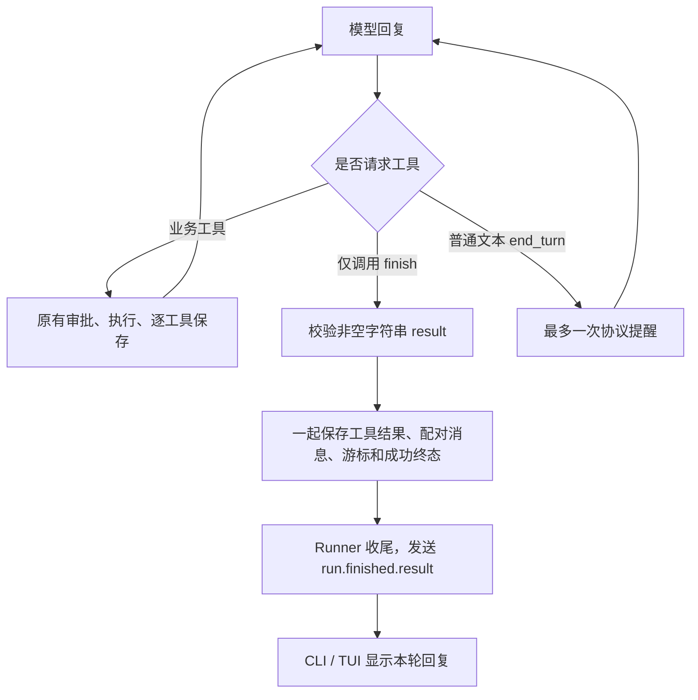

# S11：用 finish 提交本轮回复

## 先理解功能

以前模型返回 `end_turn`，Loop 就认为本轮正常结束。现在新 Run 要调用内置工具 `finish`，用字符串参数 `result` 提交完整回复：

```text
finish(result="已修复配置，测试通过；真实网络环境尚未验证。")
finish(result="你想使用 SQLite 还是 PostgreSQL？")
```

两者都正常结束本轮 Run。第二种表示等待用户补充信息；下一条输入会创建新的 Run，原聊天会话不用重建。这里没有增加业务验收器，`success` 只表示回复已经提交。后台子任务仍可跨 Run 执行，模型不能把尚未完成的工作说成已经完成。

`finish` 不是 `task_update`：Task 工具维护任务清单；`finish` 把控制权交回用户。

## 一条主线



模型仍可以先说“正在检查配置”，再调用业务工具。只有 `finish` 的成功结果会把新 Run 标记为成功；普通流式文本仍按原方式展示。

## 按这个顺序读代码

1. [completion.py](../src/kama_claude/core/completion.py)：统一的 system 结束约定和遗漏提醒。
2. [finish.py](../src/kama_claude/core/tools/builtin/finish.py)：参数只有 `result`，拒绝空白、非字符串和额外参数；返回内部 `ends_run` 控制信号，不直接保存或修改 Run。
3. [loop.py](../src/kama_claude/core/loop.py) 的 `_record_response()`：记录完整模型回复；普通工具进入 `tools` 阶段；新 Run 遗漏 `finish` 时提醒一次，再次遗漏标记 `missing_finish`。
4. [batch.py](../src/kama_claude/core/tools/batch.py) 的 `run_pending()`：执行工具，处理配对结果和游标，并提交终态。
5. [runner.py](../src/kama_claude/core/runner.py) 的 `_finish_run()`：保存会话状态，发出携带已提交回复的终态事件。
6. [conversation.py](../src/kama_claude/tui/conversation.py)：实时回复与完整历史重放共用展示方法，避免把参数、工具输出和最终回答显示三遍。

## 保存边界为什么这样放

`FinishTool.invoke()` 只返回：

```python
ToolResult(result, preserve_in_context=True, ends_run=True)
```

执行器接到成功结果后，在同一次检查点提交里完成：

```text
tool.status = completed，保存完整结果
追加对应的 tool_result 消息
tool_index 前移
run.result = result，run.status = success，run.phase = finished
保存检查点及完整历史
```

模型提出 `finish`，并不等于后端已经接受。参数非法、权限拒绝或保存失败都不能误报成功。长回复保留全文，不走普通工具的头尾预览。

成功已提交、通知尚未发送时 Core 崩溃，重开会话读取到的仍是成功和原答复，不重新执行业务工具。保存失败则立即停止，不发送成功事件。审批、未知副作用及原有预算保护仍走原链路。

## 几个容易混淆的边界

- **同批混用**：`write_file + finish` 或 `finish + write_file` 都整批拒绝，文件不会被写入。模型要分两次请求，观察写入结果后再提交回复。
- **未调用 finish**：第一次 `end_turn` 在工作历史中加入内部提醒；不伪装成真实用户输入写入 `thread.jsonl`。提醒次数随检查点保存，恢复不重置。若已耗尽步数则直接按步数上限结束。
- **模型摘要**：压缩器请求的是历史摘要，仍按普通文本结束；它不通过业务 Loop 执行 `finish`。
- **权限范围**：`finish` 是常驻控制工具，只读子 Agent 也能交回结果；它不能扩大业务工具白名单，明确禁止策略仍然生效。
- **旧记录**：检查点版本仍为 1；缺少 `completion_mode` 的旧 Run 默认为 `legacy`，继续使用原 `end_turn` 语义。新 Run 为 `explicit`，三家 Provider 使用相同结束规则。

## 前端看到什么

前端不把 `finish` 的完整参数显示成工具卡片，而是在终态保存后显示 `run.finished.result`。TUI 标记为“本轮已提交”；失败提交显示错误原因。完整历史里只有成功配对的 `finish` 结果才作为正式回复展示，单独存在的调用参数不会冒充已提交答案。

测试覆盖普通答复、提问、长回复、最后一步提交、遗漏提醒、混合批次、提交失败、通知丢失和历史去重。真实进程/TCP 测试使用假模型验证恢复行为，不代表真实模型遵守协议的成功率，也没有调用付费 API。

本轮完整非付费回归：**884 项通过、1 项因 Windows 文件符号链接权限跳过、1 项付费测试排除**。其中新增结束协议测试 22 项。改动文件 Ruff、完整源码 mypy、协议一致性、本地文档链接和差异空白检查通过；包含缓存 E5 的离线推理及既有 MCP、TCP、Core 重启与 TUI 用例。改动保留在本地，未提交、未推送。
