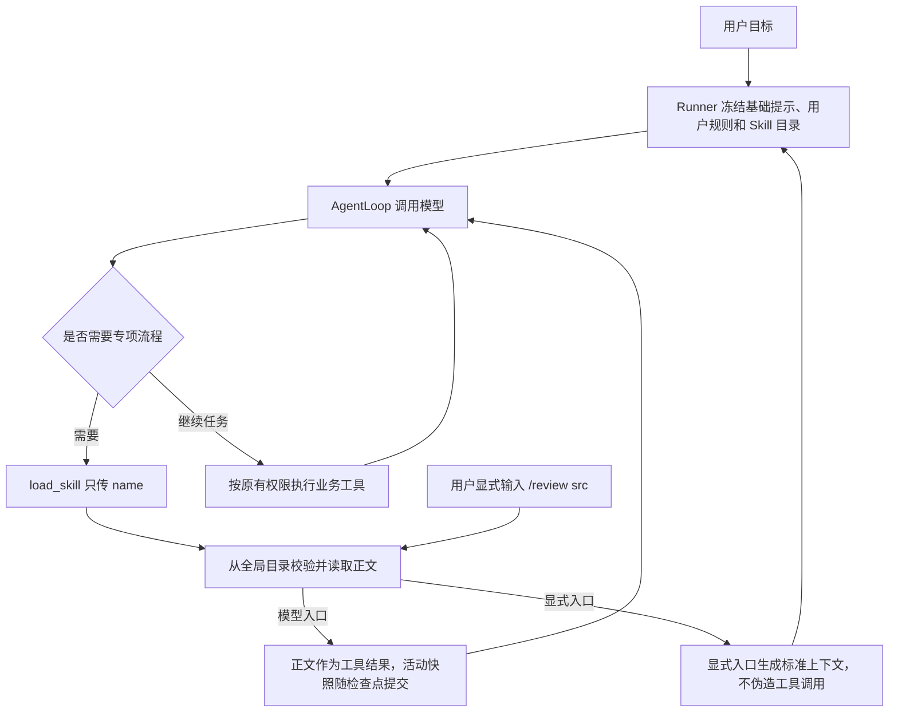

# S11：全局 Skill 与提示组织

## 1. 先理解它实现了什么

Skill 是一份可复用的操作手册。例如 review 解释如何审查代码，init 解释如何了解项目。加载文件本身不会执行脚本、创建子 Agent 或修改文件，模型还需要在原来的 AgentLoop 中逐步调用工具。

现在只有一个来源：`~/.kama/skills/<name>/SKILL.md`。Windows 的 `~` 是运行 Core 的用户主目录。Core 与 TUI 使用同一用户运行时，会发现同一批 Skill。

有两种入口：

- 用户输入 `/review src`：明确选择 review，任务范围保留在原用户消息中。
- 用户输入“审查 src”，模型调用 `load_skill({"name":"review"})`：根据目录自行选择。

两种入口共用文件加载组件，都不再覆盖基础 system，不限制或扩展工具权限。每个 Run 只启用一个 Skill；下一条用户消息是新的 Run，可以选择另一份。

## 2. 原实现与新实现

| 原实现 | 新实现 |
|---|---|
| 项目、用户、内置目录按优先级查找 | 运行时只查全局目录 |
| 扁平文件或目录式均可 | 只支持 `<name>/SKILL.md` |
| 替换 `$ARGUMENTS`，把任务正文当作 system | 用户目标留在真实消息里，正文是补充流程 |
| `allowed_tools` 改变本轮工具范围 | Skill 不再改变工具范围和审批 |
| 主要依赖 `/命令` | 显式选择与模型加载共用组件 |
| 没有独立活动正文快照 | 目录、正文随同一个 Run 保存 |

旧接口已经删除，没有通过旧字段模拟新行为。旧文件保留，但不自动移动或修改。

## 3. 最短整体流程



图中的两条正文交付路径不同：模型调用时有真实的工具调用和工具结果；显式命令则在接受目标时直接加入标准上下文。共同之处是使用同一 Loader，正文不进入 system。

## 4. 目录、模板与首次初始化

```text
~/.kama/skills/
├── .examples-initialized
├── review/
│   ├── SKILL.md
│   └── references/        # 可选，普通工具按需读取
├── summarize/SKILL.md
├── orchestrate/SKILL.md
└── init/SKILL.md
```

`.examples-initialized` 只表示首次示例补齐已完成，不是记忆数据库或 Skill 索引。初始化时将完整临时文件同步落盘，再以不覆盖目标的方式创建示例；Core/TUI 同时初始化也不覆盖已有内容。初始化失败明确报错，未完成时可重试。

仓库的 `skills/builtin` 只保留首次补齐所需模板，运行时不会把它当作另一个查找来源。初始化完成后删除一个示例文件，下一次扫描不会重新生成它。

每个 Skill 必须是 UTF-8 Markdown：

```markdown
---
name: review
description: 审查当前用户指定的代码范围，输出问题与证据
---
1. 从当前用户消息中确认范围。
2. 用搜索工具找到相关代码，再沿调用关系阅读。
3. 核实正确性、边界处理和权限问题。
4. 需要时执行验证；没有执行就明确说明。
5. 按严重程度给出问题、文件位置和证据。
```

名称与目录一致，使用最多 64 字符的小写字母、数字和短横线；不接受路径。后端解析真实位置，链接指向全局目录之外时拒绝加载。

frontmatter 使用 PyYAML 的 `safe_load` 和 Pydantic 校验，只接受 name、description。旧 `allowed_tools`、`allowed-tools` 和 `$ARGUMENTS` 都会明确报迁移错误。格式损坏和读取失败也不会被当作正常的“没有 Skill”。

内置示例已经适配当前记忆工具：init 不再创建旧 context.md；summarize 默认返回摘要，不再写入已删除的 session 记忆作用域。

## 5. 模型为什么知道可以调用它

每个新 Run 从全局目录读取名称和简介，保存为 `run.skill_catalog`，并把这份小目录放进 `load_skill` 的工具描述。这里只展示元信息，完整正文不默认发送给模型。

```python
# 概念代码
run.skill_catalog = loader.list_all_skills()
registry.register(LoadSkillTool(run))

# 模型执行到需要的步骤时
load_skill(name="review")
```

目录按名称排序，本轮冻结，最多占 2,048 个字节估算 Token。目录超限会要求精简描述，不静默省略条目。已有 Skill 修改名称或简介、新增文件，都在下一次新 Run 重新发现；恢复使用原目录。

加载工具只有一个参数 name，不接受 arguments、path、approved_path 或自定义目录。资源根目录由后端返回，参考资料不会自动展开，脚本不会自动执行。

正文读取采用首次加载时的实际内容。加载完成后保存快照，同名重复调用仅返回“已加载”；即使磁盘内容随后变化，也不会在本轮悄悄替换。尝试加载第二个名称返回明确错误，当前 Skill 保持不变。

## 6. system、记忆与 Skill 分别放在哪里

```text
system：基础 Agent 行为 + 全局/项目用户规则，本轮冻结
tools：冻结工具目录，load_skill 描述包含精简 Skill 目录
messages：自动记忆 + 工作历史 + 已加载 Skill 说明
```

基础提示补充了先读代码、保留用户修改、使用适当验证、如实报告、避免重复失败和遵守运行时权限等原则。具体工具参数仍由 Schema 说明。

Skill 描述“怎样完成这一类任务”，不会替换基础提示。自动记忆仍是可能过时的背景信息，沿用当前独立注入和压缩刷新机制。用户规则不因为 Skill 激活而改变。

显式 `/review src` 的原始输入仍写入 thread，目标 src 没有被隐藏进 system。附加的 Skill 上下文带固定来源标记，不计为真实用户轮次，也不冒充用户原文追加到 thread。

模型主动加载则有真实工具调用，工具结果正文作为真实执行结果写入完整历史。两种路径都不凭空添加 assistant/tool_use 消息。

## 7. 为什么不会被长输出预览切掉

正文最多为 4,000 个 UTF-8 字节估算 Token；超过限制就拒绝加载，要求将详细内容拆成参考文件，不返回半份手册。

成功加载返回内部标记 `ToolResult.preserve_in_context=True`。输出准备器看到它后保留完整正文，不再使用普通工具的 8,000 字符触发、4,000 字符头尾预览规则。其他工具默认关闭此标记，原归档和恢复流程保持。

这只跳过普通正文裁剪，不跳过上下文硬预算或累计 Run 预算。完整正文、目录和工具定义仍参与统一请求估算。4000 是估算 Token 上限，不是字符数。

## 8. 检查点、压缩和恢复

活动内容保存在同一个 `context.run.active_skill`，包括名称、正文、资源目录和 SHA-256。没有新增 Runtime 状态对象。检查点版本仍为 1，旧记录的目录与活动 Skill 默认为空。

```text
首次加载
→ 正文进入工作历史
→ 目录、活动快照、工具结果和游标一起提交
→ 下一次模型请求使用完整说明
```

保存失败不会继续请求模型。副作用恢复规则依旧由原工具执行器处理，Skill 不改变业务工具的 unknown 状态。

采用历史摘要时，先检查候选里是否已经有完整正文：

- 真实工具结果或显式上下文仍在近期原文中：直接复用。
- 正文随旧历史被压缩掉：从活动快照补回一条标准上下文，放在摘要确认之后、近期原文之前。

补回后重新计算完整预算和缩减比例，候选、自动记忆与加载状态仍一起提交。补回动作不读取文件、不重放加载工具，也不追加到完整 thread。

Core 重启后读取目录与活动快照，不重新扫描文件来改写冻结定义。已经加载的文件被修改或删除，也不会改变恢复中的正文。旧 Run 不会在恢复途中静默加入 load_skill 或更换原 system。

## 9. 权限和子 Agent

Skill 只提供操作方法，不提供工具授权。比如 review 写着“修改错误”，真正 write_file 或 edit_file 仍会进入现有审批；静态禁止继续拒绝执行。

父 Agent 和子 Agent 继续使用各自已有的工具白名单。允许 load_skill 的子任务可以读取同一个全局目录，并维护自己的单一活动 Skill；角色或父白名单没有该工具时，不添加加载入口。这里不增加 MCP 子任务能力或全树恢复。

参考文件和脚本照常经过文件工具与命令工具。全局 Skill 根目录通常在工作区外，使用普通工具读取额外参考文件仍可能需要外部路径审批。

## 10. 阅读顺序与迁移

1. [SkillLoader](../src/kama_claude/core/skills/loader.py)：唯一目录、首次补齐、YAML 与预算。
2. [LoadSkillTool](../src/kama_claude/core/skills/tool.py)：按名称加载、重复调用、单 Run 单 Skill。
3. [快照模型](../src/kama_claude/core/skills/model.py)与[正文保留](../src/kama_claude/core/skills/context.py)：保存了什么、如何避免重复。
4. [SessionManager](../src/kama_claude/core/session/manager.py)与[Runner](../src/kama_claude/core/runner.py)：显式命令、冻结目录与工具注册。
5. [ContextManager](../src/kama_claude/core/compact/manager.py)与[输出准备器](../src/kama_claude/core/compact/output.py)：压缩补回和完整正文保护。

升级时手动将需要的旧文件整理为全局目录式布局，移除旧字段和占位符。旧项目文件、旧扁平文件保留但不再查找。原来依赖 Skill 白名单的任务，现在应通过 Agent/角色白名单和权限配置限制工具。

现有文件不会被模板覆盖；如果现有目录式文件仍是旧格式，会明确报迁移错误，需要手工更新后再使用。


## 11. 本次验证结果

- 相关旧调用基线为 28 项通过；改造后的完整非付费回归为 **862 项通过、1 项 Windows 文件符号链接权限跳过、1 项付费测试排除**。
- 真实 Core/TCP 进程测试覆盖显式 Skill 加载后硬退出、删除临时目录里的原文件、重启并继续；原 Run、Step、目录与正文快照保持。测试显式隔离 HOME 和 Skill 根目录，不修改真实用户文件。
- 验证首次补齐、不覆盖已有文件、并发初始化、删除后不反复生成示例、YAML 安全解析、名称和 junction 越界、旧字段迁移与预算错误。
- 验证自动与显式调用、只接收 name、单 Run 单 Skill、正文不被普通预览裁剪、工具权限不扩大，以及父子工具白名单。
- 验证压缩后的正文补回、重复注入检查、摘要请求使用活动正文、恢复不重读文件、保存失败不继续模型调用、完整 thread 保持原文。
- 改动文件 Ruff、完整源码 mypy（141 个源码文件）、协议一致性、本地文档链接与 Git 差异空白检查通过。回归包含已有 MCP JSON/SSE、进程恢复、TUI 和缓存 E5 离线测试。

本轮没有发起付费模型请求，没有提交或推送，保留此前 S11 工作区改动。上述测试验证调用与状态行为，不代表真实任务成功率或 Prompt Cache 命中率。
