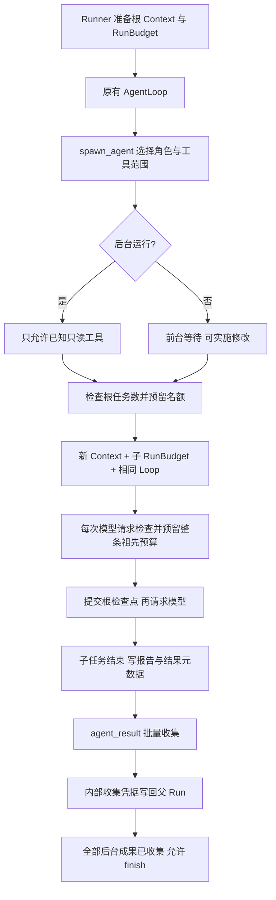

# S12：子 Agent 协作与共享预算

## 1. 这一阶段解决什么问题

主 Agent 负责理解用户目标、组织工作和提交结果。子 Agent 是它委派出去的独立执行者：有自己的模型历史，复用相同的 Loop、文件工具、权限管理和上下文处理组件。子 Agent 是同一个 Core 中的异步 Task，不是独立操作系统进程。

本阶段让这条协作链更完整：

1. 默认 explorer 只读调研，planner、reviewer 也只读；有写入能力的 executor 前台执行。
2. 模型能看到精简角色目录，按用途选择，而不是猜角色名。
3. 一次等待多个任务，拿回已完成结果，继续等待剩余任务。
4. 父任务提交前必须收集后台结果；可以取消不需要的任务，然后收集终态。
5. 完成结果落盘，缓存淘汰或 Core 重启后仍可查询。
6. Token 上限覆盖整棵任务树，任务数量限制也随本轮冻结。
7. 主、子 Agent 共用轻量重复读取保护：先提醒，再停止持续不变的短调用循环。
8. 后台完成事件先排入父任务通知队列，在下一次请求准备边界提醒模型收集结果。

范围是当前根 Run 内的协作。不同会话仍可能操作同一项目；前台执行约束不是全 Core 的文件锁。没有引入 Docker、worktree、消息群聊、任务 DAG、子任务追问或未完成子任务树的重启恢复。

## 2. 先看整体链路



正常主线仍是 `SessionManager → AgentRunner → AgentLoop`。Loop 不识别 explorer、executor，也不解析子任务的文字报告。协作规则放在 subagent 包，工具批次只调用其收尾检查。

## 3. 旧实现与现在的区别

| 环节 | 之前 | 现在 |
| --- | --- | --- |
| 默认角色 | 未指定角色时使用宽泛工具范围 | 默认 explorer，明确只读 |
| 后台能力 | 写入角色也能后台运行 | 按实际有效白名单检查，写入和 Shell 角色只能前台 |
| 角色发现 | 模型主要看到固定角色名提示 | 描述列出实际角色名、用途及定义指纹 |
| 等待 | 单个 `run_id`，有界等待 | `run_ids` 列表，等待任意结果，统一超时 |
| 收集判断 | 根据工具名和特定返回字符串判断 | 工具结果携带内部 `collected_subagents` 凭据 |
| 父任务结束 | 可以提交后留下未收集后台工作 | finish 前检查，父任务退出时清理自己的后代 |
| 结果缓存 | 内存淘汰后查询不到，报告仍在磁盘 | 回退读取当前会话运行目录中的 result.json |
| Token 限制 | 父子各拿一份上限 | 每次请求同时受自身与所有祖先的剩余额度约束 |
| 数量限制 | 同根计数已有，恢复依赖当前配置 | 新 Run 冻结 max_active/max_total，恢复沿用 |
| 死循环保护 | 步数、可选时间与 Token 上限、重复相同失败 | 增加成功读取结果不变的短循环检测，先提醒后停止 |

## 4. 按这个顺序读代码

| 顺序 | 代码与重点 |
| --- | --- |
| 1 | [角色配置加载](../src/kama_claude/core/agents/loader.py)、[角色目录](../src/kama_claude/core/subagent/roles.py)：选择哪些能力 |
| 2 | [SpawnAgentTool.invoke](../src/kama_claude/core/subagent/tool.py)：准备子 Context、组装 Loop、登记 Task |
| 3 | [RunBudget](../src/kama_claude/core/run_budget.py)、[ManagedProvider](../src/kama_claude/core/llm/managed.py)：共享预留、结算和提交 |
| 4 | [BackgroundTaskRegistry](../src/kama_claude/core/subagent/registry.py)、[查询与取消工具](../src/kama_claude/core/subagent/query.py)：等待、查询、回收 |
| 5 | [SubagentTracker](../src/kama_claude/core/subagent/tracking.py)、[工具批次](../src/kama_claude/core/tools/batch.py)：收集与 finish 条件 |
| 6 | [结果存储](../src/kama_claude/core/subagent/store.py)、[报告](../src/kama_claude/core/subagent/report.py)：长期保留已完成成果 |
| 7 | [ProgressGuard](../src/kama_claude/core/progress.py)、[工具批次](../src/kama_claude/core/tools/batch.py)：观察重复读取，随结果提交并触发停止 |

## 5. 角色与只读并行

### 5.1 目录如何形成

同名角色按 `项目 .kama/agents/ → 用户 ~/.kama/agents/ → 包内配置` 的顺序选择。

`RoleCatalog` 在工具构造时读取一次，将配置留在内存快照中。目录只显示简短用途和定义指纹，不把所有角色的完整 system prompt 放进主模型请求。调用时才使用选中角色的提示。

目录最多 2048 个 UTF-8 字节估算 Token；超限明确要求精简。坏配置显示为不可用，选择时明确报错，不退回无限制角色。配置指纹进入工具描述，因此 Core 重启后配置变更会触发原有冻结 Schema 校验，不能静默扩大旧 Run 的能力。

角色文件可以继续使用 TOML，例如：

```toml
[agent]
description = "检查指定模块的异常传播，只读"
system_prompt = "定位异常捕获与遗漏路径，给出文件位置和证据，不修改文件。"
allowed_tools = ["find_files", "search_text", "read_file"]
model = ""
```

空 model 继承父模型。角色工具范围与父白名单取交集，只能缩小父任务已经拥有的能力。

### 5.2 什么角色能后台运行

后台可用工具采用明确集合：文件读取、目录和文本搜索、读取记忆、读取任务、加载 Skill、查询结果和 finish。

Shell、写文件、编辑文件、写记忆、继续派生以及未知工具都不自动认为只读。角色与父白名单交集后的有效范围必须明确落在只读集合中，未受限的范围不能后台运行；executor 始终只能前台。

判断发生在创建业务 Task 和发布开始事件之前。被拒绝的派生不消耗累计名额、不请求模型。运行时工具审批照常生效。

这保证的是通过当前工具入口进行的能力约束，不能把上下文独立或角色白名单称为操作系统沙箱。工作区实时共享，主 Agent 修改后，先前只读调研的结论可能过时，最终验收需要核对当前文件。

### 5.3 父任务应传什么

子 Agent 不继承父对话，prompt 应说明：目标、相关路径、约束、交付内容和完成条件。

```text
目标：检查 TCP 断开时是否遗漏异常处理。
范围：core/transport/ 及相应测试。
约束：只读，不修改代码，不检查 MCP。
交付：问题、文件位置、触发条件、建议验证方式。
完成条件：结论可核实；未确认事项明确写出。
```

## 6. 派生、等待和收集

`spawn_agent` 先校验角色与有效能力，再检查预算和根配额，最后构造子任务。前台调用等待完整交接；后台调用立即返回 Run ID。

前台、后台和嵌套派生共享同一个根 Run 配额，默认同时活跃 3 个、累计成功登记 8 个。父子都等待后代时也算活跃；超额立即返回 resource_limit，不排队等待。初始化失败释放预留，结果缓存淘汰不会重置累计数量。

`agent_result` 统一使用列表参数：

```json
{"run_ids": ["child-one", "child-two"], "wait_s": 10}
```

一次 1～8 个 ID，不允许重复、路径形式或空列表。`wait_s` 在 0～30 秒间，默认 10 秒。

- 已有完成结果或明确不存在的 ID：立即返回。
- 全部仍在运行：最多等到任意一个完成，或到达统一截止时间。
- 返回完成交接和仍运行的 ID；下次仅查询剩余 ID。
- 等待者取消或超时不会取消后台业务 Task。
- 权限默认允许结果查询，静态禁止仍优先，不需要为每次等待反复审批。

返回摘要会按批量数量缩短，并保留各自完整报告路径。失败结果同样必须收集。未知副作用不会被标成已收集成功，继续沿用用户核实的中断流程。

后端在 `ToolResult.collected_subagents` 放入已交接的 ID。这个字段随检查点保存，但不作为自定义字段传给 Provider；模型不能通过伪造工具参数或返回文案生成它。祖先可以一次确认前台子任务及其已经交接的后代，避免孙任务被误判为仍未收集。

## 7. finish 与取消

| 子任务位置 | 父 Run 中的状态 | 下一步 |
| --- | --- | --- |
| 后台派生成功 | background | 可以继续独立工作或查询 |
| 子任务结束但尚未交接 | 仍为 background | agent_result 取回结果 |
| 结果明确且已交接 | collected | 不再阻挡 finish |
| 子任务中断 | unknown | 查询详细结果；副作用未知仍需核实 |
| 提前 finish | 不改变任务状态 | 返回 invalid_operation，要求先收集 |

后台完成不等于父模型已经收到成果。提前 finish 被拒绝时仍补齐本次工具结果，Loop 继续，不发布成功终态。

### 完成事件如何提醒父模型

```text
子任务保存报告与结果元数据
→ 发布 subagent.finished
→ SubagentTracker 将直接子任务的 ID、状态加入通知队列
→ 父 Loop 下一次准备请求：合并未投递通知，追加到工作历史
→ 通知与投递标记一起保存检查点
→ 按包含提醒的实际上下文检查预算，再请求模型
→ 模型调用 agent_result 取得完整交接，后端才标记 collected
```

通知只包含类似下面的简短信息，不包含子任务完整回答：

```text
Subagent `child-one` has finished with status `success`.
Call agent_result(run_ids=['child-one']) to collect its result.
```

success、failed、interrupted 都按真实状态提醒，不把中断描述为成功。多个完成结果合并成一条标准上下文消息，不修改固定 system 或工具 Schema。它不算真实用户轮次，不写入完整 thread.jsonl，但计入输入预算。

同一个子任务只提醒一次，投递记录随 Run 检查点保存。前台结果通常已经直接交接，正式记录收集时会清除待投递提醒；迟到事件不会把 collected 改回未收集。孙任务只通知直接父任务，不向每层祖先重复提醒。

这里按请求准备边界取队列快照：正在请求模型时不会插入数据或强制重发，准备期间后来到达的通知留待下一个边界。提醒本身不创建模型请求、不取消任务、不代替 agent_result，也不解除 finish 的结果收集限制。检查点保存失败时不继续请求。

队列不单独同步写盘，沿用现有检查点提交边界。已提交的通知和投递标记可恢复；若 Core 在完成事件产生后、父检查点提交前硬退出，不能保证保留这条提醒。子任务已保存的结果仍可查询，finish 收集保护仍然生效。

不再需要的任务可以调用：

```json
{"run_ids": ["child-one"]}
```

这是 `agent_cancel` 的参数。只能取消本轮派生的任务及后代，不能取消同会话中其他根 Run 的活跃任务。取消请求本身不产生收集凭据；之后仍调用 agent_result 查看真实终态。

父任务预算耗尽、失败、保存错误或取消退出时，Runner 清理自己的后台后代。清理等待有 2 秒上限；不配合取消的 Task 保留登记和活跃额度，并记录告警，不伪装成已经停止。子任务退出也清理自己的后代。Core 关闭时继续使用统一注册表清理。

## 8. 父子共享预算：最重要的一段

### 8.1 上限的含义

```toml
[agent]
max_total_tokens = 100000
max_run_seconds = 0
max_steps = 20

[subagent]
max_active = 3
max_total = 8
```

100000 限制整个根任务树的模型用量，不是每个 Agent 都能另外消耗 100000。0 仍表示关闭 Token 限制。max_steps 保留为每个 Agent 的循环保护；数量限制与 Token 限制分别约束派生规模和模型成本。

### 8.2 一笔请求如何记账

```text
子 Agent 准备普通请求、摘要或重试
→ 估计输入＋输出上限
→ 检查自身以及所有祖先的剩余 Token
→ 同步为自身及所有祖先增加估算占用
→ 提交根检查点
→ 发起 API 请求
→ 有效 Usage：用实际消耗替换本笔预留
→ 再提交根检查点
```

`RunBudget` 只绑定自己的 Run 和父 RunBudget。检查与占用之间没有 await，单事件循环中两个兄弟任务不能同时看到同一份旧余额并重复占用。任何祖先已结束或中断时，即使 Token 还有余额，后代也不能再发起请求。

子任务没有可恢复执行检查点，但它的每笔共享预留与结算都会通过祖先持有的 RunPersistence 同步提交。请求前保存失败时不调用模型，其他兄弟任务也不能继续请求。响应已发生、结算保存失败时，磁盘仍有之前的估算预留，不能在恢复后按零消耗处理。

### 8.3 为什么孙任务不重复计费

每笔用量沿父链只传播一次增量：

```text
根自身 4000
子 A 自身 3000，孙 A1 自身 1000
子 B 自身 2000

子 A 总量 = 4000
根总量 = 4000 + 3000 + 1000 + 2000 = 10000
根后代部分 = 6000
```

不能再把子 A 报告中的 4000 和孙 A1 的 1000 一起加进根总量，后者已经包含在前者中。

检查点里的 `actual_tokens`、`estimated_tokens` 都是含后代的总量；`child_actual_tokens`、`child_estimated_tokens` 是其中后代部分。自身用量由相减得到，不再保存另一份可漂移的累计状态。报告和 TUI 明确标识后代已包含。

### 8.4 未知消耗与时间

失败请求、Usage 缺失和取消保留估算占用；每次重试单独预留。自动摘要与普通请求相同。有效 Usage 可能高于估算，下一步据真实消耗停止，不能保证账单绝不越过配置值。

执行时间不累加所有并行 Agent 的秒数。根按自己的单调时钟记录墙钟执行时间，子任务也受各级祖先的剩余时间约束。恢复不重置累计 Token、估算占用或已记录的执行时间。

## 9. 已完成结果如何保存和重载

每个子 Run 目录中有：

```text
runs/<child-run-id>/
├── events.jsonl
├── outputs/
├── report.md
└── result.json
```

report.md 保存完整模型回答与后端执行证据；result.json 保存真实状态、来源会话与父 Run、有限摘要、报告路径及用量。模型陈述与后端证据分开，不根据文字猜测测试通过。

先写报告，再原子提交结果元数据，之后才缓存和通知。元数据采用同目录临时文件、flush/fsync 和原子替换。保存失败明确报告失败，不能缓存或通知成功。

查询顺序是活跃任务、有限内存缓存、后端已绑定的当前会话运行目录。Run ID 只能是安全标识，不能作为路径；记录版本、身份、类型和数值都校验，路径链接不能指向其他运行目录。损坏文件返回 storage_error，不重新派生。

这仅保存成果，不保存 Python 协程。Core 重启后，如果旧后台子任务都有已提交且结果明确的元数据，父任务可继续并查询这些结果；状态仍保留为待收集。子任务没有完成记录、存在未知副作用或 spawn_agent 本身结果未知时，仍明确拒绝自动恢复任务树。

## 10. 重复读取保护：避免一直查却不继续推进

### 10.1 为什么还需要它

`max_steps` 限制每个 Agent 的模型循环次数，重复失败保护检测连续相同错误。但 `read_file` 一直成功返回同样的内容，不算工具失败；`A → B → A → B` 这样的短循环也无法由相同失败计数覆盖。

新增的 `ProgressGuard` 只检测连续读取和搜索，不调用额外模型，也不尝试判断“任务到底做得好不好”。规则如下：

```text
工具返回最终结果
→ 对工具名、规范化参数、后端实际路径和结果计算指纹
→ 连续 3 轮相同模式：将改变方法的提醒追加到工具反馈
→ 默认连续 5 轮，且提醒之后模型仍在下一 Step 重复：停止
→ 结果、工具游标和检测状态一同保存
```

支持 `read_file`、`list_dir`、`find_files`、`search_text`，模式长度为 1～3。例如：

- `A A A`：第三次提醒，模型继续到第五次时停止。
- `A B A B A B`：第三轮提醒，持续到第五轮停止。AB 与 BA 的窗口轮转视为同一模式。
- 一个模型回复一次给出很多重复调用：先提醒，不在这批中直接按此规则停止；模型下一 Step 仍重复才停止。

### 10.2 如何减少误判

比较原始工具结果，先计算指纹，再追加提醒、生成上下文预览。不会把后端自己增加的提醒当成文件变化，也不因头尾预览相同而忽略工具返回内容的区别。这里的原始结果是工具实际返回的完整内容，不是被读取文件未返回的其他页。

参数先补齐默认值；文件路径使用后端解析结果，并遵循当前系统的大小写规则。`a.txt` 与 `./a.txt` 可归为同一调用，但不同页码、搜索条件或结果不算同一调用结果。

同一查询结果变化时清空旧证据；写入、命令、任务及记忆操作、子 Agent 查询等不在检测范围，也会打断连续读取窗口。权限拒绝、未知结果不计入。已知错误也可形成短循环，但原有重复相同失败保护仍独立生效。

这是一条保守启发式规则。通过交替调用其他工具、变化参数或更长序列形成的循环仍可能漏过；不能代替步数、时间、Token 上限，也不能代替任务验证。

### 10.3 停止和恢复

达到限制时，当前工具的真实结果照常保存，不把成功读取改成失败。Run 以 `failed / no_progress` 结束，同批尚未执行的调用补上“未执行”的错误结果，保持消息配对。TUI 使用已有预算状态事件展示原因。

检测状态只保存有界哈希指纹，最多 60 条，不复制工具正文；它存放在同一个 `context.run.progress` 中，不引入另一份执行状态。恢复保留计数和提醒位置；停止标记已提交、终态尚未来得及保存时，恢复也不能再次请求模型。检查点保存失败则立即上抛，不推进下一操作、不通知成功。

新用户输入创建新 Run，重新计数。新 Run 与子 Run 冻结相同配置，旧检查点缺少字段时保持关闭：

```toml
[agent]
repeat_failure_limit = 5  # 原有连续相同失败保护
no_progress_limit = 5     # 0 关闭；启用范围 4～20，固定第 3 轮提醒
```

环境变量为 `KAMA_AGENT_NO_PROGRESS_LIMIT`。主 Agent 停止后，后代请求同样会被祖先预算检查拒绝，再按原有退出流程清理。

工具调用内部重试与模型重复发起调用是两个层次。本轮同时明确：`outcome_unknown=True` 永远不能进入内部自动重试，即使工具声明 `retry_safe=True`。未知副作用继续走用户核实与恢复流程。

## 11. 验证与升级边界

专项测试覆盖只读能力、角色快照、批量等待、取消隔离、父任务结束保护、磁盘查询、损坏与原子写入失败、真实新 Python 进程读取、共享预留并发、摘要和重试记账、父子孙用量、检查点保存失败与恢复。

重复读取专项另覆盖单调用与二／三步循环、窗口轮转、同批提醒与下一 Step 停止、真实路径及默认参数、分页与结果变化、轮询排除、主子 Agent 一致、停止后的消息配对、保存失败和崩溃恢复。见 [test_progress.py](../tests/unit/test_progress.py) 与 [test_tool_retry.py](../tests/unit/test_tool_retry.py)。

完成提醒覆盖真实父子运行、三种终态、重复和迟到事件、直接父任务归属、多通知合并、已收集结果、检查点序列化和保存失败。见 [test_subagent_notifications.py](../tests/unit/test_subagent_notifications.py)。

完整非付费回归继续覆盖 TCP、Core 重启、MCP、权限和 TUI。测试使用假模型和受控工具，不把机制通过表述成真实任务成功率或账单收益。

工具 Schema 已变：agent_result 从单个 run_id 改为 run_ids 列表，新增 agent_cancel，spawn_agent 增加角色目录。旧中断 Run 先完成或终止；冻结 Schema 不会为升级静默放宽。检查点版本保持 1，新字段提供默认值。

仍待后续验证的方向包括：跨会话写入协调、已获批 Shell 的系统隔离、对子任务继续追问、全任务树重启恢复、真实任务成本与成功率评估。本轮没有实施这些能力。
