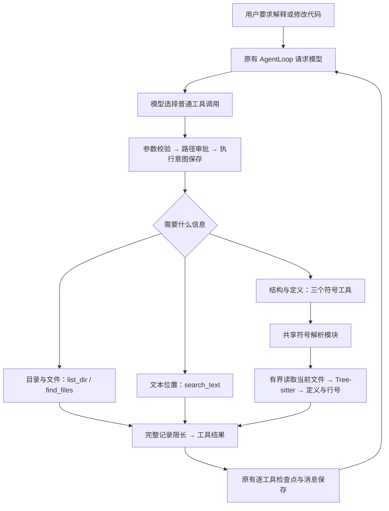

# S13：从找到文件到读懂函数

## 1. 本阶段实现了什么

Agent 要解释或修改一段代码，首先需要找到相关文件，再读到准确的实现。一次性读取整个仓库既慢，也会消耗大量上下文。本阶段提供一组可以组合的内置工具，让模型逐步缩小范围。

例如用户说：“解释请求如何路由到处理函数。”模型可以先搜索 `dispatch`，确认相关文件，再查看该文件大纲，最后读取具体函数。模型自己选择调用顺序；后端不安排一个自动搜索任务，也不创建额外的搜索子 Agent。

本阶段增加三个工具：

- `get_file_outline`：看一个源码文件有哪些定义。
- `search_symbol`：按名称查找定义的位置。
- `read_symbol`：读取选定定义的源码，过长时分页。

同时给现有 `search_text` 增加只返回文件和匹配行数的模式，完善工具描述、参数说明和结构化输出限长。`read_file` 仍返回原来的带行号文本，编辑、命令执行方式不变。

支持 Python、JavaScript/JSX、TypeScript/TSX。其他语言仍可用文件查找、文本搜索和按行读取；本阶段不提供语义引用分析、调用图、全仓库索引或 Repo Map。

## 2. 先看整体结构



没有改变 Manager → Runner → Loop。Runner 仍从公共工厂组装工具；Loop 仍把模型的工具调用交给已有执行入口。新能力位于工具模块，主 Agent 与允许这些工具的子 Agent 共用实现和工作区。

借鉴的是 SWE-agent 的“先定位、再局部阅读、有界输出”思路；没有复制其依赖容器的 Shell 脚本，也没有加入它的当前文件全局状态。我们的调用显式携带路径，适用于当前 Windows cmd 环境。

## 3. 和之前相比改了什么

| 之前 | 现在 |
|---|---|
| `search_text` 总是返回命中行和上下文 | 可以先只查看匹配文件，再针对具体文件展开 |
| 查找函数依靠字符串命中 | 可以按语法定义查找，并返回限定名和准确行号 |
| 阅读大文件需要自己猜范围 | 先取大纲，再按定义读取 |
| 大份 JSON 可能再被通用头尾预览切断 | 结构化结果先删除完整记录，再序列化；内部标记保护 JSON |
| 原有读取工具参与权限和无进展保护 | 三个新工具也接入相同规则 |

没有增加另一份运行状态或检查点版本。工具结果仍进入原有工具记录、工作历史和完整历史。工具只能报告自己实际读到的信息；后续模型是否理解正确，属于另一层能力。

## 4. 参数应该怎么用

以下代码块表示工具调用参数，不是新增 CLI 命令。

### 4.1 先查找文件

```json
{"pattern":"**/*server*.py","path":"src","limit":100}
```

这是 `find_files`。默认跳过生成目录、`.gitignore` 匹配和目录链接。路径返回在 `files` 中，相对返回的 `root`。

`list_dir` 适合粗看结构，默认深度 2，最多深度 4、共 200 条。深度边界的目录显示 `[not expanded: max_depth]`，不表示目录里面没有文件。

### 4.2 先搜索哪些文件，再搜索哪些行

```json
{"pattern":"dispatch","path":"src","output_mode":"files","include":"**/*.py"}
```

这是 `search_text` 的文件模式：

```json
{
  "root":"C:/repo/src",
  "output_mode":"files",
  "files":[{"path":"server.py","matching_lines":3,"count_complete":true}],
  "truncated":false,
  "reason":""
}
```

`matching_lines` 统计命中的行，不统计词出现次数：同一行出现两次 `dispatch` 只算一行。`count_complete=false` 时该值只是已发现行数的下界。

确认文件后，再展开命中行：

```json
{"pattern":"dispatch","path":"src/server.py","output_mode":"matches","context_lines":1}
```

`matches` 是默认模式，返回 `path`、`line`、短文本及前后文。`limit` 默认 100、最大 200，在文件模式按文件计数，在命中模式按行计数。`literal=true` 默认字面匹配；设为 false 才启用有单次匹配超时的正则，不能跨行匹配。

### 4.3 查看单文件大纲

```json
{"path":"src/server.py","limit":100}
```

这是 `get_file_outline`。结果的每条定义都有：

```json
{
  "path":"server.py",
  "name":"dispatch",
  "qualified_name":"SocketServer.dispatch",
  "kind":"method",
  "start_line":42,
  "end_line":87,
  "signature":"async def dispatch(self, request):"
}
```

行号从 1 开始，结束行包含在范围内。`signature` 是声明摘要，最多约 300 字符，缩略会带省略标记；它不是完整源码。Python 装饰器纳入读取范围，嵌套函数使用作用域限定名。JS/TS 支持常见函数声明、命名箭头函数、类方法；TS 还支持 interface、type、enum。不为匿名回调编造名称。

### 4.4 按名称找定义

```json
{"name":"SocketServer.dispatch","path":"src","match":"exact","kind":"method","limit":30}
```

这是 `search_symbol`。`name` 可以是简单名或限定名；`match` 支持 `exact/partial`，区分大小写，不把名称当正则。

可选 `kind` 为 `class/function/method/interface/type/enum`。只搜索支持语言的定义，未支持文件数单独报告，不把它们当作已解析代码。

它不是“跳转到语义定义”：同名方法可能出现在不同类或文件里，都会成为候选；导入别名、继承、重载解析和动态绑定不在本版能力中。需要查使用位置时仍用 `search_text`。

### 4.5 读取符号并续读

```json
{"path":"src/server.py","name":"SocketServer.dispatch","max_lines":100}
```

这是 `read_symbol`。除了定义信息，还返回：

- `status`：`ok` 或 `ambiguous`。
- `file_hash`：本次读到的完整文件原始字节 SHA-256。
- `start_line/end_line`：本页实际源码范围。
- `source`：原始源码页，不添加行号，不静默截断一行。
- `next_start_line`：还有源码时的下一行，否则为 null。

同名歧义时没有 `source`，返回 `symbols` 候选。先选限定名；仍有歧义时传候选的定义起始行 `start_line`。候选不能唯一确定时不擅自读取。

续读示例（哈希应替换为上次结果中的真实值）：

```python
params = {
    "path": "src/server.py",
    "name": "SocketServer.dispatch",
    "start_line": previous["next_start_line"],
    "expected_hash": previous["file_hash"],
    "max_lines": 100,
}
```

文件变化返回 `conflict`，让模型重新定位；不会把不同版本的两页源码拼成一份。单行过长无法完整放入结果时返回 `resource_limit`，提示改用 `read_file` 查看短行预览。

## 5. 共享解析和输出是怎么做的

`parse_source()` 每次读取指定文件并构造局部 Parser，不保存跨 Run 的全仓索引，也不把可变 Parser 交给多个线程共享。

过程是：

1. 检查真实路径和文件类型，按剩余预算读取，单文件最多 1 MiB。
2. 比较读取前后文件状态，文件变化明确报冲突；拒绝二进制和无效 UTF-8。
3. 根据扩展名选择官方语法包，将 BOM 之外的正文交给 Tree-sitter。
4. 遍历语法树，按已知声明节点提取名称、类型、签名和范围；以作用域组成限定名。
5. 报告语法错误、遍历上限和时间预算，返回已提取定义，不能声称解析完整。

源码切片和 Tree-sitter 使用同一份 UTF-8 内容；原始文件哈希保留 BOM/CRLF 差异。源码分页只把 LF 当行边界，不把字符串里的 Unicode 分隔符误算成源码换行。

新符号结果、`find_files` 和 `search_text` 共用 `json_result()`：

```text
生成候选记录 → 超限则移除末尾完整记录 → JSON 序列化 → 返回 ToolResult
```

结果同时限制为 8,000 字符和 50 KiB，其中预留 512 字符给运行时提醒。源码则按完整行分页。无进展提醒写入 JSON 的 `notice` 字段，不直接拼在 JSON 后面。内置 `preserve_in_context` 标记只保护这些已经独立限长的结果，不绕过模型输入预算，也不让模型伪造该标记。

已有 `read_file` 仍使用带行号文本，单页最多 50 KiB、单行超过 2,000 字符显示缩略；普通工具输出的全文归档机制继续保留。

本阶段把 Tree-sitter 运行时限制为 `>=0.25.2,<0.26`。在本机反复读取位置属性的测试中，0.26.0 发生原生访问异常；降到 0.25.2 后专项测试通过。上游记录：[Point 引用计数修复发布问题](https://github.com/tree-sitter/py-tree-sitter/issues/500)。安装新语法包可用 `uv sync --inexact`，保留已有可选依赖。

## 6. 部分结果、错误与权限

目录搜索复用当前扫描器：默认 5 秒、20 MiB 文本读取、20,000 条目录项、深度 64。不跟随符号链接或 Windows junction；默认忽略生成目录及 `.gitignore`。这些是有界探索工具，不保证一次搜索覆盖任意大型仓库。

| 情况 | 如何反馈 | 下一步 |
|---|---|---|
| 搜索没有命中，扫描完整 | 正常空结果 | 换名称或文字 |
| 结果条数或输出长度超限 | `truncated=true`，`result_limit/output_limit` | 缩小目录、名称或模式 |
| 扫描时间、字节、目录项超限 | 返回已发现记录及具体原因 | 分目录搜索 |
| 语法错误 | `parse_error`，结果不完整 | 用 `read_file` 查看相关原文 |
| 具体文件或符号不存在 | `not_found` | 重新搜索路径或名称 |
| 文件哈希改变 | `conflict` | 重新定位并读取 |
| 无权访问或审批目标变化 | `permission_denied` | 不能自动重试绕过 |
| 不支持语言或不是源码文件 | `invalid_operation` | 用文本工具 |

工具参数严格校验，未知字段和错误类型返回 `schema_error`。目录中无法解析的文件通过跳过数量和原因报告；具体文件读取失败直接返回错误。部分扫描中的“没找到”不是“仓库没有”。

三个新工具继承 `FileTool`，使用后端解析后的路径参与审批，执行前仍复核目标。工作区内沿用只读默认允许；工作区外 ASK 模式逐次询问，APPROVE/FULL 沿用当前模式规则；明确禁止始终优先。普通工具调用不能靠 `expected_hash` 获得权限。

它们加入主/子 Agent 公共工厂、只读角色清单、后台安全清单及无进展检测。父白名单不允许的工具不会因为新角色默认值自动获得授权，也不会因为只读而获得 Shell 或系统沙箱能力。

## 7. 阅读顺序和验证

推荐按以下顺序看：

1. [工具工厂](../src/kama_claude/core/tools/factory.py)：了解工具怎样交给原有运行流程。
2. [单文件大纲](../src/kama_claude/core/tools/builtin/get_file_outline.py)：最短的完整调用入口。
3. [共享解析模块](../src/kama_claude/core/tools/symbols.py)：看 `parse_source`、`Symbol` 和定义提取。
4. [符号搜索](../src/kama_claude/core/tools/builtin/search_symbol.py)：理解目录遍历及部分结果。
5. [符号阅读](../src/kama_claude/core/tools/builtin/read_symbol.py)：理解候选选择、哈希和源码分页。
6. [结构化输出](../src/kama_claude/core/tools/output.py)、[文本搜索](../src/kama_claude/core/tools/builtin/search_text.py)：理解限长和文件模式。
7. [真实工具链测试](../tests/integration/test_symbol_tools.py)：只替换模型选择，实际跑工具、权限、检查点与完整历史。

可重复的定位样例：

```text
find_files(pattern="*socket*server*.py", path="src")
→ search_text(pattern="_read_loop", path="src", output_mode="files")
→ get_file_outline(path="src/kama_claude/core/transport/socket_server.py")
→ search_symbol(name="SocketServer._read_loop", path="src")
→ read_symbol(path="src/kama_claude/core/transport/socket_server.py",
              name="SocketServer._read_loop")
```

可通过现有 CLI/TUI 自然语言要求模型完成同样定位；这些参数示例本身不是终端可直接执行的命令。

确定性验证命令：

```powershell
uv run pytest -q tests/unit/test_symbol_tools.py tests/integration/test_symbol_tools.py
uv run pytest -q -m "not integration"
uv run ruff check src tests scripts
uv run mypy src
uv run python scripts/gen_protocol_doc.py --check
```

这里验证工具行为，不宣称已测得真实模型修复成功率或成本收益。新增参数及工具描述会影响冻结 Schema；升级前完成或终止旧中断 Run，恢复仍保留原检查规则。无需新增 RPC、事件类型或检查点版本。

基础工具实现完成时的完整非付费回归：**1230 passed、2 skipped、1 deselected**。两项跳过分别为未配置本地 E5 模型的烟测、Windows 缺少文件符号链接权限的测试；真实付费模型测试被排除。当时 Ruff、完整源码 mypy（157 个文件）、协议一致性及 README/本学习文档的本地链接检查通过。另外在本仓库实际定位并分页读取了 `SocketServer._read_loop`，以 0.25.2 连续解析该文件 25 次通过；不将这些检查表述为真实模型效果验证。

## 8. 同分支的 CLI 可靠性修复

后续审查发现，CLI 还沿用了较早版本的交互和后台管理，本轮补齐了四处链路：

- `run`：先创建 one_shot 会话，再做会话范围订阅和后台 `session.send_message`。主循环持续接收事件；独立审批协程读取答案并发送 RPC，接收回调本身不等待该 RPC。父任务与子任务的审批都能处理，其他会话不会混入。stdin 结束时拒绝待审批操作，不默认允许。
- `chat`：输入、连接结束和本轮中断一起等待，断线不再停在输入提示上。中断时打印会话 ID 并退出，可去 TUI 恢复；普通失败显示原因。EOF 保留原有关闭会话语义，Ctrl+C 或断线只断开前端。
- `core start/status`：使用真正的 `core.ping`，不能只凭端口能连接判断服务存在。启动最多等待 15 秒，核对监听者属于本次创建的进程树，确认成功后才保存实际服务身份；stdout/stderr 留在 UTF-8 启动日志中。
- `core stop`：不再执行 Windows 不安全的 `os.kill(pid, 0)`。PID 文件含 PID、创建时间、解释器和端点；先核对，再发 `core.shutdown` 控制请求，由 Core 走原有 finally 收尾。确认退出后才删除同一份身份记录；超时保留记录，不强制杀死业务进程。旧纯数字 PID 记录拒绝使用，不自动信任或迁移。

Windows 虚拟环境可能有一个额外的 Python 启动器，因此 Popen.pid 不一定等于服务里的 os.getpid()。实现允许本次启动器的子进程返回 pong，但拒绝另一棵进程树的服务；实际停止目标以通过验证的服务 PID 为准。

共享模块：[输入读取](../src/kama_claude/cli/console.py)、[审批交互](../src/kama_claude/cli/permissions.py)、[短控制 RPC](../src/kama_claude/cli/rpc.py)。原始 stdin IO 使用独立守护线程，Windows 控制台走 ReadConsoleW 保留 Unicode 与原生行编辑；不会让默认线程池在退出时等待 input()。这是 CLI 输入生命周期处理，不是业务任务的取消机制。

同时修复了 ping 的异常清理、trace 的 UTF-8 读取与跟随读取间隙，工具开始信息改成简短参数摘要。新增测试包含真实 Windows 后台启动/停止、保持 stdin 开放时的进程退出，以及假模型环境下的审批、断线、PID 复用、超时不误报成功等场景；不调用付费模型。

CLI 修复后的完整非付费回归：**1252 passed、2 skipped、1 deselected**；Ruff、完整源码 mypy（160 个文件）、协议一致性及文档链接检查通过。跳过项和排除项同上。新关闭接口属于控制请求，只停止身份相符的 Core；进程身份检查不是网络鉴权，仍沿用当前本地单用户服务的信任边界。

## 9. 图片读取与长任务的小优化

此前 `read_file` 只能返回带行号的文字。把图片路径写进工具结果，或者用脚本把像素转成文字，都不能让模型直接看到原图。现在仍使用同一个工具、同一个 `path` 参数，后端识别到图片时返回真实图像内容：

```json
{"path":"screenshots/game.png"}
```

```text
FileTool：原有参数校验、工作区解析和审批
→ read_file：识别文件头，区分文字与图片
→ 图片验证、纠正方向、缩放、编码
→ ToolResult：文字说明 + 图片块
→ 原有逐工具保存：检查点 + 完整历史
→ Provider：转换为厂商支持的图像输入
→ 模型回答
```

### 文件和请求的限制

支持 PNG、JPEG、WebP、GIF，GIF 只读首帧。原文件最多 5 MiB、2,000 万像素；EXIF 方向纠正后等比例缩到长边不超过 1,536 px，不放大小图。优先转 PNG，超过 1 MiB 时改为白底 JPEG；仍超限则要求用户缩小图片。损坏图片返回明确错误，不交给模型猜测。文本阅读方式和分页参数不变，图片调用不能指定非默认行范围。

图片在检查点与完整 `thread.jsonl` 中保存为 Base64 快照。恢复时沿用保存的内容，源文件修改或删除不会改变已经提交的观察结果；完成过的读取不会重跑。普通输出裁剪只缩短文字，不截断图片块；压缩保留近期图片，旧图片可随旧历史一起进入摘要。TUI 显示文字说明，不把 Base64 打印成聊天内容，也不在终端渲染图片。

单次请求最多 20 张图片、合计 24 MiB 编码内容，超限明确报错；这是本项目的保护值，不是厂商额度。初次全文估算时每张图片暂按 4,096 Token 保守占位，不把 Base64 长度当作文本 Token；收到 Usage 后沿用真实用量锚点。该占位并不等于服务端精确计费，图像输入本身也会消耗 Token。

### Provider 怎么处理

- Anthropic：使用 `tool_result.content` 中的标准 `image` 块；缓存标记只加到请求副本。
- DeepSeek：沿用 Anthropic 兼容结构。官方当前 Flash 支持工具结果中的图片，Pro 不支持，部分 Claude 名称会映射到不同后端；本项目对已知不支持的型号提前拒绝，不允许服务端静默丢图。[官方兼容说明](https://api-docs.deepseek.com/guides/anthropic_api/)、[视觉输入说明](https://api-docs.deepseek.com/guides/vision/)。
- OpenAI Chat Completions：工具消息保留文字说明，先提交同批全部工具结果，再补一条带 `image_url` 的标准 user 图片观察，避免打断 `tool_call_id` 配对。OpenAI/Anthropic 的具体模型仍需支持视觉输入；本轮未调用它们的收费服务。[OpenAI 消息格式](https://developers.openai.com/api/reference/resources/chat/subresources/completions/methods/create)。

### 小优化的范围

基础 system 提示增加专用工具优先、可见阶段进展、完成要求及必要验证后及时收尾；回答报错问题时先诊断当前问题。命令说明强调有限、非交互执行，不使用 cmd 不支持的 heredoc，也不通过继承输出管道的命令启动常驻服务。

Windows Python 子进程默认 `PYTHONIOENCODING=utf-8`、`PYTHONUTF8=1`，已有环境及显式配置可以覆盖。命令超时保留已经捕获的 stdout/stderr，帮助判断卡在哪里；超时后的 `outcome_unknown` 语义不变，仍由用户核实，没有新增后台服务管理或自动重试未知副作用。

建议阅读：[read_file](../src/kama_claude/core/tools/builtin/read_file.py) → [图片准备](../src/kama_claude/core/tools/images.py) → [ToolResult](../src/kama_claude/core/tools/base.py) → [Provider 转换](../src/kama_claude/core/llm/provider.py)。预算和能力检查在 [llm/images.py](../src/kama_claude/core/llm/images.py)，验证在 [图片测试](../tests/unit/test_image_input.py)。

本次用临时生成的红色图片调用了一次真实 `deepseek-flash` Anthropic 兼容接口：模型回答 `Red`，真实输入 328 Token、输出 1 Token。测试经项目的 `read_file` 和 Provider 发送工具结果中的图片，为限制费用关闭了本次请求的 thinking；这只验证图片传输及识别链路，不代表真实长任务或网页视觉验收效果。升级后重新启动 Core 并创建新 Run；工具描述和 Schema 变化时，旧中断 Run 继续遵守原冻结校验。

图片及小优化完成后的完整非付费回归：**1279 passed、2 skipped、1 deselected**。跳过及排除项同上；Ruff、完整源码 mypy（162 个文件）、协议一致性和文档链接检查通过。图片测试覆盖实际解码、尺寸及格式限制、消息序列化、检查点恢复、压缩、Usage 锚点和原有路径审批；命令测试确认超时保留输出且仍标记副作用未知。

## 10. TUI：停止任务、后台离开、关闭会话

三个动作现在分开：

| 按键 | 本轮 Run | 会话与界面 |
|---|---|---|
| Ctrl+C | 有序停止，保存检查点 | 保留会话，停留在当前页面，显示恢复入口 |
| Ctrl+W | 继续后台运行 | 返回会话列表，可以重新打开或选择其他会话 |
| Ctrl+Q | 有序停止，随后终止原 Run | 关闭当前会话后退出 TUI；历史保留，不能再续聊该会话 |

**Ctrl+C 不是对 Runner 的 `Task.cancel()`。** 新增控制 RPC `session.interrupt`，由 Manager 设置本次 Run 的内存 `asyncio.Event`，Runner 将同一个信号交给 Context 和子 Agent。Loop 在模型完整回复后、工具批次在每个工具边界检查信号。当前调用自然结束，先保存结果和游标，再进入 `interrupted / user_stopped`；尚未执行的工具保留 pending。这样正常停止本身不会把运行中的工具变成 unknown。

```text
Ctrl+C → session.interrupt → 设置停止信号 → TUI 显示正在停止
       → 当前模型/工具调用完成并保存
       → 不启动下一工具或下一模型请求
       → Run 与 Session 保存为 interrupted → 前端显示继续/终止入口
```

若正等审批，后端结束该等待而不执行工具，位置仍为 awaiting_approval，恢复后重新审批。前台和后台子 Agent 共用停止信号，同样先完成当前调用；父任务等后代收尾完成再发布最终中断。原有工具超时与运行预算仍然有效，服务进程被强制退出时仍可能留下未知结果；这并不提供任意外部程序的强制安全暂停。

`session.interrupt(wait=false)` 默认立即返回 `stopping`，最终保存以 `run.interrupted` 为准；`wait=true` 等待收尾，断开等待它的客户端不会取消工具。可携带 `run_id`，迟到的旧 Run 停止请求会明确拒绝，不误停新任务。请求本身不持有执行锁，因此能停止正在持锁执行或等待审批的 Run；属于控制请求，普通 RPC 额度满时仍可处理。

Ctrl+W 清理的是前端选中身份、聊天控件和旧事件显示，不关闭 TCP、不停止 Core 中的 Task。选择别的会话时，沿用 `session.open` 切换订阅和加载历史；离开后的旧事件不改变当前界面。列表中按 Esc 会留在未选中状态，可再按 Ctrl+O 选择。此时 Ctrl+Q 只退出 TUI，不会把之前后台运行的会话关掉。

后台任务仍受原有预算、工具超时和审批超时约束；需要审批时请重新打开该会话回答，不会因为后台运行而自动批准。

Ctrl+Q 先发等待版停止请求，再发 `session.close`，都成功后才退出。终止中断 Run 时复用已有 abort 逻辑，为未执行或未知工具补齐说明结果并保存完整历史。断线、保存失败或关闭冲突会留在界面显示错误，不报告假成功。这里只更改 TUI 快捷键；CLI 和 Core 终端的 Ctrl+C 语义保持原样。

阅读入口：[TUI 协调](../src/kama_claude/tui/app.py) → [SessionManager.interrupt](../src/kama_claude/core/session/manager.py) → [Context.check_stop](../src/kama_claude/core/context.py) → [Loop](../src/kama_claude/core/loop.py) / [工具批次](../src/kama_claude/core/tools/batch.py)。验证见 [有序停止测试](../tests/unit/test_session_interrupt.py)、[TUI 按键测试](../tests/unit/test_tui_recovery.py) 和 [TCP 生命周期测试](../tests/integration/test_transport_lifecycle.py)。

本轮完整非付费回归：**1292 passed、2 skipped、1 deselected**；Ruff、源码 mypy（162 个文件）和协议检查通过。最后补齐命令判别联合及运行中恢复按钮的显示条件后，相关 TUI、停止与 TCP 测试 **23 项通过**，命令联合解析验证通过。覆盖当前工具结束后保存、等待者断线不取消工具、审批停止、前后台子 Agent、有序关闭失败及原有强制取消传播；本轮未调用付费模型。

## 11. 工具详情与流式文字的显示修复

工具参数和输出可能包含 CSS 属性选择器、数组下标或任意方括号。此前点击展开详情时，会把这些原文当成界面样式标记解析，带 JSON 转义的 `[aria-pressed=\"true\"]` 可以触发 `MarkupError`，导致 TUI 退出。这属于显示失败，不能据此判断工具执行是否成功。

现在工具详情使用 `Text.assemble` 分开组织样式标题和原文，摘要中的动态内容转义；流式文字按纯文本显示，完整回复结束后再转成 Markdown。代码原文不被当作界面标记解析。修复与测试见 [对话控件](../src/kama_claude/tui/widgets/conversation.py) 和 [标记回归测试](../tests/unit/test_tui_markup.py)；相关 TUI 回归 39 项通过。

提交前完整非付费回归：**1295 passed、2 skipped、1 deselected**，Ruff、源码 mypy（162 个文件）、协议一致性及文档本地链接检查通过。两项跳过仍为本地 E5 模型未配置、Windows 文件符号链接权限不足；付费模型测试未包含在本次回归中。
