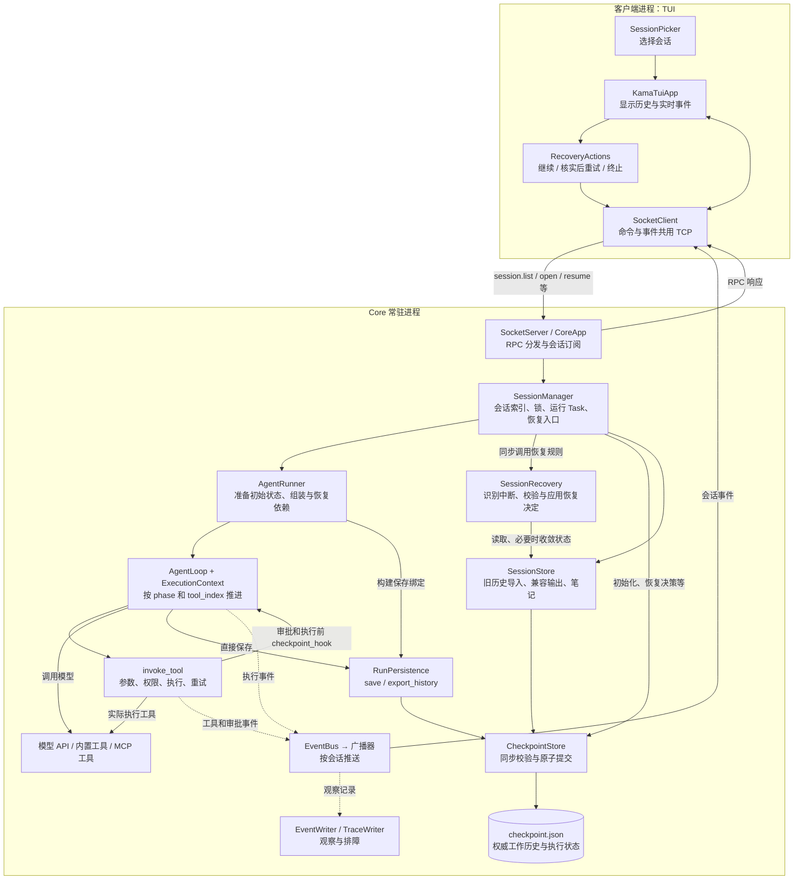
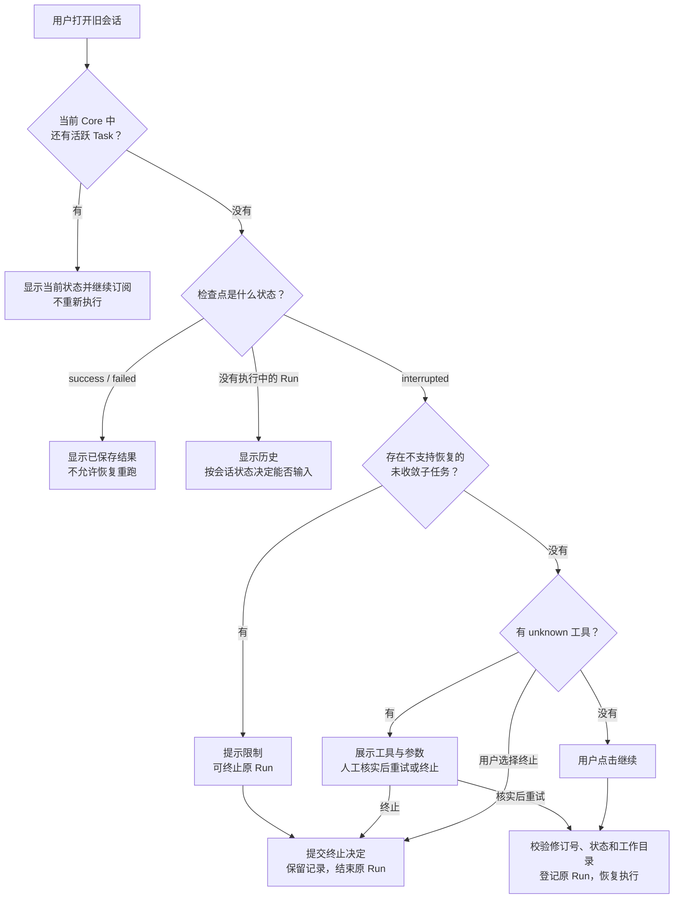
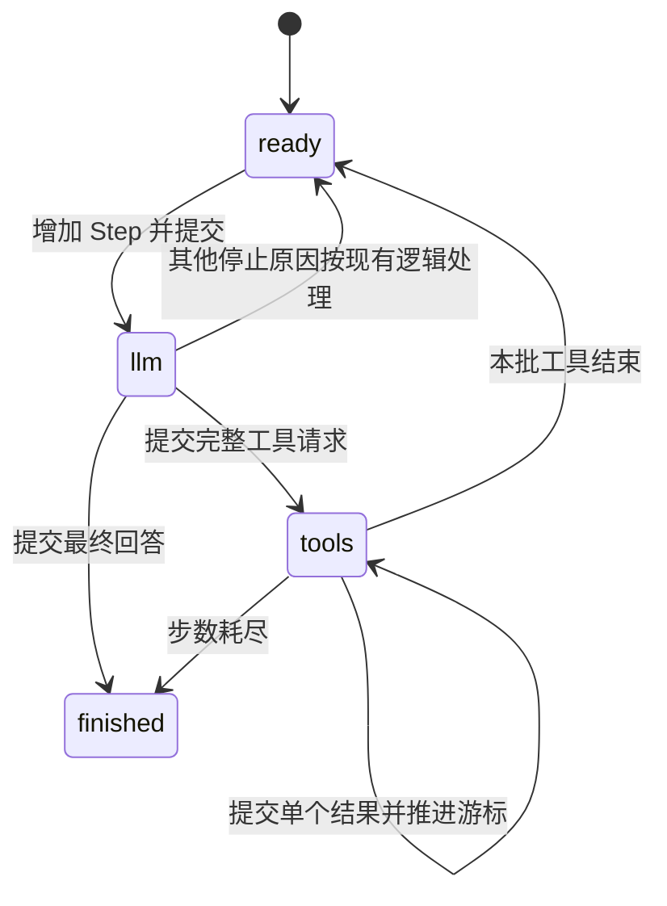

# S8：会话断点恢复——功能、整体设计与代码详解

**先看这两条链路：** [选择历史 → open → 前端选择 → resume → 续跑，以及中断前后的状态变化](./S8-中断与恢复链路速查.md)。

本文面向第一次接触 KamaClaude 的读者。先认识项目和 S8 提供的功能，再看整体结构与改动清单，最后逐层理解检查点、执行恢复、通信和界面。文中的代码片段仅保留关键逻辑；标为“伪代码”的片段用于帮助理解，完整实现以源码为准。

**阅读目标：** 读完后，你应能解释“任务执行到一半中断后，程序如何知道做到哪里、哪些操作可以继续、哪些操作必须先询问用户”。

**对比基线：** 本文的“之前”指 `stage/s7` 分支本次核对的提交 `d15cb6b`，“现在”指当前 `s8` 工作区。详细设计章节按“之前怎么做 → S8 怎么改 → 方法与设计详解”展开；代码链接打开的是当前文件。想查看同一路径的旧实现，可在项目根目录执行 `git show stage/s7:src/kama_claude/core/loop.py`，无需切换分支。

## 1. 整体介绍：S8 实现了什么

### 1.1 先认识这个项目

KamaClaude 是一个在本机运行的 AI Agent。你输入一个目标，例如：

> 阅读 README.md 和 pyproject.toml，整理项目说明，再写入 SUMMARY.md。

程序会把目标、已有对话和工具介绍交给大模型。模型可以提出“读取文件”“运行命令”“写入文件”等工具调用，由程序实际执行，再把结果交回模型。这个过程重复进行，直到模型给出最终回答，或者达到步数上限。

项目有两个主要进程：

- **TUI 进程：** 终端里的交互界面，负责输入、显示回复、展示工具进度和接收审批决定。
- **Core 进程：** 常驻后端，负责调用模型、执行工具、管理会话和保存数据。

CLI 是另一种客户端，主要用于调试。TUI 和 CLI 都通过 TCP 连接 Core，默认地址是 `127.0.0.1:7437`。一次请求和持续的运行事件共用连接：前者采用 JSON-RPC 风格的请求/响应，后者使用自定义事件信封；消息用换行分隔，称为 NDJSON。

因此，关闭一个 TUI 窗口，与关闭执行任务的 Core，是两个不同的动作。

### 1.2 理解 S8 必须知道的几个词

| 概念 | 含义 | 对应到上面的例子 |
| --- | --- | --- |
| Session，会话 | 可以包含多轮用户输入的交互空间，有稳定的 session_id | 你与 Agent 讨论这个项目的整段会话 |
| Run，一轮任务 | 一次用户输入触发的执行过程，有 run_id | “读取两个文件并写总结”这一轮 |
| Step，步骤 | 一次模型调用，以及这次回复要求执行的工具处理 | 第一步读文件，第二步写总结，第三步回复完成 |
| Tool，工具 | 程序提供给模型的能力，模型提出调用，Core 真正执行 | read_file、write_file、bash |
| messages，工作历史 | 下一次模型请求使用的消息列表，包含用户、模型和工具结果 | 模型已经读到的文件内容、执行结果 |
| Checkpoint，检查点 | 某个提交边界上，足以恢复任务逻辑状态的数据 | 已完成第一个读取、下一个要处理第二个读取 |
| 副作用 | 对外部世界产生的改变 | 写文件、追加记录、启动命令或提交远程操作 |

这里的 Step 不等于“一个工具”。一次模型回复可以同时提出多个工具调用，当前主 Agent 会按顺序处理它们。

### 1.3 S8 解决了什么问题

旧版本虽然保存会话历史，但主要在一轮 Run 结束后保存本轮模型消息。中间过程大量存在内存里；Core 突然退出时，仅凭历史文件，很难知道模型回复是否完整、哪些工具已经执行、下一步应该做什么。

S8 增加了三方面能力：

| 功能 | 用户看到的效果 | 后端增加的能力 |
| --- | --- | --- |
| 打开历史会话 | 启动 TUI 后可以选择以前的会话 | 从磁盘重建会话索引，导入旧历史 |
| 断线重新连接 | TUI 重连原会话，不再自动创建替代会话 | Run 由 Core 持有，连接断开不取消业务任务 |
| Core 重启后继续 | 中断会话展示“继续任务”等操作 | 从已提交检查点恢复原 Run 的阶段、上下文和工具游标 |

另外，S8 配套修复了几个会破坏恢复体验的问题：跨会话事件干扰、压缩后按旧下标保存历史、工具成功后的通知异常触发重试，以及 CLI 等不到终态时持续挂起。

### 1.4 两种中断，处理方法不同

**第一种：TUI 断了，Core 还活着。**

执行任务的协程仍在 Core 中，不需要重新执行。TUI 重新连接后，只需打开原会话、读取当前快照、继续订阅事件。如果任务已经完成，就显示保存的结果。

**第二种：Core 自己退出了。**

原来的 Python 协程、Future 和 TCP 连接已经消失。重启后创建新的执行对象，加载磁盘检查点，才能继续。

S8 恢复的是**任务的逻辑状态**，不是把原来的 Python 程序停在某一行，再让操作系统从那一行恢复。

| 中断位置 | 当前处理 |
| --- | --- |
| 初始目标已接受，模型还没调用 | 继续原 Run，从准备好的初始状态开始 |
| Core 在模型流式输出中退出 | 丢弃未提交的半截回复，重新请求该 Step |
| 模型完整回复已经提交 | 使用保存的回复，继续处理工具，不重新请求这次模型回复 |
| 某个工具结果已经提交 | 跳过这个工具，使用已保存结果 |
| 工具正在执行，结果尚未提交 | 标为 unknown，要求人工核实 |
| 正在等审批 | Core 存活时找回原等待；Core 重启后重新检查权限，需要时重新审批 |
| 最终结果已提交，只是通知没收到 | 打开会话即可看见完成结果，不重复执行 |
| 工作历史已经压缩并提交 | 继续使用压缩后的历史 |
| 有未完成或尚未取回结果的后台子 Agent | 第一版阻止自动恢复任务树，允许终止原 Run |

### 1.5 一个贯穿全文的例子

目标还是“读取两个文件，再写总结”。一种可能的执行顺序是：

```text
Step 1：模型提出两个读取工具
    A：read_file("README.md")
    B：read_file("pyproject.toml")

Step 2：模型根据读取结果提出写入工具
    C：write_file("SUMMARY.md", 整理后的内容)

Step 3：模型给出最终回答
```

假设检查点已经保存了 A 的结果，B 仍是 pending，此时 Core 中断。恢复后直接执行 B，A 不再重读。

再假设 C 已经把文件写好了，Core 却在保存工具结果前退出。磁盘检查点只能证明“C 已经准备开始执行”，无法证明它究竟完成没有。因此系统必须让你核实文件，再选择重试或终止，而不是直接再执行 C。

这两种情况，就是“可以确定地继续”和“必须先确认”的区别。

### 1.6 怎么启动和使用

需要 Python 3.12 和 uv。在项目根目录安装依赖：

```text
uv sync
```

当前 Core 默认使用 DeepSeek Provider。根目录的 `.env` 需要配置对应密钥和账号实际可用的模型；下面是占位示例，必须替换：

```dotenv
DEEPSEEK_API_KEY=your_key
KAMA_LLM_DEFAULT_MODEL=your_available_model
KAMA_MAX_STEPS=20
```

在**两个终端**中分别执行：

```text
# 终端一：项目根目录
uv run kama-core
```

```text
# 终端二：同一个项目根目录
uv run kama-tui
```

有历史会话时，TUI 显示选择器；方向键和 Enter 打开会话，按钮或 Ctrl+N 创建新会话。没有历史会话时自动创建。

| 操作 | 作用 |
| --- | --- |
| Ctrl+O | 打开历史会话列表，选择已有会话或新建 |
| Ctrl+Q | 退出 TUI，保留会话；Core 中正在运行的任务继续 |
| Ctrl+W | 显式关闭当前会话；运行中的会话会拒绝关闭 |
| 继续任务 | 继续没有未知副作用阻碍的中断 Run |
| 核实后重试 | 明确允许重试结果未知的工具，再按正常权限流程执行 |
| 终止本轮 | 结束中断的 Run，保留记录；chat 会话可再发新消息 |

“退出界面”“关闭会话”“终止本轮”不是同一个动作。关闭的会话可查看历史，但不能通过恢复接口重新执行其中的 Run；要继续讨论，可以创建新会话。

## 2. 简单理解实现：保存状态，再按状态继续

### 2.1 整体思路

可以把执行过程理解为一本不断更新的任务记录：

1. 接受目标时，先记下目标和 Run 身份。
2. 每次完整模型回复后，保存它提出的工具调用。
3. 真正执行工具前，记下“准备开始这次操作”。
4. 工具返回后，把结果、对话和下一个工具位置一起保存。
5. 中断后重新读取这本记录，决定继续、等待确认还是显示已完成。

这里“保存”不是只把一段文字放进日志，而是提交一个完整、可校验的 `checkpoint.json` 快照。

### 2.2 结构图：组件之间如何协作



这张图重点看两条路径：

- **执行与保存路径：** SessionManager → Runner → Loop → 工具；Loop 直接调用 RunPersistence，再由 CheckpointStore 提交。
- **观察路径：** 执行事件 → EventBus → 广播器 → TUI。日志与显示的失败，不能反过来决定一个已经成功的工具要不要重新执行。

RunPersistence 是明确的保存对象；checkpoint_hook 只连接工具执行边界与 Loop，没有新增网络服务或消息队列。SessionRecovery 也是 Core 内的普通 Python 对象，只处理恢复规则，不启动 Runner、不持有业务 Task。

### 2.3 正常执行与恢复共用一套 Loop

S8 没有另写一个恢复专用 Agent。运行时状态统一放在 context.run，新任务和恢复任务只是起点不同：

```python
context = ExecutionContext(run=saved_run, messages=checkpoint.messages)
persistence = RunPersistence(context, checkpoint, session, store)
loop = AgentLoop(
    provider, registry, bus,
    context=context,
    persistence=persistence,
)
await loop.run()
```

新任务从 ready、Step 0 开始；恢复任务从保存的 llm 或 tools 阶段进入。纯内存任务不传 persistence，也使用相同的 Run 状态结构。


### 2.4 恢复时的整体判断



“打开会话”只是查看和重新绑定；“恢复执行”必须有明确动作，两者不会混在一起。


## 3. 相比 S0–S7，新增和改动了什么

### 3.1 行为上的变化

| 位置 | 原来的行为 | S8 当前行为 |
| --- | --- | --- |
| 接受目标 | 保存输入，随后开始 Run | 先把输入、Run 身份和初始状态提交为检查点，再登记任务 |
| 中间消息 | 主要在内存，结束时追加 | 模型完整回复和每个工具结果都有提交边界 |
| Loop | 主要靠 while 循环中的当前位置 | 增加明确的 phase 与工具游标，可以重新进入中间阶段 |
| 工具执行 | 运行错误可能统一触发重试 | 按 retry_safe 决定自动重试；非安全工具异常可转为 unknown |
| 工具通知 | 通知异常可能进入工具重试 | 结果提交和通知分开，观察者异常不触发工具重执行 |
| 会话索引 | 新 Core 从空内存字典开始 | 启动扫描已有会话，识别未完成 Run |
| 客户端断线 | TUI 清空会话 ID，重连后创建新会话；旧任务未必取消 | Manager 统一持有业务任务，重连绑定原会话 |
| TUI 事件 | 全局订阅容易串会话 | 按会话订阅并过滤，打开期间缓冲、去重 |
| 退出 TUI | 尝试关闭会话 | 退出仅退出界面，关闭会话是单独操作 |
| 压缩后保存 | 仍按压缩前的消息长度截取 | 提交当前完整工作历史，不再依赖旧下标 |
| CLI 等待 | 主要等待 run.finished | 也处理 run.interrupted 和连接结束 |

### 3.2 新增的源码模块

| 文件 | 新增内容 | 为什么单独放在这里 |
| --- | --- | --- |
| [core/checkpoint/checkpoint.py](../src/kama_claude/core/checkpoint/checkpoint.py) | Checkpoint、RunCheckpoint、ToolCheckpoint、CheckpointStore、CheckpointError | 把恢复数据结构、校验和文件提交与执行循环分开 |
| [core/checkpoint/persistence.py](../src/kama_claude/core/checkpoint/persistence.py) | RunPersistence：直接提交本轮状态并导出历史 | 取消保存经过 Runner 回调的中转 |
| [core/checkpoint/recovery.py](../src/kama_claude/core/checkpoint/recovery.py) | SessionRecovery：识别遗留运行、校验并应用恢复决定 | 让普通会话流程不再穿插全部恢复规则 |
| [tui/recovery.py](../src/kama_claude/tui/recovery.py) | SessionPicker、RecoveryActions | 把历史选择和恢复决定控件从主 App 中拆出 |

三个检查点模型都位于同一个 `checkpoint.py` 中，并不是三个新服务。

### 3.3 已有模块的主要改动

| 模块 | 关键新增或变化 |
| --- | --- |
| [SessionStore](../src/kama_claude/core/session/store.py) | 接入 checkpoints；新增 session_ids、ensure_checkpoint、export_meta、export_messages；优先读取权威快照 |
| [SessionManager](../src/kama_claude/core/session/manager.py) | 加载历史索引；新增 list_sessions、open、resume、shutdown；持有 _tasks；委托 SessionRecovery 识别中断与应用恢复决定 |
| [AgentRunner](../src/kama_claude/core/runner.py) | 共用初始状态构建；恢复 Context.run；组装并传入 RunPersistence |
| [AgentLoop](../src/kama_claude/core/loop.py) | 构造时绑定 Context 和可选 RunPersistence；按 phase 和 tool_index 推进 |
| [invoke_tool](../src/kama_claude/core/tools/invocation.py) | 前置阶段调用 checkpoint_hook；返回 ToolResult；Loop 保存后再调用 publish_tool_result 通知 |
| [BaseTool / ToolResult](../src/kama_claude/core/tools/base.py) | retry_safe 与 outcome_unknown，表达重试能力及结果不确定性 |
| [PermissionManager](../src/kama_claude/core/permissions/manager.py) | 查询仍有效的审批；在发送失败、超时或取消时清理 pending |
| [CoreApp](../src/kama_claude/core/app.py) | 注册恢复 RPC、绑定 Run 归属；关闭 Core 时等待受管任务收尾 |
| [IpcEventBroadcaster](../src/kama_claude/core/transport/ipc_broadcaster.py) | session 范围、Run 与会话映射、会话事件序号 |
| [EventBus](../src/kama_claude/core/events/bus.py) / [EventWriter](../src/kama_claude/core/events/writer.py) | 安全观察通知、退订；事件文件按 Run 过滤 |
| [TUI App](../src/kama_claude/tui/app.py) | 历史选择、打开快照、恢复按钮、重连绑定、事件过滤与去重 |
| [SocketClient](../src/kama_claude/core/transport/socket_client.py) / [SocketServer](../src/kama_claude/core/transport/socket_server.py) | 请求取消/断线清理；把检查点错误映射为明确 RPC 错误 |
| [CLI run](../src/kama_claude/cli/commands/run.py) | 按本次 Run 过滤事件；处理中断及断线，不永久等待 |

协议类型同步增加在 [commands.py](../src/kama_claude/core/bus/commands.py) 和 [events.py](../src/kama_claude/core/bus/events.py)；[WIRE_PROTOCOL.md](../WIRE_PROTOCOL.md) 由脚本生成，不能只改文档而不改类型。

### 3.4 新增的测试

| 文件 | 主要验证内容 |
| --- | --- |
| [test_checkpoint_recovery.py](../tests/unit/test_checkpoint_recovery.py) | 持久化边界、逐工具恢复、未知副作用、预算、审批、压缩、旧数据和坏快照 |
| [test_tui_recovery.py](../tests/unit/test_tui_recovery.py) | 真实 Textual 屏幕上的历史选择、确认按钮、事件隔离和去重 |
| [test_cli_recovery.py](../tests/unit/test_cli_recovery.py) | CLI 不把其他 Run 当作自己的终态，中断或断线时能退出等待 |
| [test_s8_recovery.py](../tests/integration/test_s8_recovery.py) | 真实 TCP 与测试进程的硬退出、重启和重新连接 |
| [recovery_daemon.py](../tests/integration/recovery_daemon.py) | 集成测试用的守护进程入口，使用假模型和受控文件工具 |

下面的详细解释会依次展开这些改动，不需要一开始就读完所有文件。


### 3.5 先走一遍 S7 的旧流程，再和 S8 对照

下面以普通聊天消息为例，文件和方法名均来自本次核对的 S7。为了突出调用与保存顺序，代码是简化伪代码，省略事件、Skill、异常和资源管理分支。

**S7：接收消息、执行一轮、最后追加历史。**

```python
# SessionManager.send_message()
async with session_lock:
    store.append_message(sid, "user", content)  # 用户输入先落盘
    session.run_ids.append(run_id)
    store.write_meta(session)                 # 元信息单独落盘

    runner = runner_factory()
    await runner.run_and_capture(
        goal, run_id=run_id, session=session, store=store
    )
    更新会话状态并写 meta.json
```

Runner 里面：

```python
# AgentRunner.run_and_capture()
history = store.read_messages(session.id)
context = ExecutionContext(..., prefill_messages=history)
prefill_len = len(history)

await loop.run(context)                       # 中间消息主要改内存
await bus.publish(RunFinishedEvent(...))       # 先发终态
store.append_messages(                        # 再追加本轮模型/工具消息
    session.id, context.messages[prefill_len:], run_id
)
```

在正常返回或某些被处理的异常路径中，旧 Runner 会走到后面的收尾保存；硬退出、未覆盖的异常或收尾通知失败则不能保证执行到那里。所以不能把“最后会尝试保存”理解成“每个工具执行完都已经保存”。

**S8：接收时提交初始快照，执行中逐边界提交，最后先保存终态。**

```python
# SessionManager.send_message()
async with session_lock:
    cp = load_or_import_checkpoint(session_id)
    检查没有活跃任务和未处理的中断 Run
    cp.messages.append(user_message)

    runner.prepare_checkpoint(...)            # 先提交目标、Run、配置
    task = start_and_register_business_task()  # Manager 持有业务 Task

# 需要等待时，隔离外层等待者的取消
await asyncio.shield(task)
```

Runner 与 Loop 协作：

```python
context = 从检查点历史重建 Context
persistence = RunPersistence(context, checkpoint, session, store)
loop = AgentLoop(..., context=context, persistence=persistence)
await loop.run()                       # 模型/工具边界会保存

保存最终 checkpoint                          # 权威提交在前
尽力导出兼容 thread.jsonl
发布最终事件                                  # 观察通知在后
```

按同一个例子比较：

| 执行到“读取 A 已完成，B 尚未执行”时 | S7 | S8 |
| --- | --- | --- |
| 内存里有什么 | assistant 工具请求、A 的结果、for 循环位置 | 同样有执行数据，另有明确 phase 与游标 |
| 磁盘上一定有哪些中间事实 | 用户输入、元信息；本轮模型/工具消息尚不保证已写入 thread | 已提交工具批次、A 结果、配对消息和下一位置 |
| Core 此时硬退出 | 没有该位置的检查点续跑机制 | 重启后中断，确认后从 B 继续 |
| 下一次用户直接重新发目标 | 新 Run，不等于继续旧 Run | 要先处理原中断 Run，resume 保留原身份 |

**TUI 的流程也要一起比较：**

```text
S7：
连接 → 全局订阅 → 新建会话 → 显示实时事件
断线 → 清空 session_id → 下次连接再新建会话
退出 → 尝试 session.close → 退出界面

S8：
连接 → 选择/打开会话 → 读取快照并订阅本会话
断线 → 保留 session_id → 重连后 open 原会话
中断 → 展示状态 → 用户决定 → resume 原 Run
退出 → 只退出界面；关闭会话另有操作
```

因此，这次改动同时涉及存储、执行器、任务归属和前端。只增加“继续”按钮，或只在每步结束时多写一个日志文件，都不能建立完整的恢复链路。


## 4. 关键设计与实现详解

### 4.1 执行状态只有一个来源：context.run

**之前怎么做（S7）：** Step、状态和结果存在 ExecutionContext 中，Run 收尾后主要保存消息历史。

**早期 S8：** Context 与 RunCheckpoint 同时保存 Step、状态和结果，Loop 和 Runner 保存前都要同步；后来又增加 _RunExecution 打包这些对象，阅读时要反复区分多份数据。

**现在怎么改：** ExecutionContext 直接持有一个 RunCheckpoint，所有运行字段从 `context.run` 访问，不再复制和同步同名字段。

```text
ExecutionContext
├── run: RunCheckpoint        唯一的执行状态
│   ├── run_id、goal、max_steps、step
│   ├── status、phase、result、reason
│   └── tools、tool_index、模型配置……
├── messages                  当前工作历史
└── 记忆、笔记、提示构建信息

RunPersistence
└── 绑定 Context、Checkpoint、Session 和 Store，负责提交

Checkpoint
└── 磁盘快照外壳：session、messages、run、revision
```

| 对象 | 作用 | 是否另存一份执行状态 |
| --- | --- | --- |
| ExecutionContext | 提供消息操作、提示构建和运行状态入口 | 否，持有同一个 run |
| RunCheckpoint | 既是运行时状态，也是可序列化的恢复数据 | 这就是唯一的 Run 状态 |
| Checkpoint | 将会话、消息和 Run 组合成磁盘快照 | 不做第二套状态推进 |
| RunPersistence | 绑定本轮与会话存储，提供 save/export_history | 不维护 Step 或结果副本 |
| asyncio.Task | 当前 Core 的协程句柄 | 不序列化、不跨进程恢复 |

现在应该读 `context.run.step`、`context.run.status`，而不是 `context.step`、`context.status`。成功、失败和中断方法也直接修改 run：成功/失败进入 finished，中断保留原 phase。

保存时，RunPersistence 把这个 run 对象交给 Checkpoint，CheckpointStore 再序列化候选快照。原子提交内部的深拷贝用于保护文件提交，不是一套额外执行状态。

一个会话可以有多轮 Run，checkpoint.run 仍只保存当前或最近一轮的状态，不是全部历史 Run 的快照档案。


### 4.2 三个检查点模型分别负责什么

**之前怎么做（S7）：** `meta.json` 记录会话元信息和 Run ID，`thread.jsonl` 记录消息，工具和 Trace 文件记录各自的信息。它们没有统一表达“当前 Step、第几个工具、结果是否已提交”的快照结构；单看某个事件或 Task 清单，也不能可靠推出整个 Agent 的执行位置。

**S8 怎么改：** 新增三个模型，把会话、工作历史、Run 和当前工具批次合并到一个可提交的数据结构中。这里的 ToolCheckpoint 不等于原来的 Task 工具生成的任务清单：前者记录一次调用的恢复状态，后者是模型维护的计划事项。


先看数据层次：

```text
Checkpoint
├── schema_version / revision / updated_at
├── session                   会话元数据
├── messages                  当前模型工作历史
└── run: RunCheckpoint
    ├── run_id / goal / provider / model / workspace
    ├── system_prompt / tool_whitelist / tool_schemas
    ├── status / phase / step / max_steps
    ├── tools: list[ToolCheckpoint]
    │   ├── id / name / input
    │   └── status / result / attempts
    ├── tool_index
    ├── result / reason / context_pct
    └── subagents / decisions
```

**Checkpoint 的顶层字段：**

| 字段 | 用途 |
| --- | --- |
| schema_version | 说明快照采用哪一版格式，当前为 1；未知版本拒绝加载 |
| revision | 每次成功提交后增加，防止旧快照覆盖新状态，或旧界面重复提交决定 |
| updated_at | 本次快照提交时间 |
| session | 会话模式、状态、标题、创建时间、Run ID 列表等 |
| messages | 下一次模型请求要使用的完整工作历史 |
| run | 当前/最近 Run 的逻辑状态；新建但没开始任务的会话可以为 null |

**RunCheckpoint 的关键字段：**

| 字段 | 为什么必须保存 |
| --- | --- |
| run_id、goal | 恢复同一任务，不创建一个重复目标 |
| step、max_steps | 保留执行位置和步数上限 |
| phase | 判断应该请求模型，还是继续工具批次 |
| tools、tool_index | 知道模型本次要求哪些工具，以及下一个处理谁 |
| provider、model | 保持原后端与模型配置 |
| system_prompt | 保存当时组合后的系统提示，不是只保存模板文件路径 |
| tool_whitelist、tool_schemas、schemas_frozen | 保留能力范围，并检查恢复时工具定义是否兼容 |
| workspace | 记录 Core 当时的绝对工作目录 |
| result、reason | 保存最终文本或中断/失败原因 |
| context_pct | 保存 Provider 根据用量与窗口大小估算的上下文比例，供工具阶段结束后的压缩判断使用 |
| subagents | 标记未完成或未收敛子任务，防止假装可以重建任务树 |
| decisions | 记录 continue、retry_tool、abort 等恢复动作及时间 |

`decisions` 是恢复动作记录，不是全部工具审批的审计仓库。API 密钥、环境变量、Task 和 Future 都不会作为这些字段序列化。


**messages 为什么不只是聊天文本？**

模型回复中可以同时包含文字、thinking（若 Provider 返回）、tool_use；工具结果用 tool_result 与调用 ID 配对。例如下面是内部消息结构的简化示意：

```json
[
  {
    "role": "assistant",
    "content": [
      {"type": "text", "text": "先读取项目说明。"},
      {"type": "tool_use", "id": "call-A", "name": "read_file", "input": {"path": "README.md"}}
    ]
  },
  {
    "role": "user",
    "content": [
      {"type": "tool_result", "tool_use_id": "call-A", "content": "文件内容……"}
    ]
  }
]
```

这里 role=user 的工具结果是内部消息约定，不是用户手动输入了文件内容。Provider 负责转换为目标模型接口要求的格式。检查点需要保留这些结构和 ID，才能让模型知道“哪个结果对应哪个调用”，而不是只保存 TUI 上看到的文字。

**ToolCheckpoint 表示当前工具批次中的一次调用：**

| 字段 | 含义 |
| --- | --- |
| id | 模型给出的工具调用 ID，用来与 tool_result 配对 |
| name、input | 工具名称和参数，恢复不能重新猜测 |
| status | 这次调用现在处于哪个阶段 |
| result | 已知结果，或结果未知时保存的错误诊断；是否完成仍以 status 为准 |
| attempts | 已登记的执行尝试次数，不等于成功次数 |

`tools` 主要是**最近一次模型回复对应的批次**，不是整个 Run 的全部工具历史。进入下一次模型回复后会更新这个列表；以前的工具交互保存在 messages 中。

下面是字段节选，只用于理解，省略了其他恢复所需字段，不能直接覆盖真实检查点：

```json
{
  "schema_version": 1,
  "revision": 12,
  "session": {
    "id": "sess-example",
    "mode": "chat",
    "status": "interrupted"
  },
  "run": {
    "run_id": "run-example",
    "step": 1,
    "max_steps": 20,
    "status": "interrupted",
    "phase": "tools",
    "tool_index": 1,
    "tools": [
      {
        "id": "call-A",
        "name": "read_file",
        "input": {"path": "README.md"},
        "status": "completed",
        "result": {"content": "已读取的文件内容", "is_error": false}
      },
      {
        "id": "call-B",
        "name": "read_file",
        "input": {"path": "pyproject.toml"},
        "status": "pending",
        "result": null
      }
    ]
  }
}
```

`tool_index=1` 表示下一项是下标为 1 的 B；下标从 0 开始。A 的结果必须同时出现在保存的工具记录和 messages 中。

### 4.3 四种“状态”不能混在一起

**之前怎么做（S7）：** 会话已有 active、waiting_for_input、closed，Context 用 running、success、failed 表示运行结果；工具依靠局部变量和 ToolResult 表达返回值。没有可持久化的 phase、工具游标和 unknown 状态，也没有中断 Run 的明确恢复入口。旧 Loop 在模型调用的取消分支会标记失败，但工具阶段取消还涉及外层 Runner 的收尾，不能泛称“任何取消都由 Loop 自己标记失败”。

**S8 怎么改：** 增加 interrupted 和工具执行阶段，让“任务失败”“暂时中断”“操作结果未知”有不同含义，分别决定是否能恢复、从哪里恢复以及是否必须人工确认。


S8 同时存在会话状态、Run 状态、执行阶段和工具状态。它们回答不同问题。

| 分类 | 回答的问题 | 主要取值 |
| --- | --- | --- |
| Session.status | 这个会话现在能否继续交互？ | active、waiting_for_input、interrupted、closed |
| RunCheckpoint.status | 这一轮任务整体怎么样？ | running、interrupted、success、failed |
| RunCheckpoint.phase | 恢复后从哪一类代码进入？ | ready、llm、tools、finished |
| ToolCheckpoint.status | 某一个工具调用做到哪里？ | pending、awaiting_approval、executing、unknown、completed |

例如：

```text
Session.status = interrupted
Run.status     = interrupted
Run.phase      = tools
B.status       = unknown
```

意思是：会话中有一轮中断任务，执行位置在工具阶段，B 的实际结果需要确认。

`unavailable` 则是列表中用于展示坏快照的状态，不是 Session 模型新增的正常生命周期取值。

工具状态还需要更仔细地区分：

| 工具状态 | 能证明什么 | 不能据此断言什么 |
| --- | --- | --- |
| pending | 还没有提交这次执行意图 | 不代表这个工具名字以前从未出现 |
| awaiting_approval | 正在经过权限检查，可能等待用户决定 | 不代表一定已显示弹窗，策略也可能直接允许/拒绝 |
| executing | 已保存执行意图，接下来会调用工具 | 不保证工具已经进入函数体，也不能证明已完成 |
| unknown | 无法确认本次外部操作的最终结果 | 不能当成“没有执行” |
| completed | 本次调用处理已有确定的结果记录 | 不等于成功；schema 错误、拒绝审批或工具明确返回的错误也可完成处理 |

为什么 executing 不能证明“已经执行”？因为程序必须先保存 executing，再真正调用工具；两句代码之间也可能中断。因此它是一份保守的执行意图记录。

### 4.4 CheckpointStore：如何避免写坏快照

**之前怎么做（S7）：** 没有 CheckpointStore。SessionStore 的 write_meta 使用 `write_text()` 直接覆盖 meta.json，append_messages 则逐条追加 thread.jsonl。即使文件本身可读取，也没有跨消息与执行游标的一次提交，更没有检查点 revision 校验。

**S8 怎么改：** 新增单文件权威快照，先写临时文件并同步，再原子替换；业务执行在提交成功后才继续推进。兼容文件仍可存在，但不再承担这份恢复状态的权威职责。


核心实现位于 [checkpoint.py](../src/kama_claude/core/checkpoint/checkpoint.py)。

| 方法 | 职责 |
| --- | --- |
| path(sid) | 验证会话标识，构造该会话的 checkpoint.json 路径 |
| exists(sid) | 判断是否已有权威快照 |
| load(sid) | 读取、反序列化、校验版本、归属、消息形状和工具游标 |
| save(cp) | 校验修订号，原子提交新快照，成功后更新内存 revision |

直接使用 `open("checkpoint.json", "w")` 有一个问题：文件打开后，旧内容就可能被截断。若写到一半进程退出，旧状态和新状态都不完整。

当前 save 的关键顺序如下，省略异常处理的伪代码：

```python
确认磁盘 revision 与当前对象一致

candidate = 深拷贝并校验当前快照
candidate.revision += 1

with 同目录临时文件 as f:
    写入完整 JSON
    f.flush()
    os.fsync(f.fileno())

os.replace(临时文件, checkpoint.json)

# 只有替换成功，才推进调用方内存里的版本
cp.revision = candidate.revision
cp.updated_at = candidate.updated_at
```

几个细节分别解决不同问题：

- **同目录临时文件：** 避免跨文件系统移动，给原子替换提供条件。
- **完整序列化和校验：** 无法转成 JSON、消息结构不合法时，不先破坏旧文件。
- **flush：** 刷新 Python 文件缓冲。
- **fsync：** 请求操作系统同步该临时文件的数据。
- **os.replace：** 用已经准备好的文件替换权威文件，避免读到“写了一半的新快照”。
- **成功后推进 revision：** 保存失败时，内存不能假装新版本已提交。

这保证的是当前单机文件方案中的提交边界。它不等于多个文件的一起提交，也不等于任意断电环境下绝不丢数据，更不是两个独立 Core 进程间的分布式锁。

load 也不会“尽量猜着恢复”：版本未知、消息形状损坏、会话 ID 不符、工具游标越界或跳过未提交结果，都应明确拒绝。

### 4.5 保存目录与兼容旧历史

**之前怎么做（S7）：** read_meta 读取 meta.json，read_messages 读取 thread.jsonl，再裁去尾部未配对工具调用并截断过长工具结果。与此同时，SessionManager 启动时的 _sessions 是空字典，没有扫描磁盘恢复索引。因此“Store 有读取函数”不等于“重启后前端能列出、打开并继续旧会话”。

**S8 怎么改：** 启动扫描会话；没有检查点的旧会话可以导入，有检查点则优先读它。检查点里的未配对调用可能是合法的工具处理中间状态，不能沿用旧规则直接裁掉，而应先完成或终止这批调用。


默认数据布局：

```text
~/.kama/sessions/<session_id>/
├── checkpoint.json             权威状态：恢复时首先看这里
├── meta.json                   兼容元数据输出
├── thread.jsonl                兼容工作历史输出
├── notes.md                    会话主动笔记
└── runs/<run_id>/
    ├── events.jsonl            业务事件
    └── .tasks/                 本轮任务清单
```

`~` 是当前用户主目录。Core 可以通过 `KAMA_SESSIONS_DIR` 改变会话根目录，测试用它隔离用户数据。

[SessionStore](../src/kama_claude/core/session/store.py) 负责把新旧格式衔接起来：

| 方法 | 当前行为 |
| --- | --- |
| session_ids() | 找出具有 meta.json 或 checkpoint.json 的会话目录 |
| ensure_checkpoint() | 有快照就读取；没有则把旧元数据和可用历史导入 |
| read_meta() / read_messages() | 有检查点时以检查点为准 |
| write_meta() | 先提交权威元数据，再尽力更新兼容 meta.json |
| export_messages() | 导出兼容 thread.jsonl，失败不撤销已经提交的检查点 |
| write_compacted() | 提交压缩后的权威历史，再处理旧历史备份和兼容输出 |

旧会话的导入可能发生在**列出或打开会话**时，因为两条路径都会调用 ensure_checkpoint；不严格限定为点击“打开”之后。

旧数据中的坏 JSON 行或尾部孤立工具调用，仍通过原来的兼容读取处理。导入之后，不再每次都用旧裁剪规则截断检查点历史，否则会把正在等待处理的工具批次删掉。

一个检查点中“assistant 已提出 B，但还没有 B 的 tool_result”可以是合法的中间执行状态。Loop 必须先处理 B，再发下一次模型请求；不能直接把不完整工具回合交给模型。

**不要用 thread.jsonl 的最后一行判断恢复位置。** 该文件可能滞后，第一轮任务执行中甚至还没有完整兼容输出。恢复应查看 checkpoint.json 或通过 session.open 取得权威状态。

有 checkpoint.json 后，即使兼容 thread.jsonl 内容不同，也不能拿后者覆盖前者。坏快照会隔离为 unavailable；其他正常会话仍可使用。


### 4.6 从接受目标开始：不能留下“任务还没启动就丢了”的窗口

**之前怎么做（S7）：** send_message 先 append_message 保存用户输入，写 meta.json 记录 Run ID，再创建 Runner 并直接 await run_and_capture。用户目标并非完全不落盘，但落盘信息不足以恢复“本轮执行所用配置和初始执行阶段”。CLI 的 agent.run 入口还会先 create_task，再立即返回 Run ID，具体目标处理要等该 Task 获得调度。

**S8 怎么改：** 在登记真正执行的后台任务前，先提交包含用户输入、Run 身份、配置与 ready 阶段的初始检查点。这里补的是任务接受与可恢复状态之间的窗口，不是声称旧版从来没有保存用户输入。


[SessionManager.send_message()](../src/kama_claude/core/session/manager.py) 是普通消息的后端入口。它先检查会话是否关闭、是否已有活跃任务、是否有尚未处理的中断 Run。

存在中断 Run 时，不能直接再追加一条新目标，把旧任务悄悄丢到一边。需要先继续或终止它。

接受新目标时的关键顺序，伪代码：

```python
async with session_lock:
    检查会话和现有 Run

    cp.messages.append(user_message)
    更新会话标题、时间和 run_ids

    runner.prepare_checkpoint(...)
    # 到这里，用户输入和初始 Run 已一起提交到磁盘

    task = 创建后台执行任务
    self._tasks[session_id] = task
```

为什么不能等 Runner 真正开始调用模型才写第一次检查点？

因为“创建 Task”和“Task 获得执行机会”不是一回事。如果 Core 在两者之间退出，用户可能已经拿到任务身份，但磁盘没有这个目标。

因此 [AgentRunner.prepare_checkpoint()](../src/kama_claude/core/runner.py) 在接收请求阶段准备并提交：

- 原始用户消息与解释后的目标；
- Run ID、Step 0、步数上限；
- 当前工作目录；
- Provider/模型身份、最终系统提示和工具白名单；
- `status=running, phase=ready`。

真正构建工具注册表后，Runner 再保存工具 schema 并设置 `schemas_frozen=True`。初始检查点可以早于 schema 冻结，因为这时尚未执行模型或工具。

### 4.7 AgentRunner：组装一次执行，不再中转保存回调

**之前怎么做（S7）：** Runner 每轮读取历史和配置，创建 Context、Provider、工具注册表；收尾时按 prefill_len 追加消息。

**早期 S8：** Runner 额外持有 state、_RunExecution 和保存回调，Loop 更新后需要绕回 Runner 同步 Context 与 Run 的字段。

**这轮结构调整前：** 即使执行状态已经统一，run_and_capture 仍需要经过观察者注册、开始事件、执行包装和终态通知等多层方法。Manager 的正常消息处理中也夹着完整的恢复规则。

**现在怎么改：** 回到 S7 的“准备 → 组装并执行 → 收尾”顺序。run_and_capture 直接注册观察者、打开事件文件、发送开始事件，并用 try/except 组装和运行 Loop；_finish_run 集中保存与通知。Context 和 RunPersistence 仍负责唯一状态与直接保存，外部参数和 RunOutcome 返回保持不变。

```text
S7：
send_message → await runner.run_and_capture
                    → 组装依赖 → Loop → 收尾追加历史

这轮调整前：
send_message → _start → _drive → run_and_capture
    → _subscribe_observers → _publish_start
    → _execute_loop → _build_loop → Loop
    → _finish_run → _publish_outcome

现在：
send_message → _start 登记业务 Task
                 → _run_session → run_and_capture
                                      → 准备 Context 与保存对象
                                      → 注册观察者，发送开始事件
                                      → try: 组装 Loop，await loop.run()
                                      → except: 分别处理三类异常
                                      → _finish_run：保存、导出、通知
```

保留 _run_session 是因为 Task 必须由 Core 统一持有；它只是一层会话锁与通知协调，不是第二个执行器。_start 只创建、登记并回收 Task，不再重复传递一遍执行参数。

| 方法 | 阅读重点 |
| --- | --- |
| prepare_checkpoint() | 接受目标时先存初始任务，再由 Manager 调度 |
| _new_run_state() / _create_context() | 接受目标和正式执行共用的构建逻辑，只产生一份 Run |
| _prepare_context() | 读取已有检查点或准备新 Run，返回 Context 与可选 RunPersistence |
| run_and_capture() | 按准备、订阅、执行、收尾组织主流程 |
| _build_loop() | 组装模型、工具、压缩器，将 Context 和保存对象交给 Loop |
| _create_provider() / _save_tool_schemas() | 校验冻结的后端与工具定义 |
| run_and_capture() 内的 try/except | 直接组装并 await loop.run，区分保存失败、取消、普通异常 |
| _finish_run() | 收敛会话与未知工具状态，保存、导出历史、通知 |
| _track_children() | 将未收敛子任务标记写到 context.run.subagents |

简化后的正常路径和恢复路径共用同一套装配。下面省略实际模型和工具的构建过程：

```python
# 结构示意：checkpoint.run 已经是原 Run 的全部状态
context = ExecutionContext(
    run=checkpoint.run,
    messages=checkpoint.messages,
)
persistence = RunPersistence(context, checkpoint, session, store)

loop = AgentLoop(
    provider, registry, bus,
    context=context,
    persistence=persistence,
)
await loop.run()
```

恢复不再执行“context.step = saved_run.step”这类字段复制。Step、预算、状态、阶段和工具游标就在 context.run 中。

**保存路径：**

```text
Loop 更新 context.run 和 messages
    → Loop._save_checkpoint()
    → RunPersistence.save()
    → CheckpointStore.save()
```

RunPersistence 的 save 只做组合与提交：

```python
checkpoint.messages = context.messages
checkpoint.run = context.run
checkpoint.session = session.to_dict()
store.checkpoints.save(checkpoint)
```

它没有另一份 Step、status、result，也不调用模型。export_history 使用 SessionStore.export_meta 和 export_messages 输出 meta.json、thread.jsonl。两个导出方法不提交检查点，避免只想更新兼容文件却再次增加修订号。write_meta 仍用于需要提交元数据的场景。runs/、笔记与 Trace 的用途保持，检查点格式仍为 schema_version=1。

**为什么仍要保存最终 system_prompt？** 它可能包含全局记忆、项目记忆、笔记与 Skill 内容。恢复使用已保存的提示，避免文件变化后悄悄改变旧任务约束。首次构建和正式执行通过同一个 _create_context 处理，已有冻结提示不重新拼接覆盖。

**为什么仍需模型与工具校验？** 恢复旧调用时，后端、模型和参数定义必须适合原任务。schema 检查无法发现所有实现代码变化，外部依赖仍需可用。

**为什么检查 workspace？** 恢复接口由 Manager 调用 SessionRecovery.prepare_resume，核对 Core 当前目录与记录是否相同；不在共享进程中随意 chdir，也不回滚外部文件。

**异常和资源怎么收尾？** 检查点错误直接传播，不转换为普通模型错误；普通执行异常记为中断；取消先记录、保存和通知，再抛回上层。ExitStack 与 EventWriter 继续清理观察者和文件。子任务观察者可以绑定 Context 作为事件回调，但不参与主保存链路。

不带 Session/Store 的 Runner 仍可纯内存执行；这时不创建 RunPersistence，子 Agent 也使用相同 Context 结构而不增加任务树恢复功能。


### 4.8 AgentLoop：显式阶段代替隐含的程序位置

**之前怎么做（S7）：** 进入 while 就把 Step 加一，调用模型，然后用 for 循环逐个执行 response.tool_calls。下标隐藏在 for 循环内部，模型回复也只先加入内存 Context。下面是 S7 run() 主干的简化伪代码：

```python
while not context.is_done():
    context.step += 1
    response = await provider.chat(...)
    context.add_assistant_message(...)

    if response.stop_reason == "tool_use":
        for tc in response.tool_calls:
            result = await invoke_tool(...)
            context.add_tool_result(tc.id, result.content, ...)

    判断结束、步数上限，并按需压缩
```

假如 A 已执行、B 尚未执行时 Core 退出，普通 for 循环不会把“下一项是 B”保存下来；重跑这段循环也不等于从 B 接着执行。

**S8 怎么改：** 把“现在在哪个代码分支”变成 phase，把 for 循环的位置变成 tool_index，并在边界提交。旧的模型调用和工具处理能力继续使用，新增的是可以重新进入中间阶段的执行方式。


原循环的执行位置隐含在“代码现在走到哪里”。进程一结束，这个位置就没了。

S8 把位置变成可保存的 `phase`：

| phase | 下一步应做什么 |
| --- | --- |
| ready | 准备开始一个新的逻辑 Step |
| llm | 当前 Step 的模型请求尚未形成已提交的完整回复 |
| tools | 模型回复已提交，继续这次回复对应的工具批次 |
| finished | Run 已结束，不再推进 |


现在的 `run()` 只调度阶段，具体逻辑按下面的方法阅读：

| 方法 | 职责 |
| --- | --- |
| `run()` | 串联阶段；正常走完本步后发布 step.finished |
| `_start_step()` | 检查步数上限，增加 Step，提交 llm 阶段 |
| `_call_model()` | 发布步骤开始事件、请求模型、处理调用异常 |
| `_record_response()` | 保存完整 assistant 消息和工具批次，决定下一阶段 |
| `_run_tools()` | 从游标执行，直接处理结果、消息与游标，保存后通知 |
| `_save_tool_phase()` | 只保存审批前、执行前状态与尝试计数 |
| `_finish_tool_batch()` | 检查预算、按需压缩，提交批次结束状态 |
| `_save_checkpoint()` | 直接调用 RunPersistence.save，不再同步重复字段 |

`_start_step()`、`_call_model()`、`_run_tools()` 返回 False 表示调度应立即停止，例如预算已耗尽、模型调用异常或工具结果未知。它不是“任务是否成功”的返回值；正常成功或步数耗尽等终态保存在 context.run 中，按原有边界发布事件。检查点提交错误仍直接传播，完整回复保存不放进模型调用异常的捕获范围。


正常阶段变化：



这张图画的是 phase。`interrupted` 属于 Run.status；中断后仍保留原 phase，才能知道从哪里继续。

关键伪代码：

```python
while context.run.status == "running":
    if phase == "ready":
        检查步数上限
        context.run.step += 1
        phase = "llm"
        保存检查点

    if phase == "llm":
        response = await provider.chat(...)
        追加完整 assistant 消息
        保存工具批次，tool_index = 0
        根据 stop_reason 设置下一阶段
        保存检查点

    if phase == "tools":
        从 tool_index 开始逐个处理
        await invoke_tool 后，直接处理结果、消息与游标
        保存检查点，再发送最终工具通知
        本批结束后检查预算、按需压缩
        phase = "ready" 或 "finished"
        保存检查点
```

这里有两个非常重要的边界。

**模型完整回复先保存，工具才能开始。** 否则工具已经执行，检查点里却还不知道模型提出了哪次调用，就无法可靠配对结果。

**只有 ready 才增加 Step。** 如果第 5 步的模型请求中断，恢复时 phase 仍是 llm，重新请求的还是第 5 步，不会立刻跳到第 6 步。

这保留的是逻辑步骤预算。重新请求模型仍可能再次收费或产生不同回复，Step 没增加不代表模型 API 总调用数、token 或费用没有增加。

正常收到 `end_turn` 时，当前实现把本轮标为成功；这是既有 Agent 的结束语义，不等于已经运行了独立的任务验收器。达到 max_steps 则是终态失败，不能靠恢复把预算重新置为默认值。

### 4.9 工具检查点：为什么必须执行前后各保存一次

**S7：** invoke_tool 返回后，Loop 调用 context.add_tool_result；结果主要留在内存，Runner 收尾时才追加历史。

**之前的 S8：** invoke_tool 在审批、执行前和结果返回后调用 _checkpoint_tool。结果提交、消息追加和游标推进藏在回调中。

**现在：** 保留执行前后的保存边界，把结果处理放回 Loop._run_tools。读主流程即可找到结果、消息和游标如何一起更新。

```python
# Loop._run_tools 的核心顺序，省略参数和子任务标记
result = await invoke_tool(
    ...,
    checkpoint_hook=self._save_tool_phase,
    notify_result=False,
)

tool.result = asdict(result)
if result.outcome_unknown and persistence is not None:
    tool.status = "unknown"
    context.mark_interrupted("unknown_tool_result")
else:
    tool.status = "completed"
    context.add_tool_result(...)
    run.tool_index += 1

self._save_checkpoint()
await publish_tool_result(...)
```

**结果、消息和新游标在同一次快照中提交。** 保存失败直接抛出，后面的最终通知和下一工具都不会执行。未知结果也会保存，但不追加确定的 tool_result、不推进游标。

[调用入口 invoke_tool()](../src/kama_claude/core/tools/invocation.py) 仍负责参数、权限、超时和受控重试。它内部必须在两个位置先通知保存，再继续：

```python
checkpoint_hook("awaiting_approval")
allowed = await permission_manager.check_and_wait(...)

# 每次真正执行前
checkpoint_hook("executing")
result = await tool.invoke(params)
```

对应 Loop._save_tool_phase 只做这些事情：

```python
tool = run.tools[run.tool_index]
tool.status = phase
if phase == "executing":
    tool.attempts += 1
self._save_checkpoint()
```

这是同步方法，因为检查点本身采用同步写入。它只接受 awaiting_approval、executing 两种阶段，不再传 ToolResult，不处理消息，也不推进游标。没有权限管理器时，不会进入 awaiting_approval 分支。

为什么结果通知单独处理？Loop 使用 notify_result=False，先拿回结果并提交，再调用 publish_tool_result。工具成功后即使观察者报错，也不会倒退为工具执行失败或触发副作用重试。独立调用 invoke_tool 的调用方默认仍按原习惯收到最终事件。

回到 A、B 的例子：

```text
A 的结果、配对消息和 tool_index=1 一起提交
    ↓
恢复后直接取 tools[1]，即 B
    ↓
B 执行前保存 executing
    ↓
真正调用 B
    ↓
确定结果：提交 completed、tool_result、tool_index=2
未知结果：提交 unknown、中断状态，游标仍为 1
    ↓
提交成功后再发送最终工具事件
```

执行中中断时，磁盘上的 executing 不能证明工具函数是否完成。重启会将其归为 unknown，等待用户核实。

attempts 在每次执行前登记，属于累计执行意图次数，不能证明真实副作用次数。重试事件中的 attempt 是本次调用的尝试次数；恢复前后的累计值不会直接作为本次事件的 attempt。

### 4.10 unknown、错误结果与普通重试有什么不同

**之前怎么做（S7）：** 普通执行异常通常转成 runtime_error，随后按错误类别和次数决定重试；没有 retry_safe 能力声明。超时会生成 timeout 错误结果，最终错误通常交回 Loop 作为 tool_result。旧版不能用一个单独字段表达“外部操作可能已发生，但最终结果不确定”。审批通知等位置的异常还可能逃出 invoke_tool，所以不能把旧实现概括为“所有异常都会被转成 ToolResult”。

**S8 怎么改：** 保留明确错误结果，同时增加 outcome_unknown 和默认关闭的 retry_safe。错误类别之外，还要判断工具是否允许安全重试；有持久化状态时，未知结果会中断 Run，交给用户核实。


[ToolResult](../src/kama_claude/core/tools/base.py) 增加了：

```python
outcome_unknown: bool = False
```

用于区分“已经得到一个错误结果”和“根本不能确定外部操作结果”。

| 情况 | 当前处理 |
| --- | --- |
| 参数不合法、工具不存在、审批拒绝 | 保存对应错误结果，调用处理结束 |
| 工具明确返回 ToolResult 错误 | 按返回结果保存，completed 不代表成功 |
| 未声明安全重试的工具抛普通异常或遇到外层执行超时 | 保守设置 outcome_unknown，暂停有检查点的 Run |
| Core 硬退出，只留下 executing | 重启后转为 unknown |
| 结果已保存，观察者处理通知时出错 | 保留结果，不重新执行工具 |

对于 outcome_unknown，Loop 不把它伪装成一个普通的“明确失败”继续交给模型：

```python
if result.outcome_unknown and 有持久化检查点:
    tool_state.status = "unknown"
    context.mark_interrupted("unknown_tool_result")
    保存检查点
    停止本轮推进
```

unknown 状态的 result 里可能有错误诊断，但这仍不是“确定的执行结果”。恢复判断依据是状态，不是 result 是否为 null。

**retry_safe 控制的是普通执行过程中的自动重试。**

BaseTool 默认：

```python
retry_safe = False
```

当前 read_file、list_dir、task_get、task_list 显式声明为 True。仅在已声明可安全重试、错误类别允许、且次数未耗尽时，才进行受控重试；当前最多额外重试两次。

它不会让 Core 重启后所有只读 executing 都自动重放。当前恢复策略对这类 unknown 仍要求人工确认，符合第一版选定的语义。

工具“明确返回错误”也不代表绝无副作用；检查点保存的是工具层报告的结果，不能替代每个工具适配器自身的正确性，更无法阻止模型在以后提出另一条类似调用。

### 4.11 观察事件与权威提交为什么分开

**之前怎么做（S7）：** EventBus.publish 按顺序 await 所有订阅者，普通订阅异常会向上传播。工具成功后的 ToolCallFinishedEvent 发布还放在工具执行的 try 中；假如这一步抛异常，会被当作 runtime_error，可能进入重试。Runner 也先发布 RunFinishedEvent，之后才追加本轮历史，客户端看见完成和历史已保存之间存在窗口。

**S8 怎么改：** 先提交工具结果或最终 Run 状态，再通知观察者；恢复相关执行路径使用 publish_safe 隔离普通观察异常。持久化失败仍停止执行，不与显示失败混为一谈。


假设工具已把 SUMMARY.md 写好，随后 TUI 广播失败。如果异常被当成工具失败重试，就可能再写一次文件或重复执行命令。

S8 的顺序是：

```text
工具给出结果
→ 先提交结果与新执行位置
→ 再发 tool.call_finished / tool.call_failed
```

[EventBus.publish_safe()](../src/kama_claude/core/events/bus.py) 逐个调用观察者，并记录、隔离普通观察异常。它不会把这些异常交回工具重试判断。

这不表示持久化异常也被吞掉。CheckpointStore.save 的错误仍应向上传播、停止推进；安全通知机制针对的是观察路径。

EventWriter 还会按 Run 过滤记录，退出时退订，避免共享总线保留已经关闭的写入器。TraceWriter 继续用于排障，它的内存队列没有变成检查点存储。

Runner 在提交最终状态后才发布 Run 终态。后台任务异常结束、原通知没发出时，SessionManager 的 `_notify_failed_task()` 会尝试重新对齐权威状态并通知客户端，避免一直等不到终态。


### 4.12 SessionManager：让任务属于 Core，而不是属于某个连接

**之前怎么做（S7）：** SessionManager 只有会话字典和锁，send_message 直接 await Runner，没有统一的“session_id → 业务 Task”注册表。但旧版并非没有后台 Task：SocketServer 已经为每条命令 create_task，CoreApp 的 agent.run 也会创建 Task 并放入 _running_runs。因此不能断言“TUI 一断线，旧任务必定取消”。它主要缺少统一归属、会话级查询、恢复校验与重启后的遗留任务识别。

**S8 怎么改：** 把业务 Run 集中登记到 Manager._tasks，连接请求只是启动或等待它；配合 shield 隔离等待者取消，Core 关闭时再由 Manager 统一取消和等待收尾。任务仍属于 Core 进程，不会跨进程存活。


[SessionManager](../src/kama_claude/core/session/manager.py) 是会话与恢复的协调入口。它不执行模型推理，也不再展开全部恢复规则：

| 方法或成员 | 作用 |
| --- | --- |
| `_tasks` | 保存会话当前的后台执行 Task，判断“这轮是否还在本 Core 里执行” |
| `send_message()`、`_run_session()` | 准备新消息，调用 Runner，依据已提交状态发送会话事件 |
| `_start()` | 创建、登记和回收 Task，不再转发一串 Runner 参数 |
| `_recovery.recover_orphaned_run()` | 委托独立恢复模块读取快照，识别没有活跃 Task 的遗留运行 |
| `_recovery.prepare_resume()` | 委托恢复模块校验并应用决定，由 Manager 持锁保存后再调度 |
| `send_message()`、`resume()` | 在启动前校验状态，避免重复创建任务 |
| `open()`、`list_sessions()` | 提供历史、权威执行状态和恢复入口 |
| `shutdown()` | Core 正常关闭时取消并等待自己持有的任务，让执行器有机会记录中断 |

**普通消息先沿这条路线读：**

```python
# 示意，省略参数和事件字段
async def send_message(...):
    async with session_lock:
        校验会话并解析_Skill()
        记录用户输入和_Run_ID()
        runner.prepare_checkpoint(...)   # 提交初始状态
        task = self._start(..., self._run_session(...))
    return await asyncio.shield(task)

async def _run_session(...):
    async with session_lock:
        await runner.run_and_capture(...)
        从检查点同步内存会话()
        发布等待输入或会话关闭事件()       # 不再重复保存
```

和 S7 相比，接收消息、解析 Skill、调用 Runner 的职责没有改变。新增的是执行前保存初始检查点，以及由 Core 管理后台 Task。Runner._finish_run 已经提交 Run 与会话终态，再由 Manager 改状态并保存一次会造成重复写入，所以这里改为读取已提交结果。

**恢复规则到哪里找？**

打开 [checkpoint/recovery.py](../src/kama_claude/core/checkpoint/recovery.py)，只需要先看两个公开方法：

| 方法 | 输入与结果 | 何时写磁盘 |
| --- | --- | --- |
| recover_orphaned_run(sid, running=...) | 读取检查点；没有活跃 Task 时识别遗留的 running，或收敛已经完成的会话状态 | 仅状态需要修正时提交；存在活跃 Task 时不会将其误判为中断 |
| prepare_resume(cp, revision, action) | 校验版本、中断状态与恢复条件；修改传入快照，返回同一个 Run | 本方法不保存、不启动 Task，由 Manager 在锁内保存后决定是否启动 |

这里分清两个职责：CheckpointStore.load 只读取文件、校验并返回数据，不修改执行状态；SessionRecovery.recover_orphaned_run 在读取后结合活跃 Task 识别遗留中断，必要时修改并保存状态。它不启动 Runner。

prepare_resume 的 abort 分支会把 Run 标为 failed/finished，并为未完成工具调用补充真实的中断说明。continue 与 retry_tool 分支会检查未完成子 Agent、工作目录和未知工具；只有用户明确选择 retry_tool 才把未知工具改回 pending。原 Run ID、Step、预算和工作历史保持。

恢复模块没有会话字典，也没有 Task、锁或 Runner 工厂。Manager 负责“什么时候调用、是否持锁、保存后如何调度”；SessionRecovery 负责“当前状态允许做什么、决定应怎样修改快照”。这样普通运行和恢复规则可以分开阅读。

**为什么必须有 `_tasks`？**

磁盘里的 `status="running"` 只说明“上次提交快照时正在运行”，不能证明现在还有 Python 协程在执行。Core 重启后，旧进程中的 Task 已不存在。

因此要结合两种证据：

```python
# 解释用伪代码
磁盘运行中 = checkpoint.run.status == "running"
本进程正在执行 = session_id in active_tasks

if 磁盘运行中 and not 本进程正在执行:
    标记为 interrupted
    将 executing 工具改成 unknown
    保存检查点
```

启动扫描时会识别这些遗留 Run；打开和列出会话时也会对齐状态。已经提交成功、会话元数据却还停在 active 的情况，则按最终结果修正会话状态，不重新执行任务。

**为什么 TUI 断线不再结束 Run？**

连接处理协程和业务 Task 分开持有。Manager 先登记后台 Task，再按调用方式决定是否等待；需要等待时使用：

```python
return await asyncio.shield(task)
```

`shield` 的意思是：外层等待者被取消时，不把这次取消直接传给被保护的 Task。配合 Core 持有的 `_tasks`，客户端断线不再等于业务任务被取消。

它不能抵御进程退出，也不能阻止 Manager 在 Core 关闭时主动取消任务。进程退出后的续跑依靠磁盘检查点。

**怎样防止重复执行？**

客户端会限制重复点击，服务端仍必须独立检查。Manager 用会话锁和活跃任务检查串行处理启动、恢复、压缩等冲突操作；同一会话已经有 Task 时，新的恢复请求不能再派生一份。

`_run_session()` 在执行期间持有会话锁，因此恢复入口还会先检查是否忙碌，避免请求一直等到原任务结束才处理。这里是单个 Core 内的协调机制，不是多台服务器的分布式锁。

### 4.13 三个 RPC：查看、打开、继续各自负责什么

**之前怎么做（S7）：** 已有 session.create、session.send_message、session.get_history、session.compact、session.close。get_history 只能返回消息，不会同时提供恢复阶段、活跃 Task、快照修订号和会话订阅；没有 list/open/resume 这三个恢复接口。旧代码里出现 SessionResumedEvent，也主要表示 waiting_for_input 会话收到了下一条消息，不表示中断 Run 从检查点恢复。

**S8 怎么改：** 明确区分“列出历史”“打开并观察”“确认后续跑”；新恢复动作保留原 Run ID，普通发送消息仍会创建新 Run。执行恢复的 run.resumed 也要与普通会话继续交互的 session.resumed 区分。


RPC 是客户端向 Core 发请求时使用的方法名和参数约定。新增接口定义在 [commands.py](../src/kama_claude/core/bus/commands.py)，处理入口在 [CoreApp](../src/kama_claude/core/app.py)。

| 接口 | 主要输入 | 主要返回 | 会不会启动模型 |
| --- | --- | --- | --- |
| `session.list` | 无业务参数 | 会话摘要列表、状态 | 不会 |
| `session.open` | `session_id` | 会话、历史、Run、修订号、订阅水位、待审批项 | 不会 |
| `session.resume` | `session_id`、`expected_revision`、`action` | Run ID、接受后的状态 | 校验通过且选择续跑时会 |

`session.open` 不只是读取文件：Core 还会为该连接建立会话范围订阅。它的返回信息可以概括为：

```text
session              会话元信息
revision             当前检查点修订号
messages             已提交工作历史
run                  当前或最近一轮的执行记录
running              当前 Core 是否真的持有活跃 Task
pending_permissions  当前仍在等待的审批
event_seq            当前会话的事件序号水位
```

**打开后应该怎么做？**

- `running=true`：显示已有状态，继续接收事件；不调用 resume。
- Run 已成功或失败：显示结果；如果是可继续聊天的会话，可以发送下一条新消息。
- Run 中断：展示恢复面板，由用户决定。
- 会话已关闭：只查看历史。
- 快照无法读取：显示不可用或错误原因，不偷偷退回旧历史继续执行。

**恢复请求为什么带修订号？**

假设 TUI 看见的是 revision=18，另一个客户端已经处理了中断、将快照推进到 19。旧页面再提交“继续”，可能已经不符合当前状态。

```json
{
  "method": "session.resume",
  "params": {
    "session_id": "sess-example",
    "expected_revision": 18,
    "action": "continue"
  }
}
```

这是请求参数示意，省略了 JSON-RPC 的 `id`、`jsonrpc` 等外层字段。服务端必须重新加载检查点、比较版本、核对活跃任务和中断状态；不能相信页面上的旧按钮。

三种 action 的含义：

| action | 语义 |
| --- | --- |
| `continue` | 没有未知工具结果等阻塞条件时，从已保存阶段继续 |
| `retry_tool` | 用户核实未知操作后，明确同意重试；再走正常权限检查 |
| `abort` | 终止整个中断 Run，保留历史及用户决定，不只是跳过一个工具 |

如果选择 abort，当前未配对工具会获得表明恢复已终止的错误结果，避免留下无法使用的消息结构；这不代表工具实际没有产生副作用。

恢复成功的 RPC 响应表示“请求已接受、任务已登记”，不是“任务已执行成功”。模型初始化、工具兼容性检查、后续调用仍可能失败，结果通过事件和下一次 open 获取。

常见恢复错误码：

| 错误码 | 含义 |
| --- | --- |
| `-32030` | 需要恢复处理，或存在不能直接继续的条件 |
| `-32031` | 状态/修订冲突，例如界面版本过期 |
| `-32032` | 检查点存储或读取失败 |

完整字段以 [WIRE_PROTOCOL.md](../WIRE_PROTOCOL.md) 及协议模型为准。

### 4.14 TUI：从前端界面到 Core 的完整链路

**之前怎么做（S7）：** _socket_loop 连接成功后全局订阅事件，然后每次调用 session.create；finally 中清空 _session_id，下次连接重新创建。action_quit 则尽力发送 session.close 后退出。虽然已有自动重连，但缺少“重连原会话”的路径，退出界面也和关闭会话混在一起。

**S8 怎么改：** 保留会话身份，增加选择器和恢复控件；连接恢复后调用 open 原会话并重建显示，用户确认后才 resume。退出 TUI 与显式关闭会话拆为两个操作。


[TUI app.py](../src/kama_claude/tui/app.py) 使用 Textual 构建终端前端。按钮、消息块、工具块都是显示组件；模型调用和工具执行发生在 Core。

新增的 [recovery.py](../src/kama_claude/tui/recovery.py) 包含两个界面组件：

- `SessionPicker`：显示历史摘要，返回用户选择的会话 ID，或“新建会话”。
- `RecoveryActions`：根据中断记录显示继续、核实后重试或终止按钮，并保留界面看到的修订号。

界面运行链路如下：

```text
启动 TUI
  → _socket_loop 建立 TCP 连接
  → _pick_session 请求列表，选择历史或新建
  → _open_session / _load_session 请求 session.open
  → _render_history 渲染已提交历史
  → 接收事件，更新界面
  → 用户点击恢复按钮
  → _resume_session 发送 session.resume
  → 再打开会话，对齐服务端状态
```

关键方法可以这样读：

| 方法 | 输入与职责 |
| --- | --- |
| `_socket_loop()` | 管理连接生命周期。断线后重试连接，并保留原会话 ID |
| `_pick_session()` | 获取列表，等待选择；第一次没有历史时可以创建新会话 |
| `_open_session()` | 用异步锁串行打开操作，避免两次刷新互相覆盖 |
| `_load_session()` | 读取权威快照、重建显示、处理初始化期间缓冲的事件 |
| `_render_history()` | 把保存的 assistant/tool 消息转换为界面组件，不执行这些工具 |
| `_resume_session()` | 发送动作与修订号，刷新状态；失败时显示错误 |
| `_handle_event()` | 按会话和序号过滤事件，然后分派给具体显示处理 |

`_socket_loop()` 的循环是为了断线重连，不是每收到一个 token 都创建一个 client。一条连接有效时，由 SocketClient 的接收循环读取消息，区分 RPC 响应和广播事件。

Textual 的异步 worker 用于安排这些网络协程。这里不需要为每次按钮点击新建操作系统进程。

**恢复按钮为什么还需要 `_recovering`？**

它能阻止界面连续点击重复发请求，但只负责用户体验。服务端仍依靠修订号、会话锁和任务注册表保证同一 Run 不会被启动两次。

**TUI 重连时为什么保留原 session_id？**

如果断线就新建会话，旧 Run 即使还在 Core 中执行，界面也找不到它。S8 重连后重新 open 原会话：

- 原任务仍活跃：重新观察。
- 原任务已经结束：读取结果。
- Core 已重启：读取中断记录，等待确认。

`Ctrl+Q` 退出界面与 `Ctrl+W` 主动关闭会话分开；不能再把“我关掉窗口”解释成“永久关闭这个可恢复会话”。

### 4.15 打开历史和接收实时事件，怎样避免漏接与重复显示

**之前怎么做（S7）：** 主要按实时事件往界面追加组件，没有“加载权威快照，同时衔接同会话实时更新”的初始化流程。已有 replay_from_run 可以回放事件文件供查看，但事件回放不是装载检查点续跑，也不能仅靠它判断外部工具是否应该重执行。

**S8 怎么改：** open 同时返回快照和事件水位；TUI 缓冲初始化期间的事件，结合序号和稳定 ID 去重。解决的是新加入的“历史重建 + 实时流”衔接问题，不是宣称旧版已经有同样的快照加载协议。


这里有一个容易忽略的竞态：TUI 正在加载历史时，Core 可能恰好执行完一个工具。

如果先读历史、很久以后才订阅，这段间隔的通知可能丢失；如果同时处理历史和事件，同一条结果又可能显示两次。

当前方案分三部分：

1. Core 在处理 open 时建立会话订阅，并返回历史快照和该会话的 `event_seq` 水位。
2. TUI 在初始化期间缓冲收到的事件，先渲染返回的历史，再处理缓冲。
3. TUI 过滤旧序号，并结合工具 ID、Run ID 避免把快照中已有的完成结果再次渲染。

`revision` 与 `event_seq` 不是同一件事：

| 值 | 描述什么 | 用在哪里 |
| --- | --- | --- |
| `revision` | 磁盘检查点提交到第几版 | 恢复请求的版本校验 |
| `event_seq` | 当前 Core 内，该会话的事件推进位置 | TUI 过滤初始化前已反映的旧事件 |

并非每个事件都保存快照，也并非每次保存都发事件，因此二者不必相等。事件序号不是持久化日志的全局偏移；Core 重启后重新建立，TUI 以新 open 响应为基准。

**为什么还要工具 ID 去重？**

可能出现“结果已保存、快照读到了，但完成通知稍后才到”的顺序。仅靠打开时的事件水位，不能表达这条迟到通知已被历史覆盖；稳定的工具调用 ID 可以识别“这是同一个结果”。

这套机制保证的是已提交状态的重建。断线期间尚未提交的 token 没有持久化重放队列；重连时可能只看到流的后半段，完整 assistant 消息提交后，重新打开会话可从历史重建全文。

### 4.16 会话范围订阅：为什么 CLI 不再干扰另一个 TUI

**之前怎么做（S7）：** 广播器支持 global 与 run:<id>；TUI 使用 global，也没有在每条事件入口按当前 session_id 排除其他会话。因此另一个 CLI Run 的 session.closed 可能触发当前 TUI 的关闭显示，即使 TCP 连接并没有断开。

**S8 怎么改：** 增加 session:<id> 范围、Run 归属映射及客户端会话过滤。这样同一聊天会话后续产生的新 Run 和子 Run 可以继续归属于它，而不需要永久订阅所有会话。


[IPCBroadcaster](../src/kama_claude/core/transport/ipc_broadcaster.py) 维护 Run 与 Session 的归属关系，将匹配事件写给相应连接。

可以这样理解：

```text
主 Run A → 会话 S1
子 Run A1 → 继承 A 的会话 S1
主 Run B → 会话 S2

TUI 打开 S1 → 订阅 session:S1
CLI 执行 B  → B 的事件属于 S2
```

Core 为能够确定会话归属的事件补充 `session_id` 和 `event_seq`。TUI 还会再过滤不属于当前会话的事件，形成客户端校验。

打开另一个会话时，连接会切换订阅；新 Run 和子 Run 也要正确绑定归属。只在界面上记住 session_id，却继续接收所有全局事件，不能解决串消息问题。

原有全局或 Run 范围订阅仍可用于其他入口。S8 的会话订阅是事件路由机制，不是面向多租户部署的认证授权系统。

### 4.17 等待审批时中断，怎么恢复

**之前怎么做（S7）：** PermissionManager 已使用 _pending 中的 Future 等待用户决定，也已有策略文件持久化；但没有给重连界面查询当前审批的恢复入口，更没有保存“工具执行到审批阶段”的检查点。Future 取消或审批事件发送失败时，旧清理路径也不够完整，可能留下 pending 记录。

**S8 怎么改：** 保留原权限机制，增加待审批查询、清理和工具阶段记录。Core 存活时重新展示当前等待；Core 重启时重新经过权限检查，创建新的等待对象。已有持久化 always 策略仍可读取，这不等于把一次性批准也恢复了。


审批包含两个不同的东西：

- 持久化语义：“当前工具到了等待审批的位置”。
- 内存对象：等待用户决定的 Future，以及 PermissionManager 的 pending 记录。

Future 属于旧事件循环，不能序列化后放回新进程。

**仅 TUI 断线，Core 还活着：**

原等待对象仍在。open 返回当前待审批项，TUI 重建审批组件；用户决定仍通过原审批接口发给 Core。

**Core 已重启：**

旧 pending 和 Future 都已不存在，但工具检查点仍在。用户确认恢复后，Loop 重新经过该工具的权限流程；如果策略仍要求询问，创建新的等待对象并再次展示审批。

当前策略也可能已经改为允许或拒绝，因此“检查点是 awaiting_approval”不代表恢复后必然弹出一模一样的框。一次性的内存授权不能从旧 Future 中恢复。

正常取消等待时，审批管理器会清理 pending，避免保留无人等待的请求。恢复不会靠反序列化 Task/Future 来继续旧调用栈。

### 4.18 压缩为什么也要写检查点

**之前怎么做（S7）：** 自动压缩只改当前 Context.messages；Runner 收尾仍按最初的 prefill_len 取新增切片。手动压缩则已经会备份旧 thread 并把摘要写入 thread.jsonl，不能说“旧版压缩一律不落盘”。真正的问题是自动压缩后的工作历史和旧的增量追加规则不匹配。

**S8 怎么改：** 自动压缩后通过 Loop 保存当前整份工作历史，手动压缩也写入同一权威检查点；后续 Run 与 Core 重启后都从它读取。下面用长度变化说明旧切片为什么不可靠。


自动压缩是 Loop 为控制上下文长度而触发的；手动压缩是用户显式请求的。它们都会改变下一次模型调用应该看到的工作历史。

旧式做法可能先记住“本轮开始时历史有 10 条”，结束时只取：

```python
new_messages = messages[prefill_len:]
```

如果压缩后历史只剩 5 条，`messages[10:]` 就是空列表。这个位置不再能表示“本轮新增消息”，下一轮还可能读回压缩前历史。

S8 改为保存**压缩完成后的整份工作历史**：

```text
压缩前历史
  → 得到摘要和保留内容
  → 替换当前 messages
  → 提交新的 checkpoint
  → 下一次模型调用 / 下一轮 Run / Core 重启后，均从它读取
```

自动压缩由 Loop 的持久化路径保存；手动压缩通过会话存储写回检查点，并更新兼容历史。手动压缩要求会话当前适合修改，不应和活跃或待恢复 Run 同时争用上下文。

这解决的是“压缩结果能否延续”，不保证摘要保留了所有细节，也没有把原文审计历史、token 增量日志和当前工作历史混成同一个文件。

### 4.19 用贯穿例子检查：到底会从哪里继续

回到“读两个文件、写一份总结”的例子：

```text
Step 1：模型提出 read_file(A)、read_file(B)
Step 2：模型根据读取结果提出 write_file(C)
Step 3：模型返回总结
```

| 中断位置 | 快照中能确认的事实 | 恢复行为 |
| --- | --- | --- |
| Step 1 的模型回复还没完整返回 | phase=llm，step=1，没有提交这条 assistant 回复 | 保持 Step 1，重新请求模型 |
| 模型完整回复已经保存，A 还没执行 | phase=tools，A/B 为 pending | 不再请求这次回复，按批次执行 A、B |
| A 的结果已保存，B 尚未执行 | A=completed，游标已推进，历史已有 A 的结果 | 跳过 A，从 B 继续 |
| B 执行中，Core 被强制结束 | 重启时 B 变为 unknown | 停下来，用户确认后才能重试 |
| C 已写出文件，但结果保存前进程退出 | 只能确认 C 曾进入 executing | 核实文件后决定重试或终止；不宣称未执行 |
| Step 3 成功状态已保存，完成通知没发出 | run.status=success | 显示成功，不再调用模型或工具 |

这张表也是理解 S8 的核心：不是根据“界面最后显示了什么”猜恢复位置，而是根据最后一次提交的事实决定。

即使 A 是只读工具，Core 重启后的 unknown 仍走确认；`retry_safe` 控制的是当前调用内部的受控自动重试策略，不会直接绕过恢复协议。

### 4.20 常见问题与排查入口

| 现象 | 先看什么 | 正确处理方向 |
| --- | --- | --- |
| 退出 TUI 后任务还在运行 | Core 是否仍活跃、open 的 running | 这是预期行为，重新打开同一会话 |
| 重启后页面不自动继续 | Run 是否 interrupted | 明确点击继续，而不是新发一遍目标 |
| 提示工具结果未知 | tools 中的名称、参数和状态 | 先核实外部效果，再重试或终止 |
| 提示修订冲突 | 页面 revision 与当前检查点 | 刷新会话后重新决定 |
| 提示工作目录不同 | 保存的 workspace 与 Core 当前工作目录 | 从正确项目目录启动 Core |
| 恢复时工具不兼容 | 保存的工具 schema 与当前注册表 | 恢复匹配版本，或终止本轮，不能盲目续跑 |
| 会话显示不可用 | 文件格式、schema_version、读取错误 | 保留原文件排查，不删除后假装未发生 |
| 提示未完成子 Agent | subagents 标记、unknown spawn_agent | 第一版不恢复任务树，可以终止本轮 |
| 看不到断线期间的半截文本 | 消息是否已经完整提交 | 完整回复提交后重新打开历史；不期待逐 token 补发 |
| API Key 不可用、模型初始化失败 | Core 错误与中断原因 | 修好运行环境后按状态恢复；密钥不从快照读取 |

不要把删除 `checkpoint.json` 当成常规修复：它是当前恢复事实来源。修改文件来伪造 completed、重置 Step 或清空 unknown，也会破坏原本的安全边界。

### 4.21 已验证什么，以及第一版的边界

实现阶段使用假模型和受控工具验证恢复，不依赖付费模型。主要验证路径：

| 层次 | 核查内容 |
| --- | --- |
| 检查点/Loop 单元测试 | 原子写入失败、格式错误、版本冲突、模型/工具边界、消息配对、预算与游标 |
| 真实进程与 TCP 集成测试 | 客户端断开、Core 被结束后重启、已完成工具不重跑、未知结果停下确认 |
| TUI 测试 | 历史选择、恢复按钮、重复点击、审批显示、会话隔离、打开期间事件处理 |

当前通过 **328 项单元测试和 12 项选定的非付费集成测试，共 340 项**。覆盖工具结果通知顺序、前置保存失败、恢复重试计数、终态不重复提交、元数据导出、迟到异常通知隔离，以及 Loop 已保存中断但 Session 尚未收尾时的重启修正。另用全新 Python 进程验证恢复模块可独立导入。测试使用假模型和受控工具，不代表真实模型效果验证。

验证记录：

| 检查 | 结果 |
| --- | --- |
| 调整前行为基线 | 327 项通过 |
| Runner/Manager 调整后测试集 | 331 项通过 |
| S8 提交前的完整相关测试集 | 340 项通过 |
| 本轮改动 Python 文件的 Ruff | 通过 |
| mypy src | 90 个源码文件通过 |
| 协议文档一致性检查 | 使用 Python UTF-8 模式运行，通过 |
| 全仓 Ruff | 仍有既有问题；本次 S8 修改的 Python 文件检查通过，未扩展修改无关模块 |

复现本次非付费测试集：

```powershell
uv run python -X utf8 -m pytest tests/unit tests/integration/test_s8_recovery.py tests/integration/test_s5_permission_flow.py tests/integration/test_s4_session_ipc.py tests/integration/test_s2_dual_process.py tests/integration/test_ping_roundtrip.py -q
```

没有执行需要真实 API Key 的 test_run_e2e.py，也没有将检查点恢复测试当作真实模型任务效果评估。

第一版明确保留以下边界：

- **不保证任意外部副作用 exactly-once。** “外部操作成功、快照还没保存”仍可能发生，unknown 与人工确认用于处理这个窗口。
- **不恢复 Python 调用栈、OS 子进程和未提交 token。** 恢复的是已保存的业务状态。
- **不恢复未完成的子 Agent 任务树。** 不能发现一条 spawn_agent 就无条件再派生一次。
- **不允许靠恢复重置步数预算。** 继续沿用原 Run ID、Step 和 max_steps；已经正常结束或预算耗尽的 Run 不再恢复执行。
- **不自动还原外部环境。** 文件可能已变化，MCP 服务可能不可用，schema 相同也不证明实现逻辑相同。
- **不支持多个 Core 并发写同一套会话快照。** 当前锁和版本校验面向单 Core，文件写入也是同步本地 I/O，大历史会带来序列化与 fsync 开销。
- **不为每个历史 Run 保存独立完整快照。** checkpoint 保存当前工作历史和当前/最近 Run；Trace、事件文件承担观察用途。
- **不把一次性裸 Runner 调用自动变成持久会话。** 完整恢复链路依赖 SessionManager、会话目录和检查点存储。

后续如果要改进，可分别考虑操作幂等键、外部状态核验、任务树快照、快照大小控制和更完整的持久事件流。这些属于后续方案，不能当作当前已实现能力介绍。

### 4.22 建议按这个顺序阅读代码

如果想先串起恢复流程，可先看 [S8 中断与恢复链路速查](./S8-中断与恢复链路速查.md)：第一部分从前端选择历史一路追到 resume 和 Loop，第二部分按中断场景列出 Run、Session、工具的状态变化。下面再按模块逐层阅读。

第一次读，不必从 TUI 的所有组件开始。先沿“状态 → 执行 → 协调 → 界面”读：

1. [checkpoint.py](../src/kama_claude/core/checkpoint/checkpoint.py)：先看四个状态字段、三个模型，再看 load/save。
2. [store.py](../src/kama_claude/core/session/store.py)：理解为什么读取以 checkpoint 为准，以及旧历史怎样导入。
3. [loop.py](../src/kama_claude/core/loop.py)：跟踪 ready → llm → tools，观察每次 _save_checkpoint 前后发生了什么。
4. [invocation.py](../src/kama_claude/core/tools/invocation.py)：看两个前置保存钩子，再回 Loop._run_tools 看结果提交与通知。
5. [runner.py](../src/kama_claude/core/runner.py)：沿 run_and_capture 读组装、执行和异常处理，再看 _finish_run 与 RunPersistence。
6. [manager.py](../src/kama_claude/core/session/manager.py)：先读 send_message → _run_session；再到 [checkpoint/recovery.py](../src/kama_claude/core/checkpoint/recovery.py) 看中断判定、恢复规则。
7. [app.py](../src/kama_claude/core/app.py) 与 [ipc_broadcaster.py](../src/kama_claude/core/transport/ipc_broadcaster.py)：把 RPC 和会话事件路由串起来。
8. [tui/app.py](../src/kama_claude/tui/app.py) 与 [tui/recovery.py](../src/kama_claude/tui/recovery.py)：最后看界面如何打开历史、提交决定和重建显示。

读每个执行分支时都可以问三件事：**此时已经提交了什么？如果这里退出，下一次能确认什么？下一步有没有可能重复产生副作用？** 能把这三个问题回答清楚，就能理解为什么恢复功能需要这些状态和提交边界。
