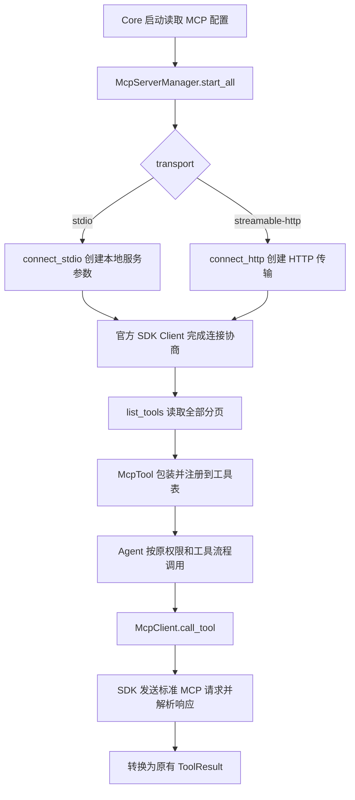

# MCP：从裸 TCP 改为 Streamable HTTP

## 实现了什么

现在支持两种 MCP 标准传输：本地服务使用 `stdio`，远程服务使用 `streamable-http`。

移除了原来的 `connect_tcp(host, port)` 和 MCP 配置中的 host/port。**TUI/CLI 与 Core 之间的 TCP 通信仍然保留**，这次修改的是 Core 访问外部 MCP 服务的链路。

Streamable HTTP 可以返回普通 JSON，也可以返回 SSE 事件流；这不等于旧版“GET /sse＋POST /messages”的 HTTP+SSE 传输。本版没有增加旧 SSE 模式。

## 以前和现在

| 位置 | 以前 | 现在 |
| --- | --- | --- |
| 远程端点 | host、port，裸 TCP 发送 NDJSON | 完整 http(s) URL，标准 Streamable HTTP |
| 协议实现 | 手写请求 ID、读行、初始化和通知 | 官方 Python MCP SDK 2.3.x 所在的 2.x 系列 |
| 版本处理 | 固定请求 2024-11-05 | SDK 自动协商并支持旧版初始化回退 |
| HTTP 响应 | 不支持 | SDK 处理 JSON、SSE、协议头及会话标识 |
| 工具发现 | 读取一页 tools/list | 按 nextCursor 读取全部分页，并防止重复游标循环 |
| 工具错误 | 可能忽略 isError | 明确映射为项目 McpToolError |
| 工具结果 | 拼接文本块 | 继续返回文本；只有 structuredContent 时序列化为 JSON |
| 关闭 | 自己关闭 socket 或子进程 | SDK 清理会话；项目负责生命周期和等待上限 |

没有给业务层引入另一套工具接口，现有工具权限、调用和检查点流程继续使用 McpTool。

## 怎样配置

先执行 `uv sync` 安装新增依赖，然后在项目或全局 `.kama/config.toml` 中配置：

```toml
[[mcp.servers]]
name = "cloudflare_docs"
transport = "streamable-http"
url = "https://docs.mcp.cloudflare.com/mcp"

[[mcp.servers]]
name = "local_tools"
transport = "stdio"
command = "python"
args = ["path/to/server.py"]
```

需要固定鉴权请求头的服务可以配置：

```toml
[[mcp.servers]]
name = "private_tools"
transport = "streamable-http"
url = "https://example.com/mcp"
headers = { Authorization = "Bearer <your-token>" }
```

请求头原样传给 HTTP 客户端，本版不做环境变量占位符替换，也没有交互式 OAuth 登录流程。真实凭证放在自己的本地配置中。

旧的 `transport="tcp"` 不能只改名字：服务端也必须提供标准 Streamable HTTP 端点。重启 Core 后读取新配置并发现工具。远程工具仍使用 `服务名__工具名`，例如 `cloudflare_docs__search_cloudflare_documentation`。

## 代码怎么走



推荐阅读顺序：

1. [配置模型](../src/kama_claude/core/config/models.py)与 [MCP 小节解析](../src/kama_claude/core/config/toml.py)：删除 host/port，增加 url/headers；S10 将原 config.py 拆为配置包，导入入口保持不变。
2. [管理器](../src/kama_claude/core/mcp/server.py)：连接、工具发现、缓存、注册和关闭；发现失败会关闭已经建立的连接。
3. [客户端](../src/kama_claude/core/mcp/client.py)：两种连接入口、会话生命周期、分页和结果转换。
4. [工具包装](../src/kama_claude/core/mcp/tool.py)：保持原 BaseTool 接口，区分确定错误与连接异常。

### 为什么客户端还有一个后台 Task

官方 SDK 的上下文管理器内部使用 AnyIO 任务组，进入和退出必须在同一个任务中完成。Core 启动、Agent 工具调用、Core 关闭却可能来自不同 asyncio Task。

所以 `_connect()` 创建一个会话所有者任务 `_run()`：它进入 SDK 上下文，连接成功后通知调用方；之后等待关闭信号，最后在同一个任务中退出上下文。工具请求直接使用 SDK 的并发分发能力，没有另外建立请求队列或 JSON-RPC 分发器。

`close()` 先发送关闭信号，等待最多 5 秒；仍未结束时取消所有者任务，再给最多 5 秒清理时间。重复关闭可以直接返回。

### 错误与恢复怎么衔接

- 工具明确返回 `isError=true`，或返回普通 MCP 协议错误：转换为确定的工具错误。
- 连接关闭、请求超时或其他传输故障：转换为 McpServerUnavailableError。远程操作可能已经发生，工具包装保留 outcome_unknown，交给已有检查点与人工确认流程。
- 取消请求仍向上传播，不把取消当成正常工具结果，也不自动重放工具调用。

## 真实服务验证

本轮使用官方 Python SDK **2.3.0**，在 Windows / Python 3.12 下验证。

### 公网现有服务

端点：`https://docs.mcp.cloudflare.com/mcp`，来自 [Cloudflare 官方连接说明](https://developers.cloudflare.com/agents/model-context-protocol/guides/connect-mcp-client/)。

实际结果：

```text
协商协议：2026-07-28
发现工具：search_cloudflare_documentation
          migrate_pages_to_workers_guide
调用工具：search_cloudflare_documentation
查询内容：What is Cloudflare Workers?
返回正文：31018 字符
连接关闭：成功
```

可复现命令：

```text
uv run python -X utf8 scripts/check_mcp.py
```

本机原代理链路无法完成请求，实测使用下面的直连选项成功：

```text
uv run python -X utf8 scripts/check_mcp.py --direct
```

`--direct` 只临时移除当前检查进程的代理环境变量；不会修改系统代理或项目默认连接行为。业务客户端仍遵循现有代理环境。结果长度和工具列表可能随远端服务更新变化，不能当作固定断言。

### 本地真实 SDK 服务

[集成测试服务](../tests/integration/mcp_server.py) 在独立进程运行官方 MCPServer，不是模拟 HTTP 响应。测试分别运行 JSON 与 SSE 两种 Streamable HTTP 返回方式，覆盖：

- 工具发现、并发调用、isError 结果与协议错误。
- 初始化、调用及关闭携带鉴权请求头；401 后清理并重连。
- 取消单次慢工具调用后继续使用会话。
- 不同 asyncio Task 连接、调用和关闭。
- Manager 发现并包装真实远程工具，关闭后清空失效工具。
- stdio 原有调用与子进程清理。

```text
uv run pytest tests/unit/test_mcp_client.py tests/unit/test_mcp_tool.py tests/integration/test_mcp_streamable_http.py -q
```

本轮完整相关回归共 **511 项通过**，其中 MCP 专项 32 项；改动文件 Ruff、mypy 和协议检查通过。公网实测是一次真实连接与工具调用验证，不等于服务可用性或兼容性的长期保证。上述验证均未调用付费模型。

参考：[官方客户端传输说明](https://github.com/modelcontextprotocol/python-sdk/blob/v2.3.0/docs/client/transports.md)、[Streamable HTTP 规范](https://modelcontextprotocol.io/specification/2025-11-25/basic/transports)。
