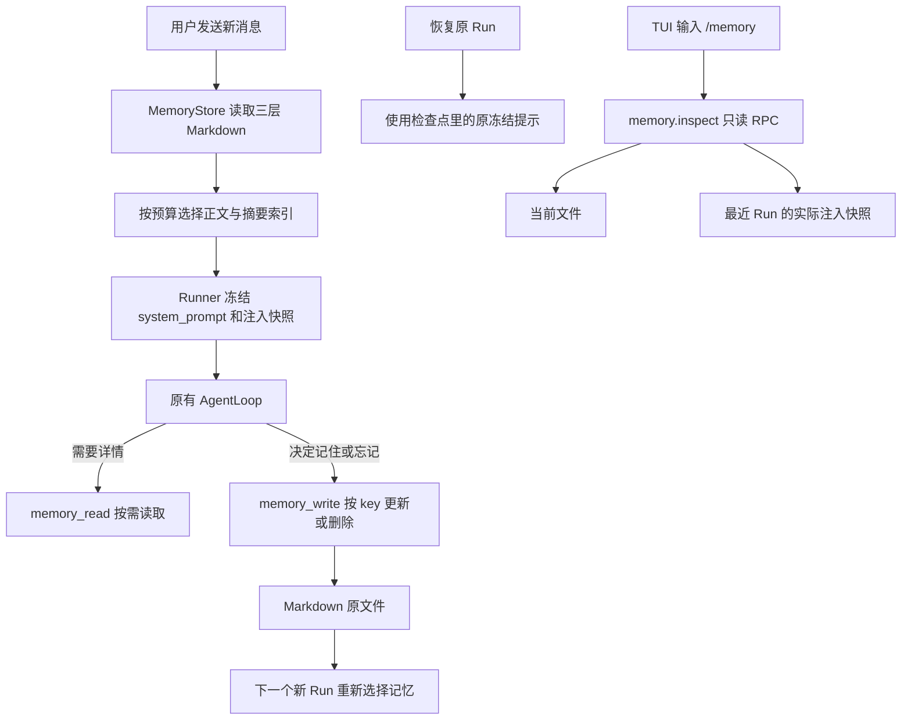

# S9：Markdown 记忆与上下文注入

## 1. 这一版能做什么

Agent 可以把值得长期保留的信息存成 Markdown，下次新任务自动看到其中一小部分，需要详情时再读取。用户可以在 TUI 输入 `/memory` 查看文件和最近 Run 真正使用的记忆。

支持三层作用域：

| 作用域 | 用途 | 保存目录 |
| --- | --- | --- |
| global | 跨项目的用户偏好，例如“解释代码时使用中文” | `~/.kama/memory/` |
| project | 项目事实、约定与经验，例如“测试使用 pytest” | Core 工作目录下的 `.kama/memory/` |
| session | 当前会话的临时决定和任务约束 | 会话目录下的 `memory/` |

每条记忆一个 `<key>.md` 文件。更新同一个 key 就替换该条，删除就删除该文件；没有记忆数据库和索引文件，也没有额外的 LLM 提炼请求。

**记忆与聊天记录是两件事。** `thread.jsonl` 保存完整对话；检查点中的 messages 保存模型工作历史；Markdown 记忆保存模型明确选择留下的事实。对话压缩、记忆删除都不会删除 thread。

## 2. 以前怎么做，现在怎么做

| 以前 | 现在 |
| --- | --- |
| 整份读取全局、项目 context.md 和会话 notes.md | 只读取新 memory 目录中的 Markdown 条目 |
| note_save 只能往当前会话追加 | memory_write 可以按 scope/key 新增、更新和删除 |
| 重复或过时内容一直追加 | 相同 key 更新；完全相同的条目不重写 |
| 三层文字直接全部注入 | 每层独立预算，正文放不下就用摘要，再不足则省略 |
| 没有直接查看实际注入的入口 | /memory 分开显示当前文件和冻结快照 |

旧 note_save、loader、笔记读写入口和 Context 的三套旧字段已经删除。旧 context.md、notes.md 不删除、不迁移，也不再自动读取或追加。需要保留的旧内容请整理成下面的新模板。

旧 Run 如果冻结的工具清单仍包含已删除工具，恢复会明确报缺失。可以查看完整历史并终止原 Run，再开始新任务；没有工具别名或兼容包装。

## 3. 一张图看清链路



运行中写入记忆后，模型可以从本轮工具调用及结果知道写入是否成功。**不会重新拼接当前 Run 的 system prompt。** 下一次新 Run 才会自动注入最新文件；当前任务需要重新核实时，也可以调用 memory_read。

## 4. 文件模板与保存方式

例如项目记忆 `.kama/memory/python_version.md`：

```markdown
# python_version

- 摘要：项目使用 Python 3.12
- 固定：否
- 更新时间：2026-11-04T10:00:00+00:00
- 来源：session_id / run_id

---

项目使用 Python 3.12，依赖通过 uv 管理。
```

文件名是 key，标题必须与文件名一致。key 长度为 1–64，以字母或数字开头，后续可使用字母、数字、点、下划线和短横线；不接受路径、Windows 保留名称和条目软链接。

头部使用固定顺序；摘要是单行文字，“固定”只能是“是”或“否”，时间必须带时区。第一条头部分隔线之后全部是正文，正文中的标题、代码块和其他分隔线不会被当成元数据。

[MemoryStore](../src/kama_claude/core/memory/store.py) 负责文件操作：

| 方法 | 职责 |
| --- | --- |
| get | 读取并校验一个固定模板 |
| scan | 收集有效条目和损坏警告，完成固定、时间、key 排序 |
| list | 返回简短索引，可做不区分大小写的关键词子串匹配和分页 |
| read | 按字符位置读取最多 4,000 字符，返回 next_offset |
| upsert | 同 key 新增或更新，内容相同时不修改时间和来源 |
| delete | 删除前校验格式，重复删除返回 already_absent |

更新先写同目录临时文件，再 flush/fsync，最后原子替换。失败时保留旧文件并清理临时文件。损坏文件不会被工具自动覆盖或删除：指定读取返回错误，列表和注入快照中记录警告，其他有效条目仍可使用。

“固定”表示优先被选中，不代表无限预算。很长的固定正文仍可能只注入摘要。

## 5. 模型怎样维护记忆

[两个工具](../src/kama_claude/core/tools/builtin/memory.py) 共用同一个 MemoryStore，不直接处理任意文件路径。

保存或修改：

```python
memory_write(
    scope="project", key="python_version",
    summary="项目使用 Python 3.12",
    content="项目使用 Python 3.12，依赖通过 uv 管理。",
    pinned=True,
)
```

列索引、查找与读取：

```python
memory_read(scope="project")
memory_read(scope="project", query="pytest")
memory_read(scope="project", key="python_version")
# 正文超过一段时，使用上次返回的 next_offset
memory_read(scope="project", key="large_document", offset=4000)
```

删除：

```python
memory_write(scope="project", key="python_version", action="delete")
```

默认 scope 为 project。新写入的摘要最多 160 字符、正文最多 4,000 字符；手工编辑的更长合法正文仍可分段读取。列表默认 20 条、最多 50 条；列表 offset 是条目位置，指定 key 时 offset 是正文字符位置。

会话和项目写入默认允许；全局写入默认需要审批。全局授权单独缓存，允许项目记忆不会顺便允许全局写入。用户明确选择全局 always_allow 后，可以按现有权限机制跨会话复用。

自然语言用法例如：“记住这个项目使用 Python 3.12”“把项目的 Python 版本改成 3.13”“忘掉 python_version”。模型会决定是否调用工具；只有工具返回保存成功才表示已经落盘，不能把一句“我记住了”当作保存证明。

## 6. 自动注入怎样控制大小

[build_memory_context](../src/kama_claude/core/memory/context.py) 在新 Run 创建时运行一次：

```python
for scope in 三层作用域:
    entries = 固定优先，再按更新时间从新到旧，最后按key排序
    for entry in entries:
        if 加入全文后仍在预算内:
            注入全文
        elif 加入摘要后仍在预算内:
            注入key和摘要
        else:
            记录省略数量
```

标题、key、正文、摘要和省略提示都参与估算。会预留省略提示的位置，不会先填满正文再让提示突破预算。预算太小连标题都放不下时，这一层不注入，省略数量仍保存在清单中。

默认配置：

```toml
[memory]
global_tokens = 512
project_tokens = 1024
session_tokens = 512
```

环境变量分别是 `KAMA_MEMORY_GLOBAL_TOKENS`、`KAMA_MEMORY_PROJECT_TOKENS`、`KAMA_MEMORY_SESSION_TOKENS`。0 表示不自动注入该层，工具仍可读取。

这些都是使用现有 S9 方法计算的估算值，不是 API 实测 token。三层预算针对记忆片段；始终存在的工具使用指引属于基础提示。完整 system、消息、工具 Schema 仍由 S9 请求前预算统一检查。

没有记忆时也提供新工具指引，避免首次使用时模型不知道该如何保存。程序不自动判断事实是否过时、不做语义去重；更正时由模型复用同一个 key。

## 7. 为什么恢复不会读到另一份记忆

[Runner._create_context](../src/kama_claude/core/runner.py) 只在 system_prompt 还没有冻结时读取 Markdown、构建快照。正式调度和中断恢复看见已有 system_prompt 后，完全跳过记忆读取。

Run 的可选 memory_snapshot 保存当时注入的文本、各层预算、全文/摘要 key、实际估算量、省略数及警告。它位于已有检查点中，仅用于复现和查看，不作为记忆数据库；检查点仍为版本 1。

即使之后修改、删除或损坏记忆文件，原 Run 也使用原冻结提示。新 Run 才读取新版本。这也是 /memory 必须区分两份内容的原因。

记忆工具仍遵守 S8：已提交 completed 的工具不重跑；写入后突然退出、工具结果没有提交时，按结果未知的规则等待核实。按 key 的幂等操作能减少重复写入，但不绕过未知结果确认。

## 8. /memory 为什么不消耗一次模型请求

```text
TUI 拦截 /memory
→ memory.inspect(session_id)
→ SessionManager.inspect_memory
→ 读取当前 Markdown 索引和已有检查点快照
→ MemoryScreen 只读展示
```

查看入口不会调用 Runner，不创建 Run、不追加 thread、不提交检查点，也不迁移旧文件。指定 key 后才取正文，避免列表提前加载所有正文到界面。

界面支持切换作用域、索引上一页/下一页、正文下一段；另一个标签页展示最近 Run 实际注入的快照。Escape 返回对话，不关闭会话或 TCP 连接。当前版本空闲时可在输入框使用 /memory。

旧检查点没有独立注入清单时，窗口明确说明，不根据当前文件伪造旧输入。当前项目目录显示在窗口顶部，项目记忆始终相对于 Core 工作目录。

## 9. 建议阅读顺序和边界

1. [MemoryStore](../src/kama_claude/core/memory/store.py)：先看 upsert/get，再看 scan/read。
2. [记忆工具](../src/kama_claude/core/tools/builtin/memory.py)：看参数如何交给 Store。
3. [注入构建](../src/kama_claude/core/memory/context.py)：看预算如何决定全文、摘要和省略。
4. [Runner](../src/kama_claude/core/runner.py)：看 _create_context 的冻结判断。
5. [会话管理](../src/kama_claude/core/session/manager.py)：看 inspect_memory 只读入口。
6. [TUI 记忆窗口](../src/kama_claude/tui/memory.py)：最后看展示和分页。

本版面向单个 Core；没有向量搜索、后台整理、自动遗忘、跨进程并发写入或子 Agent 记忆维护。需要详情时可能增加主任务的工具往返，不承诺一定降低总账单。

借鉴 [OpenCode 的按需读取](https://opencode.ai/docs/rules/) 与 [OpenClaw 的精简常驻记忆](https://docs.openclaw.ai/concepts/memory)。这里用固定 Markdown 模板、简单扫描和现有检查点实现，没有引入其框架或复制整套实现。

本次共 443 项非付费测试通过，mypy、协议一致性与改动文件 Ruff 通过。验证使用假模型和临时目录，覆盖文件保护、注入预算、真实运行及恢复、权限隔离、TUI 和真实进程/TCP 重启；这些验证不代表真实模型一定能正确判断每条记忆是否值得保存。
