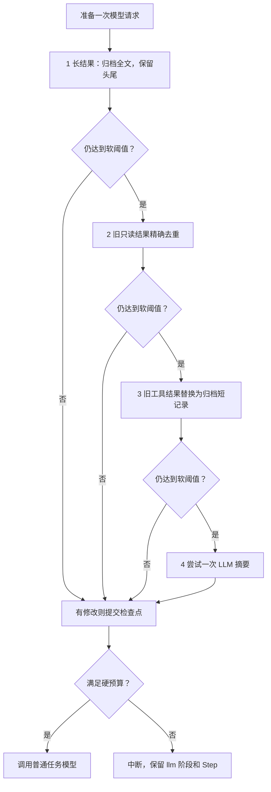

# S9：先程序处理，再调用 LLM 的分层压缩

**目标：尽量通过程序整理上下文，只有仍然达到软阈值时，才额外请求模型生成历史摘要。**

这是当前 S9 第一版的后续改进，执行主线仍为 SessionManager → Runner → Loop。没有增加一套新的 Run 状态。本篇讲压缩；本阶段新增的记忆系统另见 [Markdown 记忆与注入](./S9-Markdown记忆与注入.md)。

## 1. 先理解上下文是什么

| 部分 | 内容 |
| --- | --- |
| system | 本轮冻结的基础 / Skill 提示与已注入记忆 |
| tool_schemas | 当前可用工具的定义 |
| messages | 模型工作历史，包括真实用户输入、assistant 回复和工具调用 / 结果 |
| 检查点 | 已提交的模型工作 messages、同一个 Run 和会话元数据 |
| thread.jsonl | 完整对话原文，供前端查看；始终追加，不参与压缩 |

上下文处理改的是模型将阅读的工作历史，不会重新执行历史工具。所有程序层只替换旧工具结果的正文，保留调用和结果的 ID、参数、错误标记及配对关系。

工具返回后，完整结果先进入 messages，并和工具状态、待追加原文一起提交，再写入 thread.jsonl。到了下一次模型请求前，才准备较短的模型输入；这个较短的版本只更新检查点，原文仍在 thread 中。

## 2. S8、S9 第一版、当前实现有什么不同

| 版本 | 主要行为 |
| --- | --- |
| S8 | 工具批次结束后，参考上一次 API 占比决定是否总结；全部历史变成摘要 |
| S9 第一版 | 请求前计算完整输入；长工具结果先归档预览；旧历史摘要与近期原文分开 |
| 当前 S9 | 在预览与摘要之间增加精确去重、旧结果归档；各层结束后重算预算，空间够就停止 |



图中的“空间够”表示低于软阈值，并非一定降到了程序处理的目标比例。程序层会尽量留出余量，但不能为了目标而删除受保护内容。

## 3. 按这个顺序看代码

1. [Loop._call_model](../src/kama_claude/core/loop.py#L102)：普通模型调用前先准备上下文。
2. [Loop._prepare_model_context](../src/kama_claude/core/loop.py#L145)：取得候选、提交、通知、硬预算检查。
3. [Compactor.prepare_context](../src/kama_claude/core/compact/compactor.py#L152)：四层顺序和每层后的预算判断，这是本轮主入口。
4. [程序处理模块](../src/kama_claude/core/compact/pruning.py)：看 `deduplicate_results` 与 `prune_results`。
5. [预算与归档模块](../src/kama_claude/core/compact/budget.py)：估算、原子归档、旧预览与新短记录的全文读取。
6. [Compactor.compact_messages](../src/kama_claude/core/compact/compactor.py#L251)：最后才会进入的 LLM 摘要。
7. [SessionManager.compact](../src/kama_claude/core/session/manager.py#L346)：手动入口复用同一管线。
8. [RunPersistence.save](../src/kama_claude/core/checkpoint/persistence.py#L28)：权威状态仍从原入口提交。

Compactor 只产生临时候选，不修改传入 Context、不写检查点、不发送成功通知。`provider_factory` 只用于延迟取得模型实例，不负责保存或推动执行状态。

## 4. 第一层：长结果预览

每次模型请求前执行，不依赖自动压力开关。

单个结果超过默认 8,000 字符时，先归档全文，再用下面的内容作为工具正文：

```text
开头 2,000 字符
[kama: tool output truncated; full output: 全文路径; N chars omitted]
结尾 2,000 字符
```

这是字符限制，不是 token 数。

归档文件名由工具调用 ID 与完整内容生成哈希，保存采用“同目录临时文件 → flush/fsync → 原子替换”。已有全文不覆盖。

识别旧预览时会校验真实全文、哈希和头尾，避免把文档中的标记示例误当成已处理输出。新归档短记录也能被识别，不会被再次裁剪成伪全文。

整理后对 system、messages 和工具定义一起估算。低于软阈值就结束，不会为了生成摘要再调用模型。

## 5. 第二层：完全相同的旧只读结果去重

只有第一层结束后仍达到软阈值，才进入本层。

允许去重的工具为 `read_file`、`list_dir`、`task_get`、`task_list`。必须满足：

- 工具名相同。
- 参数 JSON 按键排序后相同，数组等内容仍保持原顺序。
- 完整输出相同。
- 没有错误标记。

工具执行过两次，不等于输出一定相同。相同文件可能已修改，相同头尾的两个长输出，中间也可能不同。所以已有预览会先读归档全文，再比较完整内容哈希。

保留最新一份内容，旧重复结果改成短记录。记录包含工具名、调用 ID、自己的全文路径和重复来源提示：

```text
[kama: archived tool result] {"tool":"read_file","call":"旧调用ID","path":"全文路径","duplicate_of":"较新调用ID"}
```

这仍然只是 `tool_result.content` 内的一段字符串，没有增加 Provider 不认识的消息字段。

即使较新的结果以后也被处理，旧结果自己的全文路径仍可读取，不会形成只能依赖另一条消息的引用链。

**去重不缓存工具执行。** 模型再次要求 read_file 时，工具仍会重新读取；这里缩减的是已经执行完毕的历史正文。

## 6. 第三层：旧结果归档短记录

第二层结束后仍达到软阈值，就从最旧的可处理结果开始，进一步把正文替换为归档短记录。

本层不要求内容重复，旧命令输出、旧文件内容都可能被处理。原始正文必须先归档；短记录没有节省 token 就不替换。

程序层保留：

- 所有真实用户消息与 assistant 内容，包括模型文字、thinking 与签名。
- 所有 tool_use 名称、参数、ID，以及对应 tool_result 外壳。
- 最近两组完整模型交互，组数可配置；程序层不因压力而主动降低保护组数。
- 错误结果，不再参与第二、三层缩减；第一层已有的长错误输出预览规则仍有效。

未完成工具批次不会进入第二、三、四层。结果 unknown 仍走 S8 的人工确认链路，不靠压缩伪造成完成。

短记录可经现有 read_file 或经权限检查的 run_cmd 读取全文。它是当时的工具输出，不自动代表当前文件状态。

## 7. 第四层：最后才请求 LLM 摘要

只有程序层结束后仍达到软阈值，才使用现有 `compact_messages()`。

它保留最新用户请求原文和近期完整交互，把其余旧历史总结为六部分：目标、已完成事项、约束与发现、文件状态、剩余任务、关键数据。

程序层不删用户和 assistant 文字；到了 LLM 后备阶段，旧文字仍可由模型总结。两者的处理范围不同。

摘要生成前先检查：

- 消息中的工具调用 / 结果配对。
- 是否存在真正可总结的旧历史。
- 固定提示与必留近期内容是否已经超预算。
- 摘要请求本身能否放进模型窗口。

无法满足时直接返回原因，不发起无效摘要请求。只有真正尝试 chat 时 `llm_used` 才为 true；创建 Provider 或准备参数不算模型调用。

摘要仍需完整结束、非空、不超过上限，候选整体至少缩小 10%，且工具配对与硬预算合法。否则不接受新摘要。

此前的程序缩减不会因为摘要失败而丢掉。再次摘要会更新旧摘要，不会叠加一长串摘要消息。

## 8. 阈值和开关

默认配置见 [README](../README.md#默认配置)。

```text
硬输入预算 = 65,536 - 8,192 - 1,024 = 56,320
软阈值     = 硬输入预算 × 0.8  = 45,056
程序目标   = 硬输入预算 × 0.65 = 36,608
```

进入第二或第三层后会尽量整理到程序目标，减少下一次请求马上又触发的情况。但是某层结束后只要已低于软阈值，就不再进入下一层。

例如：一层处理后占用 72%，虽然没有达到 65%，也不再进入下一层或调用摘要。

`prune_target_ratio` 可通过 TOML 或 `KAMA_COMPACT_PRUNE_TARGET` 配置，必须低于有效软阈值。

`auto_threshold=0` 时，自动请求只做第一层与硬预算检查；手动 /compact 仍按 80% 阈值使用完整管线。空间足够时返回“无需继续压缩，未调用 LLM”，不强制生成摘要，也不要求初始化模型 SDK。

程序层保护两组；LLM 后备继续沿用近期原文约 8,192 估算 token 的额度，必要时减少为一组，仍不能拆开工具批次。

估算采用 JSON 内容的 ASCII 约四字符一个 token、非 ASCII 每字符一个 token，并加入结构开销。缓存内容同样计入窗口；所有占用数字都是估算，不等于实际计费。

## 9. 两个例子

### 例子 A：程序处理已经足够

```text
模型多次读取相同文件
→ 第一层将长结果归档预览
→ 当前仍有压力
→ 第二层确认名称、参数和完整内容完全相同
→ 旧重复正文变成归档短记录
→ 重新估算，已低于软阈值
→ 保存检查点
→ 不调用摘要模型，继续普通任务
```

界面显示“程序整理完成（未调用 LLM）”及实际阶段。

### 例子 B：最后仍需要摘要

```text
历史中积累了大量用户讨论和 assistant 分析结论
→ 第一层处理长工具输出
→ 第二层去重，第三层归档旧结果
→ 用户和 assistant 文字仍然很多，整体仍达软阈值
→ 调用一次摘要模型
→ 摘要通过校验后，与近期原文组成新历史
→ 保存检查点
→ 调用普通任务模型
```

界面显示“已生成 LLM 摘要”。摘要调用不增加原 Run 的 Step。

## 10. 保存、失败与恢复

### 先分清两份数据

| 文件 | 谁读取 | 能否压缩 |
| --- | --- | --- |
| `checkpoint.json` 的 messages | 模型下一次请求、S8 断点恢复 | 能：保存当前工作上下文 |
| `thread.jsonl` | TUI 打开 / 重连会话、历史查询 | 不能：保留完整对话原文 |

例如工具返回了 12,000 字符，thread 中仍是全部 12,000 字符；检查点中可以只保留头尾预览或归档短记录。旧对话生成摘要后，thread 中的原始问答仍在，摘要和程序生成的确认消息不写入 thread。

### 原始消息如何保存

用户输入在 `AgentRunner.prepare_checkpoint()` 接受目标时登记；模型完整回复在 `AgentLoop._record_response()` 登记；每个工具有确定结果时，在 `AgentLoop._run_tools()` 登记。多工具结果逐个追加，成功和明确失败都保留；未知结果仍按 S8 规则等待核实。用户终止中断 Run 时，配对的中断说明也会追加。

登记调用 `RunPersistence.record_message()`，深拷贝原文并生成固定 ID。下一次 `save()` 按以下顺序处理：

```text
本次新原文 → checkpoint.history_pending
    → SessionStore.save_checkpoint：先原子提交检查点
    → flush_history：按 ID 追加缺少的 thread 行，flush/fsync
    → 保存成功后，执行下一步或通知前端
```

`history_pending` 只是待追加的少量原文，不是第二份完整对话或执行状态。追加成功后清空内存列表，下次保存时自然清空磁盘字段。若 Core 在两次写入之间退出，`ensure_checkpoint()` 会先补写；若原文已经写入，同一 ID 会跳过，不产生重复。追加失败按检查点错误停止推进；已提交工具仍是 completed，恢复不会重执行它。

### 压缩和打开会话分别怎么走

分层处理先在独立候选列表上进行。工具输出归档属于候选所需的辅助文件，工作上下文只有保存成功后才变化。

```text
自动压缩：候选 → context.messages → RunPersistence.save → 通知
手动压缩：候选 → SessionStore.write_compacted → 通知
                           ↓
                  只替换 checkpoint.messages
                  不重写、裁剪或备份替换 thread

打开会话：session.open
    → ensure_checkpoint 补齐待追加原文、检查恢复状态
    → 从 thread 读取完整历史，从 checkpoint 读取 Run / 修订号
    → TUI._render_history 显示原始问答和工具结果

继续执行：session.resume → Runner → 使用 checkpoint.messages 请求模型
```

可以按 [原文登记与保存](../src/kama_claude/core/checkpoint/persistence.py) →
[thread 追加和读取](../src/kama_claude/core/session/store.py) →
[会话打开](../src/kama_claude/core/session/manager.py) 的顺序阅读。压缩不通过历史长度或 prefill_len 推算新增消息；只记录本次真实产生的消息。

已有旧 thread 原样保留。旧版本若已经覆盖掉某些原文，本次修改不能从摘要凭空还原；这部分只能从仍存在的旧备份中恢复。已初始化会话的 thread 遗失或完整行损坏会报错，禁止把压缩上下文伪装成完整历史。

结果中新增 `applied_stages` 和 `llm_used`。阶段名为 `tool_preview`、`deduplicate`、`tool_archive`、`llm_summary`。日志记录进入阶段前后的完整请求估算量。

| 情况 | 后续行为 |
| --- | --- |
| 程序处理已足够 | 保存后继续，摘要调用为零 |
| 没有需要处理的内容 | 不改检查点，说明空间足够 |
| 程序缩减成功，摘要失败 | 提交程序结果；硬预算内继续，超限则中断 |
| 归档失败 | 不提交本次候选，不请求后续模型 |
| 检查点失败 | 直接传播，不继续模型请求，不发布成功 |
| 用户取消 | 沿原取消链路传播，保留 S8 规则 |

摘要失败时，TUI 会区分“工作历史未替换”和“程序化缩减已保存，未采用新摘要”，不会一律误称原历史完全没动。所有进度继续按会话隔离。

检查点格式版本仍为 1。新短记录只在正文中表达；不改变 Run ID、Step、工具游标和冻结提示。Core 重启后读取的仍是已提交工作历史，completed 工具不会被重跑。

## 11. 开源实现借鉴

- [OpenHands PipelineCondenser](https://github.com/OpenHands/software-agent-sdk/blob/main/openhands-sdk/openhands/sdk/context/condenser/pipeline_condenser.py)：借鉴顺序处理的组织方式，这里使用普通函数，不引入它的类体系。
- [OpenCode v1.18.27 prune](https://github.com/anomalyco/opencode/blob/v1.18.27/packages/opencode/src/session/compaction.ts)：借鉴旧工具结果缩减与摘要分离。这里引用的是明确版本，不宣称最新主分支仍有相同目录与参数。
- [Roo Code](https://github.com/RooCodeInc/Roo-Code/blob/main/src/core/context-management/index.ts)：借鉴保留可恢复记录的思路。原实现主要先摘要再回退滑窗，这里没有照搬其顺序。

程序裁剪会改变模型输入，可能影响提示缓存；归档后也可能需要重新读取。因此新压力层只在达到阈值时执行。[OpenHands 对缓存取舍的说明](https://github.com/OpenHands/software-agent-sdk/blob/main/openhands-sdk/openhands/sdk/context/condenser/README.md)

## 12. 假模型对比与验证

同一组输入：26 份已经归档为头尾预览的相同 read_file 结果。比较“原 S9 达阈值直接摘要”与“新增分层处理”。

| 指标 | 原 S9 摘要入口 | 分层入口 |
| --- | ---: | ---: |
| 摘要请求次数 | 1 | 0 |
| 处理前工作历史估算 | 29,636 | 29,636 |
| 处理后工作历史估算 | 2,346 | 18,823 |
| 已验证归档全文读取次数 | 0 | 13 |

分层入口的去重阶段，完整请求估算从 30,085 降到 19,272，低于测试配置的软阈值。上表工作历史量与这里完整请求量统计范围不同，不能混用。

数据来自假模型和临时目录，不含共同准备输入时的归档开销；路径长度会让估算略有变化。可单独运行：

```text
uv run python -X utf8 -m pytest tests/unit/test_layered_compaction.py::test_comparison_reports_calls_tokens_and_archive_reads -q -s
```

这个对比证明给定场景能减少摘要调用，不证明实际账单一定下降。程序处理后的历史比 LLM 摘要长，后续普通请求、缓存和重新读取都需要真实任务评估。

测试覆盖每层独立解决压力、精确去重的反例、近期与错误保护、归档幂等、保存失败、摘要失败后保留程序结果，以及真实 TCP/Core 重启后继续使用归档短记录。

完整非付费测试集 **399 项通过**；mypy（91 个源码文件）、协议一致性与改动文件 Ruff 通过。全仓仍有 7 条既有 Ruff 问题，本轮未扩展修改相关 MCP、Skill 或旧测试文件。

完整命令见 README。本轮不增加旧完整对话删除、语义去重、长期记忆改造或子 Agent 自动压缩。
