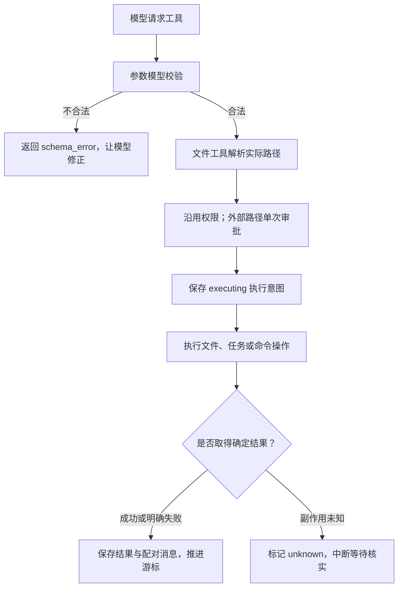

# S9：内置工具校验与代码工具链

## 1. 先理解现在能做什么

这一轮把内置工具补成了一条较完整的代码修改链：**找文件 → 搜索内容 → 按行读取 → 局部修改 → 执行验证**。主 Agent 和子 Agent 都能按授权范围使用，继续沿用原有 Loop、检查点和审批，不增加新的运行状态。

当前默认主工具集合共 15 项：文件与命令 7 项、任务 4 项、记忆 2 项、子 Agent 2 项；MCP 工具由服务额外注册。

| 工具 | 主要职责 |
| --- | --- |
| `find_files` | 用文件名或 glob 定位文件 |
| `search_text` | 查找关键词或正则，返回文件和行号 |
| `read_file` | 按行分页读取，返回下一页位置 |
| `edit_file` | 唯一匹配旧片段后局部替换，返回 diff |
| `write_file` | 创建文件或明确整文件覆盖 |
| `list_dir` | 快速看目录结构，默认过滤生成内容 |
| `bash` | 使用实际系统 shell 运行非交互命令与测试 |

## 2. 原来怎样，现在怎样

原来任务工具只手写 `input_schema`，没有统一的执行前参数模型。例如 `task_update(task_id="abc")` 会进入工具后才在 `int()` 转换时报错，可能被当成修改类工具的未知异常。

现在所有内置工具都使用 `ToolParams`，默认严格类型且拒绝未知字段。每个工具的 `input_schema` 直接由同一份参数模型生成，数值边界、必填字段和实际校验保持一致。

任务列表仍按 Run 隔离，不会自动跨 Run 或与子 Agent 共享；任务 JSON 明确使用 UTF-8 读写，避免依赖 Windows 默认编码。



参数错误不会创建待审批 Future，也不会保存 executing 意图。工具已经执行后发生的任意 ValueError、PermissionError 等异常，不能仅凭异常名称判断“没有修改过”；缺少明确信息时继续保守记录未知。

## 3. 错误类型为什么分开

| 类型 | 含义与典型处理 |
| --- | --- |
| `schema_error` | 参数缺失、类型错误、越界或未声明字段；修正参数后重新调用 |
| `not_found` | 文件、任务或记忆条目不存在；重新定位正确资源 |
| `invalid_operation` | 二进制读取、文本编码不支持、操作对象类型错误等明确业务失败 |
| `conflict` | 旧片段不唯一、不匹配，或提交前原文变化；重新读取后再编辑 |
| `permission_denied` | 路径或权限拒绝；不绕过、不重试 |
| `resource_limit` | 写入字节、编辑文件大小等超过上限；缩小操作范围 |
| `command_failed` | 命令执行结束但退出码非零；结果明确，可能已有部分副作用 |
| `runtime_error` / `timeout` | 运行异常或超时；按工具是否安全重试及副作用确定性处理 |

错误类型和 `outcome_unknown` 是两个维度。明确失败不等于完全没有执行，例如命令退出码非零仍可能改过文件。修改类操作在结果丢失时保留 unknown；不因为新增分类就自动重跑。

只读工具遇到不存在、权限、类型错误不会无意义地重复调用；原有临时运行错误和限流的受控重试保持。

## 4. 如何定位和阅读代码

```python
find_files(pattern="**/*permission*.py", path="src", limit=50)
search_text(pattern="check_and_wait", path="src", include="**/*.py")
read_file(path="src/example.py", start_line=120, max_lines=80)
```

`find_files` 的模式区分大小写，`**` 可以匹配零层目录，单文件名模式会搜索所有层级。`search_text` 默认 `literal=true`、区分大小写、保留前后各一行；设置 `literal=false` 使用正则，`case_sensitive=false` 忽略大小写，`context_lines` 可设为 0～3。搜索支持目录或单个文件。

搜索返回 JSON，例如：

```json
{
  "root": "C:/project/src",
  "matches": [
    {"path": "example.py", "line": 120, "text": "await check_and_wait(...)", "before": [], "after": []}
  ],
  "truncated": false,
  "reason": ""
}
```

查找与搜索默认最多返回 100 条，可配置至 200 条；输出最多 50 KiB。扫描还有约 5 秒、20,000 个目录条目及 20 MiB 文本读取预算。达到上限会返回部分结果与原因，不能把它理解成完整搜索无匹配。正则每次匹配最多 0.05 秒，避免病态回溯阻塞 Core；不支持跨行正则。二进制、无效 UTF-8、无法读取文件及超长行都有跳过信息。

读取格式为：

```text
File: C:/project/src/example.py
Lines: 120-199
next_start_line: 200
120 | async def handle(...):
121 |     ...
```

`start_line` 从 1 开始，`max_lines` 默认 200、最大 2000，同时受 50 KiB 输出限制。下一次使用返回的 `next_start_line`；末尾或空范围显示 none。单行超过 2000 字符会标记截断，按行分页无法获取同一超长行的后半段，可用受审批的命令工具按字符或字节查看。若触发扫描预算，应缩小范围或改用命令，避免重复请求同一受限范围。

读取采用有界分段方式，排空超长行但不累积整行。只读搜索和分页读取在线程中运行，不占用 Core 的事件循环做整段扫描；普通文件操作仍不是系统级强制 IO 沙箱。

## 5. 如何安全地局部修改

```python
edit_file(
    path="src/config.py",
    old_text="timeout = 30",
    new_text="timeout = 60",
)
```

旧片段必须非空且在文件中恰好出现一次，重叠匹配也视为多处。请不要把 `read_file` 显示的行号复制进 `old_text`。工具不做模糊替换，不支持隐式全部替换；没有匹配或存在歧义时返回 conflict。

编辑先完整读取最多 1 MiB 的 UTF-8 文件，生成新内容，再在最终替换前核对原始字节。若用户或其他程序已改过文件，就返回 conflict，保留对方的新内容。UTF-8 BOM 和一致的 CRLF 换行保持；纯 CRLF 文件仅对输入片段的换行形式做确定性对齐。

`edit_file` 与 `write_file` 共用原子写入：同目录临时文件 → 完整写入 → flush/fsync → 保留原文件权限 → 原子替换。写入内容上限按 UTF-8 字节计算为 1 MiB。局部编辑成功返回最多 200 行的 diff 预览；TUI 审批先展示新旧片段，完成后可展开工具结果查看 diff。

这能避免直接截断旧文件后留下半文件，但不是事务回滚或 exactly-once 保证。若替换已经发生、结果却未保存，仍按原有未知副作用规则处理。

## 6. 目录过滤、工作区和权限

三个遍历工具共用 `DirectoryScanner`，默认过滤 `.git`、`.venv`、`node_modules`、缓存、构建产物和 `runs` 等生成目录，并评估工作区和已遍历目录中的 `.gitignore`。没有读取 Git 索引或全局 ignore 配置；被规则过滤的文件可通过 `include_ignored=true` 查看，直接读取明确文件也不套用目录过滤。

`list_dir` 展示链接项但不递归，查找和搜索跳过链接及 Windows junction。新工具继承 FileTool，继续以 `context.run.workspace` 为根；外部目录或文件需要本次审批，批准一个目录的搜索会覆盖其中的普通后代，但不会跟随链接扩大范围。

`find_files`、`search_text` 在工作区内默认允许，`edit_file` 默认询问。外部请求只允许一次或拒绝一次，旧工具级 always 授权不能跳过。planner、reviewer 仅增加只读搜索；executor 增加编辑能力。内建 review、init Skill 的白名单同步增加适用工具。

`bash` 明确说明实际平台、默认 shell、固定工作区和每次独立进程语义。输出优先解码 UTF-8，Windows 对非 UTF-8 输出回退系统编码；命令超时、取消与进程树清理沿用现有机制。

## 7. 保存与版本边界

文件搜索、分页结果和 diff 仍通过原有工具结果保存机制写入检查点及完整历史；压缩只改变模型工作历史。新工具没有新增 RPC、运行阶段或恢复状态。

本轮升级了工具 Schema 和描述。已有中断 Run 的冻结 Schema 如果不匹配，恢复会明确拒绝；旧完整历史可以打开，用户可以终止旧 Run 再创建新任务。本版不自动改写旧检查点，也不偷偷用新工具行为续跑。

## 8. 阅读顺序

1. [base.py](../src/kama_claude/core/tools/base.py) 与 [invocation.py](../src/kama_claude/core/tools/invocation.py)：校验、权限、错误和执行边界。
2. [任务工具](../src/kama_claude/core/tools/builtin/task_update.py)：参数模型与 Schema 同源的简单例子。
3. [traversal.py](../src/kama_claude/core/tools/traversal.py)：目录过滤、glob 和有界扫描。
4. [find_files.py](../src/kama_claude/core/tools/builtin/find_files.py)、[search_text.py](../src/kama_claude/core/tools/builtin/search_text.py)、[read_file.py](../src/kama_claude/core/tools/builtin/read_file.py)：定位与按需阅读。
5. [edit_file.py](../src/kama_claude/core/tools/builtin/edit_file.py) 与 [files.py](../src/kama_claude/core/tools/files.py)：唯一匹配、并发核对和原子提交。
6. [整链集成测试](../tests/integration/test_code_tools.py)：假模型驱动真实工具完成定位、编辑、进程验证与历史保存。

正则超时采用 [regex 的公开超时接口](https://github.com/mrabarnett/mrab-regex/blob/hg/README.rst#timeout)，ignore 规则使用 pathspec；其余工具协调和文件提交逻辑由本项目实现。验证使用假模型，不调用付费 API，也不将行为测试描述为真实 Issue 修复成功率。

## 9. 本轮验收

修改前基线为 **549 项通过、1 项跳过**；最终全部单元测试及现有非付费进程、TCP、MCP、代码工具链集成测试为 **617 项通过、1 项跳过**。跳过项是当前 Windows 缺少创建文件符号链接权限，目录 junction 测试实际执行通过。

验证覆盖参数错误不审批、不执行、不误报 unknown；文件查找与搜索过滤、正则超时、输出和扫描上限；分页与编码；外部路径逐次审批；唯一匹配、CRLF/BOM、并发修改与原子替换故障；TUI 编辑预览；以及假模型驱动真实文件和命令完成整条修复链。改动文件 Ruff、`mypy src`、协议一致性、独立导入与 `git diff --check` 通过。
