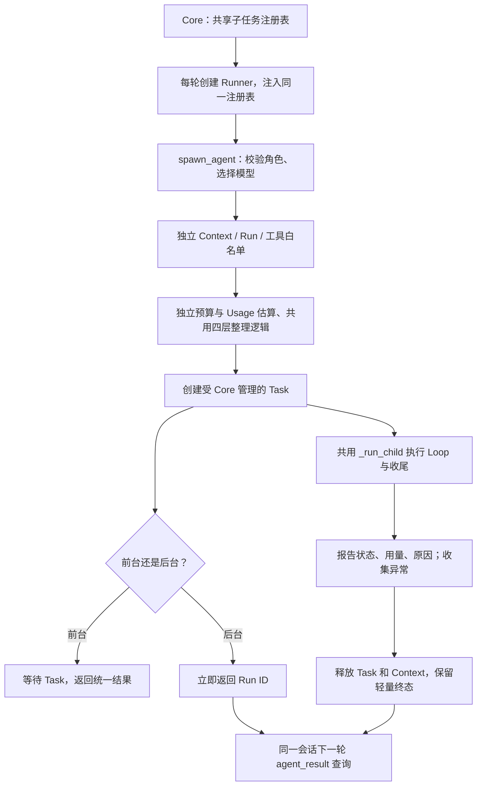

# S9：子 Agent 生命周期与运行保护

## 1. 实现了什么

子 Agent 是 Core 内的另一个异步任务，使用独立对话历史完成一次委派。它与主 Agent 共享工作区和审批管理器，拥有自己的 Run、预算与上下文整理。这里的隔离是上下文隔离，不是操作系统进程隔离。

本次修复四件事：

| 问题 | 原来的行为 | 现在的行为 |
| --- | --- | --- |
| 后台任务归属 | 每个 Runner 新建注册表，新一轮可能找不到旧任务 | Core 持有共享表，各 Runner 注入同一实例；查询按会话隔离 |
| 执行结果 | Task 没抛异常就可能报告成功，遗漏 Run 的 failed 状态 | 前后台统一按 Run 业务状态转换结果，取消和异常也发送终态 |
| 角色约束 | 角色加载失败返回 None，可能退回默认全工具 | 指定角色失败直接拒绝；显式空白名单不提供任何工具 |
| 运行保护 | 子任务只有 Step 上限，未接入主任务的受管请求与压缩 | 复用 RunBudget、ManagedProvider、TokenEstimator、Compactor |

## 2. 一次委派如何执行



主调用链仍是 `SessionManager → AgentRunner → AgentLoop`。主 Loop 把 `spawn_agent` 当作普通工具；子任务继续使用同一个 AgentLoop 类，没有另一套模型与工具执行逻辑。

## 3. 注册表为什么由 Core 持有

Runner 负责本轮运行，下一条用户消息会创建新的 Runner。过去把表放在 Runner 里，相当于每轮换一本账，旧后台任务还在运行，但新账中没有它。

现在 Core 创建唯一的 `BackgroundTaskRegistry`，同时交给 Runner 工厂和 SessionManager：

```python
registry = BackgroundTaskRegistry()

# 每轮 Runner 不同，registry 相同
runner_factory = lambda: AgentRunner(..., task_registry=registry)
SessionManager(..., task_registry=registry)
```

活跃记录包含 Task、Context、所属会话和父 Run。终态记录只包含结果文本、状态、原因和用量，**不再持有模型消息历史**。默认最多保留最近 100 条已完成结果，超过容量移除最旧的一条；活跃任务不会因为这个容量被移除。

`agent_result` 使用工具构造时绑定的会话 ID 查表，模型不能通过输入另一个会话 ID 越权查询。已过期或不属于本会话的 ID 都返回 Unknown。

关闭行为：

- 退出 TUI、TCP 临时断开：不取消会话或子任务。
- 主动关闭空闲会话：取消并等待该会话的全部子任务。
- one_shot 会话自动关闭：清理尚未完成的子任务，因此主 Agent 应在结束前收集需要的结果。
- Core 正常退出：先取消主运行，再清理全部子任务，等待命令工具已有的取消清理逻辑。

## 4. 结束、失败和取消如何区分

前后台统一经过 `SpawnAgentTool._run_child()`：打开事件文件、运行 Loop、处理异常与取消、在 finally 中发布 `subagent.finished`。

`SubagentResult.as_tool_result()` 只在业务状态为 success 且不存在未知副作用时返回成功：

| 场景 | 工具反馈 |
| --- | --- |
| 仍在运行 | `still running` |
| 正常完成 | 最终文本，`is_error=False` |
| 步数、时间、Token 或连续失败超限 | `is_error=True`，附具体原因 |
| 模型异常或运行异常 | `is_error=True`，附失败信息 |
| 取消 | `is_error=True`，原因 `cancelled` |
| 执行中取消或工具返回未知结果 | 保留未知标记，向父任务返回 `outcome_unknown=True` |

例如子 Loop 因 Step 耗尽正常返回，Python Task 本身没有抛异常，但 Run 是 failed，查询就必须是失败。

注册表的完成回调主动接收 Task 异常，再释放重对象。对于“创建 Task 后立刻取消、协程尚未获得执行机会”的窗口，协程无法进入 finally，注册表会补发一次取消通知。

普通工具明确失败仍可交给模型调整方案；副作用未知会让子 Loop 停止。子任务没有可恢复检查点，因此存在未完成子任务或未知子任务操作时，仍沿用原有人工核实与任务树恢复限制，不自动重跑。

## 5. 角色与模型怎么配置

角色从本轮固定工作区的 `.kama/agents/`、用户全局目录、内建目录依次查找。同名本地配置损坏时直接报错，不跳过它再加载内建配置。角色名称不接受路径。

```toml
[agent]
description = "只读审查"
system_prompt = "检查实现并给出问题与证据。"
allowed_tools = ["read_file", "list_dir"]
model = ""  # 继承父模型
```

工具范围分三种：

- 不写 `allowed_tools`：继承父任务允许的范围。
- 写 `allowed_tools=[]`：没有工具，只能基于委派提示回答。
- 写具体列表：取父授权范围与角色列表的交集。继续派生时继承已经收窄的范围。

这里的继承以子 Agent 已支持的工具集合为边界：当前包含文件读取、搜索与局部编辑、命令、任务记录，以及受深度限制的派生和结果查询工具；不会自动把主 Agent 的 MCP 或记忆工具添加进来。

内建 planner、reviewer 仅提供读取文件、目录和任务记录的工具；executor 保留修改与命令能力，仍受工作区校验和原有审批约束。

内建角色现在默认继承父模型。自定义 `model` 会实际选择当前 Provider 的另一个模型，复用同一供应商客户端；不会因为名字中带有 claude 等字样而猜测供应商。自定义 Provider 若没有明确的模型选择能力，会返回配置错误，不会忽略配置。

## 6. 子任务预算与压缩如何接入

每个子任务持有自己的唯一 `context.run`，保存时间、已知 Token、估算占用和连续失败记录。限制取父 Run 冻结的值，恢复父任务后不会用新配置替换原限制。

模型调用链为：

```text
子 Loop 整理上下文
→ TokenEstimator 估算并检查输入硬预算
→ 必要时程序裁剪、去重、归档，最后尝试 LLM 摘要
→ ManagedProvider 检查并预留子任务预算
→ 调用 Provider
→ 根据 Usage 结算、更新子任务锚点
```

长工具结果归档在 `<子 Run 目录>/outputs/`，四层规则与主任务一致。普通请求、摘要、重试使用同一个子任务预算；缺少 Usage 或请求失败时，估算占用仍然保留。达到限制后返回失败，不继续下一次请求。

TUI 在子任务结束行显示已知 Token、估算占用和停止原因，子任务预算事件不会覆盖主任务预算行。

**统计边界：父 Run Token 上限暂时只约束父模型请求，子任务消耗单独限制和展示，尚未实现整个任务树的合并额度。** 时间、Token 上限默认仍为 0，即关闭；沿用现有 `[agent]` 配置。子任务没有新增可恢复检查点，Core 重启后内存注册表和结果缓存不会恢复。

## 7. 代码阅读顺序

1. [app.py](../src/kama_claude/core/app.py)：共享注册表如何注入。
2. [subagent/registry.py](../src/kama_claude/core/subagent/registry.py)：活跃任务、会话隔离、结果缓存和取消。
3. [subagent/tool.py](../src/kama_claude/core/subagent/tool.py)：角色、Context、依赖组装与统一收尾。
4. [subagent/result.py](../src/kama_claude/core/subagent/result.py)：前后台共用的终态转换。
5. [agents/loader.py](../src/kama_claude/core/agents/loader.py)：严格配置校验。
6. [llm/managed.py](../src/kama_claude/core/llm/managed.py)：请求、摘要和重试记账；[compact/compactor.py](../src/kama_claude/core/compact/compactor.py)：四层整理。

本轮测试使用假模型和真实本地文件、事件总线与会话存储，覆盖跨轮查询、会话关闭、取消窗口、失败反馈、角色约束、模型选择、预算、真实摘要路径、归档和 TUI 显示；不调用付费模型，也不把这些验证描述为真实多 Agent 任务质量评估。

子 Agent 修复当次的基线为 **526 项通过、1 项跳过**，验收为 **549 项通过、1 项跳过**。跳过项是 Windows 缺少权限的文件符号链接测试，当次改动文件 Ruff、`mypy src`、协议与差异检查通过。后续文件工具升级的验证记录见[代码工具链文档](./S9-内置工具校验与代码工具链.md)。
