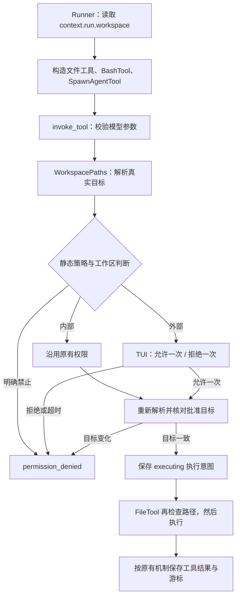

# S9：工作区路径校验与外部路径单次审批

## 1. 解决了什么问题

工作区就是本轮 Agent 处理项目的根目录。新 Run 将 Core 当时的工作目录保存到 `context.run.workspace`；后续文件工具、命令工具和子 Agent 都使用这个目录，恢复运行也沿用它。恢复入口原有的工作目录一致性校验继续保留。

当前规则覆盖 `read_file`、`write_file`、`list_dir` 及后续新增的 `find_files`、`search_text`、`edit_file`；新工具参数与行为详见[内置工具校验与代码工具链](./S9-内置工具校验与代码工具链.md)。

例如工作区是 `C:/projects/demo`：

| 模型传入的 path | 实际含义 | 权限处理 |
| --- | --- | --- |
| `src/app.py` | `C:/projects/demo/src/app.py` | 沿用原有工具权限 |
| `src/../README.md` | `C:/projects/demo/README.md` | 规范化后仍在内部，沿用权限 |
| `C:/projects/demo/README.md` | 工作区内绝对路径 | 沿用权限 |
| `../notes.txt` | `C:/projects/notes.txt` | 强制单次审批 |
| `C:/projects/demo-backup/a.py` | 名称相似但属于另一个目录 | 强制单次审批 |
| `linked/a.py`，linked 指向外部 | 链接最终指向的位置 | 按外部路径审批 |

“工作区内”不等于自动允许写入：`write_file` 仍遵循原有审批策略。工作区外只允许本次调用，不提供“始终允许”；明确配置为禁止的文件工具仍直接拒绝。

## 2. 旧流程与新流程

原来三个文件工具各自处理路径，主要检查输入中是否含有 `..`，文件和命令操作还依赖进程 cwd。这不能统一处理绝对路径、链接越界，也会误拒绝规范化后仍在工作区内的路径。

现在保留 `Manager → Runner → Loop → invoke_tool` 主线，将规则集中到 `WorkspacePaths` 和 `FileTool`，没有把路径规则塞进 Loop。



没有 PermissionManager 时，工作区外访问直接拒绝，不能静默执行。

## 3. 新增和改动的代码

| 文件 | 职责 |
| --- | --- |
| [workspace.py](../src/kama_claude/core/workspace.py) | 新增 `PathAccess`、`WorkspacePaths`、路径拒绝异常 |
| [tools/base.py](../src/kama_claude/core/tools/base.py) | 新增轻量 `FileTool`，统一调用前边界检查 |
| [tools/invocation.py](../src/kama_claude/core/tools/invocation.py) | 协调参数校验、路径审批、目标复核与执行意图保存 |
| [permissions/manager.py](../src/kama_claude/core/permissions/manager.py) | 外部访问强制 ASK；只接受单次决策，跳过授权缓存 |
| [runner.py](../src/kama_claude/core/runner.py) | 将 Run 工作区传给工具与子 Agent |
| [subagent/tool.py](../src/kama_claude/core/subagent/tool.py) | 子 Agent 和嵌套子 Agent 继承工作区 |
| [tui/app.py](../src/kama_claude/tui/app.py) | 展示完整路径，按钮、方向键、快捷键共享有效选项 |
| [WIRE_PROTOCOL.md](../WIRE_PROTOCOL.md) | 生成的审批命令、事件及新增字段 |

首次提取路径校验时，原有三个文件工具的名称、描述和 Schema 保持原样。后续代码工具链升级了参数、分页行为和说明，当前版本继续严格校验旧 Run 冻结的 Schema，不会静默切换工具行为；不匹配时可终止旧 Run，再创建新任务。

## 4. 路径如何判断

`WorkspacePaths` 构造时捕获根目录。`inspect(path)` 返回工作区、原始输入、实际目标和 `outside_workspace`；判断使用 `Path.is_relative_to()`，不用字符串前缀。

解析顺序为：

1. 相对路径拼接工作区，本机绝对路径直接使用。
2. `resolve()` 消除 `..`，解析符号链接和 Windows junction。
3. 新文件允许尚不存在，但严格核验已有部分；解析失败直接拒绝。Windows 的 `C:foo` 这类依赖驱动器当前目录的相对路径拒绝，改用完整绝对路径。
4. 检查规范化目标是否属于规范化后的根目录。

`write_file` 在检查通过后才创建父目录和写入。`list_dir` 对子链接仅显示 ` [link]`，不跟随符号链接或 junction，因此批准列举一个目录不会顺带遍历其中链接指向的其他目录。若直接请求列举那个链接目标，先按解析后的目标单独检查权限。

独立调用 `ReadFileTool()` 等工具时，默认捕获构造时的 cwd；稍后切换 cwd 不会改变它的根目录。

## 5. 外部批准为什么不能被滥用

审批事件除了原有参数，还携带：

```text
workspace          当前根目录
resolved_path      解析出的完整实际路径
outside_workspace  是否越界
allowed_decisions  本次允许的回答
```

外部请求的有效回答固定为 `allow_once`、`deny_once`。后端收到 `always_allow` 或 `always_deny` 返回 JSON-RPC 参数错误 `-32602`，原请求继续等待；不会生成授权。TUI 的按钮、方向键和 App 失焦兜底快捷键都只使用这组选项。

批准目标通过 Python 内部参数 `approved_path` 交给文件工具。模型 JSON 中即使伪造同名字段，也不能提供内部授权。批准不写入内存授权缓存或 `policy.toml`，下一次工具调用即使访问同一文件也要重新审批。

审批后，在保存执行意图前重新解析原始路径；文件工具真正访问前再检查一次。如果链接指向已经变化，即使新目标也位于工作区内，仍拒绝执行，要求重新调用。路径拒绝、审批拒绝和目标变化返回 `permission_denied`，不重试，也不标记为未知副作用。

## 6. 断线、恢复与输出归档

- **仅 TUI 断线**：Core 仍持有审批 Future。重新打开同一会话时，返回原 pending 审批及完整路径信息，继续提供两个单次选项。
- **Core 重启**：不恢复 Future 或一次性授权。工具处于 `awaiting_approval` 时，按现有恢复机制重新发起审批；已经 `executing` 的工具仍遵循 S8 的未知结果保护。
- **归档输出在工作区外**：归档生成属于 Core 内部保存，规则不变。模型通过 `read_file` 读取归档时视为外部访问，用户单次允许后可以读取。
- **子 Agent**：继承父 Run 的工作区与 PermissionManager，不能通过派生子 Agent 跳过边界检查。

## 7. 这与系统沙箱有什么区别

这是一层通用文件工具访问检查。它不隔离整个 Python 进程，也不解析 shell 命令里的路径；`bash` 只固定执行目录，原有命令审批继续保留。MCP 服务也不会因这个检查而受到文件系统隔离。检查点、记忆、Trace 等 Core 内部存储不套用通用文件工具审批。

批准后复核可以拦截已观察到的路径变化，但不宣称消除恶意并发替换路径的全部竞争条件。需要严格进程隔离时，仍应另外使用操作系统沙箱或容器。

## 8. 阅读与验证

建议按 `workspace.py → FileTool → invoke_tool → PermissionManager → PermissionSelect` 阅读，再看 Runner 和子 Agent 如何传递工作区。

测试包含真实临时文件、Windows junction、审批期间更换链接、外部拒绝与超时不写文件、非法永久决策、单次批准不缓存、主/子/恢复根目录一致，以及真实 Textual 和 TCP 重连。文件符号链接测试需要系统权限，不具备权限时明确跳过；不会把跳过写成通过。验证不调用付费模型。

首次引入路径校验时，基线为 **511 项通过**，该次验收为 **526 项通过、1 项跳过**。跳过的是文件符号链接测试，Windows 返回 `WinError 1314`（缺少创建符号链接特权）；目录 junction 测试实际运行通过。当次改动文件 Ruff、`mypy src`、协议一致性与 `git diff --check` 通过，四个工具定义与当时版本一致。后续工具升级的验收记录见代码工具链文档；没有运行付费模型端到端测试。
