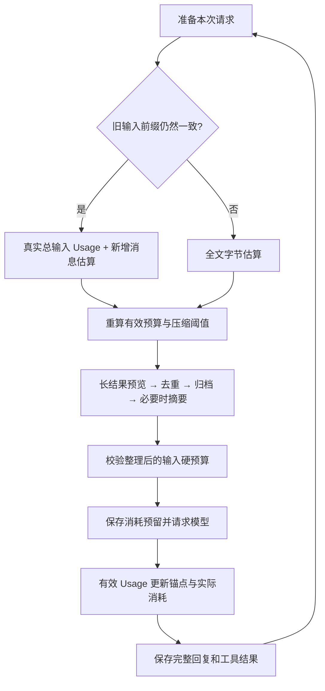

# S9：运行保护与 Usage 锚点估算

## 先看功能

这一版保留检查点恢复、完整 thread.jsonl、四层压缩和 Markdown 记忆，新增两部分：

1. **运行保护**：可选累计时间和 Token 上限；连续相同工具失败保护；命令超时、取消和有限输出。
2. **请求预算**：优先复用上次真实输入 Usage，只估算新增消息；按 Cline 的公式动态缩小压缩预算。

已经删除上一稿的 tokenizer 配置、依赖入口和滑动中位数校准。不需要下载任何分词器。工具结果未知时仍由用户核实，不自动重跑。

## 一、先把三个数字分清

| 数字 | 代表什么 | 用途 |
| --- | --- | --- |
| 上次真实总输入 Usage | 上次请求的输入，包括缓存部分 | 作为未改变历史的锚点 |
| 本次输入估算 | 当前请求大约占多少上下文 | 判断是否压缩、预留本次消耗 |
| Run 累计 Token | 所有请求的已知消耗＋未知请求的估算占用 | 限制整个任务的消耗 |

**上下文占用不是累计消耗。** 同一段历史可能被请求十次；累计消耗会增加十次，当前上下文只包含这一份历史。

## 二、以前和现在

上一稿：

```text
全文字符粗估 → 接近上限时调用本地 tokenizer → 最近20个样本的中位数修正估算
```

现在：

```text
校验上次 Usage 对应的输入前缀
→ 重算 Cline 式有效预算与压缩阈值
→ 本次输入 = 上次真实总输入 + 新增消息的字节估算
→ 超阈值则进入原有四层压缩
→ 检查硬预算 → 提交本次消耗预留 → 请求模型
→ 收到有效 Usage 后更新锚点并保存
```

没有有效锚点时，使用**完整请求的 UTF-8 字节估算**，低估系数为 1。



## 三、锚点具体保存什么

检查点中的 token_estimation 按 **Provider、模型、普通请求/摘要请求、估算版本**分组，每组只保存最新有效记录：

```text
input_tokens     上次真实总输入 Token
message_count    上次请求包含的消息数量
prefix_hash      上次 system、工具定义和消息前缀的指纹
```

不另外保存一份消息，不保存 tokenizer，也不积累滑动样本。通过原 CheckpointStore 一起提交，版本仍为 1。

**锚点建立在上次请求输入的末尾，不是在上次模型回复的末尾。** 例如：

```text
上次请求输入：用户目标 + 历史                 ← 真实输入 Usage = 10000
随后新增：assistant 回复（含 tool_use）
          user 工具结果
下次输入估算：10000 + ceil(新增消息序列化后的 UTF-8 字节数 / 4)
```

因为 input_tokens 不含本次生成的回复，assistant 回复需要作为新增内容估算一次。不会同时把 output_tokens 加到锚点里，再重复估算同一条回复。

系统提示、工具 Schema、角色和内容字段都参与全文估算。消息序列化使用规范 JSON；字符串按原文 UTF-8 字节计算。中文“中”是 3 字节，因此一个字符估为 1 token，四个“中”共 12 字节估为 3 token。这是启发式估算，不是精确分词。

### 什么时候不能复用

- 历史被摘要替换、旧工具结果被裁剪或遮蔽；
- 原有消息正文被原地改写，即使数量没变；
- system、工具定义、Provider 或模型改变；
- 历史变短，不再包含原输入前缀。

这些情况下旧记录可以留在快照里，但匹配失败就**不参与估算和阈值校准**。新请求成功取得 Usage 后再替换它。仅追加回复、工具结果或用户消息，则可以继续使用。

失败、取消、缺失或非法 Usage 不更新锚点；这些请求的未知累计消耗仍保留在 Run 预算中。

## 四、阈值的具体公式

本项目可用输入上限继续沿用原配置：

```text
B = context_window_tokens - output_reserve_tokens - 1024
E = 当前完整请求的 UTF-8 字节粗估
A = 有效锚点的上次真实总输入 Usage

r = min(4, max(1, A / E))      # 没有有效锚点时 r = 1
有效输入预算 = floor(B / r)
压缩阈值 = floor(B / r × auto_threshold)

本次输入估算 = A + ceil(新增消息 UTF-8 字节数 / 4)
本次输入估算 >= 压缩阈值 → 需要压力处理
```

**Cline 源码的分母是“本次全文粗估”，不是上一轮估算值。** 上次真实输入已经超过更长的当前历史粗估，说明有低估证据；r 只允许缩小预算，最大为 4，防止异常值把预算压到接近零。

本项目保留 auto_threshold=0.8、prune_target_ratio=0.65；程序层目标也用 B/r 计算。每次准备请求都重新算比例，第一层预览改变内容后也重新校验锚点；同一轮后续候选比较固定计数口径。摘要收益比较始终使用双方的字节粗估，不拿一侧真实 Usage 和另一侧粗估伪造缩减比例。

例如 B=56000，E=20000，A=30000：

```text
r = 1.5
压缩阈值 = floor(56000 / 1.5 × 0.8) = 29866
新增部分估为 2000
本次输入估算 = 30000 + 2000 = 32000
32000 >= 29866，因此进入压力处理。
```

这是按本项目要求组合的策略：**Codex 的 Usage＋尾部估算思路，加上 Cline 的预算缩小公式**。Cline 原代码比较的是全文粗估与缩小后的阈值；这里比较的是锚点估算，因此组合结果可能更早触发压缩。保留原来的 80%，也没有照搬 Cline 当前源码的 90% 默认比例。

历史改写后回退全文估算，等待下一次有效 Usage 校准；中文、代码等内容仍可能低估，不宣称完全消除服务端上下文超限。

## 五、如何接入原四层压缩

1. **长结果预览**：每次执行，原文先归档，保留头尾。
2. **精确去重**：仍有压力时，处理旧的完全相同只读结果。
3. **旧结果归档**：仍有压力时，旧正文变为可定位全文的短记录。
4. **LLM 摘要**：前三层不足时才请求一次摘要。

旧消息改变后无法沿用原锚点，候选会回退全文估算。Compactor 只返回候选；Loop 或手动入口提交检查点之后才通知完成。

自动和手动 /compact 共用估算和分层规则。auto_threshold=0 时，自动请求只做第一层整理和硬预算检查；手动入口使用默认 80% 压力比例。摘要请求与普通请求的锚点隔离，避免一份短摘要的 Usage 覆盖主任务历史的锚点。

完整 thread.jsonl 始终保存原对话；压缩只修改 checkpoint.messages 中的模型工作历史。TUI 打开历史会话看到的是完整对话。

## 六、运行保护如何配合

```toml
[agent]
max_steps = 20
max_run_seconds = 0
max_total_tokens = 0
repeat_failure_limit = 5

[compaction]
context_window_tokens = 65536
output_reserve_tokens = 8192
auto_threshold = 0.8
prune_target_ratio = 0.65
```

时间和累计 Token 的 0 表示关闭。环境变量为 KAMA_AGENT_MAX_RUN_SECONDS、KAMA_AGENT_MAX_TOTAL_TOKENS、KAMA_AGENT_REPEAT_FAILURE_LIMIT。新 Run 冻结上限，恢复不重置额度。

每次模型请求先检查“累计实际消耗＋未知占用＋本次输入估算＋输出预留”，保存预留后才请求。有效 Usage 返回后，用实际输入与输出替换本次预留。失败、崩溃或缺少 Usage 时保留估算占用，usage_complete=false。

普通请求、自动摘要和受管重试共用主 Run 预算；SDK 隐藏重试关闭，每次重试单独记账，最多请求三次。手动摘要只记录自身用量，不追加到已经结束的 Run；子 Agent Token 暂不汇总到主 Run。

时间使用单调时钟，包括模型、工具、审批和自动摘要等待，不计中断后的离线时间。硬退出可能丢失最后一次保存后的计时，不作为精确计费。

预算耗尽时，不启动下一个操作；未执行工具补齐说明结果。如果正在执行工具、结果未知，则保留 unknown 并中断。额度已经耗尽的原 Run 只能终止，不能借恢复重置预算。

同工具、规范参数、错误类型、原始错误内容连续相同：第 3 次提醒改变方法，默认第 5 次停止。成功或不同结果打断连续计数；unknown 和权限拒绝不参与。

## 七、命令与前端

原来 BashTool 用 communicate 收集完整输出后截断；现在 CommandExecutor 分块排空管道，最多保留 64 KiB。超时或取消先清理受管进程，再返回未知结果或传播取消。POSIX 使用进程组；Windows 用 psutil 核验进程身份并清理已发现的后代。

清理等待有上限，失败明确报告；不保证清理主动脱离管理的后台服务，不新增命令全文日志归档。命令启动后失败不代表没有副作用，仍由用户确认。

TUI 预算条展示“Usage+增量”或“UTF-8字节”、输入估算、动态压缩阈值、累计已知与估算占用、执行时间及停止原因。缓存计入输入，Anthropic / DeepSeek 兼容接口使用普通输入＋缓存读＋缓存写；OpenAI prompt_tokens 已含缓存，不重复加。

## 八、建议阅读顺序

1. [估算器](../src/kama_claude/core/compact/estimator.py)：observe 保存锚点，select 校验前缀与计算比例，request 计算本次输入，trigger 计算阈值。
2. [受管模型入口](../src/kama_claude/core/llm/managed.py)：预留 → 保存 → 请求 → 记录 Usage → 保存。
3. [分层压缩](../src/kama_claude/core/compact/compactor.py)：四层规则与有效预算。
4. [Loop](../src/kama_claude/core/loop.py)：请求前整理、硬预算检查、逐工具提交。
5. [RunBudget](../src/kama_claude/core/run_budget.py)：累计预算与重复失败。
6. [检查点模型](../src/kama_claude/core/checkpoint/checkpoint.py)：UsageAnchor 和 Run 的持久化字段。
7. [CommandExecutor](../src/kama_claude/core/tools/command.py)：命令输出、超时、取消清理。

## 九、参考与验证边界

- [Codex ContextManager](https://github.com/openai/codex/blob/main/codex-rs/core/src/context_manager/history.rs)：get_total_token_usage 将最近报告的用量与未报告尾部估算相加。本项目以“请求输入末尾”为边界，使用总输入 Usage，保留回复作为增量，未照搬其 reasoning 和多模态专用逻辑。
- [Cline 压缩协调](https://github.com/cline/cline/blob/7a7878cb52fc33967d8b464b3e3d899beac42d4d/sdk/packages/core/src/extensions/context/compaction.ts)：参考 actualPreviousInputTokens / requestInputTokens 与预算缩小公式。
- [Cline 常量](https://github.com/cline/cline/blob/7a7878cb52fc33967d8b464b3e3d899beac42d4d/sdk/packages/core/src/extensions/context/compaction-shared.ts)：低估系数上限 4，原项目触发比例 0.9；这里保留已有配置比例。

本轮 **484 项相关单元与非付费集成测试通过**；改动文件 Ruff、mypy（98 个源码文件）与协议一致性检查通过。验证使用假模型、Windows 真实本地命令、TCP 和 Core 重启，不调用付费模型；POSIX 清理分支未在本机实际运行。

覆盖增量不重复、旧前缀修改失效、校准上限、缺失 Usage、摘要隔离、检查点失败、命令清理和 TUI 展示。证明的是实现行为，不是实际账单下降或真实任务效果。
