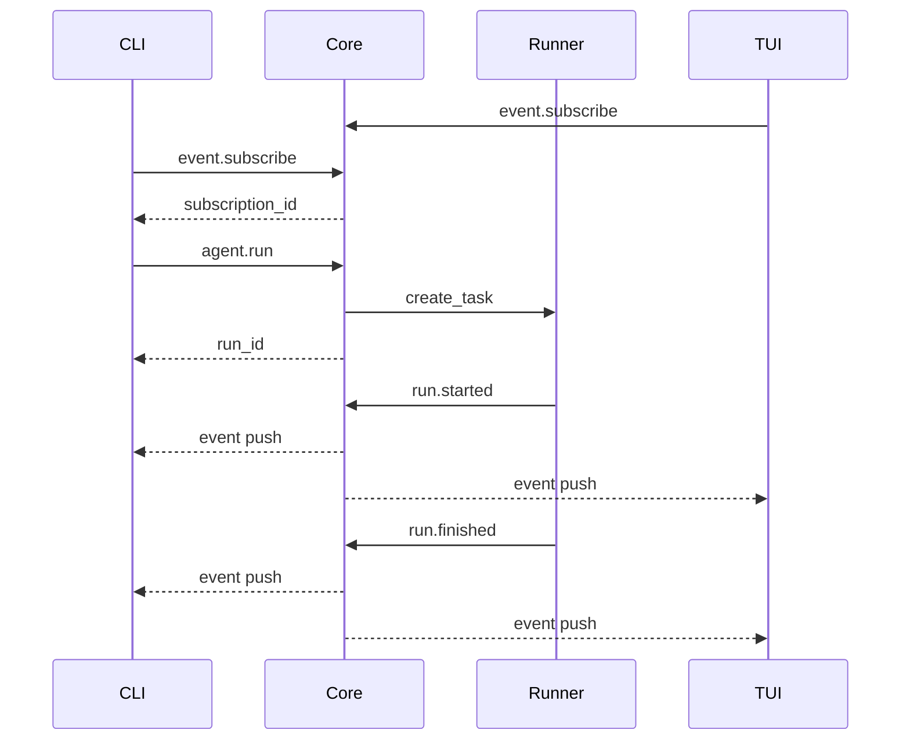

# S2 双进程与事件订阅

基准：`origin/stage/s2`，提交 `1d4d6ba`。相比 S1，最主要变化是 AgentRunner 的所有者从 CLI 变成 Core。客户端通过 RPC 发起运行，并订阅执行事件。

## 1 这次迁移解决了什么

S1 的 CLI 同时负责运行和显示，关闭进程意味着执行也终止。S2 把 Runner 放入常驻 Core，CLI 和 TUI 成为两个观察同一条事件流的客户端。客户端连接生命周期与 run 生命周期开始分离。

这里只能说客户端断连不会按设计直接取消 daemon 内的 run；不能说 daemon 崩溃后可自动恢复。S2 没有执行检查点、持久化任务恢复或自动重做工具的机制。

## 2 关键文件

| 文件及符号 | 变化 |
| --- | --- |
| `core/app.py::_agent_run_handler` | 生成 run_id 并 create_task |
| `core/app.py::_subscribe_handler` | 注册订阅，可回放历史 |
| `core/transport/socket_client.py::SocketClient` | 一个读循环同时接收响应和事件 |
| `core/transport/ipc_broadcaster.py` | 主题和 run 范围过滤、广播 |
| `core/transport/socket_server.py` | ContextVar 传递连接 writer |
| `cli/commands/run.py::_run_async` | 先订阅后触发任务，等待终态 |
| `tui/app.py::_socket_loop` | 展示事件、断线重连 |

所有路径相对 `src/kama_claude/`。

## 3 命令响应与事件的两条逻辑通道

运行请求：

```json
{"jsonrpc":"2.0","id":"request-1","method":"agent.run","params":{"goal":"读取 README.md"}}
```

响应：

```json
{"jsonrpc":"2.0","id":"request-1","result":{"run_id":"example-run"}}
```

事件：

```json
{"kind":"event","event":{"type":"run.started","run_id":"example-run","goal":"读取 README.md","ts":"..."}}
```

RPC 响应表示请求得到处理，返回可关联的 ID；运行是否完成由后续 `run.finished` 告知。事件外壳是项目定义的 `kind=event`，不是把每个事件都当成 JSON-RPC 响应。

## 4 为什么 SocketClient 只能有一个接收循环

`send_command()` 做四件事：生成 UUID 请求 ID、创建 Future、存入 `_pending[id]`、发送请求并等待 Future。

另一个协程 `run_event_loop()` 独占 reader：读到 JSON-RPC 响应，就按 id 找到 pending Future，设置 result 或 IpcError；读到 event，就调用事件处理器。这样多个请求响应交错时也能对应正确调用者。

如果每个 `send_command()` 都自行 `readline()`，两个并发命令可能读走对方的响应，或误把事件当作响应。统一接收再分发，是复用连接的关键。

发命令之前必须已经启动接收任务，否则 `send_command()` 等待的 Future 没有人完成。类似地，事件处理器不能阻塞接收循环等待同一连接上的新响应；需要把长操作调度到独立任务。

连接结束时，读循环取消所有 pending Future 并清空字典。它还没有完善的每请求超时与断连后的业务错误模型，这是后续改进点。

## 5 从订阅到执行的时序



该图表达逻辑关系，不把网络响应与后台任务首次调度之间的具体先后当成绝对保证。客户端应依靠 ID 关联，而不是假设所有事件必在响应之后到达。

CLI 先订阅再发起 run，可以减少丢失最早事件的风险。但代码使用 global 订阅，且看到任何 `run.finished` 就结束等待。S2 的单 run 限制暂时减弱了这个问题；S3 允许多个 run 后必须考虑按自己的 run_id 过滤。

## 6 广播器如何匹配

topic 使用 `fnmatch` 模式，例如 `tool.*` 匹配工具事件，`llm.token` 只匹配文本增量。scope 为 `global` 时全收，`run:<id>` 时只收该 run。

`IpcEventBroadcaster.handle()` 遍历订阅，序列化事件，向每个 writer 写入并 `await drain()`。写失败后移除死连接；服务端连接退出时也会 unsubscribe。

这个实现是串行广播。一个不读取数据的客户端可能让 drain 变慢，从而拖慢 EventBus 的 publish，再拖慢 Agent 执行。所谓事件解耦，目前主要是接口职责解耦，尚不是完整的执行隔离。

订阅者的数量和事件频率决定开销。若模型频繁输出很小的文本片段，每片都要序列化和 flush，可能让 UI 与磁盘处理成为负担。可以通过有界队列、批量刷新和背压策略改善。

## 7 回放为什么不是可靠断点续传

`replay_from_run` 指定某次运行后，服务端读取其 `events.jsonl`，按 topic 过滤，把历史逐条发送，然后注册实时订阅。

这里有三个边界：没有事件序号；没有客户端最后确认位置；回放与实时订阅切换没有原子交接。重连可能重复看到全量历史，运行仍在继续时也存在切换窗口。不能把“能读历史文件”直接写成“不丢不重的实时恢复”。

TUI 每两秒尝试重连；它只有显式提供 replay_run_id 才请求对应历史，不会自动计算断点。恢复连接与恢复到正确 UI 状态是两层不同能力。

## 8 顶层并发限制与运行文件

S2 Core 用 `_current_run_task` 保留当前任务。若它尚未结束，新 `agent.run` 抛出 RuntimeError，再由服务端转换为内部错误。此阶段允许多客户端观察，但不允许多个顶层 Agent run 同时执行。

共享 EventBus 后，Runner 每次添加 EventWriter，却没有对应退订接口。文件关闭后 handler 虽然直接返回，但订阅对象仍保留；若后续并行 run 共享总线，缺少 run_id 过滤还会让文件混入其他运行事件。S8 会针对生命周期和路由统一处理。

## 9 实验与断点

在支持 daemon 的环境下：终端 A 运行 `uv run kama-core`；终端 B 运行 `uv run kama-tui`；终端 C 运行：

```powershell
uv run kama run --goal '读取 README.md 并简述用途'
uv run pytest tests/unit/test_socket_client.py tests/unit/test_ipc_broadcaster.py -v
uv run pytest tests/integration/test_s2_dual_process.py -v
```

TUI 在 S2 主要负责观察，还没有 S4 的多轮输入框。预期 CLI 与 TUI 都能看到同一个 run 的事件。

依次在 `send_command`、`_agent_run_handler`、`IpcEventBroadcaster.handle`、`SocketClient._dispatch` 设断点。观察 request_id 与 run_id 的差异，再断开观察客户端，检查 Core 是否继续运行。

集成测试覆盖 run_id 返回、两个客户端收到广播、断开后回放有内容。它们并不证明完整模型任务成功或断点交接无丢失；某些测试只等 `run.started`，这一事件发生在模型执行之前。

## 10 面试自测

**为何先返回 run_id？** 长任务不应占住一次短响应；通过 ID 查询和订阅后续状态。但 S4 的 session.send_message 选择等待整轮完成，不要把这一语义推广到所有命令。

**一个连接如何处理并发请求？** 唯一请求 ID、pending Future 映射、单一读循环，响应按 ID 解复用。

**慢客户端会影响模型吗？** 当前实现会通过同步等待广播产生反压；要用队列隔离，并定义队列满时的处理方式。

**UI 崩了是否能恢复任务？** 执行可能仍在 Core 中继续；UI 可以重连和读取历史。它不等于 Core 崩溃恢复。

## 11 核心方法逐个精读

### 11.1 CoreApp.__init__ 与 _agent_run_handler

S2 构造器建立共享 EventBus 和 IpcEventBroadcaster，立即把 broadcaster.handle 订阅到 bus，保存 `_current_run_task=None`。共享总线的生命周期由 Core 决定，不随一次 run 结束。

`_agent_run_handler(params)` 校验 AgentRunCommand；检查当前 task 是否未完成；生成 run_id；创建传入共享 bus 的 Runner；create_task(runner.run(...))；立即返回 AgentRunResult。返回的是已创建执行任务的 ID，而不是最终答案。

`task.done()` 表示协程任务已经结束，可能成功、失败或取消，不等于业务成功。此方法仅用它判断能否接受新任务。

### 11.2 CoreApp._subscribe_handler

输入 topics、scope、可选 replay_from_run。先通过 get_connection_writer 获取发起此请求的客户端连接；若指定历史，则 await `_replay_events`；之后注册实时订阅，返回 subscription_id 与 replayed_count。

因此历史事件可能在订阅 RPC 响应之前到达客户端。客户端必须能在等待 RPC Future 时继续处理事件，不能只期待下一帧必定是响应。

### 11.3 CoreApp._replay_events

它根据 run_id 找 events 文件，缺文件返回 0；读出所有行，跳过空行与坏 JSON；用 fnmatch 检查 event.type 是否匹配 topics；把匹配项包装为 EventPushEnvelope，写给指定 writer，最后 drain 并返回条数。

S2 文件路径仍是 runs/<id>/events.jsonl，S4 后才补 session 目录搜索。它一次 read_text 读取整个文件，没有分页；返回条数也不代表客户端已渲染成功。

### 11.4 get_connection_writer 与 ContextVar

订阅 handler 的参数只有 params，没有 writer。SocketServer 在执行 handler 前通过 `_writer_var.set(writer)` 绑定当前连接，get_connection_writer 再读出。

可以把它理解为“随当前协程调用上下文携带的变量”。它比一个普通全局 current_writer 更适合并发连接，因为不同处理上下文可以保存不同 writer。它不是用户身份认证，也不替代 session 归属校验。

### 11.5 SocketClient.__init__ connect close

初始化建立 `_pending` 字典、事件回调列表和空连接句柄。connect await open_connection 后保存 reader/writer；close 关闭 writer 并限时等候关闭。close 不自动完成所有业务请求，pending 清理主要由读取循环 finally 负责。

客户端对象负责一个连接。重连时 TUI 通常创建新的 SocketClient，因此旧的 pending 表不会天然迁移过去，需要业务层决定哪些请求可以重发。

### 11.6 SocketClient.on_event

输入一个接受事件字典的异步函数，追加到事件处理器列表。它只注册，不立即订阅服务端。`client.on_event(...)` 与发送 `event.subscribe` 是两步：前者决定本地收到后交给谁，后者告诉 Core 哪些事件要发送过来。

只做前者，Core 不一定推事件；只做后者，客户端也可能没有合适的 UI 消费逻辑。

### 11.7 SocketClient.send_command

输入 method 与 params，返回对应 RPC result 字典；服务器返回 error 时抛 IpcError。它先确认已连接，再生成 request_id、构造请求、创建 Future、登记 pending、写入和 drain，最后 await Future。

先登记再发包，能避免响应极快到达却找不到 pending。方法本身不读取 reader，这是职责分离：发送者负责等待自己的 Future，统一读循环负责完成它。

如果服务器永不回复，S2 没有每请求超时，调用可能一直等待；连接结束时 Future 被取消，调用者还要正确处理取消与断线。

### 11.8 SocketClient.run_event_loop

connect 后由调用者 create_task 启动。它循环读行，网络错误或 EOF 时结束，每行交给 `_dispatch`。finally 遍历 pending，取消尚未结束的 Future，再清空字典。

只有一个协程读这一 reader，是保证解复用正确的核心。如果某个 event handler 长时间不返回，读取循环也无法继续读后续 RPC 响应；所以 UI handler 应做短更新，把长业务移到 worker。

### 11.9 SocketClient._dispatch

输入一行 bytes，解析 JSON；坏 JSON 被忽略。带 jsonrpc 的对象按 id 找 pending，pop 后设置结果或异常；kind=event 的对象取 event 字典，逐个 await 本地回调。

pop 表示这张请求收据已经处理完，避免保留引用。对未知 id 不处理，对已完成 Future 不再次 set_result，降低迟到/重复响应引起状态错误的概率。不过它没有完整校验任意 JSON 的对象形状，是可增强的输入边界。

### 11.10 IpcEventBroadcaster.subscribe 与 unsubscribe

subscribe 接收 writer、topics、scope，生成短订阅 ID，并保存一条 `_Subscription`。返回 ID 只标识这次订阅；多个订阅可能对应同一个 writer。

unsubscribe(writer) 删除这个连接的所有订阅。为什么按 writer 清理？客户端断连后，这条连接上的任何订阅都失去接收方，继续保存只会产生无效写入和对象残留。

### 11.11 两个匹配方法与 handle

`_matches_topic(type, patterns)` 检查任意 fnmatch 模式匹配；`_matches_scope(run_id, scope)` 接受 global 或比较 run: 后面的精确 ID，未知 scope 返回 False。

`handle(event)` 先 model_dump，取 type 和 run_id，遍历订阅快照，依次执行两个过滤，匹配才写包、drain。连接写失败则收集到 dead 列表，循环后统一 unsubscribe，避免遍历时直接改正在遍历的集合。

这一层传的是完整事件内容，过滤只决定接收者。增加 session 过滤应在有可信归属字段后实现，不能从工具文本猜测所属会话。

### 11.12 CLI _run_async 与 cmd_run

`_run_async(goal, config)` 连接 Core；建立 finished Event 与事件回调；启动接收循环；订阅；发 agent.run；等待 finished；最后取消接收任务并关连接，返回退出码。回调收到 failed run.finished 时设退出码 1。

`cmd_run` 负责 asyncio.run 与 KeyboardInterrupt 映射，正常使用 _run_async 的结果退出进程。这次 CLI 不创建 Runner，就是 S1 到 S2 最关键的变化。

该回调在 S2 没按自己 run_id 过滤。你应该沿着订阅 scope、回调判断、并发限制一起分析，而不是只看到代码有 run_id 就以为关联已经完整。

### 11.13 daemon 管理命令

`_ping_check(config)` 只连接端口再关闭，用于快速探测，不发送业务 ping；`_running_pid()` 读 PID 文件并尝试判断进程是否仍存在；`cmd_core_status()` 显示端口是否能连接。

`cmd_core_start()` 若未检测到监听者，Popen 一个 Core 子进程，保存 PID，打印 started；它没有等待真正的业务健康检查成功。`cmd_core_stop()` 取 PID、发 SIGTERM、删除 PID 文件，不等价于验证所有资源已经清理。

PID 文件代表运行实例的线索，不应直接当不可伪造的进程身份。学习版能展示基本生命周期，但健壮启动需要处理失败退出、PID 过期和平台差异。

### 11.14 S2 TUI 的 compose on_mount 与 _socket_loop

compose 返回顶部 Label 与 RichLog；on_mount 用 run_worker 启动网络循环；`_socket_loop` 负责连接失败后等待两秒重试、启动接收、注册回调、订阅事件、等待断线、关闭旧连接。

在 S2，TUI 不负责发用户目标，主要是观察。`_handle_event` 把事件字典转换为显示文本；token 先累积到缓冲，`_flush_tokens` 在需要切换事件类型或断线时把累计文本输出并清空。

把 UI 理解为“消费一个事件序列后改变本地控件状态”，以后测试它就可以直接喂事件，不需要每次真正调用模型。

## 12 手工模拟两个交错响应

假设发出请求 p1=core.ping 和 p2=event.subscribe，pending 表是 `{p1:F1,p2:F2}`。服务器先推一条事件，再回 p2，最后回 p1。

正确执行：事件交给回调，不改变 pending；p2 响应 pop p2 并完成 F2；p1 响应完成 F1。完成顺序不必等于请求顺序。若把 readline 写进 send_command，两个等待者可能抢错消息，这就是单读循环设计的理由。

再让连接在 p1 返回前断开。预期 finally 取消 F1，pending 清空。思考：上层是显示“任务已取消”，还是“连接丢失，执行状态未知”？后者通常更符合 S2 的进程分离语义，S8 会把这类区别落实到恢复流程。

## 13 本阶段可改进的地方

| 改进 | 实现方向 | 验收 |
| --- | --- | --- |
| RPC 超时清理 | send_command 用统一超时并在 finally 删除 pending | 服务端不回包时调用有界失败，无 Future 泄漏 |
| 订阅生命周期 | subscribe 返回 token，支持 unsubscribe | 连续执行多轮后订阅数量回到基线 |
| 慢消费者隔离 | 每连接有界发送队列和 writer task | 一个停读客户端不阻塞另一个；超限策略明确 |
| run 级路由 | Writer、CLI、TUI 按归属过滤 | 并发 A/B 的结果不会串到对方 |
| 可续传事件 | 增加 seq、after_seq 和历史实时交接屏障 | 断线前后显示连续且不重复 |

如果希望 S8 体现后端工程能力，优先做最后四项的一个完整闭环。它们有明确不变量，能用确定性测试证明价值。
