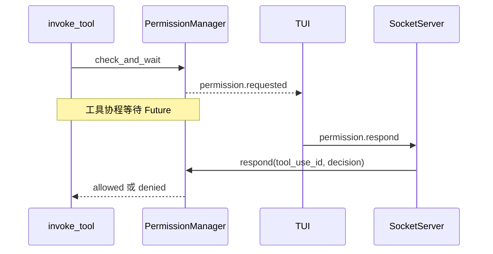

# S5 工具权限与失败处理

基准：`origin/stage/s5`，提交 `7738b8f`。本阶段在工具执行前增加参数模型和权限审批，执行后区分错误并有限重试。学习重点是控制流、信任边界和副作用。

## 1 一次工具调用现在经过哪些门

```text
模型返回 ToolCallBlock
→ 发布 tool.call_started
→ 查找工具
→ params_model 校验（若该工具提供）
→ PermissionManager.check_and_wait
→ 放行后执行，按错误分类决定是否重试
→ 发布工具结果事件
→ tool_result 回填模型
```

因此 `tool.call_started` 表示开始处理调用，不代表危险操作已真正执行。审批可能仍在等待，或参数可能不合法。

阅读顺序：`core/tools/base.py` → `builtin/bash.py` 的参数模型 → `tools/invocation.py` → `permissions/policy.py` → `permissions/manager.py` → `core/app.py` 的响应 handler → `transport/socket_server.py` → `tui/app.py`。路径均相对 `src/kama_claude/`。

## 2 参数校验与权限检查是两件事

`BashParams` 声明 command 是字符串、timeout 是 1～120 的整数；extra=ignore 表示多余字段被忽略。调用层在 `tool.params_model` 不为空时校验，具体工具还会再次解析参数。

参数合法表示“结构可以执行”，不表示“允许执行”。`write_file` 的 path 和 content 类型正确，也可能写到不应该写的地方；需要权限和资源边界继续约束。

不是每个工具都自动获得完整校验。S5 的部分任务工具没有 params_model；S7 的 MCP 工具同样设为 None。S5 调用层没有保留 S1 的 required fallback，所以“所有工具都先完整 schema 校验”是不准确的。模型看到的 JSON Schema 与执行端实际执行的校验必须分别检查。

## 3 静态策略的顺序

默认策略：bash、write_file 是 ASK；read_file、list_dir、note_save 是 ALLOW；未登记工具默认 ASK。这包括尚未配置专门策略的任务工具，因此不要自行认为所有内部任务工具都免审批。

`policy.evaluate()` 的静态评估顺序：

1. bash 的 deny_patterns 命中则 DENY。
2. bash 命中目录外操作启发式则 ASK。
3. bash 的 allow_patterns 命中则 ALLOW。
4. 使用工具默认策略。

实际执行走 `PermissionManager.check_and_wait()`，还插入缓存：deny pattern → 目录外强制 ASK → session always → persistent always → allow pattern → 工具默认值。

这两个函数的层次不能混淆；只测试 evaluate 不能覆盖审批缓存行为。目录外检测是正则启发式，关注 `/`、`~`、`..`、HOME、PWD、cd 等模式。它不是完整 shell 解析器，更不是操作系统隔离。

## 4 ASK 如何暂停而不占住整个系统

PermissionManager 创建 Future，存到 `_pending[tool_use_id]`，发出 `permission.requested`。工具调用协程 await Future，事件循环可以继续运行其他协程。

TUI 收到请求，展示 PermissionBlock 与 PermissionSelect。用户选择后，客户端发送 `permission.respond`，携带 tool_use_id 和 decision。Core handler 调 `respond()` 找到 Future 并 set_result；原工具协程恢复，应用策略，再决定执行或返回拒绝。



默认审批等待 60 秒，配置 timeout_s=0 表示无限等。超时返回拒绝并清理 pending。`cancel_session()` 能拒绝某会话的待审批，但本阶段 SocketServer 的断连处理没有接入这条调用链，所以不要把“有方法”写成“客户端断连一定立刻取消审批”。

## 5 为什么服务端必须改成并发处理命令

S4 `session.send_message` 等整轮结束才返回。若服务端读到这条命令后一直 await handler，而 handler 中工具又等审批，则同一连接后续的 permission.respond 没人读取。

依赖关系变成：send_message 等工具，工具等审批，审批等新命令，新命令等 send_message 结束。这是等待环。

S5 `_read_loop()` 对每行调用 `asyncio.create_task(self._handle_line(...))`，接收循环继续读取；审批命令可以并发完成。前端也用 worker 发送长命令，让 UI 消息泵能继续处理键盘和审批。

新代价是每连接任务数量缺少管理和限额；关闭连接后哪些 handler 继续执行、哪些要取消，也需要清楚的生命周期设计。

## 6 四种决定的真实作用域

| 决定 | 当前行为 |
| --- | --- |
| allow_once | 允许这一次 |
| deny_once | 拒绝这一次 |
| always_allow | 写入 session 缓存与工具名级 persistent 缓存，配置文件存在时落盘 |
| always_deny | 同样写入两个缓存并可落盘 |

持久化文件是 `~/.kama/policy.toml` 的 `[always]`。键是工具名，不是具体命令、文件路径或工作区；因此允许一次 bash 后选择 always，可能影响之后其他 session 的 bash 调用。目录外强制 ASK 和 deny_patterns 仍有更高优先级。

从用户体验看，应清楚告诉用户这次选择覆盖什么范围。更细粒度可拆成“本次”“本会话同类操作”“本工作区规则”，再增加撤销入口。

## 7 失败分类与重试

`invoke_tool()` 默认每次执行超时上限调整为 120 秒，最多重试 2 次，即最多执行 3 次。重试等待为 2 秒、4 秒，不是总共只等 2 秒。

| 错误 | 当前策略 | 理由或风险 |
| --- | --- | --- |
| schema_error | 不重试 | 同样参数继续执行没有意义 |
| permission_denied | 不重试 | 拒绝是边界，不是暂时故障 |
| timeout | 不重试 | 可能已有部分副作用 |
| runtime_error | 最多重试两次 | 分类过粗，可能重复执行副作用 |
| rate_limited | 最多重试两次 | 可能是暂时性限流 |

重试过程中也发布 tool.call_failed，字段 attempt 标示次数；它不一定是最终失败。当前 TUI 首次失败就从 pending 控件表移除，后续成功可能无法正确更新同一控件，适合作为事件状态设计练习。

示例：命令先把一行内容追加文件，再返回非零退出码。统一层看到 runtime_error 会重试，文件可能被追加三次。“失败”不能推导出“没有发生任何操作”，这就是幂等性问题。

## 8 审批不能替代沙箱

权限管理判断是否允许调用，文件工具和 shell 真正执行时仍拥有 Core 进程的系统权限。允许 bash 后它可以启动其他程序、访问文件或网络。当前文件工具的路径检查仍然较弱，read_file 又默认 ALLOW。

因此项目具有工具审批机制，但不具备完整操作系统沙箱。面试描述应精确；如果要做强隔离，需明确文件系统、网络、进程与资源限制，并以实际测试证明。

## 9 实验与测试

```powershell
uv run pytest tests/unit/test_tool_params.py tests/unit/test_permission_policy.py tests/unit/test_permission_manager.py tests/unit/test_tool_retry.py -v
uv run pytest tests/integration/test_s5_permission_flow.py -v
```

完整权限测试涉及等待 Future，执行时要留意某些用例对缓存行为的假设是否已过时。测试名称不是行为证据，应看实际断言和源码。

仓库根目录的 `trace_permission_flow.py` 是 S5 新增的诊断脚本：固定连接 `127.0.0.1:7437`，发送一个 echo 目标，收到任何订阅到的审批请求就自动回复 allow_once。它验证的是协议链路，不验证人工选择；使用 global 订阅，不能在混有其他运行的环境中直接把它当通用观察脚本。其收尾只检查是否收到过审批请求，也不足以证明工具最终成功。阅读时还可以注意它先发送请求再登记 pending Future，与 SocketClient 先登记后发送的稳妥顺序不同。

练习一：用 mock 工具计数 invoke 次数，参数非法时计数必须为 0。练习二：ASK 发出后先不响应，确认 Core 仍能处理 ping；响应 allow_once 后计数变 1。练习三：模拟先失败再成功，核对 attempt 和最终状态。练习四：用内存计数副作用证明通用重试可能执行多次，不必真的运行危险 shell。

## 10 面试问题

**审批用了 await 为什么还会死锁？** await 允许其他已调度协程运行，但若唯一读循环正等待长 handler，它没有继续创建处理审批消息的协程，依赖仍无法完成。

**什么错误应该重试？** 明确暂时且可安全重复的操作；需要结合工具幂等性和是否已产生副作用，不能只按 Exception 类型粗略处理。

**怎么防止模型跳过审批？** 所有实际执行必须收敛到统一入口，审批在宿主执行层落实；只写 prompt 不能构成强制控制。

## 11 核心方法逐个精读

### 11.1 参数模型与 BaseTool.params_model

BaseTool 增加 ClassVar 形式的 params_model，默认 None，表示该类可以提供 Pydantic 参数模型。例如 BashTool 设为 BashParams，WriteFileTool 也有对应参数模型。

调用层 model_validate 的主要目的在执行前发现错误；验证得到的对象没有直接传给工具，工具收到的仍是原始字典。需要默认值和转换后的字段时，具体工具会再次解析。这不是“统一层已经把所有参数变成规范化字典”。

### 11.2 matches_outside_cwd

输入 shell command 字符串，用预编译的正则列表逐一 search，任一命中返回 True。它不执行命令，不解析实际文件路径，不展开变量。

例子中 `cd ...` 或使用 HOME 会触发 ASK；复杂 shell 拼接、平台路径格式、程序内部访问仍可能超出这些规则。它是额外提醒条件，不能当成完整的路径安全证明。

### 11.3 param_preview

按工具选择适合展示的字段：bash 看 command，文件工具看 path，note_save 看 content。截取最多约 60 字符，返回可读摘要；未知工具退回参数字典摘要。

摘要只供 UI 展示，实际审批事件还携带完整 params。授权判断不应只比较被截断的 preview，否则两个不同操作可能显示成同一段文本。

### 11.4 policy.evaluate 与 PermissionManager.evaluate

policy.evaluate 输入工具名、参数和可选 ToolPolicy，返回 allow/deny/ask，按拒绝规则、目录外规则、允许规则、默认值判断。没有策略的工具默认 ASK。

Manager.evaluate 只是找到策略后委托这个纯评估函数。它不创建 Future、不读取用户选择，也不应用 session/persistent 缓存。验证完整运行行为应调用 check_and_wait，而不是只测这个包装方法。

### 11.5 PermissionManager.__init__

保存策略、policy_file、timeout_s，建立 pending 字典和 session_always 字典，并在提供 policy_file 时读持久化 always。pending 键是 tool_use_id，值包含 Future、session_id、tool_name。

即使不提供文件，always 决策仍会写入管理器里的 `_persistent_always` 字典，从而在同一 Manager 内影响其他 session；文件主要决定能否跨进程重启保存。理解内存作用域与磁盘作用域很重要。

### 11.6 check_and_wait 的自动决策部分

输入一次调用的 ID、工具名、参数、session_id，以及用来发事件的回调。先检查拒绝规则；再检查目录外条件，若需要强制 ASK 就跳过缓存放行；否则依次查 session 缓存、持久缓存、允许规则和工具默认值。

能自动决定时直接返回 `(是否允许, "auto_allow/auto_deny")`。返回第二项告诉调用层这次结果如何得出，后续决定是否发布单独的 granted/denied 事件。

### 11.7 check_and_wait 的等待部分

创建 Future 并先登记 pending，再 await event_emitter 发布 permission.requested，然后按 timeout_s 等 Future。正超时使用 wait_for，0 则直接 await。超时删除 pending，返回 False/timeout；得到决策则 _apply_response 并返回允许标志和原决策。

先登记再发事件避免用户响应非常快时找不到等待项。但发布事件异常或任务主动取消的清理没有统一 finally，可能留下 pending。这是方法生命周期精读才能发现的分支。

### 11.8 PermissionManager.respond

输入 tool_use_id 与 decision，用 pop 找并删除 pending。找不到只记 warning，不抛业务错误；找到且 Future 未完成则 set_result(decision)。这时并不直接执行工具，而是唤醒之前等待的协程。

因此 permission.respond RPC 成功返回，只能说明 handler 已处理这条消息，不能证明对应工具执行成功。未知审批 ID 也可能收到普通成功外壳，需要改进明确的结果语义。

### 11.9 _apply_response

allow_once/always_allow 返回允许，其余返回拒绝。always_allow 和 always_deny 更新 session 缓存与工具级 persistent 缓存；有 policy_file 时调用 save_policy_file。保存异常记录日志，不撤销已经做出的内存决策。

“本次已允许但持久化失败”是一种可能状态，用户下次重启后可能再次被询问。UI 若要准确反映“始终”，需要知道持久化结果，而不是只看布尔 allowed。

### 11.10 cancel_session

输入 session_id，先找所有属于该会话的 pending ID，再逐个 pop，把未完成 Future 设为 deny_once。它让等待者通过正常拒绝路径结束，而非直接取消整个 Agent task。

方法存在不等于被 SocketServer 断连逻辑调用。阅读跨模块功能时，必须搜索调用点；这里没有自动把 writer 断连映射到 session 并接入此方法。

### 11.11 load_policy_file 与 save_policy_file

load 读取文本，找到 `[always]` 区段，逐行拆键值，收集 allow/deny；不存在则空字典。这是特定格式的小解析器，不是通用 TOML 验证器。

save 创建父目录，把当前 always 字典按工具名排序写出。它会生成一份新的文件内容，不保留任意其他手工节和注释。修改策略持久化格式时必须考虑旧文件兼容及原子替换。

### 11.12 invoke_tool 的前半段

发 tool.call_started 后查工具，若有 params_model 就校验，失败直接 _fail(schema_error)。有 PermissionManager 时构造 `_emit_permission` 回调，把管理器字典事件补上 run_id 转成 PermissionRequestedEvent，再调用 check_and_wait。

允许继续；拒绝则发必要的 denied 事件并返回 permission_denied ToolResult。模型下一步看到的是明确拒绝信息，不是“工具没有找到”。权限检查只在重试循环之前执行一次，后续尝试复用这次授权。

### 11.13 invoke_tool 的重试循环

`range(1, _MAX_RETRIES + 2)` 在 MAX_RETRIES=2 时生成 1、2、3 三次尝试。每次 await wait_for(tool.invoke(...))；成功发 finished 并立即 return；失败按 error_class 处理。

runtime_error 或 rate_limited 且仍有次数时，发带 attempt 的 failed，等待 `2 * 2**(attempt-1)` 秒，再继续。timeout 直接返回错误。最终失败 _fail 返回，不再继续。

elapsed 从整个调用起点算，包含校验、审批、之前尝试和退避，并非某次工具执行的纯耗时。如果要分析性能，应额外记录审批等待和每次 attempt 的耗时。

### 11.14 _fail 与错误类型适配

S5 的 _fail 接收 error_class 和 attempt，事件中使用 error_class，ToolResult 中仍使用 error_type 字段。这是内部结果和事件协议的字段差异，不能只按名字全文替换。

统一映射能让 Loop 只关心 content/is_error，同时让 UI 和统计保留错误类别与尝试次数。若新增错误分类，要同步考虑是否重试、如何展示和如何测试。

### 11.15 _permission_respond_handler 与并发 _read_loop

Core handler 校验 PermissionRespondCommand，调用 Manager.respond，然后返回 PermissionRespondResult。SocketServer S5 的 _read_loop 不再 await 每个 handler，而是 create_task，因此同一连接可以在长 send_message 未结束时处理回应。

这里应进一步问：这些 create_task 的句柄由谁持有？断连时谁取消？同时来很多请求是否有限额？S5 解决一个等待环，同时留下需要管理的新并发边界。

### 11.16 PermissionSelect 的交互方法

构造器保存 tool_use_id 和当前选项位置。on_mount 渲染并请求焦点；_render_ui 生成带光标的选项；on_key 处理上下移动、快捷键或确认；_pick 通过 post_message 发 Decided。

它只收集用户选择，不直接接触 Core 的 Future。UI 消息继续交给 App 的 on_permission_select_decided，才会转换为网络 permission.respond。焦点日志方法 on_focus/on_blur/_log_deferred_focus 用于诊断按键为何没进选择控件。

### 11.17 PermissionBlock 与 App 的审批处理

PermissionBlock._pending_text 构造等待中的摘要；_resolve 用 resolved 标志防重复更新，并显示结果。App.on_permission_select_decided 移除选择控件、更新对应摘要、向 Core 发响应；没有其他待处理审批时恢复输入焦点。

UI 先更新、网络发送随后失败时，可能出现屏幕显示已选而服务器尚未接受的状态。改进可增加“发送中/已确认/失败可重试”，避免把本地选择当成服务器确认。

### 11.18 _do_send_message 与事件 handler 保护

S5 的 on_chat_text_area_submitted 用 run_worker 启动 `_do_send_message`。后者 await 长 RPC，失败时恢复 busy/输入框并显示错误。原 UI 消息泵因此能继续处理审批。

`_handle_event` 外层捕获异常并记录，再委托 `_handle_event_inner` 做实际类型路由。这个保护防止单个渲染错误直接终止 socket 接收循环，但也要避免把持续错误静默藏起来。

### 11.19 为什么 chat CLI 仍需单独检查

当前 `_chat_async` 的输入循环直接 await session.send_message。即使 SocketClient 接收协程能显示 permission.requested，输入循环仍在等待整轮完成，无法再次读用户输入来响应审批。

因此服务器并发与 TUI worker 的修复，不能自动证明 CLI 审批也可用。这是代码路径分析得到的待验证问题；修复可以把长发送任务独立调度，让输入循环在运行期间继续处理审批，并管理普通新输入与审批输入的冲突。

## 12 逐项预测审批与重试行为

场景一：write_file 参数不合法。预期顺序是 started、schema_error，工具 invoke 次数为 0，不应该弹审批。

场景二：合法 write_file、用户 deny_once。预期 requested、denied、tool.call_failed(permission_denied)，文件不改变，模型收到错误结果。

场景三：合法调用允许后，工具先 runtime_error、后成功。预期只有一轮审批，但会有 attempt=1 的失败事件和最终 finished。TUI 如果把首个 failed 当终态删除控件，就无法正确反映最后成功。

场景四：工具已写入文件后抛 runtime_error。当前统一重试可能再次写入。你需要先说明重复写入是否可接受，才能设计 retry_safe，而不是一律增加重试次数。

## 13 本阶段可改进的地方

| 改进 | 代码方向 | 验收 |
| --- | --- | --- |
| 细粒度授权 | 权限键包含工作区、工具、资源范围、有效期；可撤销 | 允许 A 文件不放行 B；其他工作区不继承 |
| 明确幂等重试 | 工具声明 retry_safe；区分调用前失败与执行后失败 | 有副作用工具失败后不盲重试 |
| 审批归属校验 | 审批绑定 session/run 和授权连接；处理迟到或重复响应 | 非所属客户端不能错误完成请求 |
| 断连和取消清理 | 接入 cancel_session，并在取消 finally 清理 pending | 取消后 pending 为零，工具没有继续执行 |
| schema 统一 | Pydantic 工具与外部 JSON Schema 都有执行前校验 | MCP、任务工具非法参数不会到达实际实现 |
| 重试 UI 状态 | 区分 attempt_failed 与最终失败 | 先失败后成功的调用最后显示成功且保留尝试历史 |

最适合初学者的组合是“幂等重试策略 + 测试 + TUI 最终状态”，范围清楚且容易展示前后行为差异。
